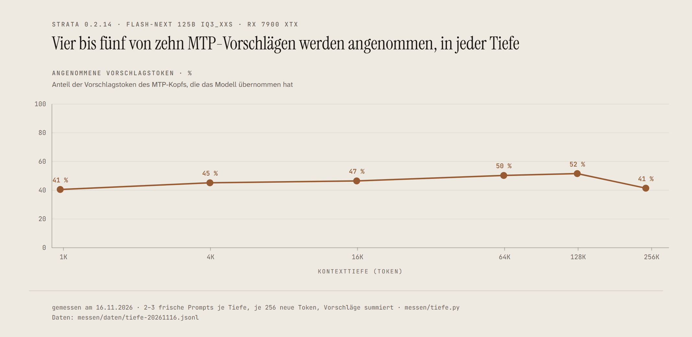
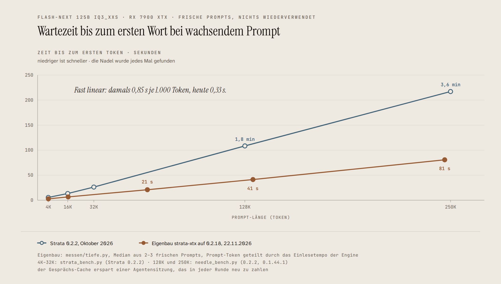
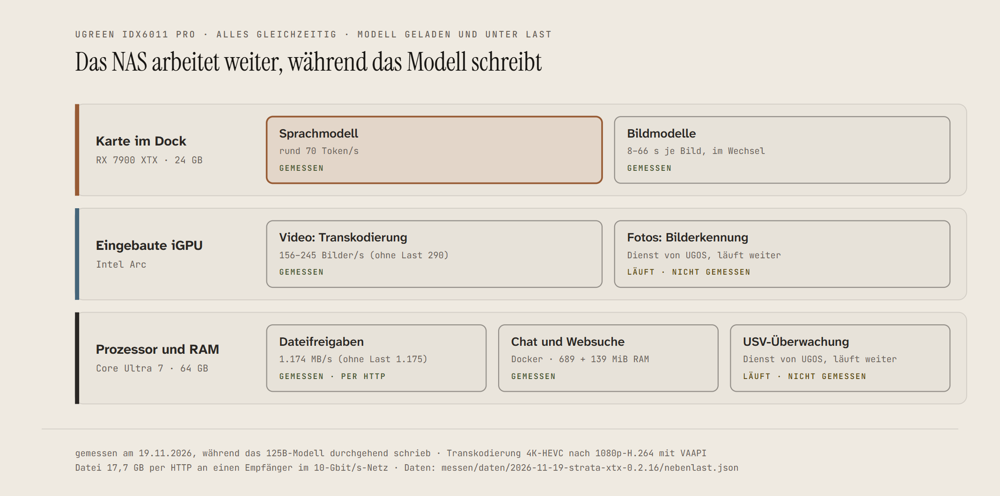
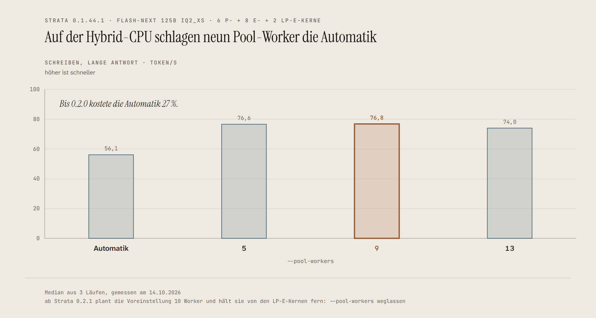
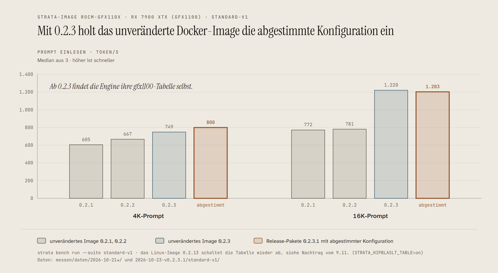
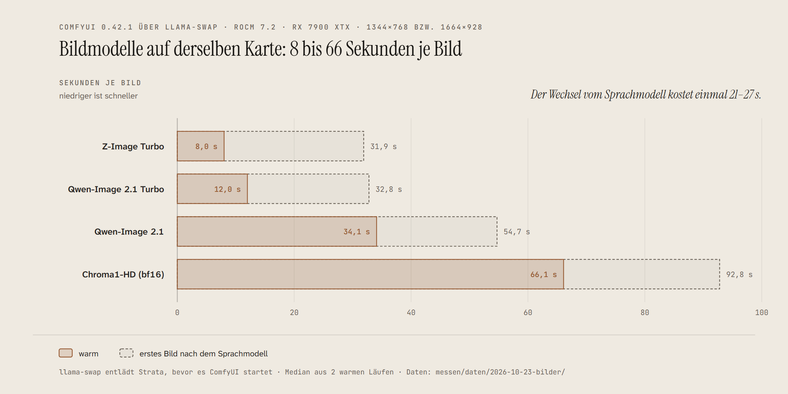

# UGREEN iDX6011 Pro + eGPU-Dock + Radeon RX 7900 XTX: ein 125B-Sprachmodell auf dem NAS

[English](README.md) · **Deutsch**

> [!TIP]
> **Die kurze, bebilderte Fassung dieses Berichts: [faf.net/lokale-ki](https://faf.net/lokale-ki/)**
> Eine Seite mit dem Aufbau, den Diagrammen und den wichtigsten Zahlen. Dieses README ist die ausführliche Fassung mit allen Messungen und Dateien.

Ein Erfahrungsbericht mit den Dateien, die dafür nötig sind: Wie ich **Qwen3.8-Flash-Next (125B, Mixture of
Experts)** mit **63–68 Token/s und 256k Kontext** auf einem UGREEN iDX6011 Pro betreiben. Die Radeon RX 7900 XTX
steckt dabei im OCuLink-eGPU-Dock von UGREEN. Gerechnet wird mit [Strata](https://github.com/Niko1221/Strata)
(ROCm/HIP) hinter [llama-swap](https://github.com/mostlygeek/llama-swap). Dasselbe NAS liefert nebenbei weiter
Fotos, Medien und Backups.

Alle Werte sind auf meiner Maschine gemessen, sofern nicht anders vermerkt. Das Repo enthält **keinen
Strata-Code**, nur Bauweg, Startkonfigurationen, UGOS-Anpassungen, Hilfsskripte und Messprogramme.

**Stand 15.11.2026:** Strata 0.2.12 aus den Release-Paketen, UGOS Pro 1.21, Kernel 6.18.15. In Konfigurationen, Skripten und Dateinamen tragen die beiden Modelle Kurznamen: `faber` ist Flash-Next 125B in der Quantisierung IQ3_XXS und im täglichen Einsatz; `velox` ist dasselbe Modell in der kleineren und schnelleren Quantisierung IQ2_XS. `liber` ist die unzensierte Fassung von `faber`: dieselben Gewichte ohne die Ablehnungen, sie beantwortet also, was man sie fragt ([docs/steuervektor.de.md](docs/steuervektor.de.md)). Chat und Agent können jedes der drei nutzen.

## Auf einen Blick

| | |
|---|---|
| Schreiben | 63–68 Token/s, bei 248K Token Kontext kaum langsamer |
| Prompt einlesen | 1.100–1.250 Token/s ab 16K: 26 s für 32K Token, 3,6 min für 250K |
| Kontext | 256K, die Nadel wurde bis 250K in 9 von 9 Fällen gefunden |
| Speicher | rund 53 GiB der 64 GB RAM, die 24-GB-Karte ist voll |
| Strom | 1,5 Wh je 1.000 geschriebene Token; NAS und Dock ziehen beim Schreiben 355 W, im Leerlauf 48 W |
| Größtes Risiko | ein Dock-Abriss bei geladenem Modell startet das NAS neu (Kernel-Fehler, entschärft) |

## Was wo steht

- **Lohnt sich das?** [Gemessen](#gemessen) und [Strata-Versionen auf dieser Karte](#strata-versionen-auf-dieser-karte)
- **Wie baue ich es nach?** [Starten](#starten), [Docker-Image](#volle-geschwindigkeit-im-docker-image), [Was ich an UGOS ändern musste](#was-ich-an-ugos-ändern-musste), [Bauen](#bauen)
- **Was kann schiefgehen?** [Dock und Anbindung](#dock-und-anbindung-was-man-wissen-muss) und [das größte offene Risiko](#das-größte-offene-risiko-ein-dock-abriss-startet-das-nas-neu)
- **Zum Vertiefen:** [jede Version im Einzelnen](docs/releases.de.md) · [die Dock-Störungen und ihre zwei Wochenuhren](docs/dock.de.md) · [wie der Agent weniger erfindet](docs/agent.de.md) · [Bilder mit ComfyUI](docs/comfyui.de.md)

## Die Kombination

```
  UGREEN iDX6011 Pro      UGOS Pro 1.21 (Debian-12-Basis, Kernel 6.18.15)
  │                       64 GB LPDDR5X · Hybrid-CPU (P- und E-Kerne) · 2× 10 GbE · 2× Thunderbolt 4
  │                       eingebaute Intel-Arc-iGPU → Transkodierung, Bilderkennung
  │
  │  OCuLink, PCIe 4.0 x4 (der Host-Port kann höchstens x4 / 16 GT/s ≈ 7,9 GB/s)
  ▼
  UGREEN LinkStation eGPU-Dock   eigenes 850-W-Netzteil
  └─ AMD Radeon RX 7900 XTX      24 GB VRAM, Navi 31 / gfx1100, im Dock mit x16 angebunden
       └─ Strata (ROCm 7.10 aus AMDs TheRock-Wheels), ein Modell zur Zeit über llama-swap
            └─ Qwen3.8-Flash-Next 125B MoE · IQ3_XXS (ISTA-DASLab) · int8-KV · MTP-Kopf · 256k
```

**Warum ein 125B-Modell auf eine 24-GB-Karte passt:** Flash-Next ist ein Mixture-of-Experts-Modell, pro Token
rechnen nur wenige Experten. Strata hält die häufig gebrauchten Experten im VRAM und den Rest im RAM. Fehlende
Experten rechnet die CPU, statt sie über die x4-Strecke zu kopieren. Möglich macht das der schnell angebundene
LPDDR5X der iDX: Das Modell belegt rund 53 GiB der 64 GB. Ein dichtes 70B-Modell wäre auf derselben Hardware
langsam (gemessen: 2,7 T/s, siehe unten), weil es pro Token alle Gewichte lesen muss.

**Zwei GPUs, sauber getrennt:** Die Arc-iGPU (`renderD128`) erledigt die Medien, die XTX (`renderD129`) rechnet
nur Sprachmodelle. Wer `/dev/dri` pauschal an einen Mediencontainer durchreicht, riskiert, dass er sich die
Dock-Karte greift. Geräte je Container ausdrücklich zuordnen. UGOS (1.21.1) führt die Karte unter Systemsteuerung → Hardware & Energie → Dedizierte Grafikkarte; sie läuft dort im Modus „NAS“, nicht „VM-Passthrough (VFIO)“.

## Gemessen

Alle Werte mit `messen/bench.py`, jeweils Median aus 3 Läufen.

| | Ollama, Qwen3.8 27B | **Strata, Flash-Next IQ3_XXS** | Strata, Flash-Next IQ2_XS |
|---|---|---|---|
| Schreiben, lange Antwort | 31,2 T/s | **63–68 T/s** | 76,5 T/s |
| 32.000 Token einlesen | 42,7 s | **25–26 s** | 24,0 s |
| Agenten-Sitzung, 6 Runden Programmieren | 162,5 s | **48–54 s** | 35,7 s |
| Kontext | 64k | **256k** (mit 249.928 Token getestet) | 256k |
| RAM der ganzen Maschine | 21,7 GiB | 53,4 GiB | 48,9 GiB |
| Leistung der Karte beim Schreiben | 322 W | 283 W | 288 W |
| Qualität laut Quantisierer | – | 99,4 % des vollen Modells | 95,7 % |

Karte im Leerlauf ohne geladenes Modell: rund 9 W, 44–51 °C.

### Tempo über die Kontexttiefe (1K bis 248K)

Je Lauf ein frischer Prompt, danach 256 neue Token; Zeiten der Engine, Median aus 2–3 Läufen. „Ohne MTP-Kopf“ ist
dieselbe Konfiguration ohne `--mtp` (ein natives Pack braucht weiter `--spec`, bekommt aber kaum Vorschläge).


| Prompt-Token | Schreiben mit MTP | Schreiben ohne MTP-Kopf | Einlesen mit MTP | Einlesen ohne MTP-Kopf | MTP-Annahme |
| ---: | ---: | ---: | ---: | ---: | ---: |
| 993 | 62,0 | 48,9 | 362 | 391 | 49 % |
| 4.075 | 60,6 | 50,2 | 745 | 782 | 49 % |
| 16.252 | 63,0 | 50,5 | 1.164 | 1.253 | 48 % |
| 65.023 | 61,1 | 49,3 | 1.185 | 1.265 | 53 % |
| 130.024 | 61,0 | 47,2 | 1.175 | 1.220 | 57 % |
| 248.052 | 56,1 | 44,9 | 1.079 | 1.117 | 50 % |

Das Schreibtempo fällt mit der Tiefe kaum (mit MTP 62 → 56 T/s bis 248K), MTP bringt in jeder Tiefe 21–29 %, das
Einlesen bleibt ab 16K bei 1.080–1.270 T/s, über die x4-Strecke. **Recall** (Stratas `needle_bench.py`): Das
Codewort wurde bei 32K, 128K und 250K in 10, 50 und 90 % Tiefe 9 von 9 Mal gefunden.



### Wie lange ein langer Prompt dauert, und wohin der Speicher geht



Das Einlesen wächst fast linear mit dem Prompt: 5,5 s bei 4K, 26 s bei 32K, 1,8 min bei 128K und 3,6 min bei 250K, die Nadel wurde jedes Mal gefunden. Der Gesprächs-Cache von Strata erspart einer Agenten-Sitzung, das in jeder Runde neu zu bezahlen: Im Agentenlauf von `strata_bench.py` werden je Sitzung nur 3 Token doppelt gelesen.


Mit geladenem, ruhendem `faber` belegt die Engine 44,6 der 62,3 GiB RAM (die Experten-Gewichte, die nicht auf die Karte passen, die K/V von 32K Token in 3,1 GiB festgepinntem RAM und den Gesprächs-Cache, wie er sich füllt), NAS-Dienste und Kernel 10,2 GiB, 7,5 GiB bleiben verfügbar. Auf der Karte nimmt der Experten-Cache 17,3 von 24 GiB (10.644 Plätze), der MTP-Entwurf 1 GiB, alles Übrige 5,3 GiB, 0,4 GiB bleiben frei. Mit 64 GB RAM ist das ungefähr die Grenze: Ein zweiter großer Dienst daneben verlangt einen kleineren Gesprächs-Cache.

### Strom, Kaltstart, NAS-Betrieb, ein dichtes 70B und UGREENs eigenes Modell (15.11.2026)


**Strom.** Gemessen an der USV, an der nur NAS und Dock hängen (über NUT gelesen, die ersten 45 s jeder Phase verworfen), daneben der Wert der Karte aus sysfs.

| Phase | NAS und Dock | Karte allein |
|---|---:|---:|
| Leerlauf, kein Modell geladen | 48 W | 9 W |
| Modell geladen, ruhend | 48 W | 10 W |
| Schreiben, 66,3 Token/s | 355 W | 205 W |
| frische 82K-Prompts einlesen, 1.159 Token/s | 392 W | 254 W |

Das sind **1,5 Wh je 1.000 geschriebene Token** für NAS und Dock (1,3 Wh über Leerlauf) und 0,09 Wh je 1.000 gelesene Token. Ein geladenes, ruhendes Modell kostet nichts Messbares gegenüber der leeren Karte.

| Fassung des 125B-Modells | Schreiben T/s | NAS und Dock | je 1.000 geschriebene Token |
|---|---:|---:|---:|
| IQ3_XXS (`faber`) | 66,3 | 355 W | 1,5 Wh |
| IQ3_XXS, unzensiert (`liber`) | 62,9 | 338 W | 1,5 Wh |
| IQ2_XS (`velox`) | 70,8 | 349 W | 1,4 Wh |

Am Vormittag desselben Tages hing noch ein Netzwerk-Switch an der USV; diese erste Messung liegt mit ihrem Abzug in `messen/daten/2026-11-15-betrieb/mit-switch/`. Der gerechnete Wert von damals (1,5 Wh) deckt sich mit dem jetzt gemessenen.

**Kaltstart.** Von der leeren Karte bis zum ersten Token: 18,6–19,6 s in fünf Läufen. Den Seitencache vor dem ersten Lauf zu leeren, machte keinen Unterschied (19,6 s).



**NAS-Betrieb, während das Modell schreibt.** Eine 17,7-GB-Datei kam per HTTP mit 589 MB/s vom NAS, während das Modell schrieb mit 593 MB/s; begrenzt hat beide Male der 5-Gbit/s-Anschluss des Arbeitsplatzes, nicht das NAS. Die Transkodierung eines 4K-HEVC-Clips nach 1080p-H.264 auf der eingebauten Arc-iGPU fiel von 290 auf 158–249 Bilder/s, immer noch das Fünf- bis Achtfache der Echtzeit. Das Schreibtempo blieb dabei bei 66 Token/s, innerhalb seiner üblichen Streuung. Nicht gemessen: SMB und ein Arbeitsplatz mit 10 Gbit/s.

**Ein dichtes 70B-Modell auf derselben Karte: 2,7 Token/s.** Llama 3.3 70B Instruct (Q4_K_M, 42,5 GB) mit llama.cpp Vulkan, so viele Schichten auf der Karte wie passen, der Rest auf der CPU, 8K Kontext:

| Schichten auf der Karte | VRAM | Schreiben T/s | NAS und Dock | je 1.000 geschriebene Token |
|---|---:|---:|---:|---:|
| 42 von 81 | 22,1 GiB | 2,69 | 138 W | 14,3 Wh |
| keine (nur CPU) | – | 1,44 | 101 W | 19,5 Wh |

Mit 40 und 38 Schichten auf der Karte waren es 2,58 und 2,48 Token/s. Das MoE-Modell schreibt 25-mal so schnell und braucht je Token rund ein Zehntel der Energie. Ein dichtes Modell fasst für jedes Token alle Gewichte an, und die Hälfte davon liegt hier hinter der CPU.

Zwei dichte Modelle, die ganz in den Grafikspeicher passen (Qwen3.8-27B und Gemma 4 31B, beide Q4), schreiben mit 37 Token/s bei 386 und 399 W: 2,9 und 3,0 Wh je 1.000 Token, das Doppelte des 125B-Modells.

**UGREENs eigenes Modell, mit und ohne Dock.** Die KI-Konsole von UGOS lädt Qwen3.5-35B-A3B (Q4_K_M, eine GGUF-Datei mit 22,0 GB) und startet es von selbst auf der Arc-iGPU, mit einem eigenen llama.cpp (SYCL, 4 Fäden, 7 Plätze). Diesen laufenden Server habe ich über seinen Unix-Socket gemessen, danach dieselbe Datei nur auf der CPU und auf der XTX:


| Weg | Schreiben T/s | Einlesen T/s | NAS und Dock | je 1.000 geschriebene Token |
|---|---:|---:|---:|---:|
| ab Werk: UGOS-Server auf der Arc-iGPU (SYCL) | 10,3 | 559 | 78 W * | 2,1 Wh * |
| Arc-iGPU, llama.cpp Vulkan | 10,2 | 191 | 64 W | 1,7 Wh |
| nur CPU, llama.cpp, 6 Fäden | 15,5 | 79 | 97 W | 1,7 Wh |
| RX 7900 XTX im Dock, llama.cpp Vulkan | 114 | 2.977 | 288 W | 0,7 Wh |

\* gerechnet: Diese Zeile ist am Vormittag mit dem Switch an derselben USV gemessen (185 W), 107,5 W sind abgezogen, auf etwa ±10 W genau. Nachmessen ging nicht, weil UGOS seine SYCL-Laufzeit zusammen mit dem Modell entfernt.

Auf der Karte schreibt das eingebaute Modell 11-mal so schnell und liest fünfmal so schnell wie ab Werk, bei 0,7 statt 2,1 Wh je 1.000 Token. Die CPU allein schreibt schneller als der iGPU-Server, liest einen Prompt aber siebenmal langsamer. Zwei Grenzen: Beim CPU-Lauf lag die Kopie von UGOS geladen und untätig daneben, und UGOS hält sein Modell im Speicher (rund 27 GB), es passt also nicht neben das 125B-Modell; ich habe es nach dem Test wieder entfernt. Die zweite Laufzeit von UGOS (`llama-gpu`) ist ein CUDA-Build und startet mit einer AMD-Karte nicht.

**Lohnt sich das große Modell? Dieselben Aufgaben für beide.** UGREENs Qwen3.5-35B-A3B passt ganz auf die Karte (22,1 GB VRAM bei 128K Kontext) und schreibt 114 Token/s, fast doppelt so schnell wie das 125B-Modell. In meinem Aufgabensatz verliert es trotzdem:

| | Flash-Next 125B (MoE, Strata) | Qwen3.5-35B-A3B (UGREENs Datei, auf der Karte) |
|---|---:|---:|
| **bestandene Aufgaben (von 102)** | **96** | **90** |
| Code | 14/15 | 12/15 |
| Logik | 14/15 | 12/15 |
| Anweisungen befolgen | 15/15 | 13/15 |
| Fakten | 12/15 | 12/15 |
| Werkzeugaufrufe | 20/20 | 20/20 |
| langer Kontext (32K, 100K) | 4/4 | 4/4 |
| Sicherheit | 17/18 | 17/18 |
| Denkbudget von 8.000 Token aufgebraucht, keine Antwort | 0 | 9 |
| Deutsch, verdeckt benotet (von 60) | 47 | 37 |
| geschriebene Token für alle 114 Aufgaben | 87.007 | 223.795 |
| Zeit für alle 114 Aufgaben | 27 min | 37 min |

Das kleine Modell denkt viel länger nach: Es schreibt für dieselben Aufgaben 2,6-mal so viele Token, deshalb dauert der ganze Satz trotz des höheren Tempos 37 % länger, und in neun Aufgaben war das Denkbudget aufgebraucht, bevor eine Antwort kam. Mit einem größeren Budget würden einige davon vermutlich bestehen; gemessen habe ich das nicht. Für das kleine Modell spricht: Es lässt den Arbeitsspeicher des NAS frei, wo das 125B-Modell rund 53 GiB belegt. Die Zahlen des 125B-Modells stammen vom 13.11. (gleiche Aufgaben, gleiche Strata-Version). Deutsch hat ein Sprachmodell verdeckt benotet, das nicht wusste, welche Antwort von welchem Modell stammt; ein anderer Prüfer als im Nachtrag vom 14.11., die Noten sind also nur innerhalb dieser Tabelle vergleichbar. Daten (nur Zählwerte): `messen/daten/2026-11-15-betrieb/qualitaet.json`.

**Zwei Personen gleichzeitig.** `messen/zwei.py` führt erst ein Gespräch mit fünf Fragen allein, dann zwei Gespräche zugleich am selben Modell, dann zwei Personen abwechselnd an zwei verschiedenen Modellen:

| | Warten bis zum ersten Wort (Median) | Schreiben T/s (Median) |
|---|---:|---:|
| eine Person allein | 0,2 s | 62,2 |
| zwei zugleich, Person A | 8,1 s | 64,7 |
| zwei zugleich, Person B | 10,5 s | 72,6 |
| abwechselnd an zwei Modellen | 20 s | – |

Strata beantwortet eine Anfrage nach der anderen: Die zweite Person wartet, bis die erste Antwort fertig ist, bei Antworten bis 400 Token rund zehn Sekunden, und bekommt dann das volle Tempo. Nutzen zwei Personen zwei verschiedene Modelle, lädt die Karte bei jedem Wechsel um, rund 20 s jedes Mal. Für gemeinsame Nutzung also ein Modell für alle.

Skripte: `messen/betrieb.py`, `messen/dicht70.py`, `messen/werksmodell.py`, `messen/transkodieren.sh`, `messen/zwei.py`. Rohdaten: `messen/daten/2026-11-15-betrieb/`.

### Kostet Strata Qualität? Strata gegen llama.cpp auf derselben Datei

Dieselbe GGUF-Datei (Flash-Next IQ3_XXS), derselbe feste Textsatz aus Stratas `tools/quant_quality.py` (Code,
Doku, Englisch, andere Sprachen, ein Agentenprotokoll; 4.995 Positionen, teacher-forced). Strata über
`quant_quality.py run`, llama.cpp (Build 11610, Vulkan, Experten auf der CPU) Position für Position über
`llama-server` (`messen/qq_llamacpp.py`, gleiches Ausgabeformat), verglichen mit `messen/qq_vergleich.py`:

| Vergleich | gleiches Top-Token | KL Mittel | KL Median | KL p99 | Perplexität |
| --- | ---: | ---: | ---: | ---: | --- |
| llama.cpp gegen Strata (Experten auf der CPU) | **95,7 %** | 0,020 | 0,0017 | 0,27 | 4,009 gegen 4,017 |
| llama.cpp gegen Strata (Experten auf der GPU) | 95,7 % | 0,020 | 0,0017 | 0,34 | 4,009 gegen 4,019 |
| Stratas CPU-Pfad gegen seinen GPU-Pfad | 95,7 % | 0,018 | 0,0017 | 0,27 | – |

**Strata kostet gegenüber llama.cpp keine messbare Qualität:** Der Unterschied ist so groß wie der zwischen Stratas
eigenen CPU- und GPU-Kernels, also Rechenrauschen. Zum Maßstab: Laut Strata-Doku liegt IQ3_XXS gegen Q8_0 bei
84,5 % und KL 0,20 – die Quantisierung kostet Qualität, die Engine nicht. Grenzen: Perplexität über die 4.982
Positionen, an denen llama.cpp den exakten Wert lieferte (Ziel unter seinen Top-4000); Stratas Prüfwerkzeug rechnet
mit FP16-KV ohne MTP-Vorschläge, der Einfluss von int8-KV ist also nicht erfasst; ein Textsatz.

### Strata-Einstellungen, die messbar etwas bringen

| Einstellung | Wert | Wirkung |
|---|---|---|
| `--pool-workers` | 9 bis 0.2.0, **ab 0.2.1 weglassen** | bis 0.2.0: 76,8 statt 56,1 T/s gegenüber der Automatik (gemessen mit IQ2_XS); 0.2.1 plant selbst 10 Worker und lässt die LP-E-Kerne frei |
| `--pcie-frac` | 0 | fehlende Experten rechnet die CPU, statt sie über x4 zu kopieren; kein Tempoverlust, schont den Link |
| `--kv` | int8 | halbiert den KV-Cache, 256k Kontext passen |
| `--max-context` | 262144 | trainiertes Maximum; 250k Token in rund 4 min eingelesen |
| `--mtp` | MTP-Kopf | Vorschlagstoken beschleunigen das Schreiben |
| `--conversation-cache-mib` | 4608 | parkt eine Sitzung bis ~120.000 Token, während eine andere Anfrage läuft (geparkt in 0,16 s, zurück in 0,06 s) |
| `STRATA_HIPBLASLT_TUNING` | `tools/hip/gfx1100-hipblaslt-100200.txt` | muss zur hipBLASLt-Version passen, sonst ~45 % langsameres Einlesen |
| Quantisierung | IQ3_XXS statt IQ3_S | 53 statt 60 GiB RAM; IQ3_S lässt neben den übrigen NAS-Diensten keinen Platz |



## Strata-Versionen auf dieser Karte

Jede Version seit 0.2.0-beta ist hier gegen ihre Vorgängerin gemessen, mit identischer Laufkonfiguration, nur Engine und Control getauscht. Einzelheiten, Tabellen und Rohdaten zu jeder Version: [docs/releases.de.md](docs/releases.de.md).


| Version | Datum | Ergebnis auf dieser Karte | An Strata gemeldet |
|---|---|---|---|
| 0.1.45 | 17.10. | kein messbarer Unterschied zu 0.1.44.1, nicht übernommen | – |
| 0.2.0-beta | 19.10. | die fertige `hip-rx7900`-Engine läuft auf gfx1100; ihre voreingestellte Worker-Zahl ist auf einer Hybrid-CPU ein Drittel langsamer; nicht übernommen | [#3262](https://github.com/Niko1221/Strata/issues/3262), [#3177](https://github.com/Niko1221/Strata/issues/3177) |
| 0.2.1 | 21.10. | **in Betrieb**; die Korrektur für Hybrid-CPUs wirkt; das Docker-Image läuft, seine gfx1100-Tabelle bringt +60 % bei 16K | [#3262](https://github.com/Niko1221/Strata/issues/3262), [#3263](https://github.com/Niko1221/Strata/issues/3263), [PR #2904](https://github.com/Niko1221/Strata/pull/2904) |
| 0.2.2 | 21.10. | **in Betrieb**; gleich schnell, robuster; `strata bench run` aus dem Paket ist vollständig | [#3263](https://github.com/Niko1221/Strata/issues/3263), [PR #2904](https://github.com/Niko1221/Strata/pull/2904) |
| 0.2.3.1 | 23.10. | **in Betrieb**; 4K-Prompts +7 % schneller eingelesen; die Engine findet ihre gfx1100-Tabelle selbst | – |
| 0.2.8 | 31.10. | **in Betrieb**; gleich; rettet leicht fehlerhafte Tool-Calls; das Docker-Image lässt 854 MiB VRAM frei | [PR #4851](https://github.com/Niko1221/Strata/pull/4851) |
| 0.2.9, 0.2.10 | 05.11. | zwischendurch **in Betrieb**; 0.2.9 behebt still falsch gelesene lange Prompts (#3431) | – |
| 0.2.11 | 05.11. | **in Betrieb**; gleich wie 0.2.10 | [#5321](https://github.com/Niko1221/Strata/issues/5321) |
| 0.2.12 | 08.11. | **in Betrieb, aktuell**; gleich wie 0.2.11; der getunte DFlash2-Drafter ist am Ende langsamer und bleibt aus | [#5615](https://github.com/Niko1221/Strata/issues/5615) |
| 0.2.13 | 09.11. | mit abgestimmter Konfiguration gleich, nicht übernommen; das Linux-Docker-Image nutzt die gfx1100-Tabelle nicht mehr und liest 16K-Prompts 35 % langsamer | [#5666](https://github.com/Niko1221/Strata/issues/5666) |

## Starten

Modelle, Packs und MTP-Kopf legt Strata selbst an (`setup.py`), sie kommen per Bind-Mount nach `/strata/data`.
Startkonfigurationen in `konfig/`, ein llama-swap-Beispiel in `konfig/llama-swap.yaml`. In `allowed_hosts` die
Namen eintragen, unter denen der Server angesprochen wird (Strata prüft den Host-Header gegen DNS-Rebinding).

Die Konfigurationen `konfig/arbeit.json`, `konfig/schnell.json` und `konfig/llama-swap.yaml` sind die erste Fassung für die selbst gebaute Engine. **Was heute läuft, steht in [`konfig/strata-0.2.12/`](konfig/strata-0.2.12/)**: dieselben Einstellungen für die fertigen Release-Pakete, die Modelle heißen dort `faber` (IQ3_XXS, vorher `arbeit`) und `velox` (IQ2_XS, vorher `schnell`).

### Volle Geschwindigkeit im Docker-Image

**Die Engine findet ihre hipBLASLt-Tabelle für gfx1100 jetzt selbst.** Ohne `STRATA_HIPBLASLT_TUNING` in der Laufkonfiguration steht im Log trotzdem `hipBLASLt tuning enabled (26 rows, gfx1100, version 100200)`. Für Besitzer einer RX 7000, die das Docker-Image mit Voreinstellungen nutzen, ist das die größte Änderung von 0.2.3: Es liest 16K-Prompts mit 1.220 statt 781 Token/s, das erste Token eines 16K-Prompts kommt nach 13,5 statt 21 Sekunden.



Mit 0.2.3 liegt das unveränderte Image wenige Prozent hinter der abgestimmten Konfiguration. Was noch abweicht: Setup wählt `--max-context 131072` und 700 MiB VRAM-Reserve, und die Engine warnte einmal, dass zu Beginn einer Anfrage nur 427 MiB frei waren. Wer 256K braucht, setzt `CONTEXT` und eine Reserve von etwa 830 MiB selbst. Bei Images vor 0.2.3 `STRATA_HIPBLASLT_TABLE=on` setzen. **Ab 0.2.13 lässt das Linux-Image die Tabelle wieder standardmäßig aus, dort also ebenfalls `-e STRATA_HIPBLASLT_TABLE=on` setzen** (gemessen: 769 statt 1.193 Token/s bei 16K, siehe [docs/releases.de.md](docs/releases.de.md)).

## Was ich an UGOS ändern musste

| # | Problem | Lösung |
|---|---|---|
| 1 | **Gelöst in UGOS 1.21.** Bis 1.19 lieferte UGOS **keine Firmware für Navi 31** (gfx1100). `amdgpu` endete mit `Fatal error during GPU init`. 1.21 bringt alle 15 Dateien mit, dazu fünf neuere `*_kicker.bin` (Stand Ende Oktober 2026) | **Unter 1.21: eigene Kopien entfernen** und den Restore-Dienst abschalten, sonst verdecken die älteren Dateien in der oberen Overlay-Schicht die neueren von UGREEN (siehe unten). Bis 1.19: 15 Dateien aus Debians `firmware-amd-graphics` (20250410) nach `/lib/firmware/amdgpu/` kopieren: `gc_11_0_0_{imu,me,mec,mes,mes1,mes_2,pfp,rlc,rlc_1}.bin`, `psp_13_0_0_{sos,ta}.bin`, `smu_13_0_0.bin`, `sdma_6_0_0.bin`, `vcn_4_0_0.bin`, `dcn_3_2_0_dmcub.bin`. Sie überlebten das Update auf 1.19 (UGOS arbeitet mit einem Overlay). Sicherheitsnetz: `ugos/` |
| 2 | UGOS setzt systemweit `GODEBUG=tlskyber=0`, Go-Programme ab Go 1.24 (z. B. llama-swap) brechen sofort ab | in der systemd-Unit `Environment=GODEBUG=` |
| 3 | Container sehen die Karte nicht | `--device /dev/kfd --device /dev/dri --group-add video --group-add render` (bei mir gid 44 und 105) |
| 4 | `docker --device` verträgt keinen Doppelpunkt (`/dev/dri/by-path/pci-0000:…`); einen umbenannten Render-Knoten findet Vulkan nicht und rechnet still auf der CPU | Pfad vorher auflösen, Namen beibehalten |
| 5 | Meldungsflut `init_user_pages: Failed to get user pages: -1` (rund 15.000 Zeilen je Modellstart) | harmlos, Folge von mmap auf btrfs/LVM; bei llama.cpp vermeidet `--no-mmap` sie |
| 6 | `/volume1` wird erst rund 41 s nach `local-fs.target` eingehängt | Units, die dort etwas brauchen, warten selbst (siehe `ugos/amdgpu-gfx1100-restore.service`) |
| 7 | `network-online.target` meldet sich, bevor das Netz nutzbar ist | CIFS-Mounts und Dienste mit fester Adresse warten selbst auf Adresse und Port |
| 8 | Neue Ordner unter `/volume1/docker` erben eine ACL, die Container trotz `rwxrwxrwx` aussperrt | Rechte und Besitzer ausdrücklich setzen |
| 9 | UGOS schreibt die Firewall gelegentlich neu, eigene Regeln in `DOCKER-USER` verschwinden | Regeln per Timer neu setzen |
| 10 | Journal auf 50 MB begrenzt, reicht nur gut eine Stunde zurück | für Fehlersuche eigene Mitschnitte |
| 11 | Nicht-interaktive SSH-Sitzungen haben kein `/sbin` im PATH, `modinfo` fehlt | ein `command not found` ist kein Negativbefund |
| 12 | sshd bietet keinen Post-Quanten-Schlüsseltausch an (`high_crypt.conf`), obwohl OpenSSH 9.2p1 ihn kann; aktuelle Clients warnen bei jeder Verbindung | `/etc/ssh/sshd_config.d/00-pq-kex.conf` mit `KexAlgorithms sntrup761x25519-sha512@openssh.com,curve25519-sha256,…`; der Name muss alphabetisch vor `high_crypt.conf` liegen, weil der erste Treffer gilt |

**Umstieg auf UGREENs Firmware unter 1.21** (so am 02.11.2026 gemacht): die eigenen Kopien aus
`/overlay/upper/usr/lib/firmware/amdgpu/` herausnehmen (als Rückweg auf dem Datenpool aufheben), `systemctl disable
amdgpu-gfx1100-restore.service`, neu starten. Nicht über `/lib/firmware` löschen: Auf einem Overlay entsteht dabei
ein Whiteout, der UGREENs Dateien gleich mit verdeckt. Ergebnis bei mir: Karte 8 s nach dem Start bereit,
DMUB-Firmware 0x07002D00 → 0x07003101, Modelle laden, Tempo im Rahmen der Messschwankung unverändert. Alles andere
in der oberen Schicht (eigene Units, `modprobe.d`, Docker) hat das Update überstanden.

Was UGOS gut macht: Watchdog, ein lesbarer Grund für den letzten Neustart, pstore für Absturzprotokolle, ein
NUT-Server für die USV. Version 1.19 brachte Kernel 6.18 und rund 700 amdgpu-Firmwaredateien, 1.21 endlich die Firmware für Navi 31.

## Bauen

Seit dem 21.10.2026 kommen Engine und Control aus den Release-Paketen von Strata. Das hier gebaute Image ist weiterhin der Container, in dem sie laufen: Es bringt ROCm mit, die Pakete werden hineingemountet (siehe das llama-swap-Makro in `konfig/strata-0.2.12/`).

```bash
docker build -t strata-hip:v0.1.45 --build-arg STRATA_REF=v0.1.45 .
```

Auf dem Rechner bauen, auf dem es läuft: llama.cpp und die Engine werden für die CPU des Bau-Rechners optimiert.
Das Image ist rund 21 GB groß, davon etwa 11 GB ROCm aus AMDs TheRock-Wheels (7.10.0a20251120, Index
`gfx110X-dgpu`). Die Kompilierung selbst dauerte 83 s, das Herunterladen dauert länger.

**Zwei Fallen, die das Dockerfile umgeht:**

1. `rocm-sdk path --root` muss einmal laufen, bevor CMake die ROCm-Wurzel sieht. Der Aufruf packt die
   Entwicklerdateien aus, darunter `lib/cmake/hip-lang`. Ohne ihn scheitert `enable_language(HIP)` mit
   „does not contain the HIP runtime CMake package“. `setup.py` erledigt das still, ein reiner CMake-Bau nicht.
2. Die Engine muss ausführbar sein. Bei einem früheren Handbau lag sie mit Rechten `----------` im Baum.

## Dock und Anbindung: was man wissen muss

- **OCuLink ist nicht hot-plug-fähig.** Erst das Dock einschalten, dann das NAS starten. Die Karte wird nur beim
  Start erkannt. Das hat mich den ersten Abend gekostet, UGREEN hat es auf Nachfrage bestätigt.
- **Nur ein Kabel.** Mit OCuLink und Thunderbolt gleichzeitig wurde gar nichts erkannt.
- **x4, nicht x16.** Der Host-Port meldet `LnkCap` x4 bei 16 GT/s. Für Inferenz unkritisch, beim Laden großer
  Modelle spürbar.
- **Keine Leistungssteuerung am Port** (`PwrCtrl-`). Das System kann das Dock nicht stromlos schalten,
  `/sys/bus/pci/slots/*/power` trainiert nur den Link neu. Nach einigen Abrissen kam die Karte nach 22–47 s von
  selbst zurück (sieht aus wie ein Neustart des Docks), nach einem anderen blieb sie bis zum nächsten Neustart weg.
- **Abrisse (Ursache noch in Untersuchung):** Jeder beginnt mit PCIe-Empfangsfehlern, 50 ms später folgt
  „Link Down“, die Karte im Leerlauf und kühl. Bei 5 von 7 Ereignissen verlor im selben Moment die
  10-GbE-Netzwerkkarte an einem anderen PCIe-Zweig ihren Link. Das spricht für eine elektrische Störung, nicht für
  die Karte. Der Energiesparmodus der USV ist es nicht (aus); hinter der Mittwochsreihe steckt aber ihr wöchentlicher Akkutest (siehe unten).
- **PCIe-Quirk:** Nach einem Abriss klemmte der Kernel den Link auf 2,5 GT/s und konnte ihn nicht neu trainieren.
  Die Korrektur („Always lift 2.5GT/s restriction“) steckt in 6.18.39, UGOS hat 6.18.15.

Die Störungen folgen, wie sich gezeigt hat, zwei Wochenuhren, und eine davon ist der Akkutest der USV. Die ganze Untersuchung samt Mitschnitt-Skript: [docs/dock.de.md](docs/dock.de.md). In zehn Wochen Aufzeichnung gab es 23 Störungen, an drei Tagen fiel die Karte vom Bus, und kein Abriss hat das NAS neu gestartet.

## Das größte offene Risiko: Ein Dock-Abriss startet das NAS neu

Verliert das Dock die Verbindung, während ein ROCm-Modell geladen ist, baut `amdgpu` unter Kernel 6.18 die
Rechen-Warteschlangen ab, obwohl sie noch benutzt werden (`kfd_device_queue_manager.c … uninitialize`). Es folgt
ein Kernel-Oops. UGOS setzt `kernel.panic_on_oops=1` und `kernel.panic=3`, also startet das ganze NAS 3 Sekunden
später neu. Bei mir dreimal reproduziert. Upstream behoben mit Linux `6cca686dfce7` (7.0) und `81665e35f143` (7.1).

**Meine Gegenmaßnahme:** llama-swap entlädt das Modell nach 30 Minuten Leerlauf (`globalTTL: 1800`). Ohne
geladenes Modell übersteht die iDX einen Abriss, die Karte ist dann aber bis zum nächsten Neustart weg.

**Unter UGOS 1.21 unverändert (getestet am 02.11.2026).** Der Kernel ist weiter 6.18.15, neu gebaut am 16.10.2026.
Gleicher Test wie zuvor: Modell geladen (25 GB VRAM), Karte mit `echo 1 > /sys/bus/pci/devices/<GPU>/remove` vom Bus
genommen. Sofort dieselbe Warnung, und der Aufruf zum Entfernen kehrt nie zurück. Rund 8 Minuten später räumt
`kswapd` Speicher auf, läuft über `amdgpu_hmm_invalidate_hsa` / `amdgpu_amdkfd_evict_userptr` in
`kfd_process_evict_queues` und trifft auf eine Schutzverletzung: Der KFD-Prozess hält noch Speicherzuordnungen der
entfernten Karte. Kernel-Panik, Neustart. Die Wartezeit (im September 3 Minuten, jetzt 8) hängt davon ab, wann die
Speicherverwaltung diese Seiten anfasst, nicht an einer festen Frist. An UGREEN gemeldet, mit pstore-Aufzeichnung.
Die Gegenmaßnahme bleibt dieselbe.

## Ein Agent (Hermes) obendrauf

- Pro Modell `context_length` im Agenten eintragen (256k), sonst rechnet er mit einem kleineren Fenster.
- `sendLoadingState: false` in llama-swap, sonst landen Ladehinweise im Denkteil der Antwort.
- Bei hoher Denkstufe immer ein Token-Budget setzen, bei schweren Code-Aufgaben denkt das Modell sonst endlos.
- Läuft nebenher eine zweite Anfrage (z. B. ein Prüfer für Befehle), verdrängt jede den Gesprächsspeicher, und
  jede lange Sitzung wird danach neu eingelesen. Der Gesprächsparkplatz von Strata (`--conversation-cache-*`) löst
  das.

**Dichte Modelle auf derselben Karte, und wie der Agent weniger erfindet (14.11.2026).** Zwei dichte Modelle, ganz im VRAM, schreiben halb so schnell wie die MoE-Modelle und urteilen nicht besser. Vier Regeln im Systemprompt heben den Anteil des Erfundenen, den ein Modell erkennt, von 17–60 % auf 88–99 %, ohne es übervorsichtig zu machen. Für angekündigte Schritte ohne Werkzeug reichen die Regeln nicht, deshalb drei Schichten:


Die Messungen, die vier Regeln und das Prüfer-Plugin: [docs/agent.de.md](docs/agent.de.md).

**Der Agent kann jedes der Modelle nutzen, auch ein unzensiertes.** Welches Modell er nimmt, ist eine Einstellung. `liber` ist dasselbe 125B-Modell, dem ein Steuervektor die Ablehnungen entfernt (Abliteration). Es beantwortet, was man es fragt, auch das, was das Originalmodell verweigert: alle 15 meiner Testaufgaben, die Modelle oft ablehnen, statt 11. Einen Filter gibt es nicht mehr; die Verantwortung liegt bei dem, der es betreibt. Aufgaben, Deutsch und Tempo bleiben gleich; der Preis ist, dass es leichter erfindet (mit den vier Regeln 91 % statt 98 % des Erfundenen erkannt). Wie es funktioniert, die Konfiguration, alle Zahlen und was man damit auf sich nimmt: [docs/steuervektor.de.md](docs/steuervektor.de.md).

## Bilder auf derselben Karte: ComfyUI über llama-swap

Seit dem 23.10. macht die XTX auch Bilder. ComfyUI läuft als weiteres Modell in llama-swap, die Karte hält also entweder das Sprachmodell oder die Bildmodelle, nie beides, und llama-swap wechselt bei Bedarf. llama-swap hat dafür einen fertigen Zugang: Ein Modell mit genau dem Namen `comfyui_auto` wird unter `/comfyui/` bedient, und der Websocket des offenen Browser-Tabs lädt das Modell weder noch hält er es fest. Der Eintrag liegt in `konfig/comfyui/llama-swap-comfyui.yaml` (Image `yanwk/comfyui-boot:rocm`, ROCm 7.2, PyTorch 2.13, ComfyUI 0.42.1); er startet in etwa 20 Sekunden.



Modelle, Sekunden je Bild, was ich auf gfx1100 gelernt habe, und der Bild-Anbieter für den Agenten: [docs/comfyui.de.md](docs/comfyui.de.md).

## Inhalt

**Bauen**

```
  Dockerfile                    Bauweg Strata + ROCm für gfx1100
```

**Startkonfigurationen**

```
  konfig/arbeit.json            Flash-Next IQ3_XXS, 256k, Denkstufe high
  konfig/schnell.json           Flash-Next IQ2_XS
  konfig/llama-swap.yaml        ein Endpunkt, ein Modell zur Zeit, Entladen nach 30 min
  konfig/strata-0.2.1/          Startkonfigurationen und llama-swap-Makro für die fertigen 0.2.1-Pakete
  konfig/strata-0.2.2/          dieselben Startkonfigurationen, llama-swap-Makro für die fertigen 0.2.2-Pakete
  konfig/strata-0.2.3.1/        Startkonfigurationen (faber = vorher arbeit, velox = vorher schnell), llama-swap-Makro für 0.2.3.1
  konfig/comfyui/               ComfyUI: llama-swap-Eintrag, Download-Skript, Arbeitsabläufe, Bild-Anbieter für Hermes Agent
  konfig/strata-0.2.8/          Startkonfigurationen und llama-swap-Makro für 0.2.8 (Konfigurationen wie bei 0.2.3.1)
  konfig/strata-0.2.11/         Startkonfigurationen und llama-swap-Makro für 0.2.11 (Konfigurationen wie seit 0.2.3.1)
  konfig/strata-0.2.12/         Startkonfigurationen und llama-swap-Makro für 0.2.12, dazu die DFlash2-Testkonfiguration, dazu liber.json (das unzensierte Modell)
  konfig/hermes-pruefer/        Plugin für Hermes Agent: prüft jede Antwort mit festen Regeln, ohne Sprachmodell
  konfig/stack/                 Chat und Websuche: Compose-Datei für Open WebUI und SearXNG, auf dem NAS getestet (EN/DE)
```

**UGOS**

```
  ugos/                         nur bis UGOS 1.19 nötig; ab 1.21 siehe Hinweis unter „Was ich an UGOS ändern musste“
  ugos/firmware-sichern.sh      sichert die 15 gfx1100-Firmwaredateien auf den Datenpool
  ugos/firmware-pruefen.sh      prüft und stellt sie nach einem UGOS-Update wieder her
  ugos/amdgpu-gfx1100-restore.service   führt die Prüfung nach jedem Start aus
```

**Mess- und Hilfsskripte**

```
  messen/bench.py               Schreiben, Einlesen, Agenten-Sitzung, Qualitätsaufgaben (aufgaben.json)
  messen/identitaet.py          gleiche Prompts gierig an zwei Modelle, Vergleich zeichengenau
  messen/langprompt.py          Einlesezeit eines frischen langen Prompts
  messen/auswertung045.py       Tabelle aus den Ergebnissen
  messen/tiefe.py               Schreib- und Einlesetempo über die Kontexttiefe (1K bis 248K)
  messen/qq_llamacpp.py         llama.cpp-Gegenstück zu Stratas quant_quality.py (Top-64 je Position, teacher-forced)
  messen/qq_vergleich.py        Top-1-Übereinstimmung, KL und Perplexität zweier Läufe
  messen/visiontest.py          Bildleser auf der CPU: Testbilder, VRAM/RAM, Vergleich mit dem 27B-Bildmodell
  messen/r3177.py               Nachstellversuch für Strata-Issue #3177 (lange Agentenanfrage mit MTP)
  messen/folgetests.py          LP-E-Kerne A/B (--cpuset-cpus) und Einlesetempo frischer Engines
  messen/t020.py                Strata 0.2.0-beta, fertige hip-rx7900-Engine: Bench, Recall, Worker, Bildleser
  messen/t021.py                Strata 0.2.1: Worker-Paare, Bench, Recall, frische Engines, standard-v1
  messen/t022.py                Strata 0.2.2 gegen 0.2.1: Versionspaare, Bench, Recall, frische Engines, standard-v1, Docker-Image
  messen/dock-mitschnitt.sh     sekundengenauer Mitschnitt um ein erwartetes Dock-Ereignis (nur lesend, braucht root)
  messen/t0231.py               Strata 0.2.3.1 gegen 0.2.2: Paare, Bench, Nadeln, frische Engines, standard-v1, Docker-Image, ohne Tabellenvariable
  messen/t128.py                erster 128K-Prompt auf frischer Engine, 0.2.3.1 gegen 0.2.2 im Wechsel
  messen/t028.py                Strata 0.2.8 gegen 0.2.3.1: zuerst standard-v1, Bench, Nadeln bis 250K, Tool-Calls, Paare, frische Engines, Docker-Image
  messen/halluzination.py       Halluzinationsprobe: 5 Bereiche × 8 echte + 8 erfundene Gegenstände, ohne und mit Regeln (--regeln)
  messen/agent_de.py            Betriebsagent auf Deutsch: 9 Aufgaben je mehrfach, Urteilsaufgaben zum Nachlesen
  messen/diagramme.py           alle Diagramme in bilder/ in einem Stil (HTML/SVG-Quellen in bilder/html/, PNG über playwright)
  messen/betrieb.py             Strom an der USV, Kaltstart und Schreiblast (strom, kaltstart, last)
  messen/dicht70.py             ein dichtes Modell, das nicht in den VRAM passt, llama.cpp Vulkan, nach Schichten auf der Karte
  messen/werksmodell.py         UGREENs eingebautes Modell: der eigene Server von UGOS auf der Arc-iGPU, nur CPU, die Karte im Dock
  messen/transkodieren.sh       4K-HEVC nach 1080p-H.264 auf der Arc-iGPU (VAAPI), Bilder je Sekunde
  messen/zwei.py                zwei Personen gleichzeitig: Wartezeit und Tempo allein, zugleich, abwechselnd an zwei Modellen
```

**Rohdaten**

```
  messen/daten/                 Rohdaten: Tiefenmessung, strata_bench.py und needle_bench.py
  messen/daten/qualitaet/       die drei Läufe (gzip) und die Vergleichsergebnisse
  messen/daten/2026-10-19/      Rohdaten des Nachtrags (README im Ordner)
  messen/daten/2026-10-21/      Rohdaten samt vier standard-v1-Ergebnissen (README im Ordner)
  messen/daten/2026-10-21-v0.2.2/  Rohdaten des 0.2.2-Nachtrags (README im Ordner)
  messen/daten/dock-2026-10-21/ Auszug des Mitschnitts vom 21.10., das Mittwochsereignis auf die Minute
  messen/daten/2026-10-23-v0.2.3.1/  Rohdaten samt memory.json und 128K-Gegentest (README im Ordner)
  messen/daten/2026-10-23-bilder/  Sekunden je Bild, vier Modelle, erstes und warmes Bild
  messen/daten/2026-10-31-v0.2.8/  Rohdaten des Nachtrags zu 0.2.8, auch als Strata-PR #4851 eingereicht (README darin)
  messen/daten/2026-11-05-v0.2.11/  Rohdaten des Nachtrags zu 0.2.11, auch als Strata-Issue #5321 eingereicht (README darin)
  messen/daten/2026-11-08-v0.2.12/  Rohdaten des Nachtrags zu 0.2.12 und des DFlash2-Tests, auch als Strata-Issue #5615 eingereicht (README darin)
  messen/daten/2026-11-09-v0.2.13/  Rohdaten des Nachtrags zu 0.2.13, samt Docker-Image mit und ohne gfx1100-Tabelle auch als Strata-Issue #5666 eingereicht (README darin)
  messen/daten/2026-11-14-erfinden/  Zählwerte: Probe je Modell und Bereich, Nachtvergleich, Urteil mit 10 Runden
  messen/daten/2026-11-15-betrieb/  Strom, Kaltstart, NAS-Betrieb, dichtes 70B, UGREENs eingebautes Modell
```

**Dokumentation und Diagramme**

```
  docs/                         jede Version im Einzelnen, die Dock-Untersuchung, der Agenten-Nachtrag, das unzensierte Modell, ComfyUI (EN/DE)
  bilder/                       die Diagramme als PNG, ihre HTML/SVG-Quellen in bilder/html/
  web/                          baut die Seiten faf.net/lokale-ki und faf.net/local-ai aus diesem Repo (bau.py), mit selbst ausgelieferten Schriften
```

Die Messskripte sprechen nur `/v1/chat/completions` an, laufen mit der Standardbibliothek von Python und lesen
VRAM, GPU-Last, Leistung und RAM aus sysfs mit (`KARTE` in `bench.py` auf die eigene Karte setzen). Die
Code-Aufgaben laufen in einem Wegwerf-Container ohne Netz.

`faber` und `velox` sind die Namen der beiden Modelle hier (IQ3_XXS und IQ2_XS; in Dateien bis 0.2.2 heißen sie `arbeit` und `schnell`).

## Lizenz

MIT für die Dateien hier, siehe `LICENSE`. Strata selbst steht unter seiner eigenen Lizenz im Upstream-Repo.
