# UGREEN iDX6011 Pro + eGPU-Dock + Radeon RX 7900 XTX: ein 125B-Sprachmodell auf dem NAS

[English](README.md) · **Deutsch**

> [!TIP]
> **Die kurze, bebilderte Fassung dieses Berichts: [faf.net/lokale-ki](https://faf.net/lokale-ki/)**
> Eine Seite mit dem Aufbau, den Diagrammen und den wichtigsten Zahlen. Dieses README ist die ausführliche Fassung mit allen Messungen und Dateien.

Ein Erfahrungsbericht mit den Dateien, die dafür nötig sind: Wie ich **Qwen3.8-Flash-Next (125B, Mixture of
Experts)** mit **64–70 Token/s und 256k Kontext** auf einem UGREEN iDX6011 Pro betreibe. Die Radeon RX 7900 XTX
steckt dabei im OCuLink-eGPU-Dock von UGREEN. Gerechnet wird mit [Strata](https://github.com/Niko1221/Strata)
(ROCm/HIP) hinter [llama-swap](https://github.com/mostlygeek/llama-swap). Dasselbe NAS liefert nebenbei weiter
Fotos, Medien und Backups.

Alle Werte sind auf meiner Maschine gemessen, sofern nicht anders vermerkt. Das Repo enthält **keinen
Strata-Code**, nur Bauweg, Startkonfigurationen, UGOS-Anpassungen, Hilfsskripte und Messprogramme.

**Stand 21.11.2026:** [strata-xtx](https://github.com/faf-net/strata-xtx), mein eigener Bau von Strata 0.2.17, der die [Schalter für das Einlesen](docs/schalter.de.md) schon im Code trägt (in Betrieb seit dem 20.11.; vom 18. bis 20.11. derselbe Eigenbau auf der Basis 0.2.15 und 0.2.16, davor Strata 0.2.14 aus den Release-Paketen), UGOS Pro 1.21, Kernel 6.18.15. In Konfigurationen, Skripten und Dateinamen tragen die drei Fassungen des Modells Kurznamen. `liber` ist Flash-Next 125B in der Quantisierung IQ3_XXS ohne die Ablehnungen, die unzensierte Fassung: dieselben Gewichte, sie beantwortet, was man sie fragt ([docs/steuervektor.de.md](docs/steuervektor.de.md)). Sie ist im täglichen Einsatz, für Chat und Agent. `faber` ist das Original, an dem zuerst gemessen wird und das als Rückfall bereitsteht. `velox` ist dasselbe Modell in der kleineren und schnelleren Quantisierung IQ2_XS und wird nur noch zum Vergleich gemessen. „Eigenbau“ heißt in diesem Bericht immer strata-xtx, „Release“ das unveränderte Strata.

## strata-xtx gegen das Standard-Release

Hier läuft nicht das Strata-Release, sondern mein Eigenbau [strata-xtx](https://github.com/faf-net/strata-xtx): dasselbe Strata mit einem kleinen Patch, der auf dieser Karte von selbst einschaltet, was das Einlesen beschleunigt. Was das gegenüber dem unveränderten Release bringt, beide auf Strata 0.2.17 und am 21.11.2026 auf derselben Maschine gemessen:

| | Release 0.2.17 | **strata-xtx** auf 0.2.17 |
|---|---:|---:|
| Prompt einlesen, 4K | 785 Token/s | **1.576 Token/s** |
| Prompt einlesen, 16K | 1.390 Token/s | **2.481 Token/s** |
| Prompt einlesen, 32K | 1.352 Token/s | **2.848 Token/s** |
| Warten auf das erste Wort, Prompt mit 128.000 Token | 82 s | **37 s** |
| Warten auf das erste Wort, Prompt mit 250.000 Token | 207 s | **82 s** |
| Schreiben im Chat | 67,9 Token/s | 77,7 Token/s |
| Qualität, eigener Aufgabensatz (102 Aufgaben) | gleich | gleich |
| Arbeitsspeicher, Kaltstart | gleich | gleich |

- **Einlesen:** `tools/strata_bench.py --long`, Median aus drei Läufen im Wechsel. **Warten:** `tools/needle_bench.py` mit dem Original, die versteckte Zahl jedes Mal gefunden.
- **Qualität:** auf 0.2.17 95 von 102 mit dem Original und 97 mit der unzensierten Fassung; über meine Bauten auf 0.2.15 bis 0.2.17 landet das Original je nach Lauf bei 95 bis 97 und die unzensierte Fassung bei 96 bis 98, auf dem unveränderten Release 0.2.16 war es dasselbe.
- **Arbeitsspeicher und Kaltstart** sind gegen das Release 0.2.14 vom 16.11. verglichen; für das Release 0.2.17 habe ich beides nicht eigens gemessen.
- **Der Preis:** Die Antworten sind nicht Bit für Bit dieselben, und die Karte zieht beim Einlesen 25 bis 30 W mehr. Weil das Einlesen halb so lange dauert, ist die Energie je gelesenem Token trotzdem rund halb so hoch.

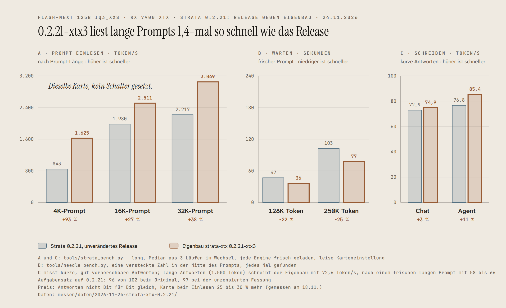

Was der Eigenbau anders macht, wie er geprüft ist und wie er entstand: [Abschnitt unten](#der-eigenbau-strata-xtx-die-schalter-fürs-einlesen-im-code). Weiter unten steht bei jedem Tempowert dabei, ob er mit strata-xtx oder mit einem Release gemessen ist.

## Auf einen Blick

| | |
|---|---|
| Schreiben | rund 70 Token/s: 77,7 bei kurzen Chat-Antworten, 64–70 bei langen; direkt nach einem frischen langen Prompt 57–63 (mit strata-xtx gemessen; das Release in denselben Läufen: 67,9 im Chat) |
| Prompt einlesen | **2.400–3.250 Token/s ab 16K mit strata-xtx**: 20 s für 65K Token, 1,3 min für 248K (Release 0.2.17: 1.350–1.400 Token/s, 3,4 min für 250K) |
| Kontext | 256K, die Nadel wurde bis 250K mit beiden Fassungen in 7 von 7 Fällen gefunden |
| Speicher | 55–59 GiB der 64 GB RAM belegt (unzensierte Fassung und Original), die 24-GB-Karte ist voll; mit strata-xtx wie mit dem Release |
| Strom | 1,6 Wh je 1.000 geschriebene Token mit dem Original, 1,75 mit der unzensierten Fassung; NAS und Dock ziehen beim Schreiben rund 400 W, im Leerlauf 62–68 W; beim Einlesen zieht die Karte mit strata-xtx 25 bis 30 W mehr als mit dem Release |
| Größtes Risiko | ein Dock-Abriss bei geladenem Modell startet das NAS neu (Kernel-Fehler, entschärft) |

## Was wo steht

- **Lohnt sich das?** [Gemessen](#gemessen) und [Strata-Versionen auf dieser Karte](#strata-versionen-auf-dieser-karte)
- **Was läuft heute?** [strata-xtx gegen das Standard-Release](#strata-xtx-gegen-das-standard-release) in Zahlen, und [der Eigenbau strata-xtx auf Strata 0.2.17](#der-eigenbau-strata-xtx-die-schalter-fürs-einlesen-im-code): was er anders macht als das Release und wie er geprüft ist
- **Wie baue ich es nach?** [Starten](#starten), [Docker-Image](#volle-geschwindigkeit-im-docker-image), [Was ich an UGOS ändern musste](#was-ich-an-ugos-ändern-musste), [Bauen](#bauen)
- **Was kann schiefgehen?** [Dock und Anbindung](#dock-und-anbindung-was-man-wissen-muss) und [das größte offene Risiko](#das-größte-offene-risiko-ein-dock-abriss-startet-das-nas-neu)
- **Zum Vertiefen:** [jede Version im Einzelnen](docs/releases.de.md) · [der Eigenbau strata-xtx und die Schalter, aus denen er entstand](docs/schalter.de.md) · [die Dock-Störungen und ihre zwei Wochenuhren](docs/dock.de.md) · [wie der Agent weniger erfindet](docs/agent.de.md) · [Bilder mit ComfyUI](docs/comfyui.de.md)

## Die Kombination

```
  UGREEN iDX6011 Pro      UGOS Pro 1.21 (Debian-12-Basis, Kernel 6.18.15)
  │                       64 GB LPDDR5X · Hybrid-CPU (P- und E-Kerne) · 2× 10 GbE · 2× Thunderbolt 4
  │                       eingebaute Intel-Arc-iGPU → Transkodierung, Bilderkennung
  │
  │  OCuLink, PCIe 4.0 x4 (der Host-Port kann höchstens x4 / 16 GT/s ≈ 7,9 GB/s)
  ▼
  UGREEN LinkStation eGPU-Dock   eigenes 850-W-Netzteil
  └─ AMD Radeon RX 7900 XTX      24 GB VRAM, Navi 31 / gfx1100, im Dock mit x16 angebunden
       └─ Strata (ROCm 7.10 aus AMDs TheRock-Wheels), ein Modell zur Zeit über llama-swap
            └─ Qwen3.8-Flash-Next 125B MoE · IQ3_XXS (ISTA-DASLab) · int8-KV · MTP-Kopf · 256k
```

**Warum ein 125B-Modell auf eine 24-GB-Karte passt:** Flash-Next ist ein Mixture-of-Experts-Modell, pro Token
rechnen nur wenige Experten. Strata hält die häufig gebrauchten Experten im VRAM und den Rest im RAM. Fehlende
Experten rechnet die CPU, statt sie über die x4-Strecke zu kopieren. Möglich macht das der schnell angebundene
LPDDR5X der iDX: Mit geladenem Modell sind 55–58 GiB der 64 GB belegt. Ein dichtes 70B-Modell wäre auf derselben Hardware
langsam (gemessen: 2,7 T/s, siehe unten), weil es pro Token alle Gewichte lesen muss.

**Zwei GPUs, sauber getrennt:** Die Arc-iGPU (`renderD128`) erledigt die Medien, die XTX (`renderD129`) rechnet
nur Sprachmodelle. Wer `/dev/dri` pauschal an einen Mediencontainer durchreicht, riskiert, dass er sich die
Dock-Karte greift. Geräte je Container ausdrücklich zuordnen. UGOS (1.21.1) führt die Karte unter Systemsteuerung → Hardware & Energie → Dedizierte Grafikkarte; sie läuft dort im Modus „NAS“, nicht „VM-Passthrough (VFIO)“.

## Gemessen

Die erste Messung, im Oktober 2026 mit der damals selbst gebauten Engine (Strata 0.1.44.1) gegen Ollama: alle Werte mit `messen/bench.py`, jeweils Median aus 3 Läufen. Die Tabelle zeigt, warum ich bei Strata geblieben bin; die heutigen Werte auf dem Eigenbau stehen in den Abschnitten darunter (ein Prompt von 32.000 Token ist heute in rund 12 s eingelesen).

| | Ollama, Qwen3.8 27B | **Strata, Flash-Next IQ3_XXS** | Strata, Flash-Next IQ2_XS |
|---|---|---|---|
| Schreiben, lange Antwort | 31,2 T/s | **64–70 T/s** | 76,5 T/s |
| 32.000 Token einlesen | 42,7 s | **25–26 s** | 24,0 s |
| Agenten-Sitzung, 6 Runden Programmieren | 162,5 s | **48–54 s** | 35,7 s |
| Kontext | 64k | **256k** (mit 249.928 Token getestet) | 256k |
| RAM der ganzen Maschine | 21,7 GiB | 53,4 GiB | 48,9 GiB |
| Leistung der Karte beim Schreiben | 322 W | 283 W | 288 W |
| Qualität laut Quantisierer | – | 99,4 % des vollen Modells | 95,7 % |

Karte im Leerlauf ohne geladenes Modell: rund 9 W, 44–51 °C.

### Tempo über die Kontexttiefe (1K bis 248K)

Je Lauf ein frischer Prompt, danach 256 neue Token; Zeiten der Engine, Median aus 2–3 Läufen. Der Eigenbau auf
Strata 0.2.17 ist am 21.11.2026 gemessen (`messen/daten/tiefe-20261121.jsonl`), das Release 0.2.14 am 16.11.2026 mit derselben
Betriebskonfiguration (`messen/daten/tiefe-20261116.jsonl`). „Ohne MTP-Kopf“ ist das Release ohne `--mtp`
(ein natives Pack braucht weiter `--spec`, bekommt aber kaum Vorschläge).

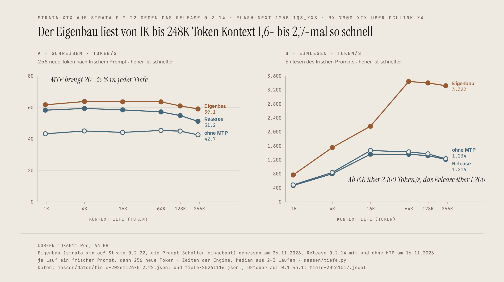

| Prompt-Token | Schreiben **strata-xtx** | Schreiben Release 0.2.14 | Schreiben Release 0.2.14 ohne MTP-Kopf | Einlesen **strata-xtx** | Einlesen Release 0.2.14 | Einlesen Release 0.2.14 ohne MTP-Kopf | MTP-Annahme (Release 0.2.14) |
| ---: | ---: | ---: | ---: | ---: | ---: | ---: | ---: |
| 995 | 60,2 | 58,3 | 43,3 | 759 | 468 | 486 | 41 % |
| 4.077 | 62,7 | 59,4 | 45,1 | 1.511 | 803 | 841 | 45 % |
| 16.254 | 61,2 | 58,5 | 44,2 | 2.478 | 1.365 | 1.468 | 47 % |
| 65.025 | 58,2 | 57,2 | 45,4 | 3.193 | 1.362 | 1.431 | 50 % |
| 130.026 | 60,1 | 54,9 | 45,0 | 3.103 | 1.324 | 1.373 | 52 % |
| 248.054 | 57,0 | 51,2 | 42,6 | 3.093 | 1.216 | 1.234 | 41 % |

strata-xtx ist auf der Basis 0.2.17 am 21.11. gemessen, das Release ist hier 0.2.14 vom 16.11.: Eine Tiefenreihe mit dem Release 0.2.17 gibt es nicht, den Vergleich auf derselben Basis und am selben Tag zeigt die [Tabelle oben](#strata-xtx-gegen-das-standard-release). Die Prompt-Token nennen den Lauf des Eigenbaus; die Prompts des Release waren je zwei Token kürzer. Die unzensierte Fassung (`liber`) liest auf dem Eigenbau 734 / 1.505 / 2.366 / 3.214 / 3.252 / 3.128 Token/s und schreibt 62,6 / 63,5 / 62,9 / 60,7 / 58,7 / 60,2 Token/s in denselben sechs Tiefen. Ohne MTP-Kopf liest der Eigenbau gleich schnell (777 bis 3.217 Token/s) und schreibt 50,0 / 50,8 / 48,1 / 48,6 / 47,6 / 46,2 Token/s; der Kopf bringt auf dem Eigenbau also 20 bis 27 % beim Schreiben, seine Vorschläge werden zu 48–53 % angenommen. Auf 0.2.16 (19.11.) lag das Schreiben ohne Kopf niedriger, bei 33 bis 46 Token/s, der Kopf schien deshalb bis zu 65 % zu bringen.

Der Eigenbau liest in jeder Tiefe 1,6- bis 2,5-mal so schnell wie das Release, ab 16K mit 2.400–3.250 T/s. Beim
Schreiben liegt er in dieser Reihe bei 57–63 T/s, das Release am 16.11. bei 51–59 T/s; derselbe Eigenbau schrieb am 19.11. auf
0.2.16 mit 54–59 T/s und am 18.11. auf 0.2.15 mit 56–63 T/s (`messen/daten/tiefe-20261119.jsonl`, `tiefe-20261118.jsonl`). Das ist vor allem die Streuung zwischen den Tagen: Im direkten
Wechsel am 21.11. schreiben Release und Eigenbau mit 67,9 und 77,7 T/s im Chat (siehe [Strata-Versionen](#strata-versionen-auf-dieser-karte)). Auf dem Release fällt das Schreibtempo mit der Tiefe kaum
(mit MTP 58 → 51 T/s), MTP bringt dort in jeder Tiefe 20–35 %, das Einlesen bleibt ab 16K bei 1.210–1.470 T/s, über die x4-Strecke. Gegenüber dem ersten Lauf am 17.10. auf 0.1.44.1
(`messen/daten/tiefe-20261017.jsonl`: mit MTP 62 → 56 T/s, Einlesen ab 16K 1.080–1.270 T/s) las das Release 0.2.14
schneller und schrieb in jeder Tiefe 1–6 T/s langsamer, auch ohne MTP-Kopf. Woran das liegt, habe ich nicht geklärt. **Recall** (Stratas `needle_bench.py`, 21.11.2026 auf dem Eigenbau): Das
Codewort wurde bei 32K und 128K in 10, 50 und 90 % Tiefe und bei 250K in 50 % Tiefe jedes Mal gefunden, vom Original und von der unzensierten Fassung, je 7 von 7 (`messen/daten/2026-11-21-strata-xtx-0.2.17/needles-*.json`).


### Wie lange ein langer Prompt dauert, und wohin der Speicher geht


Das Einlesen wächst fast linear mit dem Prompt. Im Oktober 2026 (Strata 0.2.2) waren es 5,5 s bei 4K, 26 s bei 32K, 1,8 min bei 128K und 3,6 min bei 250K. **Mit strata-xtx** sind es am 21.11.2026 2,7 s bei 4K, 6,6 s bei 16K, 20 s bei 65K, 42 s bei 130K und 80 s bei 248K; die Nadel wurde jedes Mal gefunden. Im direkten Vergleich mit dem unveränderten Release 0.2.17 (Nadeltest, derselbe Prompt): 37 gegen 82 s bei 128.000 Token und 82 gegen 207 s bei 250.000 Token. Der Gesprächs-Cache von Strata erspart einer Agenten-Sitzung, das in jeder Runde neu zu bezahlen: Im Agentenlauf von `strata_bench.py` werden je Sitzung nur 5 Token doppelt gelesen.

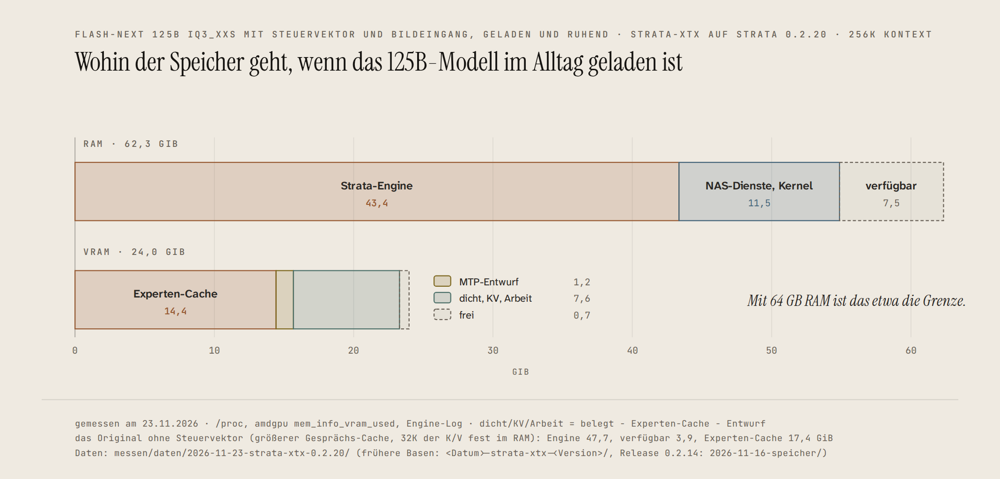

Mit geladenem, ruhendem Original (`faber`) belegt die Engine 47,7 der 62,3 GiB RAM (die Experten-Gewichte, die nicht auf die Karte passen, die K/V von 32K Token in festgepinntem RAM und den Gesprächs-Cache, wie er sich füllt), NAS-Dienste und Kernel 10,9 GiB, 3,8 GiB bleiben verfügbar. Auf der Karte nimmt der Experten-Cache 17,0 von 24 GiB (10.490 Plätze), der MTP-Entwurf 1 GiB, alles Übrige 5,3 GiB, 0,7 GiB bleiben frei. Die unzensierte Fassung im täglichen Einsatz läuft mit Bildeingang, ohne festgepinnte K/V und mit einem Gesprächs-Cache von 4,5 statt 9 GiB: Die Engine belegt 43,4 GiB, 7,4 GiB bleiben verfügbar, und weil der Bildteil auf der Karte Platz braucht, hat der Experten-Cache 14,1 GiB. Gemessen am 21.11.2026 auf dem Eigenbau (`messen/daten/2026-11-21-strata-xtx-0.2.17/`), praktisch unverändert gegenüber dem 19.11. auf 0.2.16 (Engine 47,6 GiB, 4,2 GiB verfügbar) und dem 18.11. auf 0.2.15 (`messen/daten/2026-11-19-strata-xtx-0.2.16/`, `2026-11-18-strata-xtx/`); am 16.11. auf dem Release 0.2.14 waren es 47,2 und 42,8 GiB (`messen/daten/2026-11-16-speicher/`), am 23.10. auf 0.2.3.1 belegte die Engine mit dem Original 44,6 GiB, 7,5 GiB blieben verfügbar. Mit 64 GB RAM ist das ungefähr die Grenze: Ein zweiter großer Dienst daneben verlangt einen kleineren Gesprächs-Cache.

### Ein größeres Quant von der NVMe lohnt sich nicht (20./21.11.2026)

Strata kann die Experten, die weder auf die Karte noch in ein RAM-Budget passen, während der Antwort aus der Modelldatei nachladen, und das NAS hat einen schnellen NVMe-Verbund. Ich habe deshalb zwei größere Quants desselben Modells ausprobiert, Unsloths UD-IQ4_XS (93,7 GB) und UD-Q4_K_XL (111 GB), gegen meine IQ3_XXS-Datei im Betrieb (75,8 GB), jeweils mit 45 GiB RAM-Budget. UD-IQ4_XS schreibt mit 44 bis 46 statt 61 Token/s und besteht in meinem Aufgabensatz gleich viele Aufgaben (95 und 96 gegen 96 und 96 von 102), braucht dafür aber rund 55 % länger. UD-Q4_K_XL liest für jede Antwort mit 900 Token 21 bis 23 GB von der NVMe und schreibt mit 24 Token/s. Mit beiden Dateien bleiben neben den NAS-Diensten nur rund 2,3 GiB RAM verfügbar. Meine Datei im Betrieb bleibt. Rohdaten und Bedingungen: [`messen/daten/2026-11-21-nvme-streaming/`](messen/daten/2026-11-21-nvme-streaming/README.de.md).

### Ein größeres Modell, Tencent Hy4-Flash (220B), ist hier achtmal langsamer (21./22.11.2026)

Strata 0.2.18 bringt Hy4-Flash mit, 220 Milliarden Parameter (12 Milliarden aktiv), mit eigener Engine. Ich habe das kleinste Quant (SQ-64, 62 GB plus 68 GB Engram-Datei) gegen meinen Betrieb gemessen. Es läuft, schreibt aber mit 7,0 bis 7,5 statt rund 60 Token/s und liest einen langen Prompt mit 414 statt 3.094 Token/s. Die CPU des NAS rechnet 36 GB Experten aus dem RAM, und pro Antwort mit 900 Token liest es rund 160 GB von der NVMe. Mit der Aufteilung, die Stratas Setup für diese Maschine schreibt, läuft der Speicher voll, und es schreibt nur 0,3 bis 0,6 Token/s. Die Engine verwirft die Angaben des Setups und rechnet mit dem gesamten RAM. Abhilfe ist `HY4_RAM_BUDGET_GB`, gemeldet als [Strata-Issue #6556](https://github.com/Niko1221/Strata/issues/6556). Mein Eigenbau ändert daran nichts, weil die Hy4-Engine keinen seiner Schalter liest. Hy4-Flash ist zensiert und nimmt keinen Steuervektor an. Qualität habe ich nicht gemessen. Rohdaten und Bedingungen: [`messen/daten/2026-11-22-hy4-flash/`](messen/daten/2026-11-22-hy4-flash/README.de.md).

### Strom, Kaltstart, NAS-Betrieb, ein dichtes 70B und UGREENs eigenes Modell (15. bis 21.11.2026)

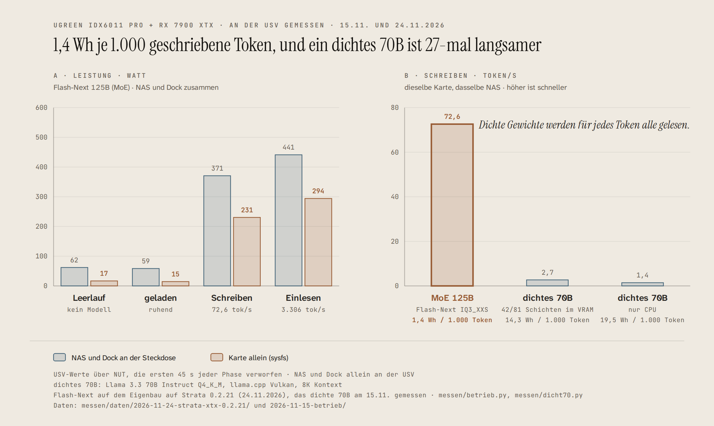

**Strom.** Gemessen am Original (`faber`) auf dem Eigenbau am 21.11.2026, an der USV, an der nur NAS und Dock hängen (über NUT gelesen, die ersten 45 s jeder Phase verworfen), daneben der Wert der Karte aus sysfs.

| Phase (strata-xtx auf 0.2.17) | NAS und Dock | Karte allein |
|---|---:|---:|
| Leerlauf, kein Modell geladen | 68 W | 22 W |
| Modell geladen, ruhend | 57 W | 13 W |
| Schreiben, 70,2 Token/s | 402 W | 242 W |
| frische 82K-Prompts einlesen, 3.119 Token/s | 436 W | 297 W |

Das sind **1,6 Wh je 1.000 geschriebene Token** für NAS und Dock (1,3 Wh über Leerlauf) und 0,04 Wh je 1.000 gelesene Token (das Release ohne die Schalter: 0,07 bis 0,09 Wh, siehe die Vergleichstabelle unten). Ein geladenes, ruhendes Modell kostet nichts Messbares gegenüber der leeren Karte.

| Fassung des 125B-Modells | Stand | Schreiben T/s | NAS und Dock | je 1.000 geschriebene Token |
|---|---|---:|---:|---:|
| IQ3_XXS (`faber`) | Eigenbau auf 0.2.17, 21.11. | 70,2 | 402 W | 1,6 Wh |
| IQ3_XXS, unzensiert (`liber`) | Eigenbau auf 0.2.17, 21.11. | 64,3 | 405 W | 1,75 Wh |
| IQ2_XS (`velox`) | Release 0.2.14, 16.11. | 71,9 | 341 W | 1,3 Wh |

Am 19.11. auf 0.2.16 waren es 68,3 und 67,4 Token/s bei 393 und 394 W, am 18.11. auf 0.2.15 68,8 und 67,9 Token/s bei 381 und 391 W (`messen/daten/2026-11-19-strata-xtx-0.2.16/`, `2026-11-18-strata-xtx/`). Die unzensierte Fassung schreibt lange Antworten auf 0.2.17 langsamer (64,3 gegen 67,4 Token/s); in der Tiefenreihe und bei den Prüfungen vor der Übernahme lag ihr Schreibtempo nicht niedriger, ich behalte das im Auge. Ein erster Lauf am frühen Morgen des 19.11. liegt unter `2026-11-19-strata-xtx-0.2.16/strom-first-run/`: Bei der unzensierten Fassung zog die Maschine schon im Leerlauf 74 statt 61 W und schrieb nur 57,7 Token/s. Auf dem NAS lief offenbar etwas nebenher; was, habe ich nicht ermittelt. Ich habe den Lauf verworfen und wiederholt, es gilt die Wiederholung.

**Was das schnellere Einlesen an Strom kostet.** Am 18.11.2026 an einem Abend, mit demselben Skript und im Wechsel gemessen (`faber`, je 150 s Last nach 80 s Ruhe, Eigenbau noch auf der Basis 0.2.15, `messen/daten/2026-11-18-strata-xtx/stromvergleich/`):

| Stand | Karte beim Schreiben | Karte beim Einlesen | NAS und Dock beim Einlesen | Einlesen | je 1.000 gelesene Token |
|---|---:|---:|---:|---:|---:|
| Release 0.2.14 ohne Schalter (zwei Läufe) | 235 / 238 W | 270 / 267 W | 413 / 341 W | 1.314 / 1.348 T/s | 0,087 / 0,070 Wh |
| Release 0.2.14 mit den 28 Schaltern | 245 W | 300 W | 469 W | 2.975 T/s | 0,044 Wh |
| Eigenbau (zwei Läufe) | 235 / 236 W | 292 / 296 W | 494 / 483 W | 2.943 / 2.945 T/s | 0,047 / 0,046 Wh |

Beim Schreiben zieht die Karte in allen Ständen gleich viel. Beim Einlesen zieht sie mit den Schaltern 25 bis 30 W mehr. Was NAS und Dock zusammen beim Einlesen ziehen, schwankt von Lauf zu Lauf zu stark für eine feste Zahl: am 18.11. zwischen 341 und 494 W, am 19.11. auf dem Eigenbau zwischen 390 und 440 W, am 21.11. 436 und 476 W. Sicher ist die Energie je gelesenem Token: Sie ist mit dem Eigenbau rund halb so hoch (0,037 bis 0,047 gegen 0,070 bis 0,087 Wh je 1.000 Token), weil das Einlesen gut doppelt so schnell fertig ist.

Zwischen den Tagen unterscheiden sich die Werte stärker als zwischen den Ständen: Am 16.11.2026 zog dieselbe Maschine auf dem Release 0.2.14 beim Schreiben 336 W (Karte 205 W, 65,9 Token/s, 1,4 Wh) und beim Einlesen 377 W (Karte 231 W, 1.339 Token/s), im Leerlauf 49 W (`messen/daten/2026-11-16-betrieb/`). Am 18.11. lag derselbe Stand bei 235 W an der Karte und 60 W im Leerlauf. Die Ursache dieses Unterschieds zwischen den Tagen kenne ich nicht; verglichen wird deshalb nur innerhalb eines Abends. Auf 0.2.12 waren es am 15.11. beim Schreiben 66,3 Token/s bei 355 W und 1,5 Wh, beim Einlesen 1.159 Token/s (`messen/daten/2026-11-15-betrieb/`). Die allererste Messung mit einem Netzwerk-Switch an derselben USV liegt mit ihrem Abzug in `messen/daten/2026-11-15-betrieb/mit-switch/`.

**Kaltstart.** Von der leeren Karte bis zum ersten Token: Median 20,5 s in fünf Läufen auf dem Eigenbau am 21.11. (19,5–25,5 s, dazu ein Ausreißer mit 47,6 s, den ich nicht erklären kann; die unzensierte Fassung 18,5–19,5 s, Median 19,5 s). Am 19.11. waren es 19,6–21,6 s, praktisch so lang wie auf dem Release 0.2.14 (18,5–19,5 s). Den Seitencache vor dem ersten Lauf zu leeren, machte kaum einen Unterschied (21,6 s am 19.11.).


**NAS-Betrieb, während das Modell schreibt.** Eine 17,7-GB-Datei kam per HTTP ohne geladenes Modell mit 1.175 MB/s vom NAS und mit 1.174 MB/s, während das Modell schrieb; der Empfänger hing mit 10 Gbit/s am selben Netz, die Leitung war damit nahezu ausgelastet. Die Transkodierung eines 4K-HEVC-Clips nach 1080p-H.264 auf der eingebauten Arc-iGPU lief ohne Modell mit 290 Bilder/s und fiel, während das Modell schrieb und der Download lief, auf 156 bis 245 Bilder/s, im langsamsten Durchgang immer noch das Fünffache der Wiedergabe. Das Schreibtempo blieb dabei bei 68 und 70 Token/s (allein im Median 69). Mit der unzensierten Fassung (`liber`): 1.175 und 1.168 MB/s, 216 bis 245 Bilder/s, Schreiben 62 und 65 Token/s gegen 66 allein. Gemessen am 19.11.2026 auf dem Eigenbau nach festem Zeitplan (`messen/nebenlast.py`, `messen/daten/2026-11-19-strata-xtx-0.2.16/nebenlast.json`); die Nebenlast dauerte nur rund 30 s und traf je zwei Anfragen. Am 16.11. auf dem Release 0.2.14, mit einem Arbeitsplatz an 5 Gbit/s als Empfänger, waren es 591 und 586 MB/s und 241–244 Bilder/s; der niedrigere erste Transkodierwert heute fällt mit dem doppelt so schnellen Download zusammen. Nicht gemessen: SMB.

**Ein dichtes 70B-Modell auf derselben Karte: 2,7 Token/s.** Llama 3.3 70B Instruct (Q4_K_M, 42,5 GB) mit llama.cpp Vulkan, so viele Schichten auf der Karte wie passen, der Rest auf der CPU, 8K Kontext:

| Schichten auf der Karte | VRAM | Schreiben T/s | NAS und Dock | je 1.000 geschriebene Token |
|---|---:|---:|---:|---:|
| 42 von 81 | 22,1 GiB | 2,69 | 138 W | 14,3 Wh |
| keine (nur CPU) | – | 1,44 | 101 W | 19,5 Wh |

Mit 40 und 38 Schichten auf der Karte waren es 2,58 und 2,48 Token/s. Das MoE-Modell schreibt 25-mal so schnell und braucht je Token rund ein Zehntel der Energie. Ein dichtes Modell fasst für jedes Token alle Gewichte an, und die Hälfte davon liegt hier hinter der CPU.

Zwei dichte Modelle, die ganz in den Grafikspeicher passen (Qwen3.8-27B und Gemma 4 31B, beide Q4), schreiben mit 37 Token/s bei 386 und 399 W: 2,9 und 3,0 Wh je 1.000 Token, das Doppelte des 125B-Modells.

**UGREENs eigenes Modell, mit und ohne Dock.** Die KI-Konsole von UGOS lädt Qwen3.5-35B-A3B (Q4_K_M, eine GGUF-Datei mit 22,0 GB) und startet es von selbst auf der Arc-iGPU, mit einem eigenen llama.cpp (SYCL, 4 Fäden, 7 Plätze). Diesen laufenden Server habe ich über seinen Unix-Socket gemessen, danach dieselbe Datei nur auf der CPU und auf der XTX:

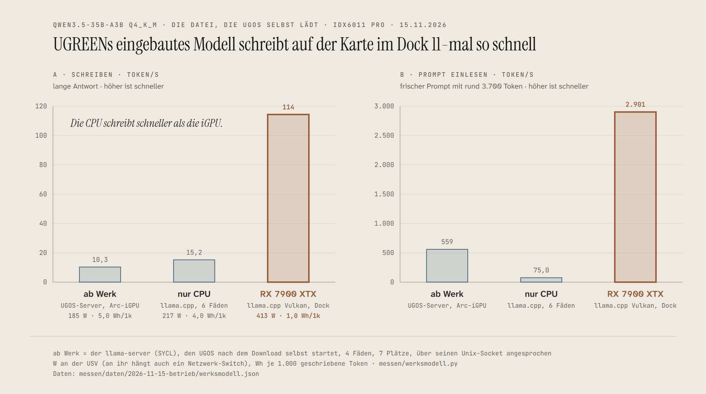

| Weg | Schreiben T/s | Einlesen T/s | NAS und Dock | je 1.000 geschriebene Token |
|---|---:|---:|---:|---:|
| ab Werk: UGOS-Server auf der Arc-iGPU (SYCL) | 10,3 | 559 | 78 W * | 2,1 Wh * |
| Arc-iGPU, llama.cpp Vulkan | 10,2 | 191 | 64 W | 1,7 Wh |
| nur CPU, llama.cpp, 6 Fäden | 15,5 | 79 | 97 W | 1,7 Wh |
| RX 7900 XTX im Dock, llama.cpp Vulkan | 114 | 2.977 | 288 W | 0,7 Wh |

\* gerechnet: Diese Zeile ist am Vormittag mit dem Switch an derselben USV gemessen (185 W), 107,5 W sind abgezogen, auf etwa ±10 W genau. Nachmessen ging nicht, weil UGOS seine SYCL-Laufzeit zusammen mit dem Modell entfernt.

Auf der Karte schreibt das eingebaute Modell 11-mal so schnell und liest fünfmal so schnell wie ab Werk, bei 0,7 statt 2,1 Wh je 1.000 Token. Die CPU allein schreibt schneller als der iGPU-Server, liest einen Prompt aber siebenmal langsamer. Zwei Grenzen: Beim CPU-Lauf lag die Kopie von UGOS geladen und untätig daneben, und UGOS hält sein Modell im Speicher (rund 27 GB), es passt also nicht neben das 125B-Modell; ich habe es nach dem Test wieder entfernt. Die zweite Laufzeit von UGOS (`llama-gpu`) ist ein CUDA-Build und startet mit einer AMD-Karte nicht.

**Lohnt sich das große Modell? Dieselben Aufgaben für beide.** UGREENs Qwen3.5-35B-A3B passt ganz auf die Karte (22,1 GB VRAM bei 128K Kontext) und schreibt 114 Token/s, fast doppelt so schnell wie das 125B-Modell. In meinem Aufgabensatz verliert es trotzdem:

| | Flash-Next 125B (MoE, Strata) | Qwen3.5-35B-A3B (UGREENs Datei, auf der Karte) |
|---|---:|---:|
| **bestandene Aufgaben (von 102)** | **98** | **90** |
| Code | 15/15 | 12/15 |
| Logik | 15/15 | 12/15 |
| Anweisungen befolgen | 15/15 | 13/15 |
| Fakten | 12/15 | 12/15 |
| Werkzeugaufrufe | 20/20 | 20/20 |
| langer Kontext (32K, 100K) | 4/4 | 4/4 |
| Sicherheit | 17/18 | 17/18 |
| Denkbudget von 8.000 Token aufgebraucht, keine Antwort | 0 | 9 |
| Deutsch, verdeckt benotet (von 60) | 47 | 37 |
| geschriebene Token für alle 114 Aufgaben | 82.901 | 223.795 |
| Zeit für alle 114 Aufgaben | 25 min | 37 min |

Das kleine Modell denkt viel länger nach: Es schreibt für dieselben Aufgaben 2,7-mal so viele Token, deshalb dauert der ganze Satz trotz des höheren Tempos 49 % länger, und in neun Aufgaben war das Denkbudget aufgebraucht, bevor eine Antwort kam. Mit einem größeren Budget würden einige davon vermutlich bestehen; gemessen habe ich das nicht. Für das kleine Modell spricht: Es lässt den Arbeitsspeicher des NAS frei, wo mit dem 125B-Modell 55 bis 58 der 64 GB belegt sind. Die Zahlen des 125B-Modells stammen vom 16.11. auf Strata 0.2.14 (gleiche Aufgaben); auf 0.2.12 bestand es am 13.11. 96 von 102. Seine Deutsch-Note stammt vom Lauf auf 0.2.12. Deutsch hat ein Sprachmodell verdeckt benotet, das nicht wusste, welche Antwort von welchem Modell stammt; ein anderer Prüfer als im Nachtrag vom 14.11., die Noten sind also nur innerhalb dieser Tabelle vergleichbar. Daten (nur Zählwerte): `messen/daten/2026-11-15-betrieb/qualitaet.json`.

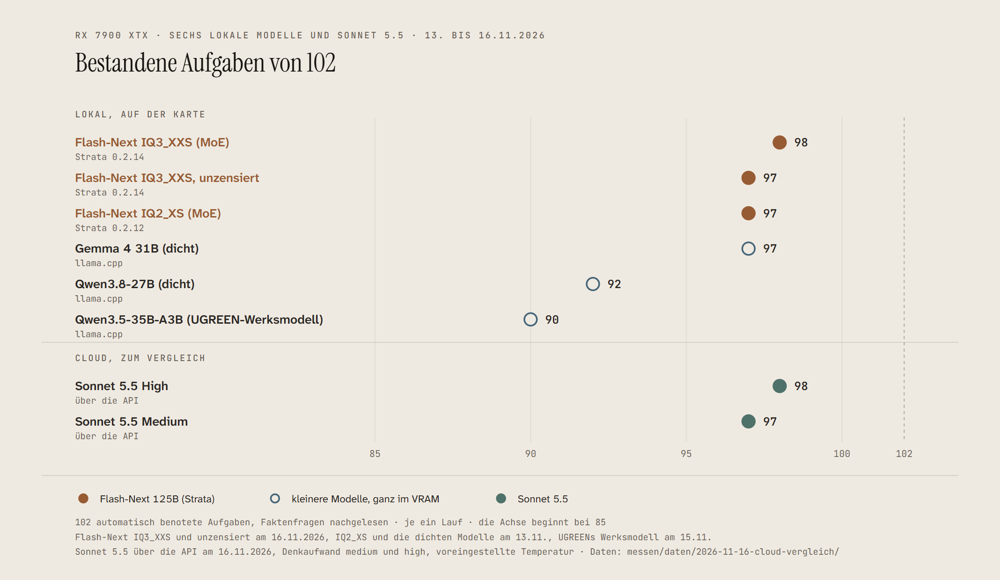

Derselbe Aufgabensatz gegen ein Modell aus der Cloud, Sonnet 5.5 über die API mit zwei Denkstufen; Zählwerte in `messen/daten/2026-11-16-cloud-vergleich/`.

**Zwei Personen gleichzeitig.** `messen/zwei.py` führt erst ein Gespräch mit fünf Fragen allein, dann zwei Gespräche zugleich am selben Modell, dann zwei Personen abwechselnd an zwei verschiedenen Modellen:

| | Warten bis zum ersten Wort (Median) | Schreiben T/s (Median) |
|---|---:|---:|
| eine Person allein | 0,3 s | 66,9 |
| zwei zugleich, Person A | 7,0 s | 62,4 |
| zwei zugleich, Person B | 5,8 s | 70,9 |
| abwechselnd an zwei Modellen | 20 s | – |

Strata beantwortet eine Anfrage nach der anderen: Die zweite Person wartet, bis die erste Antwort fertig ist, bei Antworten bis 400 Token fünf bis neun Sekunden, und bekommt dann das volle Tempo. Nutzen zwei Personen zwei verschiedene Modelle, lädt die Karte bei jedem Wechsel um, rund 20 s jedes Mal. Für gemeinsame Nutzung also ein Modell für alle. Gemessen am 19.11.2026 auf dem Eigenbau; am 16.11. auf dem Release 0.2.14 warteten beide im Median 9,5 s.

Skripte: `messen/betrieb.py`, `messen/dicht70.py`, `messen/werksmodell.py`, `messen/transkodieren.sh`, `messen/zwei.py`. Rohdaten: `messen/daten/2026-11-21-strata-xtx-0.2.17/` (Eigenbau auf 0.2.17), `messen/daten/2026-11-19-strata-xtx-0.2.16/` (Eigenbau auf 0.2.16, mit dem Lasttest), `messen/daten/2026-11-18-strata-xtx/` (Eigenbau auf 0.2.15), `messen/daten/2026-11-16-betrieb/` (Release 0.2.14) und `messen/daten/2026-11-15-betrieb/`.

### Kostet Strata Qualität? Strata gegen llama.cpp auf derselben Datei

Dieselbe GGUF-Datei (Flash-Next IQ3_XXS), derselbe feste Textsatz aus Stratas `tools/quant_quality.py` (Code,
Doku, Englisch, andere Sprachen, ein Agentenprotokoll; 4.995 Positionen, teacher-forced). Strata über
`quant_quality.py run`, llama.cpp (Build 11610, Vulkan, Experten auf der CPU) Position für Position über
`llama-server` (`messen/qq_llamacpp.py`, gleiches Ausgabeformat), verglichen mit `messen/qq_vergleich.py`:

| Vergleich | gleiches Top-Token | KL Mittel | KL Median | KL p99 | Perplexität |
| --- | ---: | ---: | ---: | ---: | --- |
| llama.cpp gegen Strata (Experten auf der CPU) | **95,7 %** | 0,020 | 0,0017 | 0,27 | 4,009 gegen 4,017 |
| llama.cpp gegen Strata (Experten auf der GPU) | 95,7 % | 0,020 | 0,0017 | 0,34 | 4,009 gegen 4,019 |
| Stratas CPU-Pfad gegen seinen GPU-Pfad | 95,7 % | 0,018 | 0,0017 | 0,27 | – |

**Strata kostet gegenüber llama.cpp keine messbare Qualität:** Der Unterschied ist so groß wie der zwischen Stratas
eigenen CPU- und GPU-Kernels, also Rechenrauschen. Zum Maßstab: Laut Strata-Doku liegt IQ3_XXS gegen Q8_0 bei
84,5 % und KL 0,20 – die Quantisierung kostet Qualität, die Engine nicht. Grenzen: Perplexität über die 4.982
Positionen, an denen llama.cpp den exakten Wert lieferte (Ziel unter seinen Top-4000); Stratas Prüfwerkzeug rechnet
mit FP16-KV ohne MTP-Vorschläge, der Einfluss von int8-KV ist also nicht erfasst; ein Textsatz.

### Strata-Einstellungen, die messbar etwas bringen

| Einstellung | Wert | Wirkung |
|---|---|---|
| `--pool-workers` | 9 bis 0.2.0, **ab 0.2.1 weglassen** | bis 0.2.0: 76,8 statt 56,1 T/s gegenüber der Automatik (gemessen mit IQ2_XS); 0.2.1 plant selbst 10 Worker und lässt die LP-E-Kerne frei |
| `--pcie-frac` | 0 | fehlende Experten rechnet die CPU, statt sie über x4 zu kopieren; kein Tempoverlust, schont den Link |
| `--kv` | int8 | halbiert den KV-Cache, 256k Kontext passen |
| `--max-context` | 262144 | trainiertes Maximum; 250.000 Token liest **strata-xtx in 82 s**, das Release 0.2.17 in 207 s |
| `--mtp` | MTP-Kopf | Vorschlagstoken beschleunigen das Schreiben |
| `--conversation-cache-mib` | 4608 | parkt eine Sitzung bis ~120.000 Token, während eine andere Anfrage läuft (geparkt in 0,16 s, zurück in 0,06 s) |
| `STRATA_HIPBLASLT_TUNING` | `tools/hip/gfx1100-hipblaslt-100200.txt` | muss zur hipBLASLt-Version passen, sonst ~45 % langsameres Einlesen |
| Quantisierung | IQ3_XXS statt IQ3_S | 53 statt 60 GiB RAM für die Engine (gemessen im Oktober 2026); IQ3_S lässt neben den übrigen NAS-Diensten keinen Platz |
| Eigenbau [strata-xtx](https://github.com/faf-net/strata-xtx) statt Release-Engine | keine Einstellung: die Engine schaltet ihre Schalter für das Einlesen selbst ein | Einlesen bei 4K / 16K / 32K **1.576 / 2.481 / 2.848** statt 785 / 1.390 / 1.352 Token/s (Release 0.2.17), Schreiben gleich bis leicht schneller, gleiche Punktzahl im Aufgabensatz; in der Laufkonfiguration steht dafür kein Schalter mehr ([Abschnitt unten](#der-eigenbau-strata-xtx-die-schalter-fürs-einlesen-im-code)) |


### Der Eigenbau strata-xtx: die Schalter fürs Einlesen im Code

Stratas Engine bringt Schalter (Umgebungsvariablen) für das Einlesen des Prompts mit, die auf der RX 7900 XTX ausgeschaltet bleiben, weil mehrere davon die Rundung ändern. Auf neueren Karten schaltet Strata vergleichbare von selbst ein. Mein Eigenbau [strata-xtx](https://github.com/faf-net/strata-xtx) tut dasselbe für genau einen Fall: Linux, eine einzige sichtbare Grafikkarte, und diese ist eine eigenständige gfx1100-Karte. Der Patch ist klein, rund 200 Zeilen in fünf Dateien; alles andere ist unverändertes Strata.

- **Was er einschaltet:** eine Tabelle mit 27 Schaltern. 26 davon setzt die Engine neu, einer ist im Release schon an. Dazu darf ein bloßes `--prefill auto` Stücke bis 32.768 Token nehmen. In der Laufkonfiguration steht im `env` nur noch die hipBLASLt-Tabelle (`STRATA_HIPBLASLT_TUNING`), kein Schalter für das Einlesen mehr.
- **Wer gewinnt:** Ein Schalter, den ich selbst setze, wird nie überschrieben. `STRATA_GFX1100_DEFAULTS=0` schaltet die ganze Tabelle ab; dann liest die Engine wie das Release (gemessen: 1.392 statt 2.386 Token/s bei 16K).
- **Selbstrettung:** Meldet die Engine nicht-endliche Werte und hilft Stratas eigener zweiter Versuch nicht, startet der Server sie einmal ohne die Tabelle neu und läuft im langsameren Modus weiter. Mit Stratas Fehlerinjektion geprüft, mit beiden Fassungen: Die auslösende Anfrage selbst endet mit einem Fehler (HTTP 503), dann ein Neustart, die folgenden Anfragen beantwortet, ein 16K-Prompt danach mit rund 1.300 Token/s gelesen, die Zahl gefunden.
- **Was ich vor der Übernahme geprüft habe (0.2.17, 20.11.2026):** Tempo gegen den laufenden Bau (gleich schnell) und am Tag darauf im Wechsel mit dem unveränderten Release 0.2.17; die Zahlen stehen in der [Tabelle oben](#strata-xtx-gegen-das-standard-release). Der Aufgabensatz ergibt 95 von 102 mit dem Original und 97 mit der unzensierten Fassung (auf 0.2.16: 97 und 96, auf dem unveränderten Release ebenfalls 96). Zwei der Aufgaben bestand das Modell auf 0.2.16 in je fünf Wiederholungen auf Eigenbau und Release gleichermaßen mal ja, mal nein, die Punktzahlen schwanken deshalb von Lauf zu Lauf um ein bis zwei. 90 Minuten Dauerlast liefen ohne Fehler durch (1.267 Anfragen, 181 von 181 versteckten Zahlen gefunden). Werkzeugaufruf, Bildeingang und Steuervektor arbeiten wie auf dem Release.
- **Preis:** Die Antworten sind nicht Bit für Bit dieselben wie ohne die Tabelle, und die Karte zieht beim Einlesen 25 bis 30 W mehr (siehe [Strom](#strom-kaltstart-nas-betrieb-ein-dichtes-70b-und-ugreens-eigenes-modell-15-bis-21112026)).

Jedes neue Strata-Release prüfe ich zuerst unverändert, baue dann den Eigenbau darauf und stelle erst um, wenn die Prüfungen mit beiden Fassungen bestanden sind. Bauweg, Patch und der gepatchte Quelltext je Version liegen im Repository [strata-xtx](https://github.com/faf-net/strata-xtx); die Herleitung steht in [docs/schalter.de.md](docs/schalter.de.md).

### Wie er entstand: 28 Umgebungsschalter auf dem Release 0.2.14 (17./18.11.2026)

Stratas Engine bringt Umgebungsschalter für das Einlesen mit, die auf dieser Kartengeneration aus sind. Einen Satz von 28 davon habe ich am 17. und 18.11.2026 auf der unveränderten Engine von Strata 0.2.14 gemessen. Am 18.11.2026 liefen die unzensierte Fassung und das Original hier einen Tag lang damit, als Einträge in der Laufkonfiguration; diese Messung war der Anlass für den Eigenbau. Stahlblau ist vorher, Bernstein nachher:

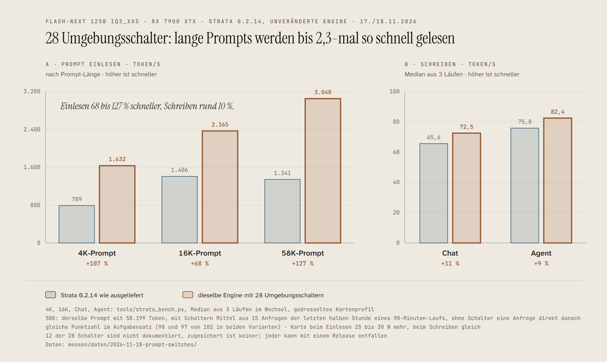

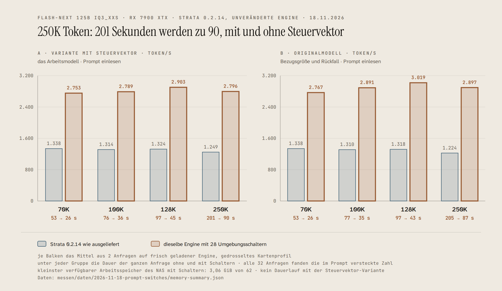

- Ein Prompt von 250.000 Token war in 90 statt 201 Sekunden eingelesen, einer von 16K mit 2.365 statt 1.406 Token/s. Das Schreiben war in dieser Messung rund 10 % schneller; im Eigenbau zeigt es sich nur in `strata_bench.py`: im Wechsel mit dem Release 72,5 gegen 69,6 Token/s im Chat auf 0.2.16, 77,7 gegen 67,9 auf 0.2.17; in den übrigen Messreihen kein klarer Unterschied.
- Mein Aufgabensatz kam mit und ohne Schalter auf 98 und 97 von 102. 90 Minuten Dauerlast liefen ohne Fehler durch (1.232 Anfragen).
- Aus den 28 wurden im Eigenbau 27: `STRATA_PREFILL_AUTO_MAX` ist dort eine feste Regel für die Stückgröße bei `--prefill auto`, `GPU_MAX_HW_QUEUES` brachte nichts und entfiel, `STRATA_CVEC_FUSE` kam dazu.
- Strata schaltet sie auf dieser Kartengeneration bewusst nicht von selbst ein, weil sich die Rundung ändert; 12 der 28 sind auch nicht beschrieben. Jeder kann mit einem Release entfallen, und die Engine ignoriert einen unbekannten Namen stillschweigend. Als Einträge in jeder Laufkonfiguration war das fehleranfällig; im Eigenbau stehen die Namen an einer Stelle im Code, und sein Patch bricht ab, wenn ein neues Release die Stellen ändert, an denen er ansetzt. Die Messung im Einzelnen: [docs/schalter.de.md](docs/schalter.de.md).

## Strata-Versionen auf dieser Karte

Jede Version seit 0.2.0-beta ist hier gegen ihre Vorgängerin gemessen, mit identischer Laufkonfiguration, nur Engine und Control getauscht. Seit dem 18.11.2026 läuft im Betrieb nicht mehr das Release, sondern der Eigenbau auf dessen Basis; im Diagramm stehen die Rauten über 0.2.16 und 0.2.17 für ihn auf beiden Basen, jeweils im Wechsel mit dem Release gemessen. Einzelheiten, Tabellen und Rohdaten zu jeder Version: [docs/releases.de.md](docs/releases.de.md).

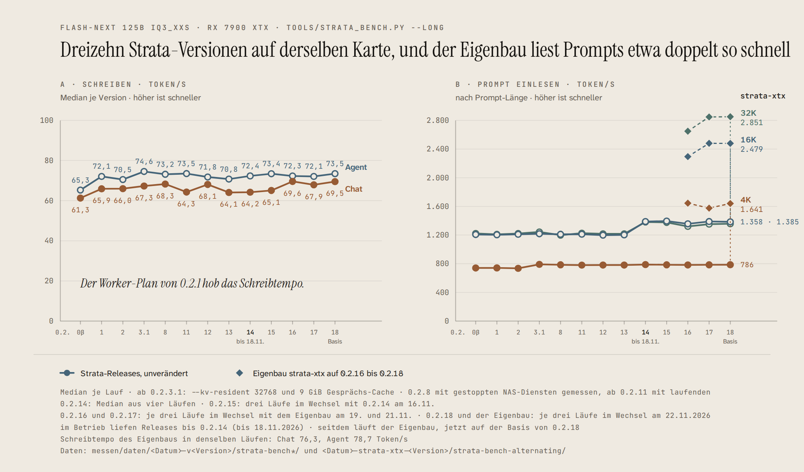

| Version | Datum | Ergebnis auf dieser Karte | An Strata gemeldet |
|---|---|---|---|
| 0.1.45 | 17.10. | kein messbarer Unterschied zu 0.1.44.1, nicht übernommen | – |
| 0.2.0-beta | 19.10. | die fertige `hip-rx7900`-Engine läuft auf gfx1100; ihre voreingestellte Worker-Zahl ist auf einer Hybrid-CPU ein Drittel langsamer; nicht übernommen | [#3262](https://github.com/Niko1221/Strata/issues/3262), [#3177](https://github.com/Niko1221/Strata/issues/3177) |
| 0.2.1 | 21.10. | **in Betrieb**; die Korrektur für Hybrid-CPUs wirkt; das Docker-Image läuft, seine gfx1100-Tabelle bringt +60 % bei 16K | [#3262](https://github.com/Niko1221/Strata/issues/3262), [#3263](https://github.com/Niko1221/Strata/issues/3263), [PR #2904](https://github.com/Niko1221/Strata/pull/2904) |
| 0.2.2 | 21.10. | **in Betrieb**; gleich schnell, robuster; `strata bench run` aus dem Paket ist vollständig | [#3263](https://github.com/Niko1221/Strata/issues/3263), [PR #2904](https://github.com/Niko1221/Strata/pull/2904) |
| 0.2.3.1 | 23.10. | **in Betrieb**; 4K-Prompts +7 % schneller eingelesen; die Engine findet ihre gfx1100-Tabelle selbst | – |
| 0.2.8 | 31.10. | **in Betrieb**; gleich; rettet leicht fehlerhafte Tool-Calls; das Docker-Image lässt 854 MiB VRAM frei | [PR #4851](https://github.com/Niko1221/Strata/pull/4851) |
| 0.2.9, 0.2.10 | 05.11. | zwischendurch **in Betrieb**; 0.2.9 behebt still falsch gelesene lange Prompts (#3431) | – |
| 0.2.11 | 05.11. | **in Betrieb**; gleich wie 0.2.10 | [#5321](https://github.com/Niko1221/Strata/issues/5321) |
| 0.2.12 | 08.11. | **in Betrieb** bis 16.11.; gleich wie 0.2.11; der getunte DFlash2-Drafter ist am Ende langsamer und bleibt aus | [#5615](https://github.com/Niko1221/Strata/issues/5615) |
| 0.2.13 | 09.11. | mit abgestimmter Konfiguration gleich, nicht übernommen; das Linux-Docker-Image nutzt die gfx1100-Tabelle nicht mehr und liest 16K-Prompts 35 % langsamer | [#5666](https://github.com/Niko1221/Strata/issues/5666) |
| 0.2.14 | 15./16.11. | **in Betrieb** vom 16. bis 18.11.; Schreiben gleich, Prompt-Einlesen in derselben Sitzung bei 16K 16 % und bei 32K 14 % schneller; eigener Aufgabensatz 98 von 102 (0.2.12: 96); keine Treiberpausen auf dieser Karte; `standard-v1` Plausibilität 11 von 12 | [#6056](https://github.com/Niko1221/Strata/issues/6056) |
| 0.2.14 mit 28 Umgebungsschaltern | 18.11. | **in Betrieb** am 18.11. bis zum Abend; dieselbe Engine, 28 ihrer Umgebungsschalter in der Laufkonfiguration: Einlesen 68 bis 127 % schneller, Aufgabensatz gleich (98 und 97 von 102), unzensierte Fassung und Original bis 250.000 Token gemessen ([docs/schalter.de.md](docs/schalter.de.md)) | – |
| 0.2.15 | 16.11. | als Release geprüft, nicht übernommen; neu ist nur das Steuerprogramm (Control 0.1.61), die Engine ist dieselbe wie in 0.2.14; in drei Läufen im Wechsel mit 0.2.14 gleich schnell; `standard-v1` Plausibilität 12 von 12; mein kleiner Aufgabensatz 34 von 35 (Werkzeuge 20 von 20, Code 14 von 15), eine Code-Aufgabe, die zwischen Läufen kippt | [#6056](https://github.com/Niko1221/Strata/issues/6056) |
| Eigenbau strata-xtx auf 0.2.15 | 18.11. | **in Betrieb** vom 18.11. abends bis 19.11.; die Schalter im Code statt in der Laufkonfiguration; Einlesen ab 16K 2.250–3.080 Token/s, Aufgabensatz 97 und 98 von 102, 90 Minuten Dauerlast ohne Fehler | – |
| 0.2.16 | 19.11. | als Release geprüft; eigener Engine-Code ohne ggml, neue Ordner im Quelltext, ein offizielles Bauskript; auf dieser Karte kein Tempogewinn: Schreiben in Paaren 61,4 gegen 59,8 Token/s bei 0.2.15, Einlesen 783 / 1.357 / 1.321 Token/s bei 4K / 16K / 32K; die Voreinstellungen für gfx1100 sind unverändert, der Eigenbau bleibt also nötig | – |
| Eigenbau strata-xtx auf 0.2.16 | 19.11. | **in Betrieb** vom 19. bis 20.11.; liest **1.645 / 2.295 / 2.650** Token/s bei 4K / 16K / 32K (Release 0.2.16 in denselben Läufen: 783 / 1.357 / 1.321), 250.000 Token in 88 statt 204 s; Schreiben, Speicher und Kaltstart wie auf 0.2.15; Aufgabensatz 97 (Original) und 96 bis 98 (unzensierte Fassung); Selbstrettung mit beiden Fassungen geprüft | – |
| 0.2.17 | 21.11. | als Release geprüft (Engine und Control 0.1.63); auf dieser Karte kein Tempogewinn: Schreiben in Paaren 61,6 gegen 62,3 Token/s bei 0.2.16, Einlesen 785 / 1.390 / 1.352 Token/s bei 4K / 16K / 32K; die Voreinstellungen für gfx1100 sind weiter unverändert, der Eigenbau bleibt also nötig | – |
| Eigenbau strata-xtx auf 0.2.17 (`xtx-2`) | 20./21.11. | **in Betrieb, aktuell** seit 20.11.; der Einlesepuffer `STRATA_PREFILL_RING` jetzt 384 statt 192, sonst derselbe Patch; liest **1.576 / 2.481 / 2.848** Token/s bei 4K / 16K / 32K (Release 0.2.17 in denselben Läufen: 785 / 1.390 / 1.352), 250.000 Token in 82 statt 207 s; Aufgabensatz 95 (Original) und 97 (unzensierte Fassung); 90 Minuten Dauerlast ohne Fehler; Selbstrettung mit beiden Fassungen geprüft | – |

## Starten

Modelle, Packs und MTP-Kopf legt Strata selbst an (`setup.py`), sie kommen per Bind-Mount nach `/strata/data`.
Startkonfigurationen in `konfig/`, ein llama-swap-Beispiel in `konfig/llama-swap.yaml`. In `allowed_hosts` die
Namen eintragen, unter denen der Server angesprochen wird (Strata prüft den Host-Header gegen DNS-Rebinding).

Die Konfigurationen `konfig/arbeit.json`, `konfig/schnell.json` und `konfig/llama-swap.yaml` sind die erste Fassung für die im Oktober selbst gebaute Engine. **Was heute läuft, steht in [`konfig/strata-xtx-0.2.17/`](konfig/strata-xtx-0.2.17/)** (`faber.json`, `liber.json`, das llama-swap-Makro): dieselben Laufkonfigurationen wie seit 0.2.3.1; im `env` steht nur noch die hipBLASLt-Tabelle (`STRATA_HIPBLASLT_TUNING`), kein Schalter für das Einlesen. Engine und Control kommen aus dem Eigenbau [strata-xtx](https://github.com/faf-net/strata-xtx) auf Strata 0.2.17, und der bringt die Schalter selbst mit. Die Modelle heißen `faber` (IQ3_XXS, vorher `arbeit`) und `liber` (dieselben Gewichte, unzensiert); `velox` (IQ2_XS, vorher `schnell`) dient nur noch dem Vergleich und läuft weiter auf dem Release 0.2.14 ([`konfig/strata-0.2.14/`](konfig/strata-0.2.14/)).

### Volle Geschwindigkeit im Docker-Image

**Die Engine findet ihre hipBLASLt-Tabelle für gfx1100 jetzt selbst.** Ohne `STRATA_HIPBLASLT_TUNING` in der Laufkonfiguration steht im Log trotzdem `hipBLASLt tuning enabled (26 rows, gfx1100, version 100200)`. Für Besitzer einer RX 7000, die das Docker-Image mit Voreinstellungen nutzen, ist das die größte Änderung von 0.2.3: Es liest 16K-Prompts mit 1.220 statt 781 Token/s, das erste Token eines 16K-Prompts kommt nach 13,5 statt 21 Sekunden.


Mit 0.2.3 liegt das unveränderte Image wenige Prozent hinter der abgestimmten Konfiguration. Was noch abweicht: Setup wählt `--max-context 131072` und 700 MiB VRAM-Reserve, und die Engine warnte einmal, dass zu Beginn einer Anfrage nur 427 MiB frei waren. Wer 256K braucht, setzt `CONTEXT` und eine Reserve von etwa 830 MiB selbst. Bei Images vor 0.2.3 `STRATA_HIPBLASLT_TABLE=on` setzen. **Ab 0.2.13 lässt das Linux-Image die Tabelle wieder standardmäßig aus, dort also ebenfalls `-e STRATA_HIPBLASLT_TABLE=on` setzen** (gemessen: 769 statt 1.193 Token/s bei 16K, siehe [docs/releases.de.md](docs/releases.de.md)).

## Was ich an UGOS ändern musste

| # | Problem | Lösung |
|---|---|---|
| 1 | **Gelöst in UGOS 1.21.** Bis 1.19 lieferte UGOS **keine Firmware für Navi 31** (gfx1100). `amdgpu` endete mit `Fatal error during GPU init`. 1.21 bringt alle 15 Dateien mit, dazu fünf neuere `*_kicker.bin` (Stand Ende Oktober 2026) | **Unter 1.21: eigene Kopien entfernen** und den Restore-Dienst abschalten, sonst verdecken die älteren Dateien in der oberen Overlay-Schicht die neueren von UGREEN (siehe unten). Bis 1.19: 15 Dateien aus Debians `firmware-amd-graphics` (20250410) nach `/lib/firmware/amdgpu/` kopieren: `gc_11_0_0_{imu,me,mec,mes,mes1,mes_2,pfp,rlc,rlc_1}.bin`, `psp_13_0_0_{sos,ta}.bin`, `smu_13_0_0.bin`, `sdma_6_0_0.bin`, `vcn_4_0_0.bin`, `dcn_3_2_0_dmcub.bin`. Sie überlebten das Update auf 1.19 (UGOS arbeitet mit einem Overlay). Sicherheitsnetz: `ugos/` |
| 2 | UGOS setzt systemweit `GODEBUG=tlskyber=0`, Go-Programme ab Go 1.24 (z. B. llama-swap) brechen sofort ab | in der systemd-Unit `Environment=GODEBUG=` |
| 3 | Container sehen die Karte nicht | `--device /dev/kfd --device /dev/dri --group-add video --group-add render` (bei mir gid 44 und 105) |
| 4 | `docker --device` verträgt keinen Doppelpunkt (`/dev/dri/by-path/pci-0000:…`); einen umbenannten Render-Knoten findet Vulkan nicht und rechnet still auf der CPU | Pfad vorher auflösen, Namen beibehalten |
| 5 | Meldungsflut `init_user_pages: Failed to get user pages: -1` (rund 15.000 Zeilen je Modellstart) | harmlos, Folge von mmap auf btrfs/LVM; bei llama.cpp vermeidet `--no-mmap` sie |
| 6 | `/volume1` wird erst rund 41 s nach `local-fs.target` eingehängt | Units, die dort etwas brauchen, warten selbst (siehe `ugos/amdgpu-gfx1100-restore.service`) |
| 7 | `network-online.target` meldet sich, bevor das Netz nutzbar ist | CIFS-Mounts und Dienste mit fester Adresse warten selbst auf Adresse und Port |
| 8 | Neue Ordner unter `/volume1/docker` erben eine ACL, die Container trotz `rwxrwxrwx` aussperrt | Rechte und Besitzer ausdrücklich setzen |
| 9 | UGOS schreibt die Firewall gelegentlich neu, eigene Regeln in `DOCKER-USER` verschwinden | Regeln per Timer neu setzen |
| 10 | Journal auf 50 MB begrenzt, reicht nur gut eine Stunde zurück | für Fehlersuche eigene Mitschnitte |
| 11 | Nicht-interaktive SSH-Sitzungen haben kein `/sbin` im PATH, `modinfo` fehlt | ein `command not found` ist kein Negativbefund |
| 12 | sshd bietet keinen Post-Quanten-Schlüsseltausch an (`high_crypt.conf`), obwohl OpenSSH 9.2p1 ihn kann; aktuelle Clients warnen bei jeder Verbindung | `/etc/ssh/sshd_config.d/00-pq-kex.conf` mit `KexAlgorithms sntrup761x25519-sha512@openssh.com,curve25519-sha256,…`; der Name muss alphabetisch vor `high_crypt.conf` liegen, weil der erste Treffer gilt |

**Umstieg auf UGREENs Firmware unter 1.21** (so am 02.11.2026 gemacht): die eigenen Kopien aus
`/overlay/upper/usr/lib/firmware/amdgpu/` herausnehmen (als Rückweg auf dem Datenpool aufheben), `systemctl disable
amdgpu-gfx1100-restore.service`, neu starten. Nicht über `/lib/firmware` löschen: Auf einem Overlay entsteht dabei
ein Whiteout, der UGREENs Dateien gleich mit verdeckt. Ergebnis bei mir: Karte 8 s nach dem Start bereit,
DMUB-Firmware 0x07002D00 → 0x07003101, Modelle laden, Tempo im Rahmen der Messschwankung unverändert. Alles andere
in der oberen Schicht (eigene Units, `modprobe.d`, Docker) hat das Update überstanden.

Was UGOS gut macht: Watchdog, ein lesbarer Grund für den letzten Neustart, pstore für Absturzprotokolle, ein
NUT-Server für die USV. Version 1.19 brachte Kernel 6.18 und rund 700 amdgpu-Firmwaredateien, 1.21 endlich die Firmware für Navi 31.

## Bauen

Vom 21.10. bis 18.11.2026 kamen Engine und Control aus den Release-Paketen von Strata. Seit dem 18.11. baue ich die Engine wieder selbst: unveränderter Strata-Quelltext plus der kleine Patch, mit dem Bauweg aus dem Repository [strata-xtx](https://github.com/faf-net/strata-xtx) (ein schlankes Bau-Image, rund fünf Minuten); die ROCm-Bibliotheken und Control kommen weiter aus den Release-Paketen, bis auf `serve/server.py`: Diese eine Datei kommt aus dem Patch, in ihr sitzt die Selbstrettung. Das hier gebaute Image ist weiterhin der Container, in dem beides läuft: Es bringt ROCm mit, die Pakete werden hineingemountet (siehe das llama-swap-Makro in `konfig/strata-xtx-0.2.17/`). Der Rest dieses Abschnitts beschreibt den ersten Eigenbau vom Oktober.

```bash
docker build -t strata-hip:v0.1.45 --build-arg STRATA_REF=v0.1.45 .
```

Auf dem Rechner bauen, auf dem es läuft: llama.cpp und die Engine werden für die CPU des Bau-Rechners optimiert.
Das Image ist rund 21 GB groß, davon etwa 11 GB ROCm aus AMDs TheRock-Wheels (7.10.0a20251120, Index
`gfx110X-dgpu`). Die Kompilierung selbst dauerte 83 s, das Herunterladen dauert länger.

**Zwei Fallen, die das Dockerfile umgeht:**

1. `rocm-sdk path --root` muss einmal laufen, bevor CMake die ROCm-Wurzel sieht. Der Aufruf packt die
   Entwicklerdateien aus, darunter `lib/cmake/hip-lang`. Ohne ihn scheitert `enable_language(HIP)` mit
   „does not contain the HIP runtime CMake package“. `setup.py` erledigt das still, ein reiner CMake-Bau nicht.
2. Die Engine muss ausführbar sein. Bei einem früheren Handbau lag sie mit Rechten `----------` im Baum.

## Dock und Anbindung: was man wissen muss

- **OCuLink ist nicht hot-plug-fähig.** Erst das Dock einschalten, dann das NAS starten. Die Karte wird nur beim
  Start erkannt. Das hat mich den ersten Abend gekostet, UGREEN hat es auf Nachfrage bestätigt.
- **Nur ein Kabel.** Mit OCuLink und Thunderbolt gleichzeitig wurde gar nichts erkannt.
- **x4, nicht x16.** Der Host-Port meldet `LnkCap` x4 bei 16 GT/s. Für Inferenz unkritisch, beim Laden großer
  Modelle spürbar.
- **Keine Leistungssteuerung am Port** (`PwrCtrl-`). Das System kann das Dock nicht stromlos schalten,
  `/sys/bus/pci/slots/*/power` trainiert nur den Link neu. Nach einigen Abrissen kam die Karte nach 22–47 s von
  selbst zurück (sieht aus wie ein Neustart des Docks), nach einem anderen blieb sie bis zum nächsten Neustart weg.
- **Abrisse (Ursache noch in Untersuchung):** Jeder beginnt mit PCIe-Empfangsfehlern, 50 ms später folgt
  „Link Down“, die Karte im Leerlauf und kühl. Bei 5 von 7 Ereignissen verlor im selben Moment die
  10-GbE-Netzwerkkarte an einem anderen PCIe-Zweig ihren Link. Das spricht für eine elektrische Störung, nicht für
  die Karte. Der Energiesparmodus der USV ist es nicht (aus); hinter der Mittwochsreihe steckt aber ihr wöchentlicher Akkutest (siehe unten).
- **PCIe-Quirk:** Nach einem Abriss klemmte der Kernel den Link auf 2,5 GT/s und konnte ihn nicht neu trainieren.
  Die Korrektur („Always lift 2.5GT/s restriction“) steckt in 6.18.39, UGOS hat 6.18.15.

Die Störungen folgen, wie sich gezeigt hat, zwei Wochenuhren, und eine davon ist der Akkutest der USV. Die ganze Untersuchung samt Mitschnitt-Skript: [docs/dock.de.md](docs/dock.de.md). In zehn Wochen Aufzeichnung gab es 23 Störungen, an drei Tagen fiel die Karte vom Bus, und kein Abriss hat das NAS neu gestartet.

## Das größte offene Risiko: Ein Dock-Abriss startet das NAS neu

Verliert das Dock die Verbindung, während ein ROCm-Modell geladen ist, baut `amdgpu` unter Kernel 6.18 die
Rechen-Warteschlangen ab, obwohl sie noch benutzt werden (`kfd_device_queue_manager.c … uninitialize`). Es folgt
ein Kernel-Oops. UGOS setzt `kernel.panic_on_oops=1` und `kernel.panic=3`, also startet das ganze NAS 3 Sekunden
später neu. Bei mir dreimal reproduziert. Upstream behoben mit Linux `6cca686dfce7` (7.0) und `81665e35f143` (7.1).

**Meine Gegenmaßnahme:** llama-swap entlädt das Modell nach 30 Minuten Leerlauf (`globalTTL: 1800`). Ohne
geladenes Modell übersteht die iDX einen Abriss, die Karte ist dann aber bis zum nächsten Neustart weg.

**Unter UGOS 1.21 unverändert (getestet am 02.11.2026).** Der Kernel ist weiter 6.18.15, neu gebaut am 16.10.2026.
Gleicher Test wie zuvor: Modell geladen (25 GB VRAM), Karte mit `echo 1 > /sys/bus/pci/devices/<GPU>/remove` vom Bus
genommen. Sofort dieselbe Warnung, und der Aufruf zum Entfernen kehrt nie zurück. Rund 8 Minuten später räumt
`kswapd` Speicher auf, läuft über `amdgpu_hmm_invalidate_hsa` / `amdgpu_amdkfd_evict_userptr` in
`kfd_process_evict_queues` und trifft auf eine Schutzverletzung: Der KFD-Prozess hält noch Speicherzuordnungen der
entfernten Karte. Kernel-Panik, Neustart. Die Wartezeit (im September 3 Minuten, jetzt 8) hängt davon ab, wann die
Speicherverwaltung diese Seiten anfasst, nicht an einer festen Frist. An UGREEN gemeldet, mit pstore-Aufzeichnung.
Die Gegenmaßnahme bleibt dieselbe.

## Ein Agent (Hermes) obendrauf

- Pro Modell `context_length` im Agenten eintragen (256k), sonst rechnet er mit einem kleineren Fenster.
- `sendLoadingState: false` in llama-swap, sonst landen Ladehinweise im Denkteil der Antwort.
- Bei hoher Denkstufe immer ein Token-Budget setzen, bei schweren Code-Aufgaben denkt das Modell sonst endlos.
- Läuft nebenher eine zweite Anfrage (z. B. ein Prüfer für Befehle), verdrängt jede den Gesprächsspeicher, und
  jede lange Sitzung wird danach neu eingelesen. Der Gesprächsparkplatz von Strata (`--conversation-cache-*`) löst
  das.

**Dichte Modelle auf derselben Karte, und wie der Agent weniger erfindet (14.11.2026).** Zwei dichte Modelle, ganz im VRAM, schreiben halb so schnell wie die MoE-Modelle und urteilen nicht besser. In meiner eigenen Probe heben vier Regeln im Systemprompt den Anteil des Erfundenen, den ein Modell erkennt, von 17–60 % auf 88–99 %. Für angekündigte Schritte ohne Werkzeug reichen die Regeln nicht, deshalb drei Schichten:

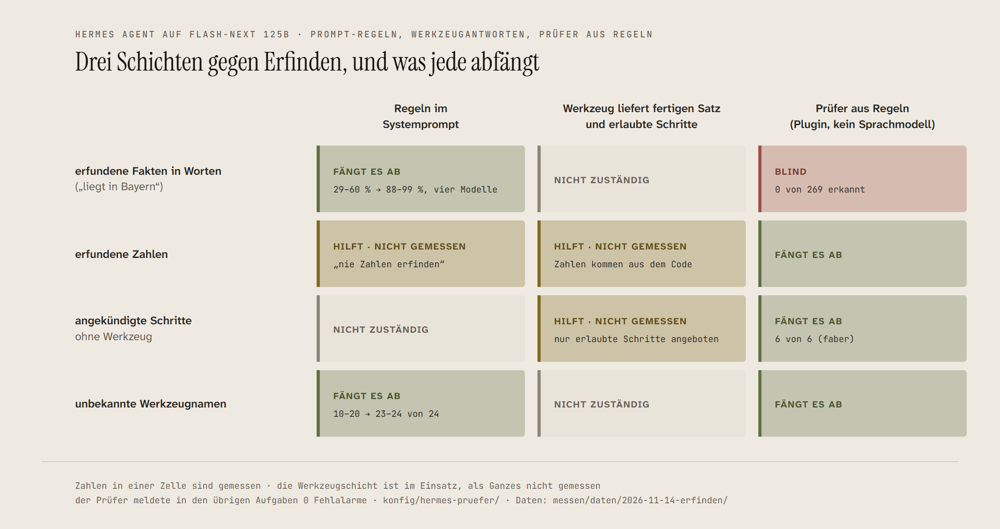

**Gegenprobe mit öffentlichen Fragensätzen (15./16.11.2026): Eine kurze Regel reicht gegen fremd Klingendes, nicht bei Befehlen.** Die vier Regeln nennen die Arten von Dingen, nach denen meine Probe fragt; deshalb die Prüfung mit Fragen, die ich nicht geschrieben habe. Eine Grundregel („Beantworte, was du weißt. Kennst du eine Sache, einen Namen oder ein Werkzeug gar nicht, sag das, statt etwas zu erfinden.“) senkt die Zahl erfundener Dinge, die das Modell als echt behandelt, von 20 auf 6 von 150 und lässt echte Fragen, wie sie sind (90 gegen 87 von 150 richtig). Eine strenge Regel mit festem „Weiß ich nicht“ halbiert die falschen Antworten (58 auf 30) und kostet einige richtige (90 auf 84). Die vier Regeln kosten doppelt so viele richtige Antworten für wenig mehr. Eine Grenze zeigte die Nachprobe mit meinen eigenen Fragen: Von 24 erfundenen Befehlsoptionen erkennt das unzensierte Modell mit der Grundregel 7, mit den vier Regeln 21 (Ortsnamen 12 gegen 22, nach Durchsicht von Hand). Für Befehle, Optionen und Orte braucht es also die ausdrückliche Nennung. Eine Kombination leistet das in einem Satz (die Grundregel plus „Das gilt besonders für Befehle, Optionen und Ortsnamen: Kennst du sie nicht sicher, sag das, auch wenn sie plausibel klingen.“): 17 von 24 Befehlsoptionen und 19 von 24 Ortsnamen, insgesamt 104 von 120 erfundenen Dingen gegen 86 mit der Grundregel und 113 mit den vier Regeln, und 91 von 150 mittelschweren Fragen richtig gegen 95 ohne Regel und 76 mit den vier Regeln. Mein Agent läuft seit dem 16.11.2026 damit.

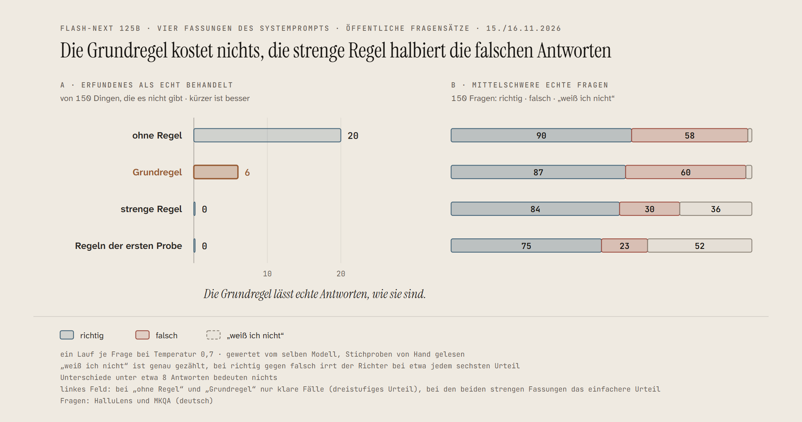

Die Messungen, die Regeln im Wortlaut und das Prüfer-Plugin: [docs/agent.de.md](docs/agent.de.md).

**Der Agent kann jedes der Modelle nutzen, auch ein unzensiertes.** Welches Modell er nimmt, ist eine Einstellung. `liber` ist dasselbe 125B-Modell, dem ein Steuervektor die Ablehnungen entfernt (Abliteration). Es beantwortet, was man es fragt, auch das, was das Originalmodell verweigert: alle 15 meiner Testaufgaben, die Modelle oft ablehnen, statt 11. Einen Filter gibt es nicht mehr; die Verantwortung liegt bei dem, der es betreibt. Aufgaben, Deutsch und Tempo bleiben gleich, und es erfindet nicht messbar mehr als das Original (25 gegen 20 von 150 Dingen, die es nicht gibt, als echt behandelt; mit einer kurzen Regel 5 gegen 6). Wie es funktioniert, die Konfiguration, alle Zahlen und was man damit auf sich nimmt: [docs/steuervektor.de.md](docs/steuervektor.de.md).

## Bilder auf derselben Karte: ComfyUI über llama-swap

Seit dem 23.10. macht die XTX auch Bilder. ComfyUI läuft als weiteres Modell in llama-swap, die Karte hält also entweder das Sprachmodell oder die Bildmodelle, nie beides, und llama-swap wechselt bei Bedarf. llama-swap hat dafür einen fertigen Zugang: Ein Modell mit genau dem Namen `comfyui_auto` wird unter `/comfyui/` bedient, und der Websocket des offenen Browser-Tabs lädt das Modell weder noch hält er es fest. Der Eintrag liegt in `konfig/comfyui/llama-swap-comfyui.yaml` (Image `yanwk/comfyui-boot:rocm`, ROCm 7.2, PyTorch 2.13, ComfyUI 0.42.1); er startet in etwa 20 Sekunden.


Modelle, Sekunden je Bild, was ich auf gfx1100 gelernt habe, und der Bild-Anbieter für den Agenten: [docs/comfyui.de.md](docs/comfyui.de.md).

## Inhalt

**Bauen**

```
  Dockerfile                    Bauweg Strata + ROCm für gfx1100
```

**Startkonfigurationen**

```
  konfig/arbeit.json            Flash-Next IQ3_XXS, 256k, Denkstufe high
  konfig/schnell.json           Flash-Next IQ2_XS
  konfig/llama-swap.yaml        ein Endpunkt, ein Modell zur Zeit, Entladen nach 30 min
  konfig/strata-0.2.1/          Startkonfigurationen und llama-swap-Makro für die fertigen 0.2.1-Pakete
  konfig/strata-0.2.2/          dieselben Startkonfigurationen, llama-swap-Makro für die fertigen 0.2.2-Pakete
  konfig/strata-0.2.3.1/        Startkonfigurationen (faber = vorher arbeit, velox = vorher schnell), llama-swap-Makro für 0.2.3.1
  konfig/comfyui/               ComfyUI: llama-swap-Eintrag, Download-Skript, Arbeitsabläufe, Bild-Anbieter für Hermes Agent
  konfig/strata-0.2.8/          Startkonfigurationen und llama-swap-Makro für 0.2.8 (Konfigurationen wie bei 0.2.3.1)
  konfig/strata-0.2.11/         Startkonfigurationen und llama-swap-Makro für 0.2.11 (Konfigurationen wie seit 0.2.3.1)
  konfig/strata-0.2.12/         Startkonfigurationen und llama-swap-Makro für 0.2.12, dazu die DFlash2-Testkonfiguration, dazu liber.json (das unzensierte Modell)
  konfig/strata-0.2.14/         Startkonfigurationen und llama-swap-Makro für das Release 0.2.14, Stand vom 18.11.2026 mit den 28 Umgebungsschaltern (prompt-schalter.json); velox läuft weiter auf diesem Release, ohne Schalter
  konfig/strata-xtx-0.2.17/     was heute läuft: Startkonfigurationen ohne Schalter und llama-swap-Makro für den Eigenbau strata-xtx auf Strata 0.2.17
  konfig/strata-xtx-0.2.16/     dasselbe für den Bau auf 0.2.16 (19. bis 20.11.2026)
  konfig/hermes-pruefer/        Plugin für Hermes Agent: prüft jede Antwort mit festen Regeln, ohne Sprachmodell
  konfig/stack/                 Chat und Websuche: Compose-Datei für Open WebUI und SearXNG, auf dem NAS getestet (EN/DE)
  konfig/opencode/              OpenCode 2 im Terminal mit den lokalen Modellen: Beispielkonfiguration und was ich gelernt habe (EN/DE)
```

**UGOS**

```
  ugos/                         nur bis UGOS 1.19 nötig; ab 1.21 siehe Hinweis unter „Was ich an UGOS ändern musste“
  ugos/firmware-sichern.sh      sichert die 15 gfx1100-Firmwaredateien auf den Datenpool
  ugos/firmware-pruefen.sh      prüft und stellt sie nach einem UGOS-Update wieder her
  ugos/amdgpu-gfx1100-restore.service   führt die Prüfung nach jedem Start aus
```

**Mess- und Hilfsskripte**

```
  messen/bench.py               Schreiben, Einlesen, Agenten-Sitzung, Qualitätsaufgaben (aufgaben.json)
  messen/identitaet.py          gleiche Prompts gierig an zwei Modelle, Vergleich zeichengenau
  messen/langprompt.py          Einlesezeit eines frischen langen Prompts
  messen/auswertung045.py       Tabelle aus den Ergebnissen
  messen/tiefe.py               Schreib- und Einlesetempo über die Kontexttiefe (1K bis 248K)
  messen/qq_llamacpp.py         llama.cpp-Gegenstück zu Stratas quant_quality.py (Top-64 je Position, teacher-forced)
  messen/qq_vergleich.py        Top-1-Übereinstimmung, KL und Perplexität zweier Läufe
  messen/visiontest.py          Bildleser auf der CPU: Testbilder, VRAM/RAM, Vergleich mit dem 27B-Bildmodell
  messen/r3177.py               Nachstellversuch für Strata-Issue #3177 (lange Agentenanfrage mit MTP)
  messen/folgetests.py          LP-E-Kerne A/B (--cpuset-cpus) und Einlesetempo frischer Engines
  messen/t020.py                Strata 0.2.0-beta, fertige hip-rx7900-Engine: Bench, Recall, Worker, Bildleser
  messen/t021.py                Strata 0.2.1: Worker-Paare, Bench, Recall, frische Engines, standard-v1
  messen/t022.py                Strata 0.2.2 gegen 0.2.1: Versionspaare, Bench, Recall, frische Engines, standard-v1, Docker-Image
  messen/dock-mitschnitt.sh     sekundengenauer Mitschnitt um ein erwartetes Dock-Ereignis (nur lesend, braucht root)
  messen/t0231.py               Strata 0.2.3.1 gegen 0.2.2: Paare, Bench, Nadeln, frische Engines, standard-v1, Docker-Image, ohne Tabellenvariable
  messen/t128.py                erster 128K-Prompt auf frischer Engine, 0.2.3.1 gegen 0.2.2 im Wechsel
  messen/t028.py                Strata 0.2.8 gegen 0.2.3.1: zuerst standard-v1, Bench, Nadeln bis 250K, Tool-Calls, Paare, frische Engines, Docker-Image
  messen/halluzination.py       Halluzinationsprobe: 5 Bereiche × 8 echte + 8 erfundene Gegenstände, ohne und mit Regeln (--regeln)
  messen/agent_de.py            Betriebsagent auf Deutsch: 9 Aufgaben je mehrfach, Urteilsaufgaben zum Nachlesen
  messen/diagramme.py           alle Diagramme in bilder/ in einem Stil (HTML/SVG-Quellen in bilder/html/, PNG über playwright)
  messen/betrieb.py             Strom an der USV, Kaltstart und Schreiblast (strom, kaltstart, last)
  messen/dicht70.py             ein dichtes Modell, das nicht in den VRAM passt, llama.cpp Vulkan, nach Schichten auf der Karte
  messen/werksmodell.py         UGREENs eingebautes Modell: der eigene Server von UGOS auf der Arc-iGPU, nur CPU, die Karte im Dock
  messen/transkodieren.sh       4K-HEVC nach 1080p-H.264 auf der Arc-iGPU (VAAPI), Bilder je Sekunde
  messen/zwei.py                zwei Personen gleichzeitig: Wartezeit und Tempo allein, zugleich, abwechselnd an zwei Modellen
```

**Rohdaten**

```
  messen/daten/                 Rohdaten: Tiefenmessung, strata_bench.py und needle_bench.py
  messen/daten/qualitaet/       die drei Läufe (gzip) und die Vergleichsergebnisse
  messen/daten/2026-10-19/      Rohdaten des Nachtrags (README im Ordner)
  messen/daten/2026-10-21/      Rohdaten samt vier standard-v1-Ergebnissen (README im Ordner)
  messen/daten/2026-10-21-v0.2.2/  Rohdaten des 0.2.2-Nachtrags (README im Ordner)
  messen/daten/dock-2026-10-21/ Auszug des Mitschnitts vom 21.10., das Mittwochsereignis auf die Minute
  messen/daten/2026-10-23-v0.2.3.1/  Rohdaten samt memory.json und 128K-Gegentest (README im Ordner)
  messen/daten/2026-10-23-bilder/  Sekunden je Bild, vier Modelle, erstes und warmes Bild
  messen/daten/2026-10-31-v0.2.8/  Rohdaten des Nachtrags zu 0.2.8, auch als Strata-PR #4851 eingereicht (README darin)
  messen/daten/2026-11-05-v0.2.11/  Rohdaten des Nachtrags zu 0.2.11, auch als Strata-Issue #5321 eingereicht (README darin)
  messen/daten/2026-11-08-v0.2.12/  Rohdaten des Nachtrags zu 0.2.12 und des DFlash2-Tests, auch als Strata-Issue #5615 eingereicht (README darin)
  messen/daten/2026-11-09-v0.2.13/  Rohdaten des Nachtrags zu 0.2.13, samt Docker-Image mit und ohne gfx1100-Tabelle auch als Strata-Issue #5666 eingereicht (README darin)
  messen/daten/2026-11-15-v0.2.14/  Rohdaten des Tests von 0.2.14: Paare gegen 0.2.12, standard-v1, strata_bench, Nadeln, frische Engines (README darin)
  messen/daten/2026-11-14-erfinden/  Zählwerte: Probe je Modell und Bereich, Nachtvergleich, Urteil mit 10 Runden
  messen/daten/2026-11-15-betrieb/  Strom, Kaltstart, NAS-Betrieb, dichtes 70B, UGREENs eingebautes Modell
  messen/daten/2026-11-16-betrieb/  Nachmessung auf Strata 0.2.14: Strom und Tempo der drei Modelle, Kaltstart, Wartezeiten, zwei Personen, Aufgabensatz
  messen/daten/2026-11-16-cloud-vergleich/  derselbe Aufgabensatz gegen Sonnet 5.5 über die API: Zählwerte je Aufgabenart, keine Texte
  messen/daten/2026-11-16-v0.2.15/  Rohdaten des Tests von 0.2.15: drei Läufe strata_bench im Wechsel mit 0.2.14, standard-v1, Paare (README darin)
  messen/daten/2026-11-18-prompt-switches/  28 Umgebungsschalter auf dem Release 0.2.14: Tempo, Aufgabensatz, Leerlauf, 90 Minuten Dauerlast, lange Prompts bis 250K auf unzensierter Fassung und Original, Abnahme nach der Übernahme (README darin)
  messen/daten/2026-11-18-strata-xtx/  Eigenbau strata-xtx auf der Basis 0.2.15: Strom, Stromvergleich gegen das Release, Kaltstart, Wartezeiten, zwei Personen, Speicher
  messen/daten/2026-11-21-strata-xtx-0.2.17/  Eigenbau strata-xtx auf der Basis 0.2.17, der heutige Stand: Prüfungen vor der Übernahme, drei Läufe strata_bench im Wechsel mit dem Release 0.2.17, Nadeln, Strom, Kaltstart, Wartezeiten, zwei Personen, Speicher; unter release-0.2.17/ der Test des unveränderten Release
  messen/daten/2026-11-19-strata-xtx-0.2.16/  Eigenbau strata-xtx auf der Basis 0.2.16: Prüfungen vor der Übernahme, drei Läufe strata_bench im Wechsel mit dem Release 0.2.16, Nadeln, Strom, Kaltstart, Wartezeiten, zwei Personen, Speicher; unter release-0.2.16/ der Test des unveränderten Release
  messen/daten/2026-11-18-unsloth-ud-iq2xs/  Unsloth UD-IQ2_XS v3.1 gegen die IQ3_XXS-Datei: Perplexität, Tempo ohne und mit Schaltern (README darin)
  messen/daten/2026-11-21-nvme-streaming/  größere Quants (UD-IQ4_XS, UD-Q4_K_XL) mit Experten von der NVMe: Tempo, Speicher, NVMe-Lesen, Aufgabensatz (README darin)
  messen/daten/2026-11-22-hy4-flash/       Tencent Hy4-Flash (220B) gegen Flash-Next: Tempo, Speicher, NVMe-Lesen, die RAM-Falle (README darin)
  messen/schalter.py            die 28 Schalter in eine Laufkonfiguration eintragen, herausnehmen, prüfen (Stand 18.11., für das unveränderte Release)
  messen/schalter_pruefen.py    kennt eine Engine die 28 Namen noch? Prüfung für jedes Release, ohne Karte
  messen/daten/2026-11-16-speicher/  Speicherbelegung von Original und unzensierter Fassung auf 0.2.14
  messen/daten/tiefe-20261121.jsonl  Tempo über die Kontexttiefe auf dem Eigenbau (0.2.17), Original, unzensierte Fassung und Original ohne MTP-Kopf (19.11. auf 0.2.16: tiefe-20261119.jsonl, 18.11. auf 0.2.15: tiefe-20261118.jsonl)
  messen/daten/tiefe-20261116.jsonl  Tempo über die Kontexttiefe auf dem Release 0.2.14, mit und ohne MTP-Kopf (Oktober: tiefe-20261017.jsonl)
```

**Dokumentation und Diagramme**

```
  docs/                         jede Version im Einzelnen, die Dock-Untersuchung, der Agenten-Nachtrag, das unzensierte Modell, ComfyUI (EN/DE)
  bilder/                       die Diagramme als PNG, ihre HTML/SVG-Quellen in bilder/html/
  web/                          baut die Seiten faf.net/lokale-ki und faf.net/local-ai aus diesem Repo (bau.py), mit selbst ausgelieferten Schriften
```

Die Messskripte sprechen nur `/v1/chat/completions` an, laufen mit der Standardbibliothek von Python und lesen
VRAM, GPU-Last, Leistung und RAM aus sysfs mit (`KARTE` in `bench.py` auf die eigene Karte setzen). Die
Code-Aufgaben laufen in einem Wegwerf-Container ohne Netz.

`liber`, `faber` und `velox` sind die Namen der drei Fassungen hier (unzensiert, Original IQ3_XXS, IQ2_XS; in Dateien bis 0.2.2 heißen faber und velox `arbeit` und `schnell`).

## Lizenz

MIT für die Dateien hier, siehe `LICENSE`. Strata selbst steht unter seiner eigenen Lizenz im Upstream-Repo.
