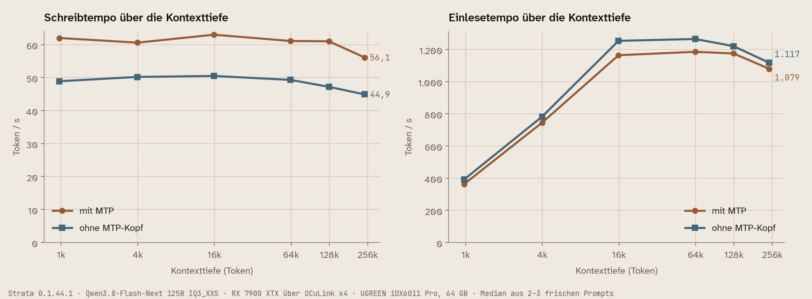
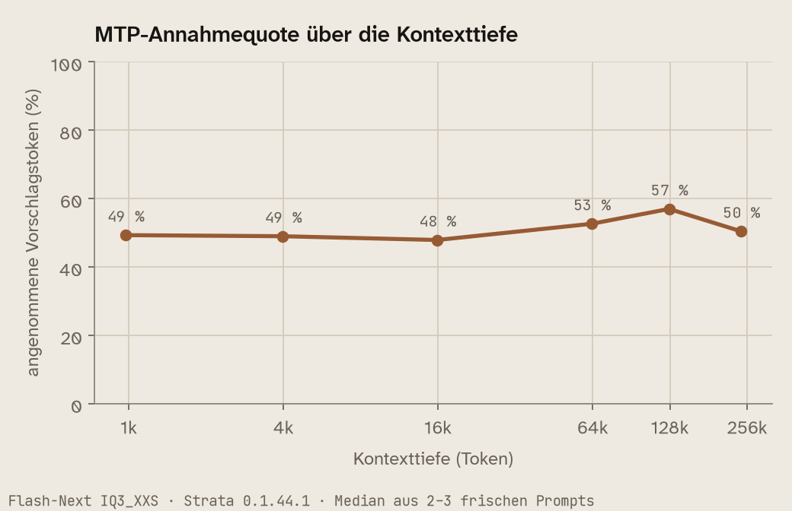
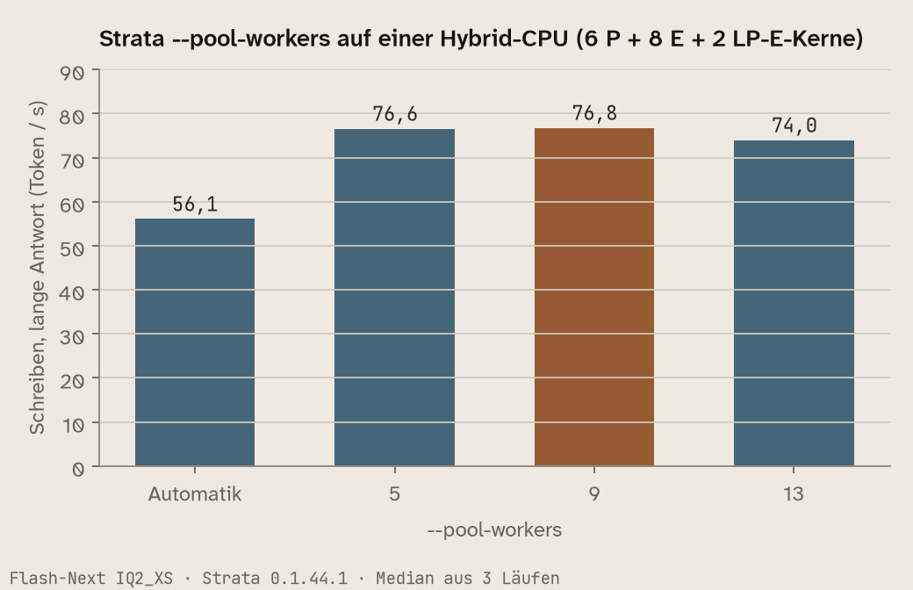

# UGREEN iDX6011 Pro + eGPU-Dock + Radeon RX 7900 XTX: ein 125B-Sprachmodell auf dem NAS

[English](README.md) · **Deutsch**

Ein Erfahrungsbericht mit den Dateien, die dafür nötig sind: Wie ich **Qwen3.8-Flash-Next (125B, Mixture of
Experts)** mit **63–68 Token/s und 256k Kontext** auf einem UGREEN iDX6011 Pro betreiben. Die Radeon RX 7900 XTX
steckt dabei im OCuLink-eGPU-Dock von UGREEN. Gerechnet wird mit [Strata](https://github.com/Niko1221/Strata)
(ROCm/HIP) hinter [llama-swap](https://github.com/mostlygeek/llama-swap). Dasselbe NAS liefert nebenbei weiter
Fotos, Medien und Backups.

Alle Werte sind auf meiner Maschine gemessen, sofern nicht anders vermerkt. Das Repo enthält **keinen
Strata-Code**, nur Bauweg, Startkonfigurationen, UGOS-Anpassungen, Hilfsskripte und Messprogramme.

## Die Kombination

```
  UGREEN iDX6011 Pro      UGOS Pro 1.19 (Debian-12-Basis, Kernel 6.18.15)
  │                       64 GB LPDDR5X · Hybrid-CPU (P- und E-Kerne) · 2× 10 GbE · 2× Thunderbolt 4
  │                       eingebaute Intel-Arc-iGPU → Transkodierung, Bilderkennung
  │
  │  OCuLink, PCIe 4.0 x4 (der Host-Port kann höchstens x4 / 16 GT/s ≈ 7,9 GB/s)
  ▼
  UGREEN LinkStation eGPU-Dock   eigenes 850-W-Netzteil
  └─ AMD Radeon RX 7900 XTX      24 GB VRAM, Navi 31 / gfx1100, im Dock mit x16 angebunden
       └─ Strata (ROCm 7.10 aus AMDs TheRock-Wheels), ein Modell zur Zeit über llama-swap
            └─ Qwen3.8-Flash-Next 125B MoE · IQ3_XXS (ISTA-DASLab) · int8-KV · MTP-Kopf · 256k
```

**Warum ein 125B-Modell auf eine 24-GB-Karte passt:** Flash-Next ist ein Mixture-of-Experts-Modell, pro Token
rechnen nur wenige Experten. Strata hält die häufig gebrauchten Experten im VRAM und den Rest im RAM. Fehlende
Experten rechnet die CPU, statt sie über die x4-Strecke zu kopieren. Möglich macht das der schnell angebundene
LPDDR5X der iDX: Das Modell belegt rund 53 GiB der 64 GB. Ein dichtes 70B-Modell wäre auf derselben Hardware
langsam (geschätzt 3–5 T/s), weil es pro Token alle Gewichte lesen muss.

**Zwei GPUs, sauber getrennt:** Die Arc-iGPU (`renderD128`) erledigt die Medien, die XTX (`renderD129`) rechnet
nur Sprachmodelle. Wer `/dev/dri` pauschal an einen Mediencontainer durchreicht, riskiert, dass er sich die
Dock-Karte greift. Geräte je Container ausdrücklich zuordnen.

## Gemessen

Alle Werte mit `messen/bench.py`, jeweils Median aus 3 Läufen.

| | Ollama, Qwen3.8 27B | **Strata, Flash-Next IQ3_XXS** | Strata, Flash-Next IQ2_XS |
|---|---|---|---|
| Schreiben, lange Antwort | 31,2 T/s | **63–68 T/s** | 76,5 T/s |
| 32.000 Token einlesen | 42,7 s | **25–26 s** | 24,0 s |
| Agenten-Sitzung, 6 Runden Programmieren | 162,5 s | **48–54 s** | 35,7 s |
| Kontext | 64k | **256k** (mit 249.928 Token getestet) | 256k |
| RAM der ganzen Maschine | 21,7 GiB | 53,4 GiB | 48,9 GiB |
| Leistung der Karte beim Schreiben | 322 W | 283 W | 288 W |
| Qualität laut Quantisierer | – | 99,4 % des vollen Modells | 95,7 % |

Karte im Leerlauf ohne geladenes Modell: rund 9 W, 44–51 °C.

### Tempo über die Kontexttiefe (1K bis 248K)

Je Lauf ein frischer Prompt, danach 256 neue Token; Zeiten der Engine, Median aus 2–3 Läufen. „Ohne MTP-Kopf“ ist
dieselbe Konfiguration ohne `--mtp` (ein natives Pack braucht weiter `--spec`, bekommt aber kaum Vorschläge).



| Prompt-Token | Schreiben mit MTP | Schreiben ohne MTP-Kopf | Einlesen mit MTP | Einlesen ohne MTP-Kopf | MTP-Annahme |
| ---: | ---: | ---: | ---: | ---: | ---: |
| 993 | 62,0 | 48,9 | 362 | 391 | 49 % |
| 4.075 | 60,6 | 50,2 | 745 | 782 | 49 % |
| 16.252 | 63,0 | 50,5 | 1.164 | 1.253 | 48 % |
| 65.023 | 61,1 | 49,3 | 1.185 | 1.265 | 53 % |
| 130.024 | 61,0 | 47,2 | 1.175 | 1.220 | 57 % |
| 248.052 | 56,1 | 44,9 | 1.079 | 1.117 | 50 % |

Das Schreibtempo fällt mit der Tiefe kaum (mit MTP 62 → 56 T/s bis 248K), MTP bringt in jeder Tiefe 21–29 %, das
Einlesen bleibt ab 16K bei 1.080–1.270 T/s, über die x4-Strecke. **Recall** (Stratas `needle_bench.py`): Das
Codewort wurde bei 32K, 128K und 250K in 10, 50 und 90 % Tiefe 9 von 9 Mal gefunden.



### Kostet Strata Qualität? Strata gegen llama.cpp auf derselben Datei

Dieselbe GGUF-Datei (Flash-Next IQ3_XXS), derselbe feste Textsatz aus Stratas `tools/quant_quality.py` (Code,
Doku, Englisch, andere Sprachen, ein Agentenprotokoll; 4.995 Positionen, teacher-forced). Strata über
`quant_quality.py run`, llama.cpp (Build 11610, Vulkan, Experten auf der CPU) Position für Position über
`llama-server` (`messen/qq_llamacpp.py`, gleiches Ausgabeformat), verglichen mit `messen/qq_vergleich.py`:

| Vergleich | gleiches Top-Token | KL Mittel | KL Median | KL p99 | Perplexität |
| --- | ---: | ---: | ---: | ---: | --- |
| llama.cpp gegen Strata (Experten auf der CPU) | **95,7 %** | 0,020 | 0,0017 | 0,27 | 4,009 gegen 4,017 |
| llama.cpp gegen Strata (Experten auf der GPU) | 95,7 % | 0,020 | 0,0017 | 0,34 | 4,009 gegen 4,019 |
| Stratas CPU-Pfad gegen seinen GPU-Pfad | 95,7 % | 0,018 | 0,0017 | 0,27 | – |

**Strata kostet gegenüber llama.cpp keine messbare Qualität:** Der Unterschied ist so groß wie der zwischen Stratas
eigenen CPU- und GPU-Kernels, also Rechenrauschen. Zum Maßstab: Laut Strata-Doku liegt IQ3_XXS gegen Q8_0 bei
84,5 % und KL 0,20 – die Quantisierung kostet Qualität, die Engine nicht. Grenzen: Perplexität über die 4.982
Positionen, an denen llama.cpp den exakten Wert lieferte (Ziel unter seinen Top-4000); Stratas Prüfwerkzeug rechnet
mit FP16-KV ohne MTP-Vorschläge, der Einfluss von int8-KV ist also nicht erfasst; ein Textsatz.

### Strata-Einstellungen, die messbar etwas bringen

| Einstellung | Wert | Wirkung |
|---|---|---|
| `--pool-workers` | 9 bis 0.2.0, **ab 0.2.1 weglassen** | bis 0.2.0: 76,8 statt 56,1 T/s gegenüber der Automatik (gemessen mit IQ2_XS); 0.2.1 plant selbst 10 Worker und lässt die LP-E-Kerne frei |
| `--pcie-frac` | 0 | fehlende Experten rechnet die CPU, statt sie über x4 zu kopieren; kein Tempoverlust, schont den Link |
| `--kv` | int8 | halbiert den KV-Cache, 256k Kontext passen |
| `--max-context` | 262144 | trainiertes Maximum; 250k Token in rund 4 min eingelesen |
| `--mtp` | MTP-Kopf | Vorschlagstoken beschleunigen das Schreiben |
| `--conversation-cache-mib` | 4608 | parkt eine Sitzung bis ~120.000 Token, während eine andere Anfrage läuft (geparkt in 0,16 s, zurück in 0,06 s) |
| `STRATA_HIPBLASLT_TUNING` | `tools/hip/gfx1100-hipblaslt-100200.txt` | muss zur hipBLASLt-Version passen, sonst ~45 % langsameres Einlesen |
| Quantisierung | IQ3_XXS statt IQ3_S | 53 statt 60 GiB RAM; IQ3_S lässt neben den übrigen NAS-Diensten keinen Platz |



### Strata 0.1.44.1 gegen 0.1.45 (17.10.2026)

Für Flash-Next auf gfx1100 kein messbarer Unterschied, alle Werte im Rauschen:

| Variante | lang T/s | 8k einlesen T/s | 32k einlesen s | Agent s |
|---|---|---|---|---|
| 0.1.44.1 | 65,5 | 1.175 | 26,0 | 52,6 |
| 0.1.45 | 63,5 | 1.151 | 26,3 | 53,7 |
| 0.1.45 `--pool-affinity p-cores` | 61,0 | 1.134 | 27,2 | 48,1 |
| 0.1.45 `--pool-affinity measure` | 62,5 | 1.111 | 26,7 | 49,5 |
| 0.1.45 `STRATA_CPU_IQ_ALL_EXACT1=1` | 61,4 | 1.143 | 26,8 | 49,8 |

Langer Prompt (103.341 Token, frisch): 87,7 s · 88,1 s · mit `STRATA_SCORES_THREAD=1` 85,3 s. Gierige Antworten
(temperature 0) sind zwischen den Versionen **nicht** byte-identisch, inhaltlich aber gleich. `STRATA_HIP_WMMA`
gilt nur für gfx12.

### Nachtrag 19.10.2026: Strata 0.2.0-beta, Bilder und drei Prüfungen für das Strata-Team

**Die fertig gebaute RX-7000-Engine von 0.2.0-beta läuft auf dieser Karte.** Laut Release ist das Paket `hip-rx7900` nur kompiliert und auf keiner echten RX 7000 gelaufen. Hier lief es auf der XTX, mit denselben Gewichten, Packs und Einstellungen wie `arbeit`. `strata_bench.py --long` ergab 61,3 tok/s beim Schreiben im Chat, 741 / 1.207 / 1.223 tok/s beim Einlesen von 4K / 16K / 32K und 68,6 % Cache-Treffer in der Agentensitzung, also dasselbe wie 0.1.44.1. Recall war 9/9 bis 250K, unser Aufgabensatz kam auf 27 von 29. Der Betrieb bleibt auf 0.1.44.1, weil die neue Version hier nichts Messbares bringt.

| | 0.1.44.1 (17.10.) | 0.2.0-beta `hip-rx7900` |
|---|---:|---:|
| Schreiben im Chat (`strata_bench --long`) | 63,7 | 61,3 tok/s |
| Einlesen 4K / 16K / 32K | 741 / 1.195 / 1.224 | 741 / 1.207 / 1.223 tok/s |
| Recall 32K / 128K / 250K | 9/9 | 9/9 |
| neue Standard-Workerzahl von 0.2.0 (hier 15) | – | 39,8 / 41,2 tok/s statt 59,7 / 64,0 mit `--pool-workers 9` |

**Auf einer Hybrid-CPU `--pool-workers` behalten.** 0.2.0 plant einen Worker je physischem Kern außer dem des Hosts. Auf der 255H sind das 15, und damit war es ein Drittel langsamer als mit 9. Außerdem hält Strata die zwei LP-E-Kerne (unter Linux `cpu_lowpower`, ohne L3) für P-Kerne und belegt sie früh. Auf CPU 0–13 begrenzt, las der Container kurze Prompts rund 40 % schneller (66 → 94 tok/s bei 63 Token); das Schreibtempo blieb gleich.

**Bilder direkt ins 125B-Modell.** Flash-Next hat einen eigenen Bildleser (mmproj, 907 MB). Auf der CPU (`--vision cpu`) kostet er keinen VRAM und rund 1 GiB RAM. Alle Testbilder hat er richtig gelesen, in 1,2–5 s je Bild. Unsere Engine 0.1.44.1 kann das schon, sobald `tools/vision` gebaut ist (`-DSTRATA_VISION_CUDA=OFF`). 0.2.0 nimmt auf 24-GB-Karten standardmäßig den GPU-Leser. Auf der XTX kostet der 776 Expertenslots (1,28 GiB), ein großes Bild dauert dafür 3,5 s statt 5,6 s. Wer aktualisiert und diesen Tausch nicht will, setzt `--vision cpu` ausdrücklich.

**Strata-Issue #3177** (MTP-Verify-Timeout auf einer einzelnen 7900 XTX bei ~54K Token) lässt sich hier nicht nachstellen. 6 von 6 Agentenanfragen mit 55.019 Token und je 2.500 Token Antwort liefen durch, auf 0.1.45 und 0.1.44.1, mit und ohne MTP-Kopf.

**Frische Engines.** Laut 0.2.0-Release liest auf der R9700 etwa jede zweite frische Engine mit MTP Prompts 10–23 % langsamer. Hier: Eine von 24 frischen 0.2.0-Engines las beide 4K-Prompts rund 38 % langsamer (420 statt etwa 675 tok/s), mit 0.1.44.1 keine von 24. Die Startzeilen der langsamen Engine glichen denen der anderen. Auf gfx1100 kommt es also auch vor, aber selten.

Skripte: `messen/visiontest.py`, `messen/r3177.py`, `messen/folgetests.py`, `messen/t020.py`. Rohdaten: `messen/daten/2026-10-19/`.

### Nachtrag 21.10.2026: Strata 0.2.1, jetzt hier im Betrieb

**Der Fix für die Hybrid-CPU aus Strata-Issue #3262 wirkt.** 0.2.1 zählt die zwei LP-E-Kerne (`cpu_lowpower`) als Effizienzkerne. Ohne `--pool-workers` plant es 10 Worker auf CPU 1–10 und lässt CPU 14/15 frei, das Setup im Docker-Image schreibt ebenfalls 10. Gemessen in 3 verschränkten Paaren, je Lauf eine frische Engine:

| | Schreiben tok/s | Prompt mit 63 Token, tok/s |
|---|---:|---:|
| 0.1.44.1, `--pool-workers 9` (zwei davon auf den LP-E-Kernen) | 63,3 | 66,1 |
| 0.2.1, `--pool-workers 9` (CPU 1–9) | 61,5 | 88,0 |
| **0.2.1 Standard, 10 Worker** | **61,1** | **97,6** |

Alles andere bleibt wie bisher: `strata_bench.py --long` 65,9 tok/s beim Schreiben, 742 / 1.204 / 1.210 tok/s bei 4K / 16K / 32K, Recall 6/6 bis 128K, unser Aufgabensatz 28 von 29, 8 von 8 frischen Engines normal schnell. Beide Verpackungsfehler aus #3263 sind in 0.1.46 behoben. **Seit 21.10. läuft dieses NAS mit den fertigen Release-Paketen** (Engine 0.1.46 `hip-rx7900`, Control 0.1.46.2) und ohne `--pool-workers`. Konfigurationen und das llama-swap-Makro liegen in `konfig/strata-0.2.1/`.

**Das Docker-Image `ghcr.io/niko1221/strata:0.2.1-rocm-gfx110x` läuft auf der XTX.** Laut Release war es gebaut, aber auf keiner Karte gestartet. Sein unveränderter `strata bench run --suite standard-v1 --track default` ist vollständig, 12/12 Prüfungen. Mit seinen eigenen Voreinstellungen liest es lange Prompts aber langsamer als unsere Konfiguration: 3 Slots, GPU-Bildleser, 128K, 700 MiB Reserve und keine hipBLASLt-Tabelle ergeben 772 tok/s bei 16K. **Die gfx1100-Tabelle liegt im Paket, ist in 0.2.1 aber nur Opt-in. Sie bringt +23 % bei 4K und +60 % bei 16K** (`STRATA_HIPBLASLT_TABLE=on` → 1.238 tok/s). Wer das Image nutzt, sollte sie setzen.

| `standard-v1`, Median aus 3, tok/s | kurz Prompt / Schreiben | 4K Prompt / Schreiben | 16K Prompt / Schreiben |
|---|---:|---:|---:|
| Docker-Image, Voreinstellungen | 43,3 / 58,9 | 605,4 / 55,9 | 772,0 / 55,0 |
| + `PARALLEL=1` | 57,8 / 63,7 | 623,9 / 59,3 | 773,8 / 58,7 |
| + `PARALLEL=1 STRATA_HIPBLASLT_TABLE=on` | 60,4 / 65,8 | 768,3 / 62,4 | 1.238,5 / 69,3 |
| Release-Pakete mit `konfig/strata-0.2.1/arbeit.json` | 51,7 / 69,0 | 743,9 / 63,5 | 1.236,7 / 62,5 |

An Strata gemeldet in #3262, #3263 und PR #2904, die Ergebnisse liegen dort mit. Skript: `messen/t021.py`. Rohdaten: `messen/daten/2026-10-21/`.

### Nachtrag 21.10.2026, abends: Strata 0.2.2, ebenfalls im Betrieb

0.2.2 (Engine 0.1.47 `hip-rx7900`, Control 0.1.47) ändert an der Geschwindigkeit dieser Kombination nichts, macht sie aber robuster: Tool-Aufrufe mit falsch geschriebener Einleitung werden als Aufruf erkannt, ein NaN im langen Prompt bricht die Anfrage nicht mehr ab, ein seltener Hänger im ersten Verify-Fenster auf HIP ist behoben. Gemessen gegen die 0.2.1-Pakete mit derselben Startkonfiguration, nur Engine und Control getauscht:

| Median tok/s | 0.2.2 | 0.2.1 |
|---|---:|---:|
| 3 verschränkte Paare: Schreiben / 63-Token-Prompt | 62,1 / 93,6 | 60,5 / 93,9 |
| `strata_bench.py --long`: Chat / Agent Schreiben | 66,0 / 72,5 | 65,9 / 74,6 |
| Einlesen 4K / 16K / 32K | 736 / 1.211 / 1.222 | 742 / 1.204 / 1.210 |

Recall 6/6 bis 128K, 8 von 8 frischen Engines normal schnell, unser Aufgabensatz 28 von 29 (der eine Fehlschlag ist ein Fehlalarm der Prüfung: Die Phishing-Mail wurde geschrieben, mit einem Hinweis davor). **`strata bench run` aus dem Release-Paket ist jetzt vollständig („complete“)**, weil dem Control-Archiv eine `COMMIT`-Datei beiliegt. Das Docker-Image `0.2.2-rocm-gfx110x` läuft ebenfalls, mit denselben langsamen Voreinstellungen wie 0.2.1 (700 MiB Reserve, keine hipBLASLt-Tabelle, 16K mit 781 tok/s), der Rat oben gilt also weiter. **Seit dem Abend des 21.10. läuft dieses NAS mit 0.2.2.** Die Konfigurationen sind unverändert, nur das Makro bindet die neuen Pakete ein (`konfig/strata-0.2.2/`). Skript: `messen/t022.py`. Rohdaten: `messen/daten/2026-10-21-v0.2.2/`. Gemeldet in #3263 und PR #2904.

## Dock und Anbindung: was man wissen muss

- **OCuLink ist nicht hot-plug-fähig.** Erst das Dock einschalten, dann das NAS starten. Die Karte wird nur beim
  Start erkannt. Das hat mich den ersten Abend gekostet, UGREEN hat es auf Nachfrage bestätigt.
- **Nur ein Kabel.** Mit OCuLink und Thunderbolt gleichzeitig wurde gar nichts erkannt.
- **x4, nicht x16.** Der Host-Port meldet `LnkCap` x4 bei 16 GT/s. Für Inferenz unkritisch, beim Laden großer
  Modelle spürbar.
- **Keine Leistungssteuerung am Port** (`PwrCtrl-`). Das System kann das Dock nicht stromlos schalten,
  `/sys/bus/pci/slots/*/power` trainiert nur den Link neu. Nach einigen Abrissen kam die Karte nach 22–47 s von
  selbst zurück (sieht aus wie ein Neustart des Docks), nach einem anderen blieb sie bis zum nächsten Neustart weg.
- **Abrisse (Ursache noch in Untersuchung):** Jeder beginnt mit PCIe-Empfangsfehlern, 50 ms später folgt
  „Link Down“, die Karte im Leerlauf und kühl. Bei 5 von 7 Ereignissen verlor im selben Moment die
  10-GbE-Netzwerkkarte an einem anderen PCIe-Zweig ihren Link. Das spricht für eine elektrische Störung, nicht für
  die Karte. Die USV ist als Ursache ausgeschlossen.
- **PCIe-Quirk:** Nach einem Abriss klemmte der Kernel den Link auf 2,5 GT/s und konnte ihn nicht neu trainieren.
  Die Korrektur („Always lift 2.5GT/s restriction“) steckt in 6.18.39, UGOS hat 6.18.15.

## Das größte offene Risiko: Ein Dock-Abriss startet das NAS neu

Verliert das Dock die Verbindung, während ein ROCm-Modell geladen ist, baut `amdgpu` unter Kernel 6.18 die
Rechen-Warteschlangen ab, obwohl sie noch benutzt werden (`kfd_device_queue_manager.c … uninitialize`). Es folgt
ein Kernel-Oops. UGOS setzt `kernel.panic_on_oops=1` und `kernel.panic=3`, also startet das ganze NAS 3 Sekunden
später neu. Bei mir dreimal reproduziert. Upstream behoben mit Linux `6cca686dfce7` (7.0) und `81665e35f143` (7.1).

**Meine Gegenmaßnahme:** llama-swap entlädt das Modell nach 30 Minuten Leerlauf (`globalTTL: 1800`). Ohne
geladenes Modell übersteht die iDX einen Abriss, die Karte ist dann aber bis zum nächsten Neustart weg.

## Was ich an UGOS ändern musste

| # | Problem | Lösung |
|---|---|---|
| 1 | UGOS liefert **keine Firmware für Navi 31** (gfx1100), auch nicht in 1.19. `amdgpu` endet mit `Fatal error during GPU init` | 15 Dateien aus Debians `firmware-amd-graphics` (20250410) nach `/lib/firmware/amdgpu/` kopieren: `gc_11_0_0_{imu,me,mec,mes,mes1,mes_2,pfp,rlc,rlc_1}.bin`, `psp_13_0_0_{sos,ta}.bin`, `smu_13_0_0.bin`, `sdma_6_0_0.bin`, `vcn_4_0_0.bin`, `dcn_3_2_0_dmcub.bin`. Sie überlebten das Update auf 1.19 (UGOS arbeitet mit einem Overlay). Sicherheitsnetz: `ugos/` |
| 2 | UGOS setzt systemweit `GODEBUG=tlskyber=0`, Go-Programme ab Go 1.24 (z. B. llama-swap) brechen sofort ab | in der systemd-Unit `Environment=GODEBUG=` |
| 3 | Container sehen die Karte nicht | `--device /dev/kfd --device /dev/dri --group-add video --group-add render` (bei mir gid 44 und 105) |
| 4 | `docker --device` verträgt keinen Doppelpunkt (`/dev/dri/by-path/pci-0000:…`); einen umbenannten Render-Knoten findet Vulkan nicht und rechnet still auf der CPU | Pfad vorher auflösen, Namen beibehalten |
| 5 | Meldungsflut `init_user_pages: Failed to get user pages: -1` (rund 15.000 Zeilen je Modellstart) | harmlos, Folge von mmap auf btrfs/LVM; bei llama.cpp vermeidet `--no-mmap` sie |
| 6 | `/volume1` wird erst rund 41 s nach `local-fs.target` eingehängt | Units, die dort etwas brauchen, warten selbst (siehe `ugos/amdgpu-gfx1100-restore.service`) |
| 7 | `network-online.target` meldet sich, bevor das Netz nutzbar ist | CIFS-Mounts und Dienste mit fester Adresse warten selbst auf Adresse und Port |
| 8 | Neue Ordner unter `/volume1/docker` erben eine ACL, die Container trotz `rwxrwxrwx` aussperrt | Rechte und Besitzer ausdrücklich setzen |
| 9 | UGOS schreibt die Firewall gelegentlich neu, eigene Regeln in `DOCKER-USER` verschwinden | Regeln per Timer neu setzen |
| 10 | Journal auf 50 MB begrenzt, reicht nur gut eine Stunde zurück | für Fehlersuche eigene Mitschnitte |
| 11 | Nicht-interaktive SSH-Sitzungen haben kein `/sbin` im PATH, `modinfo` fehlt | ein `command not found` ist kein Negativbefund |

Was UGOS gut macht: Watchdog, ein lesbarer Grund für den letzten Neustart, pstore für Absturzprotokolle, ein
NUT-Server für die USV. Version 1.19 brachte Kernel 6.18 und rund 700 amdgpu-Firmwaredateien.

## Ein Agent (Hermes) obendrauf

- Pro Modell `context_length` im Agenten eintragen (256k), sonst rechnet er mit einem kleineren Fenster.
- `sendLoadingState: false` in llama-swap, sonst landen Ladehinweise im Denkteil der Antwort.
- Bei hoher Denkstufe immer ein Token-Budget setzen, bei schweren Code-Aufgaben denkt das Modell sonst endlos.
- Läuft nebenher eine zweite Anfrage (z. B. ein Prüfer für Befehle), verdrängt jede den Gesprächsspeicher, und
  jede lange Sitzung wird danach neu eingelesen. Der Gesprächsparkplatz von Strata (`--conversation-cache-*`) löst
  das.

## Bauen

```bash
docker build -t strata-hip:v0.1.45 --build-arg STRATA_REF=v0.1.45 .
```

Auf dem Rechner bauen, auf dem es läuft: llama.cpp und die Engine werden für die CPU des Bau-Rechners optimiert.
Das Image ist rund 21 GB groß, davon etwa 11 GB ROCm aus AMDs TheRock-Wheels (7.10.0a20251120, Index
`gfx110X-dgpu`). Die Kompilierung selbst dauerte 83 s, das Herunterladen dauert länger.

**Zwei Fallen, die das Dockerfile umgeht:**

1. `rocm-sdk path --root` muss einmal laufen, bevor CMake die ROCm-Wurzel sieht. Der Aufruf packt die
   Entwicklerdateien aus, darunter `lib/cmake/hip-lang`. Ohne ihn scheitert `enable_language(HIP)` mit
   „does not contain the HIP runtime CMake package“. `setup.py` erledigt das still, ein reiner CMake-Bau nicht.
2. Die Engine muss ausführbar sein. Bei einem früheren Handbau lag sie mit Rechten `----------` im Baum.

## Starten

Modelle, Packs und MTP-Kopf legt Strata selbst an (`setup.py`), sie kommen per Bind-Mount nach `/strata/data`.
Startkonfigurationen in `konfig/`, ein llama-swap-Beispiel in `konfig/llama-swap.yaml`. In `allowed_hosts` die
Namen eintragen, unter denen der Server angesprochen wird (Strata prüft den Host-Header gegen DNS-Rebinding).

## Inhalt

```
  Dockerfile                    Bauweg Strata + ROCm für gfx1100
  konfig/arbeit.json            Flash-Next IQ3_XXS, 256k, Denkstufe high
  konfig/schnell.json           Flash-Next IQ2_XS
  konfig/llama-swap.yaml        ein Endpunkt, ein Modell zur Zeit, Entladen nach 30 min
  ugos/firmware-sichern.sh      sichert die 15 gfx1100-Firmwaredateien auf den Datenpool
  ugos/firmware-pruefen.sh      prüft und stellt sie nach einem UGOS-Update wieder her
  ugos/amdgpu-gfx1100-restore.service   führt die Prüfung nach jedem Start aus
  messen/bench.py               Schreiben, Einlesen, Agenten-Sitzung, Qualitätsaufgaben (aufgaben.json)
  messen/identitaet.py          gleiche Prompts gierig an zwei Modelle, Vergleich zeichengenau
  messen/langprompt.py          Einlesezeit eines frischen langen Prompts
  messen/auswertung045.py       Tabelle aus den Ergebnissen
  messen/tiefe.py               Schreib- und Einlesetempo über die Kontexttiefe (1K bis 248K)
  messen/charts.py              die Charts in bilder/ (helles Workbench-Design)
  messen/daten/                 Rohdaten: Tiefenmessung, strata_bench.py und needle_bench.py
  messen/qq_llamacpp.py         llama.cpp-Gegenstück zu Stratas quant_quality.py (Top-64 je Position, teacher-forced)
  messen/qq_vergleich.py        Top-1-Übereinstimmung, KL und Perplexität zweier Läufe
  messen/daten/qualitaet/       die drei Läufe (gzip) und die Vergleichsergebnisse
  messen/visiontest.py          Bildleser auf der CPU: Testbilder, VRAM/RAM, Vergleich mit dem 27B-Bildmodell
  messen/r3177.py               Nachstellversuch für Strata-Issue #3177 (lange Agentenanfrage mit MTP)
  messen/folgetests.py          LP-E-Kerne A/B (--cpuset-cpus) und Einlesetempo frischer Engines
  messen/t020.py                Strata 0.2.0-beta, fertige hip-rx7900-Engine: Bench, Recall, Worker, Bildleser
  messen/daten/2026-10-19/      Rohdaten des Nachtrags (README im Ordner)
  messen/t021.py                Strata 0.2.1: Worker-Paare, Bench, Recall, frische Engines, standard-v1
  messen/daten/2026-10-21/      Rohdaten samt vier standard-v1-Ergebnissen (README im Ordner)
  konfig/strata-0.2.1/          Startkonfigurationen und llama-swap-Makro für die fertigen 0.2.1-Pakete
  messen/t022.py                Strata 0.2.2 gegen 0.2.1: Versionspaare, Bench, Recall, frische Engines, standard-v1, Docker-Image
  messen/daten/2026-10-21-v0.2.2/  Rohdaten des 0.2.2-Nachtrags (README im Ordner)
  konfig/strata-0.2.2/          dieselben Startkonfigurationen, llama-swap-Makro für die fertigen 0.2.2-Pakete
```

Die Messskripte sprechen nur `/v1/chat/completions` an, laufen mit der Standardbibliothek von Python und lesen
VRAM, GPU-Last, Leistung und RAM aus sysfs mit (`KARTE` in `bench.py` auf die eigene Karte setzen). Die
Code-Aufgaben laufen in einem Wegwerf-Container ohne Netz.

## Lizenz

MIT für die Dateien hier, siehe `LICENSE`. Strata selbst steht unter seiner eigenen Lizenz im Upstream-Repo.
