# UGREEN iDX6011 Pro + eGPU dock + Radeon RX 7900 XTX: a 125B LLM on a NAS

**English** · [Deutsch](README.de.md)

> [!TIP]
> **The short, illustrated version of this report: [faf.net/local-ai](https://faf.net/local-ai/)**
> One page with the setup, the charts and the key numbers. This README is the full version with every measurement and file.

A field report with working files: how I run **Qwen3.8-Flash-Next (125B, Mixture of Experts)** at **63–68
tokens/s with a 256k context** on a UGREEN iDX6011 Pro NAS, with a Radeon RX 7900 XTX in UGREEN's OCuLink eGPU
dock, using [Strata](https://github.com/Niko1221/Strata) (ROCm/HIP) behind
[llama-swap](https://github.com/mostlygeek/llama-swap). The same NAS keeps serving photos, media and backups.

Everything here was measured on my machine unless marked otherwise. This repository contains **no Strata code**,
only the build recipe, launch configs, UGOS fixes, helper scripts and benchmark tools.

**As of 19 Nov 2026:** [strata-xtx](https://github.com/faf-net/strata-xtx), a build of my own of Strata 0.2.16 that carries the [switches for prompt reading](docs/schalter.md) in its code (in production since 19 Nov; from 18 Nov the same own build on the base of 0.2.15, before that Strata 0.2.14 from the release packages), UGOS Pro 1.21, kernel 6.18.15. In configs, scripts and file names the three versions of the model go by short names. `liber` is Flash-Next 125B in the IQ3_XXS quantization with the refusals removed, the uncensored version: the same weights, it answers whatever it is asked ([docs/steuervektor.md](docs/steuervektor.md)). It is the one in daily use, for chat and agent. `faber` is the original, which is measured first and kept as the fallback. `velox` is the same model in the smaller and faster IQ2_XS quantization, now measured only for comparison. In this report "own build" always means strata-xtx and "release" the unchanged Strata.

## At a glance

| | |
|---|---|
| Writing | 63–68 tokens/s; 54–59 right after a fresh long prompt |
| Reading a prompt | 2,300–3,000 tokens/s from 16K on with [my own build](#my-own-build-strata-xtx-the-prompt-reading-switches-in-the-code): 22 s for 65K tokens, 1.4 min for 248K (release 0.2.16: 1,200–1,400 tokens/s, 3.4 min for 248K) |
| Context | 256K, the needle was found 7 of 7 times up to 250K with both versions |
| Memory | 55–58 GiB of the 64 GB RAM in use (uncensored version and original), the 24 GB card is full |
| Power | 1.6 Wh per 1,000 tokens written (original and uncensored version); NAS and dock draw about 390 W while writing, 61 W idle |
| Biggest risk | a dock dropout with a model loaded reboots the NAS (kernel bug, mitigated) |

## Where to find what

- **Is it worth it?** [Measured](#measured) and [Strata releases on this card](#strata-releases-on-this-card)
- **What runs today?** [My own build strata-xtx on Strata 0.2.16](#my-own-build-strata-xtx-the-prompt-reading-switches-in-the-code): what it does differently from the release and how it is checked
- **How do I rebuild it?** [Run](#run), [Docker image](#full-speed-in-the-docker-image), [What I had to change on UGOS](#what-i-had-to-change-on-ugos), [Build](#build)
- **What can go wrong?** [Dock and link](#dock-and-link-what-you-need-to-know) and [the biggest open risk](#the-biggest-open-risk-a-dock-dropout-reboots-the-nas)
- **Going deeper:** [every release in detail](docs/releases.md) · [my own build strata-xtx and the switches it grew out of](docs/schalter.md) · [the dock disturbances and their two weekly clocks](docs/dock.md) · [making the agent invent less](docs/agent.md) · [pictures with ComfyUI](docs/comfyui.md)

## The combination

```
  UGREEN iDX6011 Pro      UGOS Pro 1.21 (Debian 12 base, kernel 6.18.15)
  │                       64 GB LPDDR5X · hybrid CPU (P- and E-cores) · 2× 10 GbE · 2× Thunderbolt 4
  │                       built-in Intel Arc iGPU → video transcoding, photo recognition
  │
  │  OCuLink, PCIe 4.0 x4 (host port caps at x4 / 16 GT/s ≈ 7.9 GB/s)
  ▼
  UGREEN LinkStation eGPU dock   own 850 W power supply
  └─ AMD Radeon RX 7900 XTX      24 GB VRAM, Navi 31 / gfx1100, x16 inside the dock
       └─ Strata (ROCm 7.10 from AMD's TheRock wheels), one model at a time via llama-swap
            └─ Qwen3.8-Flash-Next 125B MoE · IQ3_XXS (ISTA-DASLab) · int8 KV cache · MTP draft head · 256k
```

**Why a 125B model fits on a 24 GB card:** Flash-Next is a Mixture-of-Experts model; only a few experts run per
token. Strata keeps the frequently used experts in VRAM and the rest in system RAM, and computes missing experts
on the CPU instead of copying them over the x4 link. The iDX's fast LPDDR5X is what makes this work: with the model
loaded, 55–58 GiB of the 64 GB are in use. A dense 70B model on the same hardware is slow (measured: 2.7 T/s, see below), because
it has to read all weights for every token.

**Two GPUs, cleanly separated:** the Arc iGPU (`renderD128`) handles media, the XTX (`renderD129`) only runs
language models. Passing `/dev/dri` wholesale to a media container lets it grab the dock card; assign devices per
container. UGOS (1.21.1) lists the card under Control Panel → Hardware & Power → Dedicated graphics card; it runs in the mode "NAS" there, not "VM passthrough (VFIO)".

## Measured

The first measurement, in October 2026 with the engine I built myself back then (Strata 0.1.44.1) against Ollama: all values from `messen/bench.py`, median of 3 runs each. The table shows why I stayed with Strata; today's values on my own build are in the sections below (a 32,000-token prompt is read in about 12 s today).

| | Ollama, Qwen3.8 27B | **Strata, Flash-Next IQ3_XXS** | Strata, Flash-Next IQ2_XS |
|---|---|---|---|
| Writing, long answer | 31.2 T/s | **63–68 T/s** | 76.5 T/s |
| Reading 32,000 tokens | 42.7 s | **25–26 s** | 24.0 s |
| Agent session, 6 coding turns | 162.5 s | **48–54 s** | 35.7 s |
| Context | 64k | **256k** (tested with 249,928 tokens) | 256k |
| RAM used, whole machine | 21.7 GiB | 53.4 GiB | 48.9 GiB |
| Card power while writing | 322 W | 283 W | 288 W |
| Quality per the quantizer | – | 99.4 % of the full model | 95.7 % |

Card at idle with no model loaded: about 9 W, 44–51 °C.

### Throughput vs context depth (1K to 248K)

One fresh prompt per run, then 256 new tokens; engine timings, median of 2–3 runs. My own build on Strata 0.2.16 was measured on
19 Nov 2026 (`messen/daten/tiefe-20261119.jsonl`), the 0.2.14 release on 16 Nov 2026 with the same production config
(`messen/daten/tiefe-20261116.jsonl`). "Without MTP head" is the release with `--mtp` removed (a native pack still
needs `--spec`, but gets almost no drafts).

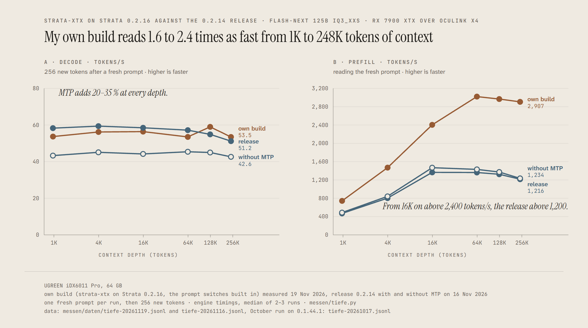

| Prompt tokens | Decode own build | Decode release 0.2.14 | Decode release 0.2.14 without MTP head | Prefill own build | Prefill release 0.2.14 | Prefill release 0.2.14 without MTP head | MTP acceptance (release 0.2.14) |
| ---: | ---: | ---: | ---: | ---: | ---: | ---: | ---: |
| 995 | 53.7 | 58.3 | 43.3 | 742 | 468 | 486 | 41 % |
| 4,077 | 56.2 | 59.4 | 45.1 | 1,470 | 803 | 841 | 45 % |
| 16,254 | 56.4 | 58.5 | 44.2 | 2,404 | 1,365 | 1,468 | 47 % |
| 65,025 | 53.5 | 57.2 | 45.4 | 3,021 | 1,362 | 1,431 | 50 % |
| 130,026 | 59.0 | 54.9 | 45.0 | 2,968 | 1,324 | 1,373 | 52 % |
| 248,054 | 53.5 | 51.2 | 42.6 | 2,907 | 1,216 | 1,234 | 41 % |

The prompt tokens are those of the own build's run; the release's prompts were two tokens shorter each. The uncensored version (`liber`) reads 658 / 1,438 / 2,290 / 2,925 / 2,933 / 2,890 tokens/s on my own build and writes 56.9 / 50.9 / 56.2 / 52.6 / 55.4 / 55.6 tokens/s at the same six depths. Without the MTP head my own build reads equally fast (760 to 3,087 tokens/s) and writes 32.6 / 35.2 / 42.2 / 44.7 / 45.6 / 42.7 tokens/s; so on my own build the head adds 20 to 65 % to decode, and 50–56 % of its drafts are accepted.

My own build reads 1.6 to 2.4 times as fast as the release at every depth, at 2,300–3,000 tok/s from 16K on. In this
series it decodes at 54–59 tok/s, the release on 16 Nov at 51–59 tok/s; the same own build on the base of 0.2.15
decoded at 56–63 tok/s on 18 Nov (`messen/daten/tiefe-20261118.jsonl`). That is the scatter between days: alternating
directly on 19 Nov, release and own build decode almost equally fast, 69.6 and 72.5 tok/s in chat (see [Strata releases](#strata-releases-on-this-card)). On the release decode drops little with depth (58 → 51 tok/s
with MTP), MTP adds 20–35 % at every depth there, prefill stays at 1,210–1,470 tok/s from 16K on, over the x4 link. Compared with the first run on 17 Oct on 0.1.44.1
(`messen/daten/tiefe-20261017.jsonl`: 62 → 56 tok/s with MTP, prefill 1,080–1,270 tok/s from 16K on) the 0.2.14 release read
faster and decoded 1–6 tok/s slower at every depth, without the MTP head too. I have not found out why. **Recall** (Strata's `needle_bench.py`, 19 Nov 2026 on my own build): the code word was found
every time at 32K and 128K at depths of 10, 50 and 90 % and at 250K at a depth of 50 %, by the original and by the uncensored version, 7 of 7 each (`messen/daten/2026-11-19-strata-xtx-0.2.16/needles-*.json`).

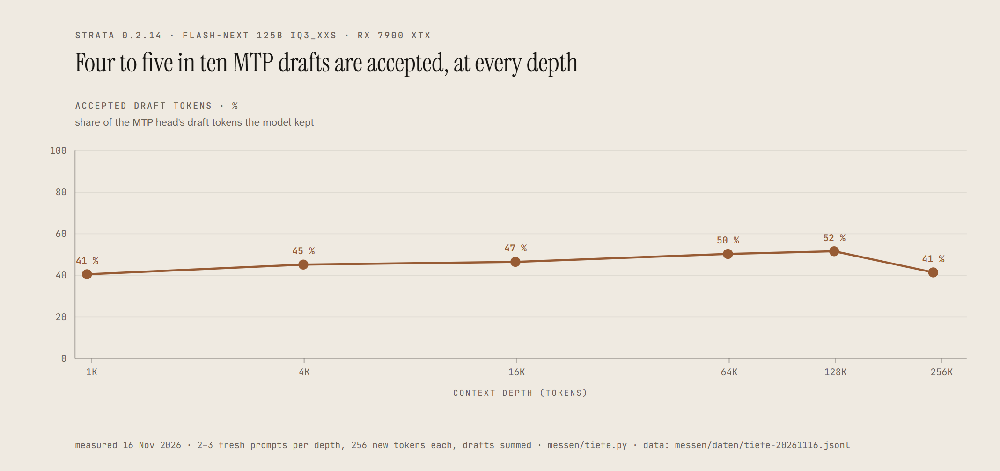

### How long a long prompt takes, and where the memory goes

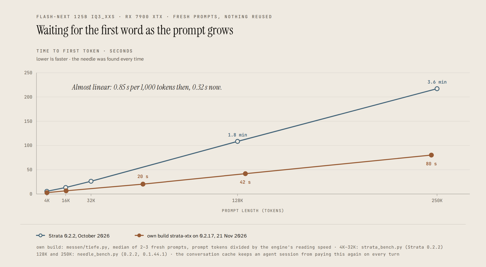

Reading grows almost linearly with the prompt. In October 2026 (Strata 0.2.2) it took 5.5 s at 4K, 26 s at 32K, 1.8 min at 128K and 3.6 min at 250K. On my own build on 19 Nov 2026 it takes 2.8 s at 4K, 6.8 s at 16K, 22 s at 65K, 44 s at 130K and 85 s at 248K; the needle was found every time. The unchanged 0.2.16 release needs 204 s for the same 250K prompt. Strata's conversation cache keeps an agent session from paying this again on every turn: in `strata_bench.py`'s agent run only 5 tokens per session are read twice.

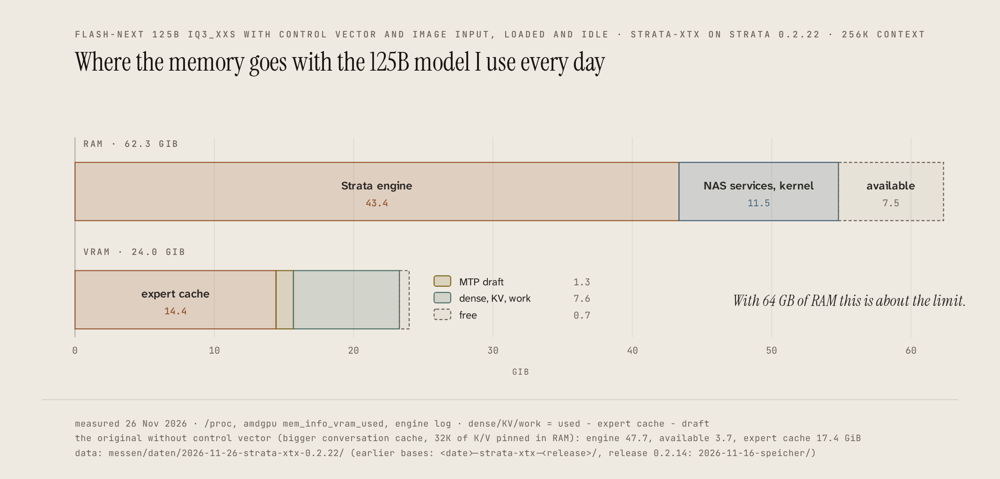

With the original (`faber`) loaded and idle, the engine holds 47.6 GiB of the 62.3 GiB RAM (the expert weights that do not fit on the card, the K/V of 32K tokens in pinned RAM, and the conversation cache as it fills), the NAS services and the kernel 10.5 GiB, and 4.2 GiB stay available. On the card the expert cache takes 17.0 GiB of 24 GiB (10,490 slots), the MTP draft 1 GiB, everything else 5.3 GiB, 0.7 GiB stay free. The uncensored version in daily use runs with image input, without pinned K/V and with a 4.5 instead of 9 GiB conversation cache: the engine holds 43.4 GiB, 7.4 GiB stay available, and because the image part needs room on the card, the expert cache gets 14.1 GiB. Measured on 19 Nov 2026 on my own build (`messen/daten/2026-11-19-strata-xtx-0.2.16/`), unchanged from 18 Nov on the base of 0.2.15 (`messen/daten/2026-11-18-strata-xtx/`); on 16 Nov on the 0.2.14 release it was 47.2 and 42.8 GiB (`messen/daten/2026-11-16-speicher/`), on 23 Oct on 0.2.3.1 the engine held 44.6 GiB with the original, and 7.5 GiB stayed available. With 64 GB RAM this is about the limit: a second large service next to it needs the conversation cache made smaller.

### Power, cold start, the NAS at work, a dense 70B and UGREEN's own model (15 to 19 Nov 2026)

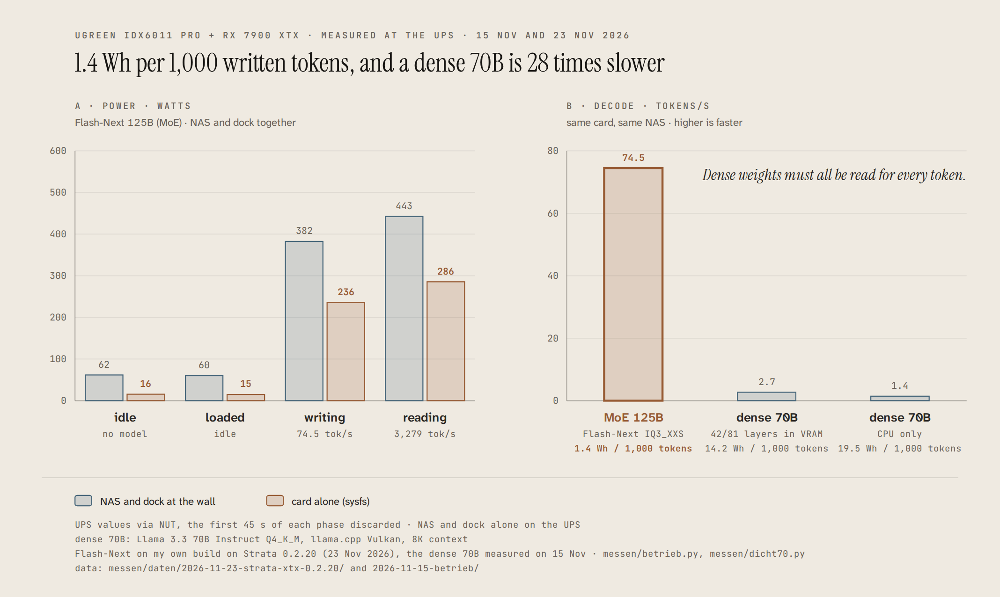

**Power.** Measured with the original (`faber`) on my own build on 19 Nov 2026, at the UPS that feeds only the NAS and the dock (read over NUT, the first 45 s of each phase discarded), next to the card's own value from sysfs.

| Phase | NAS and dock | Card alone |
|---|---:|---:|
| Idle, no model loaded | 61 W | 18 W |
| Model loaded, resting | 59 W | 15 W |
| Writing, 68.3 tokens/s | 393 W | 241 W |
| Reading fresh 82K prompts, 2,894 tokens/s | 390 W | 294 W |

That is **1.6 Wh per 1,000 written tokens** for NAS and dock (1.3 Wh above idle) and 0.04 Wh per 1,000 tokens read. A loaded, resting model costs nothing measurable over the empty card.

| Version of the 125B model | State | Writing tok/s | NAS and dock | per 1,000 written tokens |
|---|---|---:|---:|---:|
| IQ3_XXS (`faber`) | own build on 0.2.16, 19 Nov | 68.3 | 393 W | 1.6 Wh |
| IQ3_XXS, uncensored (`liber`) | own build on 0.2.16, 19 Nov | 67.4 | 394 W | 1.6 Wh |
| IQ2_XS (`velox`) | release 0.2.14, 16 Nov | 71.9 | 341 W | 1.3 Wh |

On 18 Nov on the base of 0.2.15 it was 68.8 and 67.9 tokens/s at 381 and 391 W (`messen/daten/2026-11-18-strata-xtx/`): no difference between the two bases. A first run early on 19 Nov is kept under `strom-first-run/`: with the uncensored version the machine drew 74 instead of 61 W already when idle and wrote only 57.7 tokens/s. Something was evidently running on the NAS at the same time; I did not find out what. I discarded that run and repeated it, and the repeat is what counts.

**What the faster reading costs in power.** Measured on one evening, 18 Nov 2026, with the same script and in alternation (`faber`, 150 s of load after 80 s of rest each, the own build still on the base of 0.2.15, `messen/daten/2026-11-18-strata-xtx/stromvergleich/`):

| State | Card while writing | Card while reading | NAS and dock while reading | Reading | per 1,000 tokens read |
|---|---:|---:|---:|---:|---:|
| Release 0.2.14 without switches (two runs) | 235 / 238 W | 270 / 267 W | 413 / 341 W | 1,314 / 1,348 tok/s | 0.087 / 0.070 Wh |
| Release 0.2.14 with the 28 switches | 245 W | 300 W | 469 W | 2,975 tok/s | 0.044 Wh |
| Own build (two runs) | 235 / 236 W | 292 / 296 W | 494 / 483 W | 2,943 / 2,945 tok/s | 0.047 / 0.046 Wh |

While writing, the card draws the same in every state. While reading it draws 25 to 30 W more with the switches. What NAS and dock draw together while reading varies too much from run to run for one fixed number: between 341 and 494 W on 18 Nov, between 390 and 440 W on my own build on 19 Nov. What is certain is the energy per token read: with my own build it is about half as high (0.037 to 0.047 against 0.070 to 0.087 Wh per 1,000 tokens), because reading is done a good twice as fast.

Between days the values differ more than between states: on 16 Nov 2026 the same machine drew 336 W while writing on the 0.2.14 release (card 205 W, 65.9 tokens/s, 1.4 Wh) and 377 W while reading (card 231 W, 1,339 tokens/s), and 49 W idle (`messen/daten/2026-11-16-betrieb/`). On 18 Nov the same state was at 235 W at the card and 60 W idle. I do not know the cause of this difference between the days; so I only compare within one evening. On 0.2.12 it was 66.3 tokens/s at 355 W and 1.5 Wh while writing on 15 Nov, and 1,159 tokens/s while reading (`messen/daten/2026-11-15-betrieb/`). The very first measurement, with a network switch on the same UPS, and its deduction are in `messen/daten/2026-11-15-betrieb/mit-switch/`.

**Cold start.** From an unloaded card to the first token: 19.6–21.6 s in five runs on my own build (median 20.5 s; the uncensored version 18.5–20.5 s, median 18.6 s), practically as long as on the 0.2.14 release (18.5–19.5 s). Dropping the page cache before the first run made hardly any difference (21.6 s).

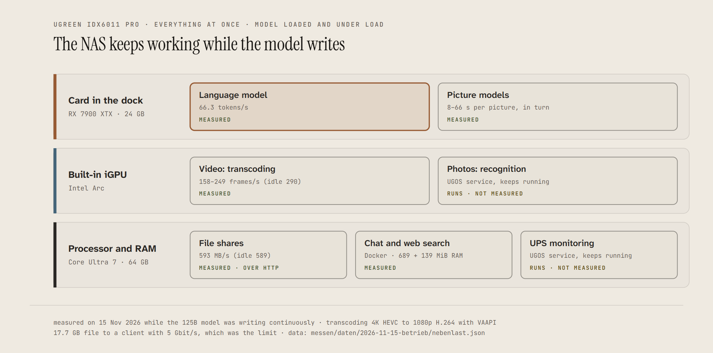

**The NAS at work while the model writes.** A 17.7 GB file downloaded from the NAS over HTTP at 1,175 MB/s without a model and at 1,174 MB/s while the model was writing; the receiver sat on the same network with 10 Gbit/s, which the transfer nearly filled. Transcoding a 4K HEVC clip to 1080p H.264 on the built-in Arc iGPU ran at 290 frames/s without a model and dropped to 156 to 245 frames/s while the model was writing and the download was running, in the slowest pass still five times playback speed. Decode stayed at 68 and 70 tokens/s (69 in the median when alone). With the uncensored version (`liber`): 1,175 and 1,168 MB/s, 216 to 245 frames/s, decode 62 and 65 tokens/s against 66 alone. Measured on 19 Nov 2026 on my own build with a fixed schedule (`messen/nebenlast.py`, `messen/daten/2026-11-19-strata-xtx-0.2.16/nebenlast.json`); the side load lasted only about 30 s and hit two requests each. On 16 Nov on the 0.2.14 release, with a workstation on 5 Gbit/s as the receiver, it was 591 and 586 MB/s and 241–244 frames/s; today's lower first transcoding value coincides with the download being twice as fast. Not measured: SMB.

**A dense 70B model on the same card: 2.7 tokens/s.** Llama 3.3 70B Instruct (Q4_K_M, 42.5 GB) with llama.cpp Vulkan, as many layers on the card as fit, the rest on the CPU, 8K context:

| Layers on the card | VRAM | Decode tok/s | NAS and dock | per 1,000 written tokens |
|---|---:|---:|---:|---:|
| 42 of 81 | 22.1 GiB | 2.69 | 138 W | 14.3 Wh |
| none (CPU only) | – | 1.44 | 101 W | 19.5 Wh |

With 40 and 38 layers on the card it was 2.58 and 2.48 tokens/s. The MoE model writes 25 times faster and needs about a tenth of the energy per token. A dense model touches all its weights for every token, and half of them sit behind the CPU here.

Two dense models that fit entirely into video memory (Qwen3.8-27B and Gemma 4 31B, both Q4) write at 37 tokens/s at 386 and 399 W: 2.9 and 3.0 Wh per 1,000 tokens, twice the 125B model.

**UGREEN's own model, with and without the dock.** UGOS's AI console downloads Qwen3.5-35B-A3B (Q4_K_M, one 22.0 GB GGUF) and starts it by itself on the Arc iGPU with its own llama.cpp build (SYCL, 4 threads, 7 slots). I measured that running server through its Unix socket, then the same file CPU-only and on the XTX:

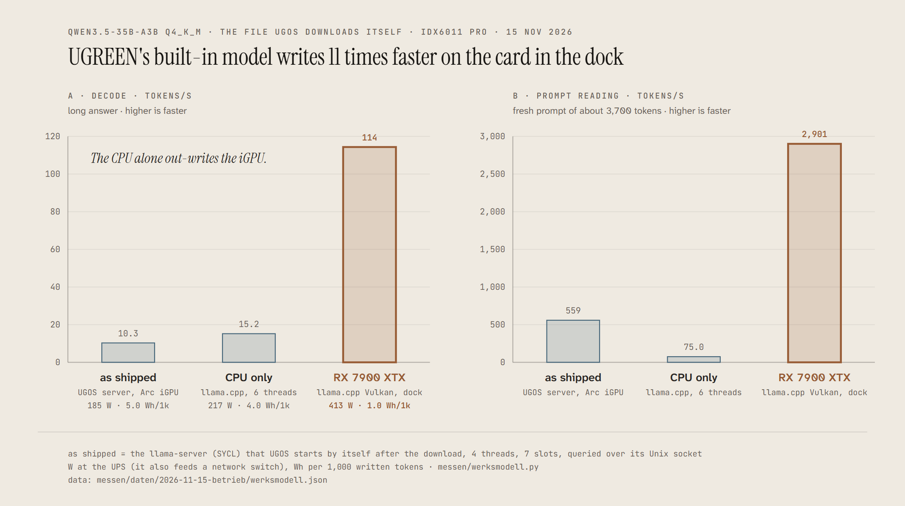

| Path | Decode tok/s | Prompt tok/s | NAS and dock | per 1,000 written tokens |
|---|---:|---:|---:|---:|
| as shipped: UGOS server on the Arc iGPU (SYCL) | 10.3 | 559 | 78 W * | 2.1 Wh * |
| Arc iGPU, llama.cpp Vulkan | 10.2 | 191 | 64 W | 1.7 Wh |
| CPU only, llama.cpp, 6 threads | 15.5 | 79 | 97 W | 1.7 Wh |
| RX 7900 XTX in the dock, llama.cpp Vulkan | 114 | 2,977 | 288 W | 0.7 Wh |

\* calculated: this row was measured in the morning with the switch on the same UPS (185 W), 107.5 W are deducted, accurate to about ±10 W. It could not be re-measured because UGOS removes its SYCL runtime together with the model.

On the card the built-in model writes 11 times faster and reads five times faster than as shipped, at 0.7 instead of 2.1 Wh per 1,000 tokens. The CPU alone out-writes the iGPU server but reads a prompt seven times more slowly. Two limits: the CPU run had UGOS's copy loaded and idle next to it, and UGOS keeps its model in memory (about 27 GB), so it does not fit next to the 125B model; I removed it after the test. UGOS's second runtime (`llama-gpu`) is a CUDA build and does not start with an AMD card.

**Is the big model worth it? The same tasks on both.** UGREEN's Qwen3.5-35B-A3B fits entirely on the card (22.1 GB of VRAM with 128K context) and writes at 114 tokens/s, almost twice as fast as the 125B model. On my task set it still loses:

| | Flash-Next 125B (MoE, Strata) | Qwen3.5-35B-A3B (UGREEN's file, on the card) |
|---|---:|---:|
| **graded tasks passed (of 102)** | **98** | **90** |
| code | 15/15 | 12/15 |
| logic | 15/15 | 12/15 |
| following instructions | 15/15 | 13/15 |
| facts | 12/15 | 12/15 |
| tool calls | 20/20 | 20/20 |
| long context (32K, 100K) | 4/4 | 4/4 |
| safety | 17/18 | 17/18 |
| reasoning budget of 8,000 tokens used up, no answer | 0 | 9 |
| German, graded blind (of 60) | 47 | 37 |
| tokens written for all 114 tasks | 82,901 | 223,795 |
| time for all 114 tasks | 25 min | 37 min |

The small model thinks much longer: it writes 2.7 times as many tokens for the same tasks, so despite the higher speed the whole set takes 49 % longer, and in nine tasks it used up the reasoning budget without answering. With a larger budget some of those would probably pass; I did not measure that. What speaks for the small model: it leaves the RAM of the NAS free, where 55 to 58 of the 64 GB are taken with the 125B model. The 125B numbers are from 16 Nov on Strata 0.2.14 (same tasks); on 0.2.12 it passed 96 of 102 on 13 Nov. Its German grade is from the run on 0.2.12. German was graded blind by a language model that did not know which answer came from which model; a different grader than in the 14 Nov follow-up, so the scores are comparable within this table only. Data (counts only): `messen/daten/2026-11-15-betrieb/qualitaet.json`.

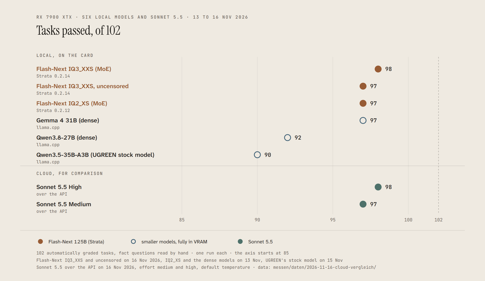

The same task set against a cloud model, Sonnet 5.5 over the API at two effort levels; counts in `messen/daten/2026-11-16-cloud-vergleich/`.

**Two people at the same time.** `messen/zwei.py` runs one conversation of five questions alone, then two conversations at once on the same model, then two people alternating between two different models:

| | Wait for the first word (median) | Decode tok/s (median) |
|---|---:|---:|
| one person alone | 0.3 s | 66.9 |
| two at once, person A | 7.0 s | 62.4 |
| two at once, person B | 5.8 s | 70.9 |
| alternating between two models | 20 s | – |

Strata answers one request after the other: the second person waits until the first answer is finished, five to nine seconds with answers of up to 400 tokens, and then gets the full speed. If two people use two different models, the card reloads on every change, about 20 s each time. For shared use, one model for everyone. Measured on 19 Nov 2026 on my own build; on 16 Nov on the 0.2.14 release both waited 9.5 s in the median.

Scripts: `messen/betrieb.py`, `messen/dicht70.py`, `messen/werksmodell.py`, `messen/transkodieren.sh`, `messen/zwei.py`. Raw data: `messen/daten/2026-11-19-strata-xtx-0.2.16/` (own build on 0.2.16), `messen/daten/2026-11-18-strata-xtx/` (own build on 0.2.15), `messen/daten/2026-11-16-betrieb/` (release 0.2.14) and `messen/daten/2026-11-15-betrieb/`.

### Does Strata cost quality? Strata vs llama.cpp on the same file

Same GGUF (Flash-Next IQ3_XXS), same fixed text set from Strata's `tools/quant_quality.py` (code, docs, English,
other languages, an agent transcript; 4,995 positions, teacher-forced). Strata through `quant_quality.py run`,
mainline llama.cpp (build 11610, Vulkan, experts on the CPU) position by position through `llama-server`
(`messen/qq_llamacpp.py`, same output format), compared with `messen/qq_vergleich.py`:

| Comparison | same top token | KL mean | KL median | KL p99 | Perplexity |
| --- | ---: | ---: | ---: | ---: | --- |
| llama.cpp vs Strata (experts on CPU) | **95.7 %** | 0.020 | 0.0017 | 0.27 | 4.009 vs 4.017 |
| llama.cpp vs Strata (experts on GPU) | 95.7 % | 0.020 | 0.0017 | 0.34 | 4.009 vs 4.019 |
| Strata CPU path vs Strata GPU path | 95.7 % | 0.018 | 0.0017 | 0.27 | – |

**Strata costs no measurable quality against llama.cpp:** the difference is as large as the one between Strata's
own CPU and GPU kernels, i.e. numerical noise. For scale, Strata's docs put IQ3_XXS against Q8_0 at 84.5 % and KL
0.20 – the quantization costs quality, the engine does not. Limits: perplexity over the 4,982 positions where
llama.cpp returned the exact value (target among its top 4,000); Strata's yardstick runs FP16 K/V without MTP
drafts, so the effect of int8 K/V is not covered; one text set.

### Strata settings that measurably matter

| Setting | Value | Effect |
|---|---|---|
| `--pool-workers` | 9 up to 0.2.0, **leave it out from 0.2.1** | up to 0.2.0: 76.8 instead of 56.1 T/s vs. automatic (measured with IQ2_XS); 0.2.1 plans 10 workers itself and keeps them off the LP-E cores |
| `--pcie-frac` | 0 | the CPU computes missing experts instead of copying them over x4; no speed loss, spares the link |
| `--kv` | int8 | halves the KV cache, 256k context fits |
| `--max-context` | 262144 | the trained maximum; my own build reads 248,000 tokens in 85 s (the release in 3.4 min) |
| `--mtp` | MTP draft head | draft tokens speed up writing |
| `--conversation-cache-mib` | 4608 | parks a session of up to ~120,000 tokens while another request runs (parked in 0.16 s, restored in 0.06 s) |
| `STRATA_HIPBLASLT_TUNING` | `tools/hip/gfx1100-hipblaslt-100200.txt` | must match the hipBLASLt version, otherwise prompt reading is ~45 % slower |
| Quantization | IQ3_XXS instead of IQ3_S | 53 instead of 60 GiB RAM for the engine (measured in October 2026); IQ3_S leaves no room for other NAS services |
| Own build [strata-xtx](https://github.com/faf-net/strata-xtx) instead of the release engine | not a setting: the engine turns its prompt-reading switches on by itself | reading 1.6 to 2.4 times as fast, decode equal to slightly faster, the same task-set score; the run config no longer holds a switch for this ([section below](#my-own-build-strata-xtx-the-prompt-reading-switches-in-the-code)) |

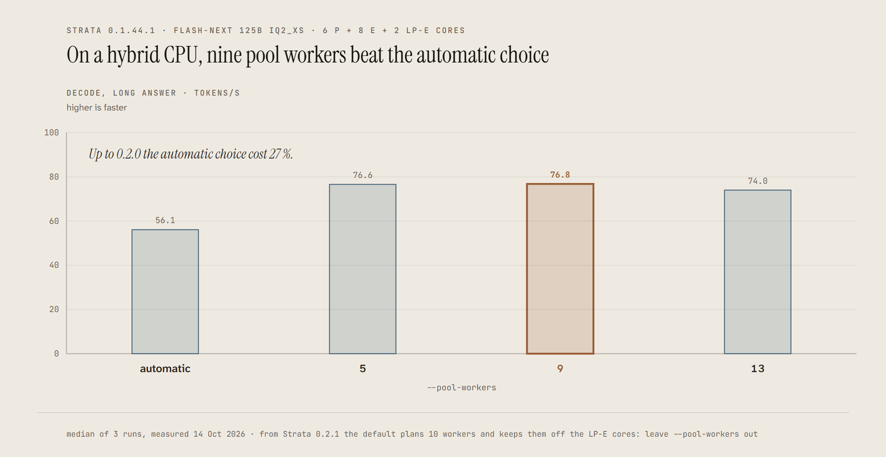

### My own build strata-xtx: the prompt-reading switches in the code

Strata's engine ships with switches (environment variables) for reading the prompt that stay off on the RX 7900 XTX, because several of them change the rounding. On newer cards Strata turns comparable ones on by itself. My own build [strata-xtx](https://github.com/faf-net/strata-xtx) does the same for exactly one case: Linux, a single visible graphics card, and that card a discrete gfx1100 one. The patch is small, about 200 lines in five files; everything else is unchanged Strata.

- **What it turns on:** a table of 27 switches. The engine newly sets 26 of them, one is already on in the release. On top, a bare `--prefill auto` may take chunks of up to 32,768 tokens. In the run config, `env` only holds the hipBLASLt table (`STRATA_HIPBLASLT_TUNING`) and no switch for prompt reading any more.
- **Who wins:** a switch I set myself is never overwritten. `STRATA_GFX1100_DEFAULTS=0` turns the whole table off; the engine then reads like the release (measured: 1,392 instead of 2,386 tokens/s at 16K).
- **Self-rescue:** if the engine reports non-finite values and Strata's own second attempt does not help, the server starts it once more without the table and carries on in the slower mode. Checked with Strata's fault injection, with both versions: the request that triggers it ends with an error itself (HTTP 503), then one restart, the following requests answered, a 16K prompt read at about 1,300 tokens/s afterwards, the number found.
- **What I checked before adopting it (0.2.16, 19 Nov 2026):** alternating with the unchanged 0.2.16 release, my own build reads 1,645 / 2,295 / 2,650 tokens/s at 4K / 16K / 32K, the release 783 / 1,357 / 1,321. It reads a prompt of 248,000 tokens in 85 to 87 s, the release in 204 s. The task set scores 97 of 102 with the original and 96 with the uncensored version, and also 96 on the unchanged release. In five repeats each on own build and release, the model passes two of the tasks sometimes and sometimes not on both, so the uncensored version lands at 96 to 98 depending on the run. 90 minutes of continuous load ran without an error (1,232 requests, 176 of 176 hidden numbers found). Tool calls, image input and the control vector work as on the release.
- **Price:** the answers are not bit for bit the same as without the table, and the card draws 25 to 30 W more while reading (see [Power](#power-cold-start-the-nas-at-work-a-dense-70b-and-ugreens-own-model-15-to-19-nov-2026)).

I test every new Strata release unchanged first, then build my own build on it, and switch over only when the checks have passed with both versions. Build path, patch and the patched source per release are in the [strata-xtx](https://github.com/faf-net/strata-xtx) repository; how it came about is in [docs/schalter.md](docs/schalter.md).

### How it came about: 28 environment switches on the 0.2.14 release (17/18 Nov 2026)

The fork `nicejunjie/Strata-rdna3` mostly sets environment variables for RDNA3 cards. The stock engine of Strata 0.2.14 knows 28 of them too. On 18 Nov 2026 the uncensored version and the original ran with them here for a day, as entries in the run config; that measurement was the reason for my own build. Steel blue is before, amber is after:

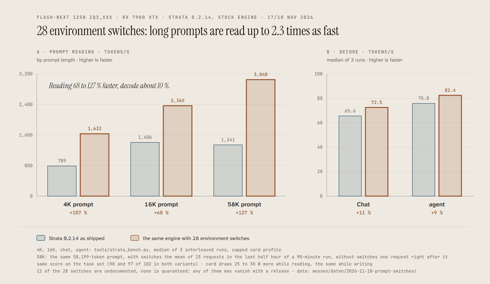

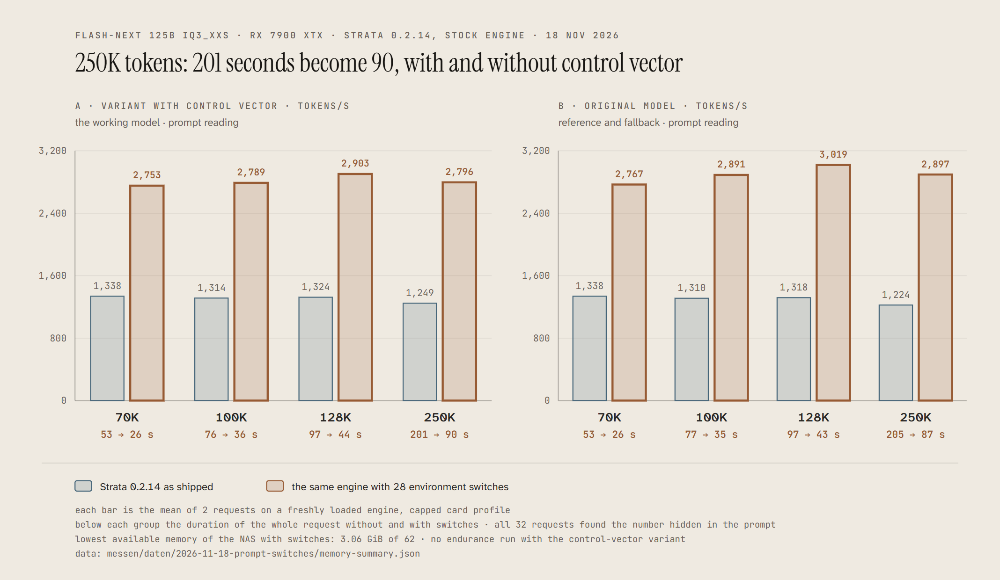

- A prompt of 250,000 tokens was read in 90 instead of 201 seconds, one of 16K at 2,365 instead of 1,406 tok/s. Decode was about 10 % faster in that measurement; little of that is left in my own build: 72.5 against 69.6 tok/s in chat when alternating with the release, no difference in the other series.
- My task set scored 98 and 97 of 102 with and without the switches. 90 minutes of continuous load ran without an error (1,232 requests).
- The 28 became 27 in my own build: `STRATA_PREFILL_AUTO_MAX` is a fixed rule for the chunk size of `--prefill auto` there, `GPU_MAX_HW_QUEUES` brought nothing and was dropped, `STRATA_CVEC_FUSE` was added.
- Strata deliberately does not turn them on by itself on this card generation, because the rounding changes; 12 of the 28 are not described either. Any of them may vanish with a release, and the engine silently ignores a name it does not know. As entries in every run config that was error-prone; in my own build the names sit in one place in the code, and its patch aborts when a new release changes the places it hooks into. The measurement in detail: [docs/schalter.md](docs/schalter.md).

## Strata releases on this card

Every release since 0.2.0-beta was measured here against the one before it, with the identical run config and only engine and control swapped. Since 18 Nov 2026 production no longer runs the release but my own build on its base; in the chart it is the diamond above the 0.2.16 release. Details, tables and raw data for each one: [docs/releases.md](docs/releases.md).

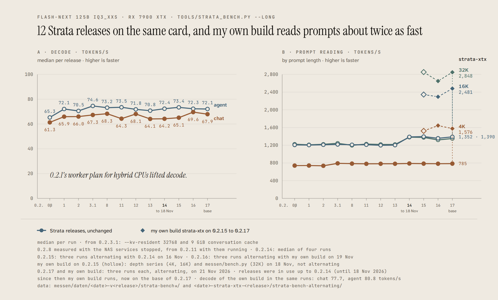

| Release | Date | Result on this card | Reported to Strata |
|---|---|---|---|
| 0.1.45 | 17 Oct | no measurable difference to 0.1.44.1, not adopted | – |
| 0.2.0-beta | 19 Oct | the prebuilt `hip-rx7900` engine runs on gfx1100; its default worker count is a third slower on a hybrid CPU; not adopted | [#3262](https://github.com/Niko1221/Strata/issues/3262), [#3177](https://github.com/Niko1221/Strata/issues/3177) |
| 0.2.1 | 21 Oct | **in production**; the hybrid-CPU fix works; the Docker image runs, its gfx1100 table is worth +60 % at 16K | [#3262](https://github.com/Niko1221/Strata/issues/3262), [#3263](https://github.com/Niko1221/Strata/issues/3263), [PR #2904](https://github.com/Niko1221/Strata/pull/2904) |
| 0.2.2 | 21 Oct | **in production**; same speed, more robust; `strata bench run` from the package is complete | [#3263](https://github.com/Niko1221/Strata/issues/3263), [PR #2904](https://github.com/Niko1221/Strata/pull/2904) |
| 0.2.3.1 | 23 Oct | **in production**; 4K prompt reading +7 %; the engine finds its gfx1100 table by itself | – |
| 0.2.8 | 31 Oct | **in production**; equal; recovers malformed tool calls; the Docker image leaves 854 MiB of VRAM free | [PR #4851](https://github.com/Niko1221/Strata/pull/4851) |
| 0.2.9, 0.2.10 | 5 Nov | **in production** in between; 0.2.9 fixes silently wrong long prompts (#3431) | – |
| 0.2.11 | 5 Nov | **in production**; equal to 0.2.10 | [#5321](https://github.com/Niko1221/Strata/issues/5321) |
| 0.2.12 | 8 Nov | **in production** until 16 Nov; equal to 0.2.11; the tuned DFlash2 drafter is slower end to end and stays off | [#5615](https://github.com/Niko1221/Strata/issues/5615) |
| 0.2.13 | 9 Nov | equal with the tuned config, not adopted; the Linux Docker image no longer uses the gfx1100 table and reads 16K prompts 35 % slower | [#5666](https://github.com/Niko1221/Strata/issues/5666) |
| 0.2.14 | 15/16 Nov | **in production** from 16 to 18 Nov; decode equal, prompt reading 16 % faster at 16K and 14 % at 32K in the same session; own task set 98 of 102 (0.2.12: 96); no driver pauses on this card; `standard-v1` sanity 11 of 12 | [#6056](https://github.com/Niko1221/Strata/issues/6056) |
| 0.2.14 with 28 environment switches | 18 Nov | **in production** on 18 Nov until the evening; the same engine, 28 environment variables from the rdna3 fork in the run config: reading 68 to 127 % faster, task set unchanged (98 and 97 of 102), uncensored version and original measured up to 250,000 tokens ([docs/schalter.md](docs/schalter.md)) | – |
| 0.2.15 | 16 Nov | tested as a release, not adopted; only the control program is new (control 0.1.61), the engine is the same as in 0.2.14; equally fast in three runs alternating with 0.2.14; `standard-v1` sanity 12 of 12; my small task set 34 of 35 (tools 20 of 20, code 14 of 15), one code task that flips between runs | [#6056](https://github.com/Niko1221/Strata/issues/6056) |
| own build strata-xtx on 0.2.15 | 18 Nov | **in production** from the evening of 18 Nov to 19 Nov; the switches in the code instead of the run config; reading at 2,250–3,080 tokens/s from 16K on, task set 97 and 98 of 102, 90 minutes of continuous load without an error | – |
| 0.2.16 | 19 Nov | tested as a release; engine code of its own without ggml, new folders in the source, an official build script; no speed gain on this card: decode 61.4 against 59.8 tokens/s for 0.2.15 in pairs, reading 783 / 1,357 / 1,321 tokens/s at 4K / 16K / 32K; the defaults for gfx1100 are unchanged, so my own build is still needed | – |
| own build strata-xtx on 0.2.16 | 19 Nov | **in production, current** since 19 Nov; reads 1,645 / 2,295 / 2,650 tokens/s at 4K / 16K / 32K alternating with the release, 248,000 tokens in 85 s; decode, memory and cold start as on 0.2.15; task set 97 (original) and 96 to 98 (uncensored version); self-rescue checked with both versions | – |

## Run

Strata's `setup.py` creates models, packs and the MTP head; they are bind-mounted to `/strata/data`. Launch configs
are in `konfig/`, a llama-swap example in `konfig/llama-swap.yaml`. Put the host names the server is reached under
into `allowed_hosts` (Strata checks the Host header against DNS rebinding).

The configs in `konfig/arbeit.json`, `konfig/schnell.json` and `konfig/llama-swap.yaml` are the first version for the engine I built myself in October. **What runs today is in [`konfig/strata-xtx-0.2.16/`](konfig/strata-xtx-0.2.16/)** (`faber.json`, `liber.json`, the llama-swap macro): the same run configs as since 0.2.3.1; `env` only holds the hipBLASLt table (`STRATA_HIPBLASLT_TUNING`) and no switch for prompt reading. Engine and control come from my own build [strata-xtx](https://github.com/faf-net/strata-xtx) on Strata 0.2.16, which brings the switches itself. The models are named `faber` (IQ3_XXS, was `arbeit`) and `liber` (the same weights, uncensored); `velox` (IQ2_XS, was `schnell`) only serves for comparison now and keeps running on the 0.2.14 release ([`konfig/strata-0.2.14/`](konfig/strata-0.2.14/)).

### Full speed in the Docker image

**The engine now finds its gfx1100 hipBLASLt table by itself.** With `STRATA_HIPBLASLT_TUNING` removed from the run config, the log still says `hipBLASLt tuning enabled (26 rows, gfx1100, version 100200)`. That is the biggest change of 0.2.3 for RX 7000 owners who use the Docker image with its defaults: it reads 16K prompts at 1,220 instead of 781 tok/s, the first token of a 16K prompt comes after 13.5 s instead of 21 s.

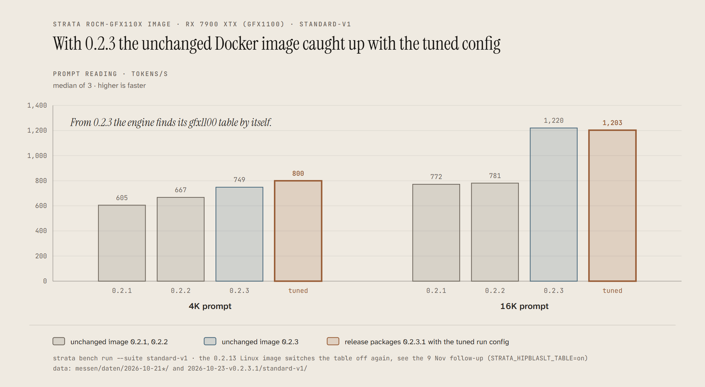

With 0.2.3 the unchanged image is within a few percent of the tuned config. What still differs: setup picks `--max-context 131072` and a 700 MiB VRAM reserve, and the engine warned once that only 427 MiB were free at the start of a request. If you need 256K, set `CONTEXT` and a reserve of about 830 MiB yourself. On images before 0.2.3, set `STRATA_HIPBLASLT_TABLE=on`. **From 0.2.13 the Linux image leaves the table off again by default, so set `-e STRATA_HIPBLASLT_TABLE=on` there too** (measured: 769 instead of 1,193 tokens/s at 16K, see [docs/releases.md](docs/releases.md)).

## What I had to change on UGOS

| # | Problem | Fix |
|---|---|---|
| 1 | **Solved in UGOS 1.21.** Up to 1.19, UGOS shipped **no firmware for Navi 31** (gfx1100). `amdgpu` ended with `Fatal error during GPU init`. 1.21 ships all 15 files plus five newer `*_kicker.bin` (late October 2026) | **On 1.21: remove your own copies** and disable the restore service, otherwise your older files in the overlay's upper layer hide UGREEN's newer ones (see below). Up to 1.19: copy 15 files from Debian's `firmware-amd-graphics` (20250410) to `/lib/firmware/amdgpu/`: `gc_11_0_0_{imu,me,mec,mes,mes1,mes_2,pfp,rlc,rlc_1}.bin`, `psp_13_0_0_{sos,ta}.bin`, `smu_13_0_0.bin`, `sdma_6_0_0.bin`, `vcn_4_0_0.bin`, `dcn_3_2_0_dmcub.bin`. They survived the update to 1.19 (UGOS uses an overlay). Safety net: `ugos/` |
| 2 | UGOS sets `GODEBUG=tlskyber=0` system-wide; Go programs from Go 1.24 (e.g. llama-swap) abort immediately | `Environment=GODEBUG=` in the systemd unit |
| 3 | Containers don't see the card | `--device /dev/kfd --device /dev/dri --group-add video --group-add render` (gid 44 and 105 here) |
| 4 | `docker --device` rejects colons (`/dev/dri/by-path/pci-0000:…`); a renamed render node is not found by Vulkan, which then silently computes on the CPU | resolve the path first, keep the node name |
| 5 | Kernel log flood `init_user_pages: Failed to get user pages: -1` (about 15,000 lines per model load) | harmless, caused by mmap on btrfs/LVM; with llama.cpp `--no-mmap` avoids it |
| 6 | `/volume1` is mounted about 41 s after `local-fs.target` | units that need it wait on their own (see `ugos/amdgpu-gfx1100-restore.service`) |
| 7 | `network-online.target` fires before the network is usable | CIFS mounts and services bound to a fixed address wait for address and port themselves |
| 8 | New folders under `/volume1/docker` inherit an ACL that locks containers out despite `rwxrwxrwx` | set permissions and owner explicitly |
| 9 | UGOS occasionally rewrites the firewall; own rules in `DOCKER-USER` disappear | re-apply rules from a timer |
| 10 | Journal capped at 50 MB, covers only about an hour | keep your own recordings for troubleshooting |
| 11 | Non-interactive SSH sessions have no `/sbin` in PATH, `modinfo` is not installed | a `command not found` is not a negative result |
| 12 | sshd offers no post-quantum key exchange (`high_crypt.conf`), although OpenSSH 9.2p1 supports it; current clients warn on every connection | `/etc/ssh/sshd_config.d/00-pq-kex.conf` with `KexAlgorithms sntrup761x25519-sha512@openssh.com,curve25519-sha256,…`; the name must sort before `high_crypt.conf`, because the first match wins |

**Switching to UGREEN's firmware on 1.21** (what I did on 2 Nov 2026): move your copies out of
`/overlay/upper/usr/lib/firmware/amdgpu/` (keep them on the data pool as a fallback), `systemctl disable
amdgpu-gfx1100-restore.service`, reboot. Do not delete them through `/lib/firmware`: on an overlay that creates a
whiteout and hides UGREEN's files as well. Result here: card ready 8 s after boot, DMUB firmware 0x07002D00 →
0x07003101, models load, throughput unchanged within noise. Everything else in the upper layer (own units,
`modprobe.d`, Docker) survived the update.

What UGOS does well: watchdog, a readable last-reboot reason, pstore crash logs, a NUT server for the UPS, and
version 1.19 brought kernel 6.18 with about 700 amdgpu firmware files. 1.21 finally added the Navi 31 firmware.

## Build

From 21 Oct to 18 Nov 2026 engine and control came from Strata's release packages. Since 18 Nov I build the engine myself again: unchanged Strata source plus the small patch, with the build path from the [strata-xtx](https://github.com/faf-net/strata-xtx) repository (a lean build image, about five minutes); the ROCm libraries and control still come from the release packages, except for `serve/server.py`: that one file comes from the patch, the self-rescue lives in it. The image built here is still the container both run in: it brings ROCm, and the packages are mounted into it (see the llama-swap macro in `konfig/strata-xtx-0.2.16/`). The rest of this section describes the first own build from October.

```bash
docker build -t strata-hip:v0.1.45 --build-arg STRATA_REF=v0.1.45 .
```

Build on the machine it will run on: llama.cpp and the engine are optimized for the build machine's CPU. The image
is about 21 GB, roughly 11 GB of which is ROCm from AMD's TheRock wheels (7.10.0a20251120, index `gfx110X-dgpu`).
Compiling took 83 s; downloading takes longer.

**Two traps the Dockerfile avoids:**

1. `rocm-sdk path --root` has to run once before CMake can see the ROCm root. It unpacks the developer files,
   including `lib/cmake/hip-lang`. Without it, `enable_language(HIP)` fails with "does not contain the HIP runtime
   CMake package". `setup.py` does this silently, a plain CMake build does not.
2. The engine must be executable. An earlier manual build left it with mode `----------`.

## Dock and link: what you need to know

- **OCuLink is not hot-pluggable.** Switch the dock on first, then start the NAS. The card is only detected at
  boot. This cost me an evening; UGREEN confirmed it when asked.
- **Use one cable.** With OCuLink and Thunderbolt connected at the same time, nothing was detected.
- **x4, not x16.** The host port reports `LnkCap` x4 at 16 GT/s. Irrelevant for inference, noticeable when loading
  large models.
- **No power control on the port** (`PwrCtrl-`). The OS cannot power-cycle the dock; `/sys/bus/pci/slots/*/power`
  only retrains the link. After some dropouts the card came back on its own after 22–47 s (which looks like the
  dock restarting); after another it stayed gone until the next reboot.
- **Dropouts (cause still under investigation):** each starts with PCIe receiver errors, followed 50 ms later by
  "Link Down", with the card idle and cool. In 5 of 7 events the 10 GbE NIC on a different PCIe branch lost its
  link at the same moment, which points to an electrical disturbance rather than the card. Not caused by the UPS's eco mode (off); the weekly battery self-test of the UPS, however, is behind the Wednesday series (see below).
- **PCIe quirk:** after one dropout the kernel clamped the link to 2.5 GT/s and failed to retrain. The fix
  ("Always lift 2.5GT/s restriction") is in 6.18.39; UGOS ships 6.18.15.

The disturbances turned out to follow two weekly clocks, and one of them is the UPS testing its battery. The whole investigation, with the capture script: [docs/dock.md](docs/dock.md). In ten weeks of logging there were 23 disturbances, the card dropped off the bus on three days, and no dropout rebooted the NAS.

## The biggest open risk: a dock dropout reboots the NAS

If the dock drops while a ROCm model is loaded, `amdgpu` under kernel 6.18 tears down the compute queues while
they are still in use (`kfd_device_queue_manager.c … uninitialize`), and a kernel oops follows. UGOS sets
`kernel.panic_on_oops=1` and `kernel.panic=3`, so the whole NAS restarts three seconds later. Reproduced three
times. Fixed upstream in Linux `6cca686dfce7` (7.0) and `81665e35f143` (7.1).

**My mitigation:** llama-swap unloads the model after 30 minutes idle (`globalTTL: 1800`). With no model loaded,
the iDX survives a dropout; the card is then gone until the next reboot.

**Still present in UGOS 1.21 (tested 2 Nov 2026).** The kernel is still 6.18.15, rebuilt on 16 Oct 2026. Same test as
before: model loaded (25 GB VRAM), card removed with `echo 1 > /sys/bus/pci/devices/<GPU>/remove`. The same warning
appears at once, and the remove call itself never returns. About 8 minutes later `kswapd` reclaims memory, walks into
`kfd_process_evict_queues` via `amdgpu_hmm_invalidate_hsa` / `amdgpu_amdkfd_evict_userptr` and hits a general
protection fault: the KFD process still holds userptr mappings of the removed card. Kernel panic, restart. The delay
(3 minutes in September, 8 now) depends on when memory reclaim touches those pages, not on a fixed timer. Reported
to UGREEN with the pstore record. The mitigation stays the same.

## Running an agent (Hermes) on top

- Set `context_length` per model in the agent (256k), otherwise it assumes a smaller window.
- `sendLoadingState: false` in llama-swap, otherwise loading notices end up in the reasoning part of the answer.
- With high reasoning effort always set a token budget; on hard coding tasks the model can otherwise think
  forever.
- If a second request (e.g. a command reviewer) runs alongside, each one evicts the conversation cache and every
  long session gets re-read. Strata's conversation parking (`--conversation-cache-*`) solves that.

**Dense models on the same card, and how to make the agent invent less (14 Nov 2026).** Two dense models fully in VRAM write at half the speed of the MoE models and do not judge better. In my own probe, four rules in the system prompt raise the share of made-up things a model recognises from 17–60 % to 88–99 %. For announced steps without a tool the rules are not enough, hence three layers:

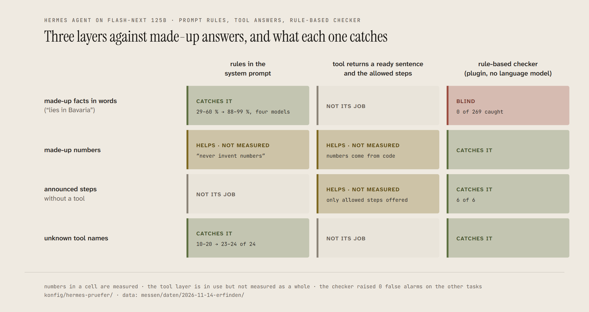

**Counter-check with public question sets (15/16 Nov 2026): one short rule is enough against things that sound foreign, not for commands.** The four rules name the kinds of things my probe asks about, so I checked with questions I did not write. A basic rule ("Answer what you know. If you do not know a thing, a name or a tool at all, say so instead of making something up.") cuts made-up things treated as real from 20 to 6 of 150 and leaves real questions as they are (90 against 87 of 150 right). A strict rule with a fixed "I don't know" halves the wrong answers (58 to 30) and costs some right ones (90 to 84). The four rules cost twice as many right answers for little more. A follow-up with my own questions showed a limit: of 24 made-up command options the uncensored model recognises 7 with the basic rule and 21 with the four rules (places 12 against 22, after reading the answers by hand). So commands, options and places need to be named explicitly. A combination does that in one sentence (the basic rule plus "This applies especially to commands, options and place names: if you do not know them for certain, say so, even if they sound plausible."): 17 of 24 command options and 19 of 24 places, 104 of 120 made-up things in all against 86 with the basic rule and 113 with the four rules, and 91 of 150 medium questions right against 95 without a rule and 76 with the four rules. My agent has been running with it since 16 Nov 2026.

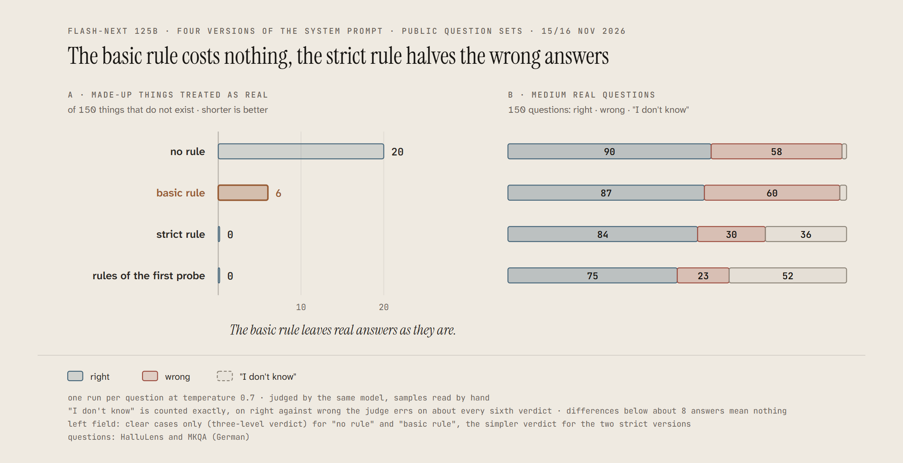

The measurements, the rules in their wording and the checker plugin: [docs/agent.md](docs/agent.md).

**The agent can use any of the models, including an uncensored one.** Which model it takes is a setting. `liber` is the same 125B model with its refusals removed by a steering vector (abliteration). It answers whatever it is asked, including what the original model declines: all 15 of my test tasks that models often refuse, instead of 11. There is no filter left; the responsibility lies with whoever runs it. Tasks, German and speed stay the same, and it does not measurably make up more than the original (25 against 20 of 150 things that do not exist treated as real; 5 against 6 with a short rule). How it works, the config, all numbers and what you take on: [docs/steuervektor.md](docs/steuervektor.md).

## Pictures on the same card: ComfyUI through llama-swap

Since 23 Oct the XTX also makes pictures. ComfyUI runs as one more model in llama-swap, so the card holds either the chat model or the picture models, never both, and llama-swap swaps them on demand. llama-swap has a ready entry point for this: a model named exactly `comfyui_auto` is served under `/comfyui/`, and the open browser tab's websocket neither loads the model nor keeps it loaded. The entry is in `konfig/comfyui/llama-swap-comfyui.yaml` (image `yanwk/comfyui-boot:rocm`, ROCm 7.2, PyTorch 2.13, ComfyUI 0.42.1); it starts in about 20 s.

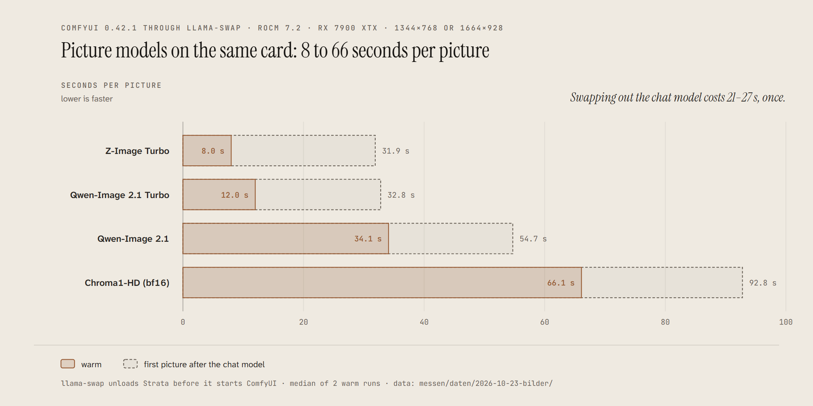

Models, seconds per picture, what I learned on gfx1100 and the image backend for the agent: [docs/comfyui.md](docs/comfyui.md).

## Contents

**Build**

```
  Dockerfile                    build recipe for Strata + ROCm on gfx1100
```

**Launch configs**

```
  konfig/arbeit.json            Flash-Next IQ3_XXS, 256k, reasoning effort high
  konfig/schnell.json           Flash-Next IQ2_XS
  konfig/llama-swap.yaml        one endpoint, one model at a time, unload after 30 min
  konfig/strata-0.2.1/          launch configs and llama-swap macro for the prebuilt 0.2.1 packages
  konfig/strata-0.2.2/          the same launch configs, llama-swap macro for the prebuilt 0.2.2 packages
  konfig/strata-0.2.3.1/        launch configs (faber = was arbeit, velox = was schnell) and llama-swap macro for 0.2.3.1
  konfig/comfyui/               ComfyUI: llama-swap entry, download script, workflows, image backend for Hermes Agent
  konfig/strata-0.2.8/          launch configs and llama-swap macro for 0.2.8 (configs unchanged from 0.2.3.1)
  konfig/strata-0.2.11/         launch configs and llama-swap macro for 0.2.11 (configs unchanged since 0.2.3.1)
  konfig/strata-0.2.12/         launch configs and llama-swap macro for 0.2.12, plus the DFlash2 test config, and liber.json (the uncensored model)
  konfig/strata-0.2.14/         launch configs and llama-swap macro for the 0.2.14 release, state of 18 Nov 2026 with the 28 environment switches (rdna3-schalter.json); velox still runs on this release, without switches
  konfig/strata-xtx-0.2.16/     what runs today: launch configs without switches and llama-swap macro for my own build strata-xtx on Strata 0.2.16
  konfig/hermes-pruefer/        plugin for Hermes Agent: checks every answer with fixed rules, no language model
  konfig/stack/                 chat and web search: Compose file for Open WebUI and SearXNG, tested on the NAS (EN/DE)
  konfig/opencode/              OpenCode 2 in the terminal with the local models: example config and what I learned (EN/DE)
```

**UGOS**

```
  ugos/                         only needed up to UGOS 1.19; on 1.21 and later see the note under "What I had to change"
  ugos/firmware-sichern.sh      backs up the 15 gfx1100 firmware files to the data pool
  ugos/firmware-pruefen.sh      checks and restores them after a UGOS update
  ugos/amdgpu-gfx1100-restore.service   runs the check after every boot
```

**Benchmark and helper scripts**

```
  messen/bench.py               writing, reading, agent session, quality tasks (aufgaben.json, German prompts)
  messen/identitaet.py          same prompts greedy to two models, character-exact comparison
  messen/langprompt.py          read time of a fresh long prompt
  messen/auswertung045.py       results table
  messen/tiefe.py               decode/prefill vs context depth (1K to 248K)
  messen/qq_llamacpp.py         llama.cpp counterpart of Strata's quant_quality.py (teacher-forced top-64 per position)
  messen/qq_vergleich.py        top-1 agreement, KL and perplexity of two runs
  messen/visiontest.py          picture reader on the CPU: test pictures, VRAM/RAM, against the 27B vision model
  messen/r3177.py               reproduction attempt for Strata issue #3177 (long agent request with MTP)
  messen/folgetests.py          LP-E cores A/B (--cpuset-cpus) and fresh-engine prompt speed
  messen/t020.py                Strata 0.2.0-beta prebuilt hip-rx7900 engine: bench, needles, workers, picture readers
  messen/t021.py                Strata 0.2.1: worker pairs, bench, needles, fresh engines, standard-v1
  messen/t022.py                Strata 0.2.2 against 0.2.1: version pairs, bench, needles, fresh engines, standard-v1, Docker image
  messen/dock-mitschnitt.sh     second-by-second capture around an expected dock event (read-only, needs root)
  messen/t0231.py               Strata 0.2.3.1 against 0.2.2: pairs, bench, needles, fresh engines, standard-v1, Docker image, table variable off
  messen/t128.py                first 128K prompt on a fresh engine, 0.2.3.1 against 0.2.2, alternating
  messen/t028.py                Strata 0.2.8 against 0.2.3.1: standard-v1 first, bench, needles to 250K, tool calls, pairs, fresh engines, Docker image
  messen/halluzination.py       hallucination probe: 5 areas × 8 real + 8 made-up items, without and with rules (--regeln)
  messen/agent_de.py            operations agent in German: 9 tasks, repeated, judgement tasks to be read by hand
  messen/diagramme.py           all charts in bilder/ in one style (HTML/SVG sources in bilder/html/, PNG via playwright)
  messen/betrieb.py             power at the UPS, cold start and write load (strom, kaltstart, last)
  messen/dicht70.py             a dense model that does not fit into VRAM, llama.cpp Vulkan, by layers on the card
  messen/werksmodell.py         UGREEN's built-in model: UGOS's own server on the Arc iGPU, CPU only, the card in the dock
  messen/transkodieren.sh       4K HEVC to 1080p H.264 on the Arc iGPU (VAAPI), frames per second
  messen/zwei.py                two people at the same time: wait and speed alone, at once, alternating between two models
```

**Raw data**

```
  messen/daten/                 raw data: depth sweep, strata_bench.py and needle_bench.py results
  messen/daten/qualitaet/       the three runs (gzip) and the comparison results
  messen/daten/2026-10-19/      raw data of the follow-up (README inside)
  messen/daten/2026-10-21/      raw data incl. four standard-v1 results (README inside)
  messen/daten/2026-10-21-v0.2.2/  raw data of the 0.2.2 follow-up (README inside)
  messen/daten/dock-2026-10-21/ excerpt of the capture of 21 Oct, the Wednesday event on schedule
  messen/daten/2026-10-23-v0.2.3.1/  raw data incl. memory.json and the 128K A/B (README inside)
  messen/daten/2026-10-23-bilder/  seconds per picture, four models, first and warm
  messen/daten/2026-10-31-v0.2.8/  raw data of the 0.2.8 follow-up, also sent as Strata PR #4851 (README inside)
  messen/daten/2026-11-05-v0.2.11/  raw data of the 0.2.11 follow-up, also sent as Strata issue #5321 (README inside)
  messen/daten/2026-11-08-v0.2.12/  raw data of the 0.2.12 follow-up and the DFlash2 test, also sent as Strata issue #5615 (README inside)
  messen/daten/2026-11-09-v0.2.13/  raw data of the 0.2.13 follow-up, incl. the Docker image with and without the gfx1100 table also sent as Strata issue #5666 (README inside)
  messen/daten/2026-11-15-v0.2.14/  raw data of the 0.2.14 test: pairs against 0.2.12, standard-v1, strata_bench, needles, fresh engines (README inside)
  messen/daten/2026-11-14-erfinden/  counts: probe per model and area, night comparison, judgement with 10 rounds
  messen/daten/2026-11-15-betrieb/  power, cold start, NAS at work, dense 70B, UGREEN's built-in model
  messen/daten/2026-11-16-betrieb/  re-measured on Strata 0.2.14: power and speed of the three models, cold start, waiting times, two people, task set
  messen/daten/2026-11-16-cloud-vergleich/  the same task set against Sonnet 5.5 over the API: counts per category, no texts
  messen/daten/2026-11-16-v0.2.15/  raw data of the 0.2.15 test: three strata_bench runs alternating with 0.2.14, standard-v1, pairs (README inside)
  messen/daten/2026-11-18-rdna3-switches/  28 environment switches on the 0.2.14 release: speed, task set, idle, 90 minutes of load, long prompts up to 250K on uncensored version and original, acceptance run after adoption (README inside)
  messen/daten/2026-11-18-strata-xtx/  own build strata-xtx on the base of 0.2.15: power, power comparison against the release, cold start, waiting times, two people, memory
  messen/daten/2026-11-19-strata-xtx-0.2.16/  own build strata-xtx on the base of 0.2.16, today's state: checks before adoption, three strata_bench runs alternating with the 0.2.16 release, needles, power, cold start, waiting times, two people, memory; under release-0.2.16/ the test of the unchanged release
  messen/daten/2026-11-18-unsloth-ud-iq2xs/  Unsloth UD-IQ2_XS v3.1 against the IQ3_XXS file: perplexity, speed without and with the switches (README inside)
  messen/schalter.py            write the 28 switches into a run config, remove them, check (state of 18 Nov, for the unchanged release)
  messen/schalter_pruefen.py    does an engine still know the 28 names? check for every release, without the card
  messen/daten/2026-11-16-speicher/  memory use of the original and the uncensored version on 0.2.14
  messen/daten/tiefe-20261119.jsonl  speed vs context depth on my own build (0.2.16): original, uncensored version, and original without the MTP head (18 Nov on 0.2.15: tiefe-20261118.jsonl)
  messen/daten/tiefe-20261116.jsonl  speed vs context depth on the 0.2.14 release, with and without the MTP head (October: tiefe-20261017.jsonl)
```

**Documentation and charts**

```
  docs/                         every release in detail, the dock investigation, the agent follow-up, the uncensored model, ComfyUI (EN/DE)
  bilder/                       the charts as PNG, their HTML/SVG sources in bilder/html/
  web/                          builds the pages faf.net/local-ai and faf.net/lokale-ki from this repo (bau.py), with self-hosted fonts
```

The benchmark scripts only talk to `/v1/chat/completions`, use Python's standard library and sample VRAM, GPU load,
power and RAM from sysfs (set `KARTE` in `bench.py` to your card). Code tasks run in a throwaway container without
network.

File and folder names are German, and so are the scripts' comments: `messen` = measuring, `konfig` = configs, `bilder` = pictures, `daten` = data, `tiefe` = depth, `erfinden` = making things up. `liber`, `faber` and `velox` are the names of the three versions here (uncensored, original IQ3_XXS, IQ2_XS; in files up to 0.2.2 faber and velox are called `arbeit` and `schnell`).

## License

MIT for the files in this repository, see `LICENSE`. Strata itself is under its own license upstream.
