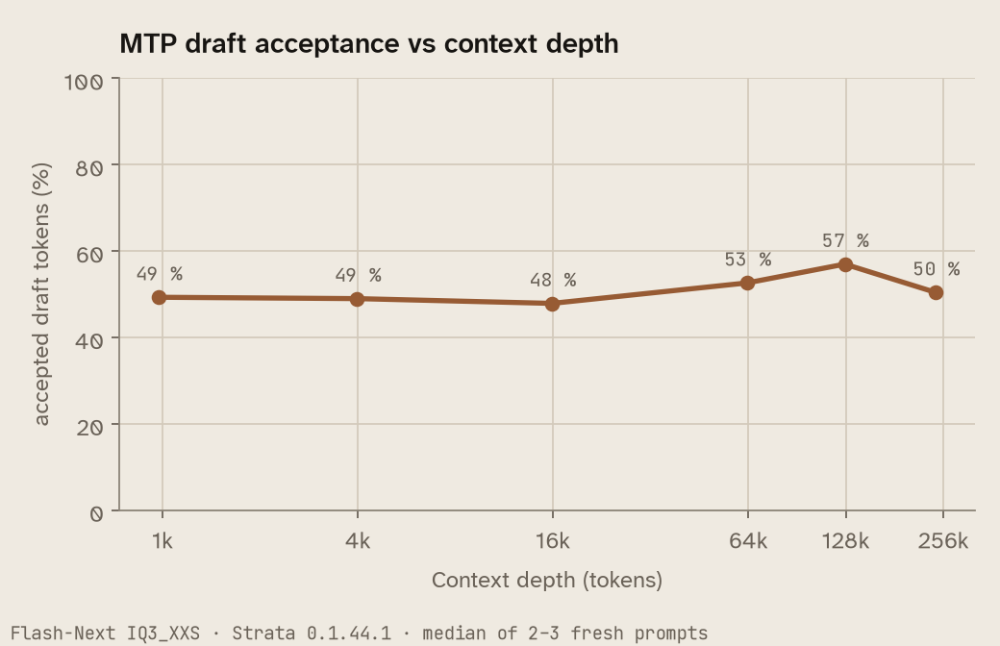
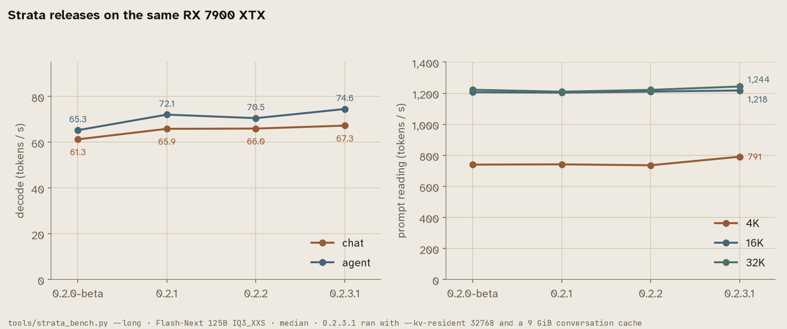
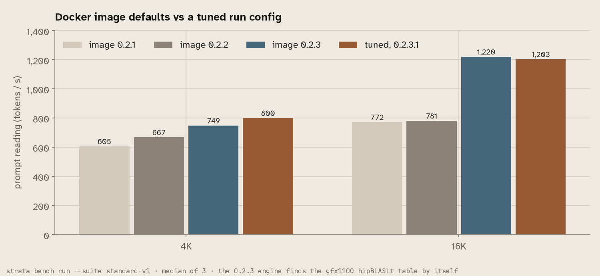
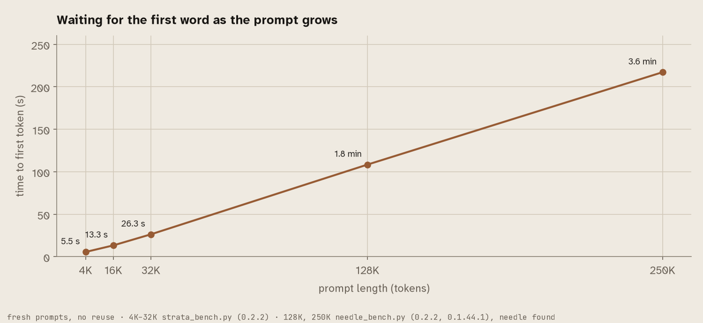
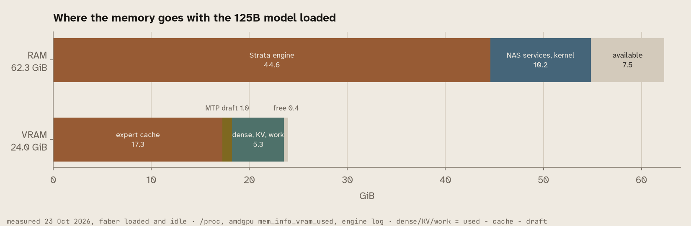
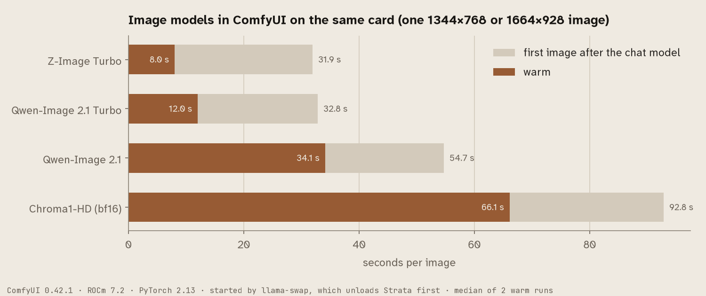

# UGREEN iDX6011 Pro + eGPU dock + Radeon RX 7900 XTX: a 125B LLM on a NAS

**English** · [Deutsch](README.de.md)

A field report with working files: how I run **Qwen3.8-Flash-Next (125B, Mixture of Experts)** at **63–68
tokens/s with a 256k context** on a UGREEN iDX6011 Pro NAS, with a Radeon RX 7900 XTX in UGREEN's OCuLink eGPU
dock, using [Strata](https://github.com/Niko1221/Strata) (ROCm/HIP) behind
[llama-swap](https://github.com/mostlygeek/llama-swap). The same NAS keeps serving photos, media and backups.

Everything here was measured on my machine unless marked otherwise. This repository contains **no Strata code**,
only the build recipe, launch configs, UGOS fixes, helper scripts and benchmark tools.

## The combination

```
  UGREEN iDX6011 Pro      UGOS Pro 1.19 (Debian 12 base, kernel 6.18.15)
  │                       64 GB LPDDR5X · hybrid CPU (P- and E-cores) · 2× 10 GbE · 2× Thunderbolt 4
  │                       built-in Intel Arc iGPU → video transcoding, photo recognition
  │
  │  OCuLink, PCIe 4.0 x4 (host port caps at x4 / 16 GT/s ≈ 7.9 GB/s)
  ▼
  UGREEN LinkStation eGPU dock   own 850 W power supply
  └─ AMD Radeon RX 7900 XTX      24 GB VRAM, Navi 31 / gfx1100, x16 inside the dock
       └─ Strata (ROCm 7.10 from AMD's TheRock wheels), one model at a time via llama-swap
            └─ Qwen3.8-Flash-Next 125B MoE · IQ3_XXS (ISTA-DASLab) · int8 KV cache · MTP draft head · 256k
```

**Why a 125B model fits on a 24 GB card:** Flash-Next is a Mixture-of-Experts model; only a few experts run per
token. Strata keeps the frequently used experts in VRAM and the rest in system RAM, and computes missing experts
on the CPU instead of copying them over the x4 link. The iDX's fast LPDDR5X is what makes this work: the model
uses about 53 GiB of the 64 GB. A dense 70B model on the same hardware would be slow (estimated 3–5 T/s), because
it has to read all weights for every token.

**Two GPUs, cleanly separated:** the Arc iGPU (`renderD128`) handles media, the XTX (`renderD129`) only runs
language models. Passing `/dev/dri` wholesale to a media container lets it grab the dock card; assign devices per
container.

## Measured

All values from `messen/bench.py`, median of 3 runs each.

| | Ollama, Qwen3.8 27B | **Strata, Flash-Next IQ3_XXS** | Strata, Flash-Next IQ2_XS |
|---|---|---|---|
| Writing, long answer | 31.2 T/s | **63–68 T/s** | 76.5 T/s |
| Reading 32,000 tokens | 42.7 s | **25–26 s** | 24.0 s |
| Agent session, 6 coding turns | 162.5 s | **48–54 s** | 35.7 s |
| Context | 64k | **256k** (tested with 249,928 tokens) | 256k |
| RAM used, whole machine | 21.7 GiB | 53.4 GiB | 48.9 GiB |
| Card power while writing | 322 W | 283 W | 288 W |
| Quality per the quantizer | – | 99.4 % of the full model | 95.7 % |

Card at idle with no model loaded: about 9 W, 44–51 °C.

### Throughput vs context depth (1K to 248K)

One fresh prompt per run, then 256 new tokens; engine timings, median of 2–3 runs. "Without MTP head" is the same
configuration with `--mtp` removed (a native pack still needs `--spec`, but gets almost no drafts).


| Prompt tokens | Decode with MTP | Decode without MTP head | Prefill with MTP | Prefill without MTP head | MTP acceptance |
| ---: | ---: | ---: | ---: | ---: | ---: |
| 993 | 62.0 | 48.9 | 362 | 391 | 49 % |
| 4,075 | 60.6 | 50.2 | 745 | 782 | 49 % |
| 16,252 | 63.0 | 50.5 | 1,164 | 1,253 | 48 % |
| 65,023 | 61.1 | 49.3 | 1,185 | 1,265 | 53 % |
| 130,024 | 61.0 | 47.2 | 1,175 | 1,220 | 57 % |
| 248,052 | 56.1 | 44.9 | 1,079 | 1,117 | 50 % |

Decode barely drops with depth (62 → 56 tok/s with MTP up to 248K), MTP adds 21–29 % at every depth, prefill stays
at 1,080–1,270 tok/s from 16K on, over the x4 link. **Recall** (Strata's `needle_bench.py`): the code word was found
9 of 9 times at 32K, 128K and 250K, at depths of 10, 50 and 90 %.



### Does Strata cost quality? Strata vs llama.cpp on the same file

Same GGUF (Flash-Next IQ3_XXS), same fixed text set from Strata's `tools/quant_quality.py` (code, docs, English,
other languages, an agent transcript; 4,995 positions, teacher-forced). Strata through `quant_quality.py run`,
mainline llama.cpp (build 11610, Vulkan, experts on the CPU) position by position through `llama-server`
(`messen/qq_llamacpp.py`, same output format), compared with `messen/qq_vergleich.py`:

| Comparison | same top token | KL mean | KL median | KL p99 | Perplexity |
| --- | ---: | ---: | ---: | ---: | --- |
| llama.cpp vs Strata (experts on CPU) | **95.7 %** | 0.020 | 0.0017 | 0.27 | 4.009 vs 4.017 |
| llama.cpp vs Strata (experts on GPU) | 95.7 % | 0.020 | 0.0017 | 0.34 | 4.009 vs 4.019 |
| Strata CPU path vs Strata GPU path | 95.7 % | 0.018 | 0.0017 | 0.27 | – |

**Strata costs no measurable quality against llama.cpp:** the difference is as large as the one between Strata's
own CPU and GPU kernels, i.e. numerical noise. For scale, Strata's docs put IQ3_XXS against Q8_0 at 84.5 % and KL
0.20 – the quantization costs quality, the engine does not. Limits: perplexity over the 4,982 positions where
llama.cpp returned the exact value (target among its top 4,000); Strata's yardstick runs FP16 K/V without MTP
drafts, so the effect of int8 K/V is not covered; one text set.

### Strata settings that measurably matter

| Setting | Value | Effect |
|---|---|---|
| `--pool-workers` | 9 up to 0.2.0, **leave it out from 0.2.1** | up to 0.2.0: 76.8 instead of 56.1 T/s vs. automatic (measured with IQ2_XS); 0.2.1 plans 10 workers itself and keeps them off the LP-E cores |
| `--pcie-frac` | 0 | the CPU computes missing experts instead of copying them over x4; no speed loss, spares the link |
| `--kv` | int8 | halves the KV cache, 256k context fits |
| `--max-context` | 262144 | the trained maximum; 250k tokens read in about 4 min |
| `--mtp` | MTP draft head | draft tokens speed up writing |
| `--conversation-cache-mib` | 4608 | parks a session of up to ~120,000 tokens while another request runs (parked in 0.16 s, restored in 0.06 s) |
| `STRATA_HIPBLASLT_TUNING` | `tools/hip/gfx1100-hipblaslt-100200.txt` | must match the hipBLASLt version, otherwise prompt reading is ~45 % slower |
| Quantization | IQ3_XXS instead of IQ3_S | 53 instead of 60 GiB RAM; IQ3_S leaves no room for other NAS services |


### Strata 0.1.44.1 vs 0.1.45 (17 Oct 2026)

No measurable difference for Flash-Next on gfx1100; all values within noise:

| Variant | long T/s | 8k read T/s | 32k read s | Agent s |
|---|---|---|---|---|
| 0.1.44.1 | 65.5 | 1,175 | 26.0 | 52.6 |
| 0.1.45 | 63.5 | 1,151 | 26.3 | 53.7 |
| 0.1.45 `--pool-affinity p-cores` | 61.0 | 1,134 | 27.2 | 48.1 |
| 0.1.45 `--pool-affinity measure` | 62.5 | 1,111 | 26.7 | 49.5 |
| 0.1.45 `STRATA_CPU_IQ_ALL_EXACT1=1` | 61.4 | 1,143 | 26.8 | 49.8 |

Long prompt (103,341 tokens, fresh): 87.7 s · 88.1 s · with `STRATA_SCORES_THREAD=1` 85.3 s. Greedy answers
(temperature 0) are **not** byte-identical between the versions, but equivalent in content. `STRATA_HIP_WMMA` is
gfx12 only.

### Follow-up 19 Oct 2026: Strata 0.2.0-beta, pictures, and three checks for the Strata team

**0.2.0-beta's prebuilt RX 7000 engine runs on this card.** The release notes say the `hip-rx7900` package was compiled but never ran on a real RX 7000. Here it ran on the XTX with the same weights, packs and settings as `arbeit`: `strata_bench.py --long` gave 61.3 tok/s chat decode, 741 / 1,207 / 1,223 tok/s prompt at 4K / 16K / 32K and a 68.6 % agent cache hit, the same as 0.1.44.1. Recall was 9/9 up to 250K, and our task set passed 27 of 29. Production stays on 0.1.44.1, because the new version brings nothing measurable here.

| | 0.1.44.1 (17 Oct) | 0.2.0-beta `hip-rx7900` |
|---|---:|---:|
| chat decode (`strata_bench --long`) | 63.7 | 61.3 tok/s |
| 4K / 16K / 32K prompt | 741 / 1,195 / 1,224 | 741 / 1,207 / 1,223 tok/s |
| needles 32K / 128K / 250K | 9/9 | 9/9 |
| 0.2.0's new default worker count (15 here) | – | 39.8 / 41.2 tok/s instead of 59.7 / 64.0 with `--pool-workers 9` |

**Keep `--pool-workers` on a hybrid CPU.** 0.2.0 plans one worker per physical core but the host's, which means 15 on the 255H, and that was a third slower than 9. Strata also counts the two LP-E cores (Linux `cpu_lowpower`, no L3) as P-cores and puts workers on them early. Limiting the container to CPUs 0-13 made short prompts about 40 % faster (66 → 94 tok/s for a 63-token prompt) and left decode unchanged.

**Pictures straight into the 125B model.** Flash-Next has its own picture reader (mmproj, 907 MB). On the CPU (`--vision cpu`) it costs no VRAM and about 1 GiB of RAM, and it read all test pictures correctly in 1.2–5 s each. Our 0.1.44.1 engine can do this already once `tools/vision` is built (`-DSTRATA_VISION_CUDA=OFF`). 0.2.0 makes the GPU reader the default on 24 GB cards. On the XTX it costs 776 expert slots (1.28 GiB), and a large picture takes 3.5 s instead of 5.6 s. If you update, set `--vision cpu` explicitly unless you want that trade.

**Strata issue #3177** (MTP verify timeout on a single 7900 XTX at ~54K tokens) does not reproduce here: 6 of 6 agent requests of 55,019 tokens with 2,500 tokens of output each finished, on 0.1.45 and 0.1.44.1, with and without the MTP head.

**Fresh engines.** The 0.2.0 notes report that about half of the fresh engines with MTP on an R9700 read prompts 10–23 % slower. Here: 1 of 24 fresh 0.2.0 engines read both 4K prompts about 38 % slower (420 instead of about 675 tok/s), 0 of 24 with 0.1.44.1. The slow engine's start-up lines were the same as the others'. So it happens on gfx1100 too, but rarely.

Scripts: `messen/visiontest.py`, `messen/r3177.py`, `messen/folgetests.py`, `messen/t020.py`. Raw data: `messen/daten/2026-10-19/`.

### Follow-up 21 Oct 2026: Strata 0.2.1, now in production here

**The hybrid-CPU fix from Strata issue #3262 works.** 0.2.1 counts the two LP-E cores (`cpu_lowpower`) as efficiency cores. Without `--pool-workers` it plans 10 workers on CPUs 1–10 and leaves CPUs 14/15 free, and setup inside the Docker image writes the same 10. Measured in 3 interleaved pairs, a fresh engine per run:

| | decode tok/s | 63-token prompt tok/s |
|---|---:|---:|
| 0.1.44.1, `--pool-workers 9` (two of them on the LP-E cores) | 63.3 | 66.1 |
| 0.2.1, `--pool-workers 9` (CPUs 1–9) | 61.5 | 88.0 |
| **0.2.1 default, 10 workers** | **61.1** | **97.6** |

Everything else stays as before: `strata_bench.py --long` 65.9 tok/s chat decode, 742 / 1,204 / 1,210 tok/s at 4K / 16K / 32K, needles 6/6 up to 128K, our task set 28 of 29, 8 of 8 fresh engines normal. Both packaging notes from #3263 are fixed in 0.1.46. **Since 21 Oct this NAS runs the prebuilt release packages** (engine 0.1.46 `hip-rx7900`, control 0.1.46.2) without `--pool-workers`; configs and the llama-swap macro are in `konfig/strata-0.2.1/`.

**The Docker image `ghcr.io/niko1221/strata:0.2.1-rocm-gfx110x` runs on the XTX.** The release notes listed it as built but not run on a card. Its unchanged `strata bench run --suite standard-v1 --track default` is complete with 12/12 sanity checks. Its own choices read long prompts more slowly than our config, though: 3 slots, GPU picture reader, 128K, 700 MiB reserve, and no hipBLASLt table give 772 tok/s at 16K. **The gfx1100 hipBLASLt table that ships in the package but is opt-in in 0.2.1 is worth +23 % at 4K and +60 % at 16K** (`STRATA_HIPBLASLT_TABLE=on` → 1,238 tok/s). If you use the image, set it.

| `standard-v1`, medians of 3, tok/s | short prompt / decode | 4K prompt / decode | 16K prompt / decode |
|---|---:|---:|---:|
| Docker image, defaults | 43.3 / 58.9 | 605.4 / 55.9 | 772.0 / 55.0 |
| + `PARALLEL=1` | 57.8 / 63.7 | 623.9 / 59.3 | 773.8 / 58.7 |
| + `PARALLEL=1 STRATA_HIPBLASLT_TABLE=on` | 60.4 / 65.8 | 768.3 / 62.4 | 1,238.5 / 69.3 |
| release packages with `konfig/strata-0.2.1/arbeit.json` | 51.7 / 69.0 | 743.9 / 63.5 | 1,236.7 / 62.5 |

Reported to Strata in #3262, #3263 and PR #2904, together with the results. Script: `messen/t021.py`. Raw data: `messen/daten/2026-10-21/`.

### Follow-up 21 Oct 2026, evening: Strata 0.2.2, also in production

0.2.2 (engine 0.1.47 `hip-rx7900`, control 0.1.47) brings no speed change for this combination, but more robustness: tool calls with a mistyped opener are read as calls, a NaN in a long prompt no longer fails the request, a rare hang of the first verify window on HIP is fixed. Measured against the 0.2.1 packages with the same run config, only engine and control swapped:

| median tok/s | 0.2.2 | 0.2.1 |
|---|---:|---:|
| 3 interleaved pairs: decode / 63-token prompt | 62.1 / 93.6 | 60.5 / 93.9 |
| `strata_bench.py --long`: chat / agent decode | 66.0 / 72.5 | 65.9 / 74.6 |
| 4K / 16K / 32K prompt | 736 / 1,211 / 1,222 | 742 / 1,204 / 1,210 |

Needles 6/6 up to 128K, 8 of 8 fresh engines normal, our task set 28 of 29 (the one miss is a false alarm of the check: the phishing mail was written, with a note in front). **`strata bench run` from the release package is complete now**, because the control archive carries a `COMMIT` file. The `0.2.2-rocm-gfx110x` Docker image runs too, with the same slow defaults as 0.2.1 (700 MiB reserve, no hipBLASLt table, 16K at 781 tok/s), so the advice above still holds. **Since the evening of 21 Oct this NAS serves with 0.2.2**; the configs are unchanged, only the macro mounts the new packages (`konfig/strata-0.2.2/`). Script: `messen/t022.py`. Raw data: `messen/daten/2026-10-21-v0.2.2/`. Reported in #3263 and PR #2904.

### Follow-up 23 Oct 2026: Strata 0.2.3.1, now in production, and four releases side by side

The 0.2.3 notes list RX 7000 as built but not run on real hardware. Here it ran: engine 0.1.48 `hip-rx7900` with control 0.1.48.1, against the 0.2.2 packages with the identical run config, only engine and control swapped.

| median tok/s | 0.2.3.1 | 0.2.2 |
|---|---:|---:|
| 3 interleaved pairs: decode / 63-token prompt | 62.5 / 111.7 | 61.6 / 112.3 |
| `strata_bench.py --long`: chat / agent decode | 67.3 / 78.3 | 66.0 / 72.5 * |
| 4K / 16K / 32K prompt | 791 / 1,218 / 1,244 | 736 / 1,211 / 1,222 * |

\* 0.2.2 run of 21 Oct, before `--kv-resident 32768` and the 9 GiB conversation cache. Prompt reading at 4K is about 7 % faster in every test, decode is equal within the noise. Needles 6/6 at 32K and 128K and 3/3 at 250K, `standard-v1` complete with 12/12, our task set 29 of 29, 8 of 8 fresh engines normal. **Since the evening of 23 Oct this NAS serves with 0.2.3.1.** The models are called `faber` (was `arbeit`) and `velox` (was `schnell`) here now; configs and the llama-swap macro with the old names as aliases are in `konfig/strata-0.2.3.1/`. Script: `messen/t0231.py`. Raw data: `messen/daten/2026-10-23-v0.2.3.1/`.



From 0.2.0-beta to 0.2.3.1 nothing got slower on this card. Decode rose from 61 to 67 tok/s, mostly with 0.2.1's worker plan for hybrid CPUs (#3262); prompt reading at 16K and 32K was already at its ceiling.

**The first 128K prompt of the 0.2.3.1 run took 217 s, where every earlier release needed about 108 s.** A separate A/B (`messen/t128.py`) settled it: a fresh engine each time, the identical run config, alternating, twice each. 0.2.3.1 read the first 128K prompt in 110.5 and 110.8 s, 0.2.2 in 111.1 and 111.6 s, the needle was found every time. So no regression; the 217 s was a one-off in a long test run, most likely the conversation cache and RAM filled by the tests before it.

### Full speed in the Docker image

**The engine now finds its gfx1100 hipBLASLt table by itself.** With `STRATA_HIPBLASLT_TUNING` removed from the run config, the log still says `hipBLASLt tuning enabled (26 rows, gfx1100, version 100200)`. That is the biggest change of 0.2.3 for RX 7000 owners who use the Docker image with its defaults: it reads 16K prompts at 1,220 instead of 781 tok/s, the first token of a 16K prompt comes after 13.5 s instead of 21 s.



With 0.2.3 the unchanged image is within a few percent of the tuned config. What still differs: setup picks `--max-context 131072` and a 700 MiB VRAM reserve, and the engine warned once that only 427 MiB were free at the start of a request. If you need 256K, set `CONTEXT` and a reserve of about 830 MiB yourself. On images before 0.2.3, set `STRATA_HIPBLASLT_TABLE=on`.

### How long a long prompt takes, and where the memory goes



Reading grows almost linearly with the prompt: 5.5 s at 4K, 26 s at 32K, 1.8 min at 128K and 3.6 min at 250K, the needle was found every time. Strata's conversation cache keeps an agent session from paying this again on every turn: in `strata_bench.py`'s agent run only 3 tokens per session are read twice.



With `faber` loaded and idle, the engine holds 44.6 GiB of the 62.3 GiB RAM (the expert weights that do not fit on the card, the K/V of 32K tokens in 3.1 GiB of pinned RAM, and the conversation cache as it fills), the NAS services and the kernel 10.2 GiB, and 7.5 GiB stay available. On the card the expert cache takes 17.3 GiB of 24 GiB (10,644 slots), the MTP draft 1 GiB, everything else 5.3 GiB, 0.4 GiB stay free. With 64 GB RAM this is about the limit: a second large service next to it needs the conversation cache made smaller.

## Dock and link: what you need to know

- **OCuLink is not hot-pluggable.** Switch the dock on first, then start the NAS. The card is only detected at
  boot. This cost me an evening; UGREEN confirmed it when asked.
- **Use one cable.** With OCuLink and Thunderbolt connected at the same time, nothing was detected.
- **x4, not x16.** The host port reports `LnkCap` x4 at 16 GT/s. Irrelevant for inference, noticeable when loading
  large models.
- **No power control on the port** (`PwrCtrl-`). The OS cannot power-cycle the dock; `/sys/bus/pci/slots/*/power`
  only retrains the link. After some dropouts the card came back on its own after 22–47 s (which looks like the
  dock restarting); after another it stayed gone until the next reboot.
- **Dropouts (cause still under investigation):** each starts with PCIe receiver errors, followed 50 ms later by
  "Link Down", with the card idle and cool. In 5 of 7 events the 10 GbE NIC on a different PCIe branch lost its
  link at the same moment, which points to an electrical disturbance rather than the card. Not caused by the UPS's eco mode (off); the weekly battery self-test of the UPS, however, is behind the Wednesday series (see below).
- **PCIe quirk:** after one dropout the kernel clamped the link to 2.5 GT/s and failed to retrain. The fix
  ("Always lift 2.5GT/s restriction") is in 6.18.39; UGOS ships 6.18.15.

### Follow-up 21 Oct 2026: the disturbances follow two weekly clocks

Logged with second resolution since 15 Oct (`messen/dock-mitschnitt.sh`, read-only: kernel messages, link changes, AER counters of the dock port, the NVMe port and the 10 GbE port, link state and power of the card). Going back through the kernel log, the events fall into two series:

| series | events | step per week | reading |
|---|---|---|---|
| Sunday | 13 Sep 17:14:33 · 20 Sep :36 · 27 Sep :39 · 4 Oct :43 · 18 Oct :49.8 | +3.3 s (about 5.5 ppm) | a free-running clock, like a quartz without time sync |
| Wednesday | 23 Sep 17:40:00 · 30 Sep 18:01:10 · 7 Oct 18:22:22 · 14 Oct 18:43:32 · **21 Oct 19:04:41** | +21 min 9-12 s | a fixed interval of 7 days 21 min 10 s: **the UPS's weekly battery self-test** (see below) |

**The Wednesday prediction hit within 2 s.** Predicted 19:04:43, measured: the 10 GbE NIC lost its link at 19:04:41.3 for 5.1 s, and 1.5 s later the dock port logged a corrected receiver error (`RxErr`). The OCuLink link stayed at 16 GT/s x4, no model was loaded, the card idled at 17 W. On 14 Oct the 10 GbE link dropped on schedule while the card was not even on the bus, so the source sits outside the NAS. Both the copper network cable and the OCuLink cable pick it up; the dock is one victim, not the cause. The router's event log shows nothing at these times. Excerpt: `messen/daten/dock-2026-10-21/`.

**Update, same night: the Wednesday series is the UPS testing its battery.** The NAS and the dock are the only loads on an Eaton Ellipse PRO 1200, read via NUT once a minute. In six weeks its battery charge left 100 % exactly six times, each time in the minute right after a Wednesday event (16 Sep 17:18:58, 23 Sep 17:40:12, 30 Sep 18:01:49, 7 Oct 18:22:49, 14 Oct 18:44:14, 21 Oct 19:05:29): 100 → 99 %, runtime 3,814 → 3,775 s, back to 100 % about 20 minutes later. Three of these samples even caught the runtime estimate on battery (1,037 s and 2,812 s instead of 3,814 s). The datasheet lists an automatic battery test once a week; the extra 21 minutes per week are the UPS's own timer. So the NAS is not disturbed from outside on Wednesdays, its own UPS switches it to battery for a few seconds, and that switch is what the copper network link and the OCuLink link pick up (5 of 6 tests; on 16 Sep nothing was logged). The status read once a minute stays `OL`, which is why this was missed at first. NUT on this model offers no command to start or schedule the test. The Sunday series shows no such trace and remains open.

Next: on 25 Oct (end of daylight saving time) the Sunday series tells whether its device switches to winter time (17:14:53) or not (16:14:53); on 28 Oct the Wednesday series is due at 18:25:51 CET if it really is a fixed interval. If you see repeated `RxErr` on an OCuLink port, log with second resolution and look for a weekly pattern before you replace cables or the dock.

## The biggest open risk: a dock dropout reboots the NAS

If the dock drops while a ROCm model is loaded, `amdgpu` under kernel 6.18 tears down the compute queues while
they are still in use (`kfd_device_queue_manager.c … uninitialize`), and a kernel oops follows. UGOS sets
`kernel.panic_on_oops=1` and `kernel.panic=3`, so the whole NAS restarts three seconds later. Reproduced three
times. Fixed upstream in Linux `6cca686dfce7` (7.0) and `81665e35f143` (7.1).

**My mitigation:** llama-swap unloads the model after 30 minutes idle (`globalTTL: 1800`). With no model loaded,
the iDX survives a dropout; the card is then gone until the next reboot.

## What I had to change on UGOS

| # | Problem | Fix |
|---|---|---|
| 1 | UGOS ships **no firmware for Navi 31** (gfx1100), not even in 1.19. `amdgpu` ends with `Fatal error during GPU init` | copy 15 files from Debian's `firmware-amd-graphics` (20250410) to `/lib/firmware/amdgpu/`: `gc_11_0_0_{imu,me,mec,mes,mes1,mes_2,pfp,rlc,rlc_1}.bin`, `psp_13_0_0_{sos,ta}.bin`, `smu_13_0_0.bin`, `sdma_6_0_0.bin`, `vcn_4_0_0.bin`, `dcn_3_2_0_dmcub.bin`. They survived the update to 1.19 (UGOS uses an overlay). Safety net: `ugos/` |
| 2 | UGOS sets `GODEBUG=tlskyber=0` system-wide; Go programs from Go 1.24 (e.g. llama-swap) abort immediately | `Environment=GODEBUG=` in the systemd unit |
| 3 | Containers don't see the card | `--device /dev/kfd --device /dev/dri --group-add video --group-add render` (gid 44 and 105 here) |
| 4 | `docker --device` rejects colons (`/dev/dri/by-path/pci-0000:…`); a renamed render node is not found by Vulkan, which then silently computes on the CPU | resolve the path first, keep the node name |
| 5 | Kernel log flood `init_user_pages: Failed to get user pages: -1` (about 15,000 lines per model load) | harmless, caused by mmap on btrfs/LVM; with llama.cpp `--no-mmap` avoids it |
| 6 | `/volume1` is mounted about 41 s after `local-fs.target` | units that need it wait on their own (see `ugos/amdgpu-gfx1100-restore.service`) |
| 7 | `network-online.target` fires before the network is usable | CIFS mounts and services bound to a fixed address wait for address and port themselves |
| 8 | New folders under `/volume1/docker` inherit an ACL that locks containers out despite `rwxrwxrwx` | set permissions and owner explicitly |
| 9 | UGOS occasionally rewrites the firewall; own rules in `DOCKER-USER` disappear | re-apply rules from a timer |
| 10 | Journal capped at 50 MB, covers only about an hour | keep your own recordings for troubleshooting |
| 11 | Non-interactive SSH sessions have no `/sbin` in PATH, `modinfo` is not installed | a `command not found` is not a negative result |

What UGOS does well: watchdog, a readable last-reboot reason, pstore crash logs, a NUT server for the UPS, and
version 1.19 brought kernel 6.18 with about 700 amdgpu firmware files.

## Running an agent (Hermes) on top

- Set `context_length` per model in the agent (256k), otherwise it assumes a smaller window.
- `sendLoadingState: false` in llama-swap, otherwise loading notices end up in the reasoning part of the answer.
- With high reasoning effort always set a token budget; on hard coding tasks the model can otherwise think
  forever.
- If a second request (e.g. a command reviewer) runs alongside, each one evicts the conversation cache and every
  long session gets re-read. Strata's conversation parking (`--conversation-cache-*`) solves that.

## Pictures on the same card: ComfyUI through llama-swap

Since 23 Oct the XTX also makes pictures. ComfyUI runs as one more model in llama-swap, so the card holds either the chat model or the picture models, never both, and llama-swap swaps them on demand. llama-swap has a ready entry point for this: a model named exactly `comfyui_auto` is served under `/comfyui/`, and the open browser tab's websocket neither loads the model nor keeps it loaded. The entry is in `konfig/comfyui/llama-swap-comfyui.yaml` (image `yanwk/comfyui-boot:rocm`, ROCm 7.2, PyTorch 2.13, ComfyUI 0.42.1); it starts in about 20 s.



| Model | Files | Seconds per picture, warm | License |
|---|---|---:|---|
| Z-Image Turbo | `z_image_turbo_bf16`, `qwen_3_4b`, `ae` | 8 | Apache 2.0 |
| Qwen-Image 2.1 Turbo | `qwen_image_2.1_turbo_int8_convrot`, `qwen3vl_8b_int8_convrot` | 12 | Qwen Research License |
| Qwen-Image 2.1 | `qwen_image_2.1_int8_convrot`, `qwen3vl_8b_int8_convrot` | 34 | Qwen Research License |
| Chroma1-HD | `Chroma1-HD` (bf16), `t5xxl_fp16`, `ae` | 66 | Apache 2.0 |

What I learned on gfx1100:

- **The `int8_convrot` files of the official ComfyUI templates run on ROCm**, at the speeds above.
- **No fp8 weights on this card.** `Chroma1-HD-fp8mixed` with the fp8 T5 ended in an `amdgpu ... page fault`, ComfyUI died, llama-swap restarted it. The NAS stayed up. The same models in bf16/fp16 ran without a fault since.
- **Prompts in English** match much better. Qwen-Image 2.1 wrote a German poster headline wrong and in small print; in English it was a clean headline across the top.
- The first ComfyUI start creates the model folders as root; a download running as another user then fails on the rename.

For the agent there is a small image backend for Hermes Agent in `konfig/comfyui/hermes-plugin/`: it puts the prompt into one of the workflows in `konfig/comfyui/workflows/` (derived from the official templates), sends it to `/comfyui/api/prompt` and returns the picture, so "make a picture of …" in Telegram comes back as a picture. `konfig/comfyui/modelle-laden.sh` downloads the files (about 77 GB). Raw timings: `messen/daten/2026-10-23-bilder/`.

## Build

```bash
docker build -t strata-hip:v0.1.45 --build-arg STRATA_REF=v0.1.45 .
```

Build on the machine it will run on: llama.cpp and the engine are optimized for the build machine's CPU. The image
is about 21 GB, roughly 11 GB of which is ROCm from AMD's TheRock wheels (7.10.0a20251120, index `gfx110X-dgpu`).
Compiling took 83 s; downloading takes longer.

**Two traps the Dockerfile avoids:**

1. `rocm-sdk path --root` has to run once before CMake can see the ROCm root. It unpacks the developer files,
   including `lib/cmake/hip-lang`. Without it, `enable_language(HIP)` fails with "does not contain the HIP runtime
   CMake package". `setup.py` does this silently, a plain CMake build does not.
2. The engine must be executable. An earlier manual build left it with mode `----------`.

## Run

Strata's `setup.py` creates models, packs and the MTP head; they are bind-mounted to `/strata/data`. Launch configs
are in `konfig/`, a llama-swap example in `konfig/llama-swap.yaml`. Put the host names the server is reached under
into `allowed_hosts` (Strata checks the Host header against DNS rebinding).

## Contents

```
  Dockerfile                    build recipe for Strata + ROCm on gfx1100
  konfig/arbeit.json            Flash-Next IQ3_XXS, 256k, reasoning effort high
  konfig/schnell.json           Flash-Next IQ2_XS
  konfig/llama-swap.yaml        one endpoint, one model at a time, unload after 30 min
  ugos/firmware-sichern.sh      backs up the 15 gfx1100 firmware files to the data pool
  ugos/firmware-pruefen.sh      checks and restores them after a UGOS update
  ugos/amdgpu-gfx1100-restore.service   runs the check after every boot
  messen/bench.py               writing, reading, agent session, quality tasks (aufgaben.json, German prompts)
  messen/identitaet.py          same prompts greedy to two models, character-exact comparison
  messen/langprompt.py          read time of a fresh long prompt
  messen/auswertung045.py       results table
  messen/tiefe.py               decode/prefill vs context depth (1K to 248K)
  messen/charts.py              the charts in bilder/ (light Workbench design)
  messen/daten/                 raw data: depth sweep, strata_bench.py and needle_bench.py results
  messen/qq_llamacpp.py         llama.cpp counterpart of Strata's quant_quality.py (teacher-forced top-64 per position)
  messen/qq_vergleich.py        top-1 agreement, KL and perplexity of two runs
  messen/daten/qualitaet/       the three runs (gzip) and the comparison results
  messen/visiontest.py          picture reader on the CPU: test pictures, VRAM/RAM, against the 27B vision model
  messen/r3177.py               reproduction attempt for Strata issue #3177 (long agent request with MTP)
  messen/folgetests.py          LP-E cores A/B (--cpuset-cpus) and fresh-engine prompt speed
  messen/t020.py                Strata 0.2.0-beta prebuilt hip-rx7900 engine: bench, needles, workers, picture readers
  messen/daten/2026-10-19/      raw data of the follow-up (README inside)
  messen/t021.py                Strata 0.2.1: worker pairs, bench, needles, fresh engines, standard-v1
  messen/daten/2026-10-21/      raw data incl. four standard-v1 results (README inside)
  konfig/strata-0.2.1/          launch configs and llama-swap macro for the prebuilt 0.2.1 packages
  messen/t022.py                Strata 0.2.2 against 0.2.1: version pairs, bench, needles, fresh engines, standard-v1, Docker image
  messen/daten/2026-10-21-v0.2.2/  raw data of the 0.2.2 follow-up (README inside)
  konfig/strata-0.2.2/          the same launch configs, llama-swap macro for the prebuilt 0.2.2 packages
  messen/dock-mitschnitt.sh     second-by-second capture around an expected dock event (read-only, needs root)
  messen/daten/dock-2026-10-21/ excerpt of the capture of 21 Oct, the Wednesday event on schedule
  konfig/strata-0.2.3.1/        launch configs (faber = was arbeit, velox = was schnell) and llama-swap macro for 0.2.3.1
  messen/t0231.py               Strata 0.2.3.1 against 0.2.2: pairs, bench, needles, fresh engines, standard-v1, Docker image, table variable off
  messen/t128.py                first 128K prompt on a fresh engine, 0.2.3.1 against 0.2.2, alternating
  messen/daten/2026-10-23-v0.2.3.1/  raw data incl. memory.json and the 128K A/B (README inside)
  messen/charts2.py             charts for releases, Docker image, picture models, context and memory
  konfig/comfyui/               ComfyUI: llama-swap entry, download script, workflows, image backend for Hermes Agent
  messen/daten/2026-10-23-bilder/  seconds per picture, four models, first and warm
```

The benchmark scripts only talk to `/v1/chat/completions`, use Python's standard library and sample VRAM, GPU load,
power and RAM from sysfs (set `KARTE` in `bench.py` to your card). Code tasks run in a throwaway container without
network. File and folder names are German; the scripts' comments too.

## License

MIT for the files in this repository, see `LICENSE`. Strata itself is under its own license upstream.
