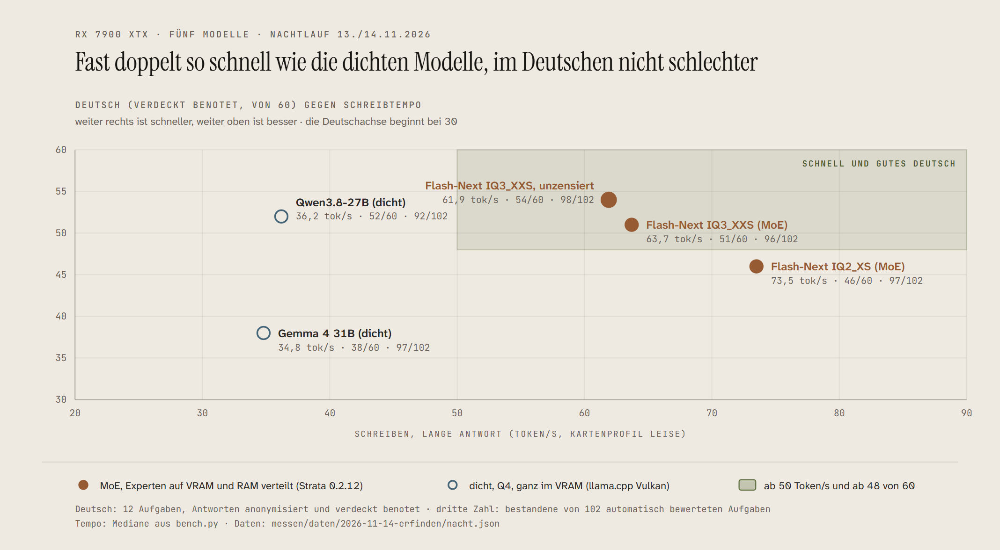
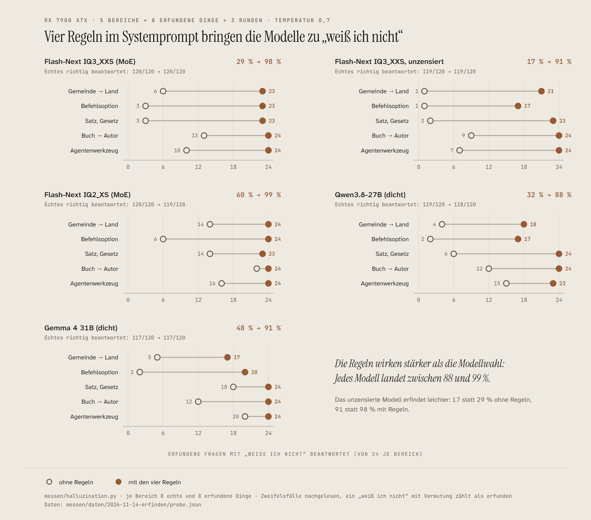
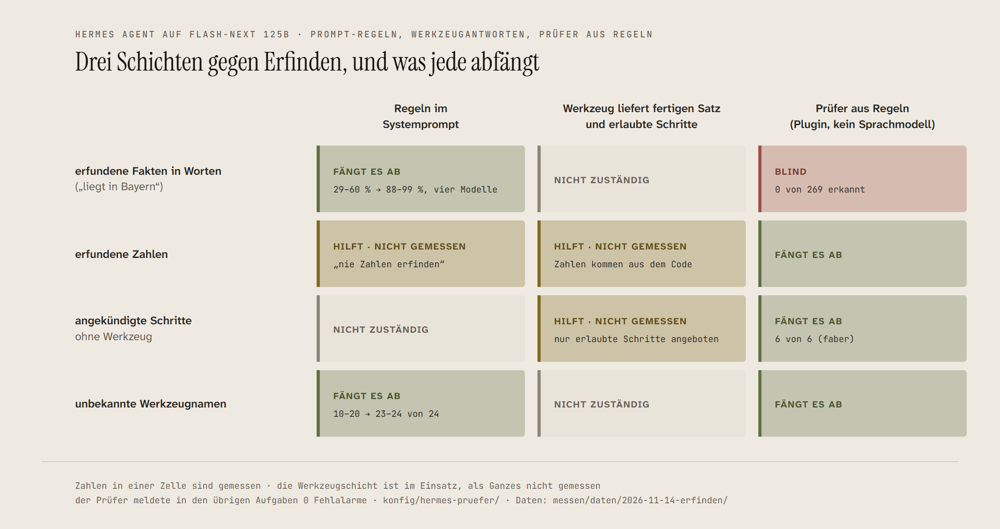

# Dichte Modelle auf derselben Karte, und wie man das Erfinden senkt

[English](agent.md) · **Deutsch** · [← README](../README.de.md)

In Konfigurationen, Skripten und Dateinamen tragen die beiden Modelle Kurznamen: `faber` ist Flash-Next 125B in der Quantisierung IQ3_XXS und im täglichen Einsatz; `velox` ist dasselbe Modell in der kleineren und schnelleren Quantisierung IQ2_XS.

Nachtrag vom 14.11.2026 zum Abschnitt [Ein Agent obendrauf](../README.de.md#ein-agent-hermes-obendrauf).

Der Agent auf diesem NAS betreibt einen Datenbestand mit eigenen Werkzeugen. Er hat zwei Schwächen gezeigt: Er
erfindet Antworten auf Dinge, die es nicht gibt, und er kündigt Schritte an, für die er kein Werkzeug hat („ich
pausiere den Lauf“). Zwei Fragen: Hilft ein anderes Modell auf derselben Karte, und was hilft sonst?

**Dichte Modelle helfen nicht.** Qwen3.8-27B und Gemma 4 31B (je Q4, ganz im VRAM, llama.cpp Vulkan) gegen die beiden
MoE-Modelle dieses NAS (Strata 0.2.12), alle durch dasselbe Messprogramm:



| | Aufgaben (102) | Deutsch, blind (60) | Urteil (9) | Schreiben t/s | Einlesen 32K t/s | erstes Token bei 32K |
|---|---|---|---|---|---|---|
| Flash-Next IQ3_XXS (`faber`, MoE) | 96 | 51 | 7,5 | 63,7 | 1.183 | 27,0 s |
| Flash-Next IQ3_XXS, unzensiert ([`liber`](steuervektor.de.md), MoE) | 98 | 54 | 7 | 61,9 | 1.188 | 26,9 s |
| Flash-Next IQ2_XS (`velox`, MoE) | 97 | 46 | 6,5 | 73,5 | 1.321 | 24,3 s |
| Qwen3.8-27B (dicht) | 92 | 52 | 7 | 36,2 | 796 | 40,3 s |
| Gemma 4 31B (dicht) | 97 | 38 | 4 | 34,8 | 602 | 52,9 s |

Die dichten Modelle schreiben halb so schnell und urteilen nicht besser. Qwen3.8-27B schreibt gutes Deutsch, denkt aber
so lange, dass fünf Code-Aufgaben am Denkbudget von 8.000 Token scheitern. Gemma 4 liefert ungefragt Varianten und
durchsucht in der Lage „Werkzeug fehlt“ jedes Mal die eigene Konfiguration. Die Deutsch-Antworten wurden anonymisiert
und blind benotet, erst danach entschlüsselt.

**Vier Sätze im Systemprompt wirken stärker als die Modellwahl.** Die Probe `messen/halluzination.py` fragt in fünf
Bereichen nach je 8 echten und 8 erfundenen Dingen (Gemeinden, Befehlsoptionen, Fachbegriffe, Bücher, Parameter der
eigenen Werkzeuge), drei Runden, Temperatur 0,7. Dann dieselbe Probe mit diesem Zusatz im Systemprompt:

```
- Kennst du einen Ort, ein Buch, eine Person, einen Fachbegriff, einen Befehl oder eine Option nicht sicher,
  antworte „Weiß ich nicht“ oder „Das ist mir nicht bekannt“. Das ist eine richtige Antwort.
- Erfinde nie Bundesländer, Autoren, Formeln, Optionen oder Zahlen, auch nicht als Vermutung.
- Nenne nur Werkzeuge und Parameter, die oben stehen. Gibt es keins, sag: „Dafür habe ich kein Werkzeug.“
- Rufe für Fragen ohne Bezug zur Katalogdatenbank kein katalog-Werkzeug auf.
```



Ohne Regeln erkennen die fünf Modelle nur 17 bis 60 % der erfundenen Dinge und erfinden den Rest, am häufigsten
Bundesländer erfundener Gemeinden und Optionen, die es nicht gibt. Mit den Regeln sind es 88 bis 99 %, und **Echtes
beantworten sie genauso richtig wie vorher** (117 bis 120 von 120): Die Regel macht sie nicht übervorsichtig. Am
meisten bleibt bei den dichten Modellen übrig, vor allem bei Gemeinden und Befehlsoptionen. Überraschend ist velox:
Das kleinere Modell mit niedrigerer Denkstufe erfindet schon ohne Regel nur halb so oft wie faber. Zweifelsfälle wurden
nachgelesen; Antworten mit „nicht bekannt“, die trotzdem eine Vermutung lieferten („möglicherweise liegt sie in …“), zählen als erfunden.
Grenzen: einzelne Fragen ohne Gesprächsverlauf und ein kurzer Systemprompt. In einem langen Agenten-Prompt ist die
Wirkung nicht gemessen.

**Beim Urteil helfen drei Runden nicht weiter.** Mit `messen/agent_de.py` bekam faber dieselben Betriebslagen zehnmal
statt dreimal:


Eine harte Anweisung („weicht die Zahl ab, hör auf“) hält das Modell in 10 von 10 Antworten ein. Muss es selbst
abwägen, sieht es schlechter aus als nach drei Runden: Bricht ein Sammellauf ab, während niemand wach ist, erfindet es in
6 von 10 Antworten Fähigkeiten („ich pausiere die Sammlung“, „Retry mit Backoff“). Fehlt ein angekündigtes Werkzeug,
meldet es das nur in 3 von 10 Antworten sauber; meist will es die eigene Konfiguration durchsuchen.

**Darum drei Schichten statt einer:**



Die Regeln im Prompt fangen erfundene Fakten ab, aber nicht angekündigte Schritte. Dafür liefern die Werkzeuge des
Agenten jetzt einen fertigen Satz samt erlaubter nächster Schritte, die Zahlen kommen damit aus dem Code. Und ein kleiner
Prüfer ohne Sprachmodell liest jede Antwort mit: [`konfig/hermes-pruefer/`](../konfig/hermes-pruefer/), ein Plugin für
Hermes Agent. Er meldet unbelegte Zahlen, angekündigte Schritte ohne Werkzeug und unbekannte Werkzeugnamen. Auf den
Agentenantworten fand er alle sechs erfundenen Abbruch-Antworten, ohne Fehlalarm in den übrigen Aufgaben. Erfundene
Fakten in Worten sieht er nicht: Von 269 erfundenen Probeantworten hätte er keine gemeldet. Rohdaten (nur Zählwerte):
`messen/daten/2026-11-14-erfinden/`.
