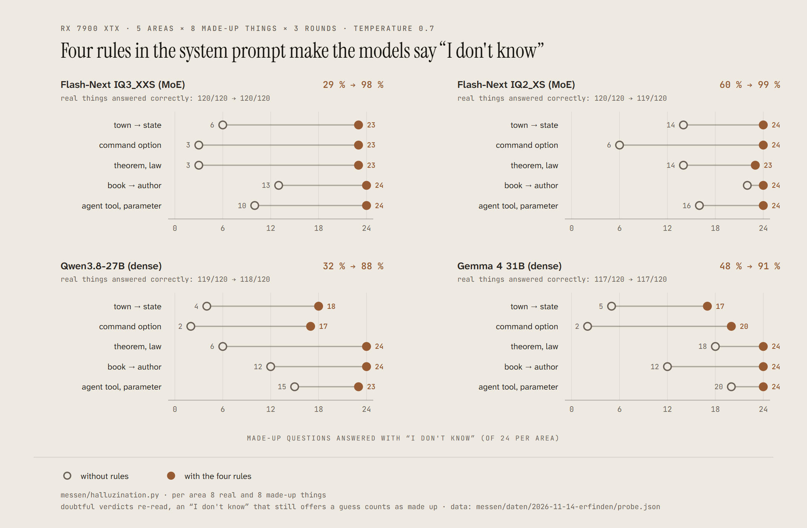

# Dense models on the same card, and how to make the agent invent less

**English** · [Deutsch](agent.de.md) · [← README](../README.md)

In configs, scripts and file names the two models go by short names: `faber` is Flash-Next 125B in the IQ3_XXS quantization, the one in daily use; `velox` is the same model in the smaller and faster IQ2_XS quantization.

Follow-up of 14 Nov 2026 to the section [Running an agent on top](../README.md#running-an-agent-hermes-on-top).

The agent on this NAS runs a data collection with its own tools. It showed two weaknesses: it makes up answers about
things that do not exist, and it announces steps it has no tool for ("I'm pausing the run"). Two questions: does
another model on the same card help, and what else does?

**Dense models do not help.** Qwen3.8-27B and Gemma 4 31B (Q4 each, fully in VRAM, llama.cpp Vulkan) against the two
MoE models of this NAS (Strata 0.2.12), all through the same benchmark:


| | tasks (102) | German, blind (60) | judgement (9) | decode tok/s | prefill 32K tok/s | first token at 32K |
|---|---|---|---|---|---|---|
| Flash-Next IQ3_XXS (`faber`, MoE) | 96 | 51 | 7.5 | 63.7 | 1,183 | 27.0 s |
| Flash-Next IQ2_XS (`velox`, MoE) | 97 | 46 | 6.5 | 73.5 | 1,321 | 24.3 s |
| Qwen3.8-27B (dense) | 92 | 52 | 7 | 36.2 | 796 | 40.3 s |
| Gemma 4 31B (dense) | 97 | 38 | 4 | 34.8 | 602 | 52.9 s |

The dense models write at half the speed and do not judge better. Qwen3.8-27B writes good German but thinks so long
that five coding tasks hit the 8,000-token reasoning budget. Gemma 4 adds unrequested variants and, when a tool is
missing, searches its own configuration every time. The German answers were anonymised and graded blind, then decoded.

**Four sentences in the system prompt beat the choice of model.** The probe `messen/halluzination.py` asks about 8 real
and 8 made-up things in each of five areas (towns, command options, theorems, books, parameters of the agent's own
tools), three rounds, temperature 0.7. Then the same probe with these four rules appended to the (German) system prompt:

```
- If you are not sure about a place, book, person, technical term, command or option, answer
  "I don't know" or "I'm not aware of that". That is a correct answer.
- Never make up states, authors, formulas, options or numbers, not even as a guess.
- Only name tools and parameters listed above. If there is none, say: "I have no tool for that."
- Do not call a catalogue tool for questions unrelated to the catalogue database.
```



Without the rules the four models recognise only 29 to 60 % of the made-up things and invent the rest, most often the
state of a made-up town and options that do not exist. With the rules it is 88 to 99 %, and **they answer real things
as correctly as before** (117 to 120 of 120): the rules do not make them overcautious. The dense models keep the most,
mainly towns and command options. velox is the surprise: the smaller model with lower reasoning effort invents only half
as often as faber even without rules. Doubtful verdicts were re-read; "I don't know" answers that still offered a
guess ("it may be in …") count as made up. Limits: single questions without a conversation, and a short system prompt. The effect inside a
long agent prompt is not measured.

**For judgement, three rounds are not enough.** With `messen/agent_de.py`, faber got the same operating situations ten
times instead of three:


A hard instruction ("if the number deviates, stop") is followed in 10 of 10 answers. Where the model has to weigh things
itself, it looks worse than after three rounds: when a collection job aborts and nobody is awake, it invents capabilities
in 6 of 10 answers ("I'm pausing the collection", "retry with backoff"). When an announced tool is missing, it reports
that cleanly in only 3 of 10 answers; mostly it wants to search its own configuration.

**Hence three layers instead of one:**


The prompt rules catch made-up facts, but not announced steps. For those, the agent's tools now return a ready sentence
plus the allowed next steps, so the numbers come from code. And a small checker without a language model reads every
answer: [`konfig/hermes-pruefer/`](../konfig/hermes-pruefer/), a plugin for Hermes Agent. It flags unsupported numbers,
announced steps without a tool and unknown tool names. On the agent answers it caught all six made-up abort answers,
with no false alarm on the other tasks. It does not see made-up facts in plain words: of 269 made-up probe answers it
would have flagged none. Raw data (counts only): `messen/daten/2026-11-14-erfinden/`.
