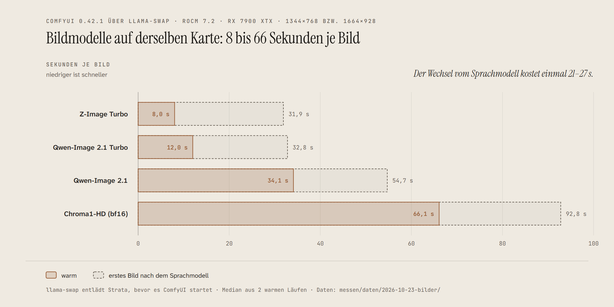

# Bilder auf derselben Karte: ComfyUI über llama-swap

[English](comfyui.md) · **Deutsch** · [← README](../README.de.md)

Seit dem 23.10. macht die XTX auch Bilder. ComfyUI läuft als weiteres Modell in llama-swap, die Karte hält also entweder das Sprachmodell oder die Bildmodelle, nie beides, und llama-swap wechselt bei Bedarf. llama-swap hat dafür einen fertigen Zugang: Ein Modell mit genau dem Namen `comfyui_auto` wird unter `/comfyui/` bedient, und der Websocket des offenen Browser-Tabs lädt das Modell weder noch hält er es fest. Der Eintrag liegt in `konfig/comfyui/llama-swap-comfyui.yaml` (Image `yanwk/comfyui-boot:rocm`, ROCm 7.2, PyTorch 2.13, ComfyUI 0.42.1); er startet in etwa 20 Sekunden.

| Modell | Dateien | Sekunden je Bild, warm | Lizenz |
|---|---|---:|---|
| Z-Image Turbo | `z_image_turbo_bf16`, `qwen_3_4b`, `ae` | 8 | Apache 2.0 |
| Qwen-Image 2.1 Turbo | `qwen_image_2.1_turbo_int8_convrot`, `qwen3vl_8b_int8_convrot` | 12 | Qwen Research License |
| Qwen-Image 2.1 | `qwen_image_2.1_int8_convrot`, `qwen3vl_8b_int8_convrot` | 34 | Qwen Research License |
| Chroma1-HD | `Chroma1-HD` (bf16), `t5xxl_fp16`, `ae` | 66 | Apache 2.0 |

Was ich auf gfx1100 gelernt habe:

- **Die `int8_convrot`-Dateien der offiziellen ComfyUI-Vorlagen laufen auf ROCm**, mit den Zeiten oben.
- **Keine fp8-Gewichte auf dieser Karte.** `Chroma1-HD-fp8mixed` mit dem fp8-T5 endete in einem `amdgpu ... page fault`, ComfyUI starb, llama-swap startete es neu. Das NAS blieb stabil. Dieselben Modelle in bf16/fp16 laufen seitdem ohne Fehler.
- **Prompts auf Englisch** treffen deutlich besser. Qwen-Image 2.1 schrieb eine deutsche Plakatüberschrift falsch und klein; auf Englisch stand sie sauber über die ganze Breite.
- Der erste ComfyUI-Start legt die Modellordner als root an; ein Download unter einem anderen Benutzer scheitert danach beim Umbenennen.

Für den Agenten liegt in `konfig/comfyui/hermes-plugin/` ein kleiner Bild-Anbieter für Hermes Agent: Er setzt den Prompt in einen der Arbeitsabläufe aus `konfig/comfyui/workflows/` (aus den offiziellen Vorlagen abgeleitet), schickt ihn an `/comfyui/api/prompt` und gibt das Bild zurück, so kommt „mach ein Bild von …“ in Telegram als Bild zurück. `konfig/comfyui/modelle-laden.sh` lädt die Dateien (rund 77 GB). Rohdaten der Zeiten: `messen/daten/2026-10-23-bilder/`.
