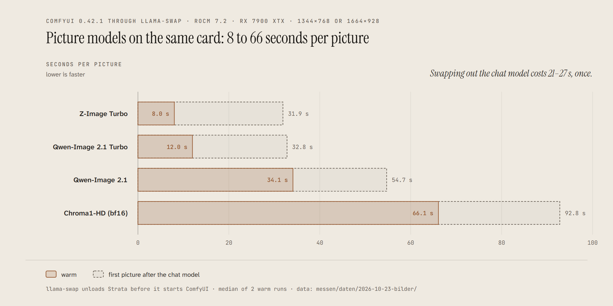

# Pictures on the same card: ComfyUI through llama-swap

**English** · [Deutsch](comfyui.de.md) · [← README](../README.md)

Since 23 Oct the XTX also makes pictures. ComfyUI runs as one more model in llama-swap, so the card holds either the chat model or the picture models, never both, and llama-swap swaps them on demand. llama-swap has a ready entry point for this: a model named exactly `comfyui_auto` is served under `/comfyui/`, and the open browser tab's websocket neither loads the model nor keeps it loaded. The entry is in `konfig/comfyui/llama-swap-comfyui.yaml` (image `yanwk/comfyui-boot:rocm`, ROCm 7.2, PyTorch 2.13, ComfyUI 0.42.1); it starts in about 20 s.

| Model | Files | Seconds per picture, warm | License |
|---|---|---:|---|
| Z-Image Turbo | `z_image_turbo_bf16`, `qwen_3_4b`, `ae` | 8 | Apache 2.0 |
| Qwen-Image 2.1 Turbo | `qwen_image_2.1_turbo_int8_convrot`, `qwen3vl_8b_int8_convrot` | 12 | Qwen Research License |
| Qwen-Image 2.1 | `qwen_image_2.1_int8_convrot`, `qwen3vl_8b_int8_convrot` | 34 | Qwen Research License |
| Chroma1-HD | `Chroma1-HD` (bf16), `t5xxl_fp16`, `ae` | 66 | Apache 2.0 |

What I learned on gfx1100:

- **The `int8_convrot` files of the official ComfyUI templates run on ROCm**, at the speeds above.
- **No fp8 weights on this card.** `Chroma1-HD-fp8mixed` with the fp8 T5 ended in an `amdgpu ... page fault`, ComfyUI died, llama-swap restarted it. The NAS stayed up. The same models in bf16/fp16 ran without a fault since.
- **Prompts in English** match much better. Qwen-Image 2.1 wrote a German poster headline wrong and in small print; in English it was a clean headline across the top.
- The first ComfyUI start creates the model folders as root; a download running as another user then fails on the rename.

For the agent there is a small image backend for Hermes Agent in `konfig/comfyui/hermes-plugin/`: it puts the prompt into one of the workflows in `konfig/comfyui/workflows/` (derived from the official templates), sends it to `/comfyui/api/prompt` and returns the picture, so "make a picture of …" in Telegram comes back as a picture. `konfig/comfyui/modelle-laden.sh` downloads the files (about 77 GB). Raw timings: `messen/daten/2026-10-23-bilder/`.
