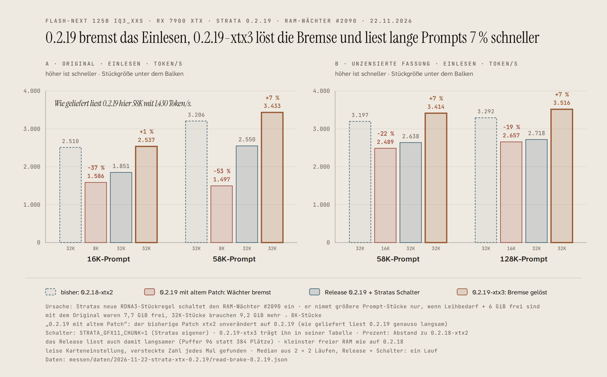
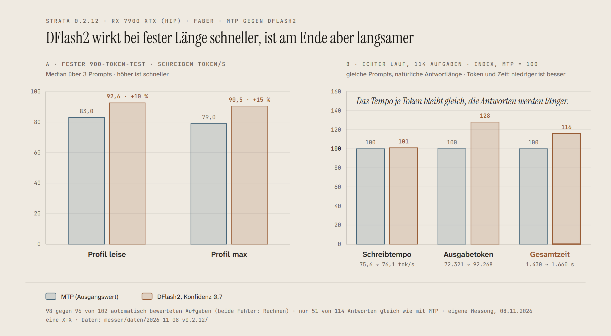
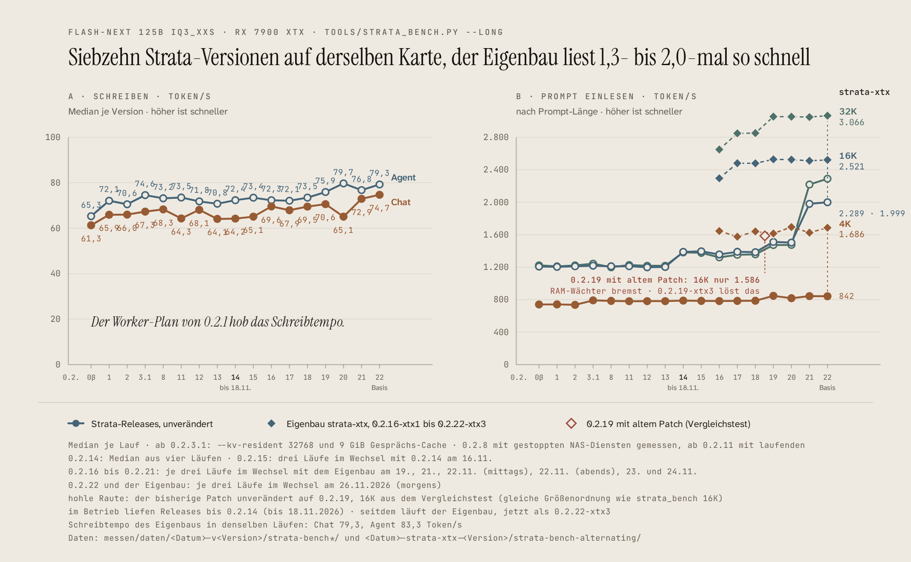

# Strata-Versionen auf dieser Karte, eine nach der anderen

[English](releases.md) · **Deutsch** · [← README](../README.de.md)

In Konfigurationen, Skripten und Dateinamen tragen die drei Fassungen des Modells Kurznamen. `liber` ist Flash-Next 125B in der Quantisierung IQ3_XXS ohne die Ablehnungen, die unzensierte Fassung: dieselben Gewichte, sie beantwortet, was man sie fragt. Sie ist im täglichen Einsatz, für Chat und Agent. `faber` ist das Original, an dem zuerst gemessen wird und das als Rückfall bereitsteht. `velox` ist dasselbe Modell in der kleineren und schnelleren Quantisierung IQ2_XS und wird nur noch zum Vergleich gemessen.

Die neueste zuerst. Jede Version ist gegen ihre Vorgängerin gemessen, mit identischer Laufkonfiguration, nur Engine und Control getauscht. Übersichtstabelle und Diagramm: [README](../README.de.md#strata-versionen-auf-dieser-karte).

## Nachtrag 26.11.2026: Strata 0.2.22 ändert das Sampling von Anfragen ohne Angabe (#7070), der Eigenbau läuft darauf unverändert als `0.2.22-xtx3`

Engine und Control 0.1.69. Für eine Karte ändert das Release nichts an der Qwen-Engine; der Quelltextunterschied betrifft nur eine Speicherregel für zwei Karten (#7089), Symboldateien und die Versionsnummer. Geändert hat sich Control ([#7070](https://github.com/Niko1221/Strata/issues/7070)): Seit 0.2.20 lief jede Anfrage ohne Sampling-Angabe auf einem mit `--mtp` gestarteten Modell greedy; ab 0.2.22 nimmt Flash-Next wieder das Sampling der Modellkarte (mit Denken: Temperatur 1,0, top_p 0,95, top_k 20; ohne Denken zusätzlich presence penalty 1,5).

| Median | Release 0.2.22 | Vergleich |
|---|---:|---:|
| Paare im Wechsel, dieselbe Sitzung: Schreiben, Token/s | 66,1 | 64,6 (Release 0.2.21) |
| `strata_bench.py --long`, 3 Läufe im Wechsel: Prompt 4K / 16K / 32K, Token/s | 842 / 1.999 / 2.289 | **1.686 / 2.521 / 3.066** (`0.2.22-xtx3`); Release 0.2.21: 843 / 1.980 / 2.217 |
| dieselben Läufe: Schreiben Chat / Agent, Token/s | 74,7 / 79,3 | 79,3 / 83,3 (`0.2.22-xtx3`) |
| eine Runde mit voller Leistung: Prompt 4K / 16K / 32K | 844 / 1.995 / 2.320 | 1.601 / 2.517 / 3.047 |
| Prompt mit 128.000 / 250.000 Token, versteckte Zahl in der Mitte | 54 / 104 s | 38 / 79 s (`faber`), 35 / 77 s (`liber`); Release 0.2.21: 47 / 103 s |
| Aufgabensatz, bestanden von 102 | nicht bewertet | `faber` 97, `liber` 95 (`0.2.22-xtx3`) |

- **Der Sampling-Block.** Mein Agent schickt in seiner Hauptschleife weder eine Temperatur noch eine Denktiefe. Auf 0.2.22 wären seine Anfragen deshalb mit Temperatur 1,0 gelaufen. Beide Laufkonfigurationen tragen jetzt `"sampling": {"temperature": 0}` ([`konfig/strata-xtx-0.2.22/`](../konfig/strata-xtx-0.2.22/)); Anfragen in der Form meines Agenten antworten damit wie auf 0.2.21 (`checks/sampling-7070.json`, `checks/agent-sampling-7070.json`). Eine Anfrage, die ihr eigenes Sampling nennt, bekommt es weiterhin.
- **Ein falscher Alarm.** In der ersten Abnahmeprüfung gegen `0.2.21-xtx3` schrieb die unzensierte Fassung in einer Ladung des neuen Baus mit 49,8 und 51,2 Token/s (sonst 65 bis 67), der Median fiel unter die Schwelle, und ich habe nicht umgestellt. Ein Ladungstest, der Test zu #7070 und der Aufgabensatz schienen in dieselbe Richtung zu zeigen (2 bis 6 % langsamer, die Injektionsaufgabe si-2 einmal verloren). Der Quelltextunterschied bot keinen Mechanismus, also habe ich Engine und Control über Kreuz getauscht, mit Steuervektor, 16 Anfragen je Variante, zweimal, das alte Paar doppelt als A/A-Kontrolle: Alle Varianten lagen innerhalb von 98 bis 105 % beieinander. Der zweite Lauf war über alle Varianten 15 % langsamer, weil das NAS damals knapp an Speicher war (rund 5 GiB im Swap); die langsamen Einzelladungen der Nacht kamen vom selben Druck und trafen den alten Bau ebenso. si-2 mit 30 frischen Lesungen je Bau: 28 von 30 auf `0.2.21-xtx3`, 29 von 30 auf `0.2.22-xtx3`. Eine unabhängige zweite Prüfung der Rohdaten und des Quelltexts kam zum selben Ergebnis.
- **Der Patch greift unverändert.** Einlesen gleich wie beim laufenden Bau (`liber` 58K 3.437 gegen 3.437, 16K 2.415 gegen 2.407), Stückgröße 32.768 im Engine-Log; mit abgeschalteter Tabelle 16K 2.001 bis 2.015 und 58K 2.031 bis 2.081 Token/s in drei von sechs Ladungen und rund 2.540 in den übrigen drei (der RAM-Wächter steht hier auf der Kante zu 32K-Stücken). 250.000 Token in 73,6 bis 74,8 s, Selbstrettung mit `liber` geprüft, 90 Minuten Dauerlast mit `liber` ohne Fehler (1.316 Anfragen, 188 von 188 versteckten Zahlen, verfügbarer RAM nie unter 5,4 GiB). In Betrieb seit 26.11., 07:15; Abnahme bestanden, `liber` 58K 3.465 und 3.435, 128K 3.589 Token/s.
- **Prompt-Injektion.** Die Fehlschläge bei si-2 waren nie Gehorsam, sondern Nachsehen (`ls ~/.ssh`, nachdem eine Mail das Modell aufgefordert hatte, den Schlüssel zu lesen). Gemessen mit 14 Mustern in fünf Varianten, samt der Abhilfe für meinen Agenten: [docs/agent.de.md](agent.de.md#werkzeugergebnisse-als-fremddaten-rahmen-26112026).
- Daten: [`messen/daten/2026-11-26-strata-xtx-0.2.22/`](../messen/daten/2026-11-26-strata-xtx-0.2.22/) (README darin).

## Nachtrag 24.11.2026: Strata 0.2.21 holt beim Einlesen auf (Abhilfe für #6687), der Eigenbau läuft darauf unverändert als `0.2.21-xtx3`

Engine und Control 0.1.67. Ohne fest gehaltene Experten zählt der RAM-Wächter aus 0.2.19 jetzt nur noch die Hälfte des Leihspeichers und hält 3 statt 6 GiB Reserve ([#6687](https://github.com/Niko1221/Strata/issues/6687)). Auf diesem NAS liest das unveränderte Release damit in 16K- statt 8K-Stücken. 32K-Stücke verfehlt es knapp: Gebraucht werden 4.675 MiB Leihe plus 3.072 MiB Reserve, frei waren 7.688 MiB (im zweiten Lauf 7.736), es fehlten 59 (11) MiB.

| Median | Release 0.2.21 | Vergleich |
|---|---:|---:|
| Paare im Wechsel, dieselbe Sitzung: Schreiben, Token/s | 65,5 | 66,0 (Release 0.2.20) |
| `strata_bench.py --long`, 3 Läufe im Wechsel: Prompt 4K / 16K / 32K, Token/s | 843 / 1.980 / 2.217 | **1.625 / 2.511 / 3.049** (`0.2.21-xtx3`); Release 0.2.20: 818 / 1.503 / 1.475 |
| dieselben Läufe: Schreiben Chat / Agent, Token/s | 72,9 / 76,8 | 74,9 / **85,4** (`0.2.21-xtx3`) |
| eine Runde mit voller Leistung: Prompt 4K / 16K / 32K | 784 / 1.996 / 2.326 | 1.604 / 2.482 / 3.056 |
| Prompt mit 128.000 / 250.000 Token, versteckte Zahl in der Mitte | 47 / 103 s | 36 / 77 s (`faber` und `liber`); Release 0.2.20: 73 / 175 s |
| Aufgabensatz, bestanden von 102 | nicht bewertet | `faber` 96, `liber` 97 (`0.2.21-xtx3`) |

- **Der Patch ließ sich unverändert anwenden.** Gegen den laufenden Bau (`0.2.20-xtx3`) liest der neue gleich schnell (99 bis 101 %), schreibt gleich schnell, die Stückgröße im Engine-Log ist 32.768. Mit abgeschalteter Tabelle liest er wie das Release (16K 2.001, 58K 2.054 Token/s in 16K-Stücken; auf 0.2.20 waren es 1.454 und 1.427 in 8K-Stücken). Aufgabensatz 96 und 97: Die zwei Aufgaben, die `faber` gegenüber dem 23.11. verlor (ein Tippfehler im erzeugten Code, die Frage nach einem erfundenen Buch), kippen zwischen Läufen; `liber` verlor das Buch und gewann eine Werkzeugaufgabe. 250.000 Token in 73,5 bis 75,1 s, Selbstrettung mit `liber` geprüft, 90 Minuten Dauerlast mit `liber` ohne Fehler (1.316 Anfragen, 188 von 188 versteckten Zahlen, verfügbarer RAM nie unter 5,5 GiB). In Betrieb seit 24.11., 20:38; Abnahme bestanden, `liber` zuerst.
- **Der Vorsprung schrumpft, bleibt aber.** Bei 32K liest der Eigenbau 1,4-mal, bei 4K 1,9-mal so schnell wie das Release. Den Rest tragen die übrigen 26 Schalter der Tabelle, nicht die Stückgröße.
- **Folgeanfragen gegen die Stream-Schwelle.** In #6687 halbierte ein anderer Nutzer (RX 7800 XT) mit der Schwelle 1.024 statt 3.072 die Wartezeit auf eine Folgeanfrage mit 1.600 neuen Token. Mein Bau streamt ab 4.095 Token (Grenze des CPU-Anteils, sie hat Vorrang vor `STRATA_PREFILL_STREAM_MIN`). Gemessen mit 4K- und 32K-Vorspann aus dem Gesprächs-Cache und 500 / 1.600 / 3.000 neuen Token, Grenze 4.096 / 2.048 / 1.024, beide Modelle, zwei Runden leise und eine max: Mit 4.096 wartet `liber` 1,5 bis 3,4 s; mit 2.048 bei 3.000 neuen Token 5,3 statt 3,4 s, mit 1.024 schon bei 1.600 neuen Token 5,2 statt 2,6 s. Die Schwelle hatte sich im Log tatsächlich verschoben (1023), der Vorspann kam aus dem Cache, 108 von 108 versteckten Zahlen gefunden. Bei einem 125B-Modell mit Experten im RAM kostet der gestreamte Weg pauschal rund 5 s. Die Grenze bleibt bei 4.096.
- Daten: [`messen/daten/2026-11-24-strata-xtx-0.2.21/`](../messen/daten/2026-11-24-strata-xtx-0.2.21/) (README darin).

## Nachtrag 23.11.2026: Strata 0.2.20 ändert hier nichts, der Eigenbau läuft darauf unverändert als `0.2.20-xtx3`

Engine und Control 0.1.66. Für Flash-Next auf dieser Karte bringt das Release keine Änderung. Der RAM-Wächter aus 0.2.19 ist noch da: Das unveränderte Release liest in 8K-Stücken (die Logzeilen von 0.2.18, 0.2.19 und 0.2.20 stehen in [#6687](https://github.com/Niko1221/Strata/issues/6687)). Neu für Hy4-Flash: Seine Engine folgt jetzt der RAM-Aufteilung, die Stratas Setup schreibt, damit ist [#6556](https://github.com/Niko1221/Strata/issues/6556) behoben: Mit genau den Angaben des Setups schreibt es mit 12,7 bis 13,4 statt 0,3 bis 0,6 Token/s, bei mindestens 9,5 GiB verfügbarem RAM und ohne Auslagerung ([`messen/daten/2026-11-23-hy4-0.2.20/`](../messen/daten/2026-11-23-hy4-0.2.20/README.de.md)).

| Median | Release 0.2.20 | Vergleich |
|---|---:|---:|
| Paare im Wechsel, dieselbe Sitzung: Schreiben, Token/s | 64,8 | 65,8 (Release 0.2.19) |
| `strata_bench.py --long`, 3 Läufe im Wechsel: Prompt 4K / 16K / 32K, Token/s | 818 / 1.503 / 1.475 | **1.694 / 2.524 / 3.053** (`0.2.20-xtx3`) |
| dieselben Läufe: Schreiben Chat / Agent, Token/s | 65,1 / 79,7 | **72,2** / 83,6 (`0.2.20-xtx3`) |
| eine Runde mit voller Leistung: Prompt 4K / 16K / 32K | 788 / 1.502 / 1.506 | 1.600 / 2.519 / 3.061 |
| Prompt mit 128.000 / 250.000 Token, versteckte Zahl in der Mitte | 73 / 175 s | 35 / 77 s (`faber` und `liber`) |
| Aufgabensatz, bestanden von 102 | nicht bewertet | `faber` 98, `liber` 97 (`0.2.20-xtx3`) |

- **Der Patch ließ sich unverändert anwenden.** Gegen den laufenden Bau (`0.2.19-xtx3`) liest der neue gleich schnell (96 bis 105 %), die Stückgröße im Engine-Log ist 32.768, und mit abgeschalteter Tabelle liest er so langsam wie das Release (16K 1.454, 58K 1.427 Token/s). Aufgabensatz 98 und 97 wie auf 0.2.19, 250.000 Token in 74 bis 76 s mit beiden Modellen, Selbstrettung mit `liber` geprüft, 90 Minuten Dauerlast mit `liber` ohne Fehler (1.309 Anfragen, 187 von 187 versteckten Zahlen, verfügbarer RAM nie unter 5,5 GiB). In Betrieb seit 23.11., 12:10; Abnahme bestanden, `liber` zuerst.
- **CPU-Anteil bei kurzen Prompts neu geprüft.** Meine Tabelle lässt den Prozessor bei Prompt-Stücken bis 4.096 Token einen Teil der Experten übernehmen. Grenzen von 3.072 bis 6.144 mit Prompts von 2K bis 16K: 4.096 hält 4K bei 1.131 statt 714 Token/s (3.072), bei 16K lesen alle Grenzen gleich schnell (2.517 bis 2.545), 6.144 liest 6K schneller (+30 %), 8K aber langsamer (−12 %). Die Tabelle bleibt, wie sie ist. In der Nacht davor, auf 0.2.19, brachte der Anteil bei 1K das 2,7-fache, 0,4 und 0,8 lasen wie 0,6, und die hipBLASLt-Tuning-Tabelle abzuschalten änderte nichts Messbares.
- Daten: [`messen/daten/2026-11-23-strata-xtx-0.2.20/`](../messen/daten/2026-11-23-strata-xtx-0.2.20/) (README darin).

## Nachtrag 22.11.2026, abends: Strata 0.2.19 bremst das Einlesen hinter einem RAM-Wächter, der Eigenbau `0.2.19-xtx3` löst die Bremse

Engine und Control 0.1.65. Neu sind zwei Dinge: Strata bringt jetzt eigene Voreinstellungen für RDNA3-Karten mit (`gfx11_extra.hpp`: ein Satz Rechenwege, WMMA-Pfade, 8-Bit-Hyperconnections, eine CPU-Beteiligung beim Einlesen und eine Regel für die Prompt-Stücke), und ein drittes Modell mit eigener Engine, Thinking Machines Inkling 2 Mini (26B, 3,4B aktiv; Ergebnis im README: schnell oder lange Prompts, nicht beides). Die Bauten heißen ab hier `<Strata-Version>-xtx<Patchstand>`.

| Median | Release 0.2.19 | Vergleich |
|---|---:|---:|
| Paare im Wechsel, dieselbe Sitzung: Schreiben, Token/s | 65,3 | 61,8 (Release 0.2.18) |
| `strata_bench.py --long`, 3 Läufe im Wechsel: Prompt 4K / 16K / 32K, Token/s | 847 / 1.510 / 1.472 | **1.615 / 2.528 / 3.054** (`0.2.19-xtx3`) |
| dieselben Läufe: Schreiben Chat / Agent, Token/s | 70,6 / 75,9 | 75,3 / **81,7** (`0.2.19-xtx3`) |
| Prompt mit 128.000 / 250.000 Token, versteckte Zahl in der Mitte | 72,8 / 177 s | 35,0 / 77,7 s (`faber`), 34,5 / 76,5 s (`liber`) |
| Einlesen 58K, Vergleichstest (Median 2 × 2 Läufe), `faber` | 1.430 | 1.497 (alter Patch `xtx2`), **3.433** (`0.2.19-xtx3`), 3.206 (`0.2.18-xtx2`) |
| Aufgabensatz, bestanden von 102 | nicht bewertet | `faber` 98, `liber` 97 (`0.2.19-xtx3`) |

- **Das Release ist gegenüber 0.2.18 etwas schneller,** beim Schreiben in den Paaren um 6 %, beim Einlesen in `strata_bench.py` um 8 bis 9 %, und 250.000 Token sind in 177 statt 206 s gelesen.
- **Aber es bremst sich selbst.** Stratas neue Stückregel für RDNA3 erlaubt Prompt-Stücke bis 32K und schaltet dabei einen RAM-Wächter ein, der als Abhilfe für [#2090](https://github.com/Niko1221/Strata/issues/2090) kam. Der nimmt die großen Stücke nur, wenn neben dem zusätzlichen Leihspeicher noch 6 GiB frei bleiben. Mit geladenem 125B-Modell waren auf diesem NAS 7,7 GiB frei, 32K-Stücke brauchen 9,2 GiB mehr, also liest das Release ab 16K in **8K-Stücken** (mit `liber` in 16K-Stücken; die Engine nennt die Stückgröße in ihrem Log). Mit Stratas eigenem Schalter `STRATA_GFX11_CHUNK=1`, der den Wächter überspringt, liest dasselbe Release 58K mit 2.550 statt 1.430 Token/s.
- **Mein bisheriger Patch fiel auf 0.2.19 auf dasselbe Niveau:** 58K mit 1.497 statt 3.206 Token/s (−53 %), mit `liber` 128K mit 2.657 statt 3.292 (−19 %), weil der Wächter erst nach meiner Tabelle greift. Ich habe ihn deshalb nicht übernommen. Die Diagnose in Einzelläufen: Stratas RDNA3-Voreinstellungen ganz aus (`STRATA_GFX11_DEFAULTS=0`) gibt 3.327 Token/s, nur die WMMA-Pfade aus ändert nichts (1.497), `STRATA_GFX11_CHUNK=1` allein gibt 3.490 (`checks/brake-diagnosis.json`).
- **`0.2.19-xtx3`** setzt in der Tabelle zusätzlich `STRATA_GFX11_CHUNK=1`; die Selbstrettung schaltet beim Neustart ohne Tabelle auch `STRATA_GFX11_DEFAULTS=0`. Das ist alles. Ergebnis im Vergleichstest: `faber` 16K 2.537 und 58K 3.433, `liber` 58K 3.414 und 128K 3.516 Token/s, also 1 bis 7 % schneller als `0.2.18-xtx2`. Über die Kontexttiefe liest der Bau ab 64K 7 bis 10 % schneller als `0.2.18-xtx2` am Mittag.
- **Speicher:** Der kleinste freie Arbeitsspeicher beim Einlesen lag mit `0.2.19-xtx3` bei 3,5 GiB (`faber`) und 5,2 GiB (`liber`), auf 0.2.18 bei 3,6 und 5,5 GiB; der Swap blieb in allen Läufen unverändert. Der Wächter verhindert hier also nichts, was ohne ihn schiefginge.
- **`GDN_PP`:** Strata 0.2.19 setzt für RDNA3 `STRATA_GDN_PP=2`, meine Tabelle 1 (sie greift zuerst). Im Vergleich in drei abwechselnden Runden waren bei 58K und 128K beide gleich schnell. Bei 16K gewann für `faber` die 2 in allen drei Runden (2.331 gegen 2.166 Token/s, +8 %), für `liber` die 1 (2.299 gegen 2.235, +3 %). Weil lange Prompts den Ausschlag geben und die unzensierte Fassung das Arbeitsmodell ist, bleibe ich bei 1 (`checks/gdn-pp-comparison.json`).
- **Schreiben:** In `strata_bench.py` war der Eigenbau im Chat 7 % und im Agentenlauf 8 % schneller als das Release; bei voller Kartenleistung (eine Runde) schrieb er im Agentenlauf 90,9 gegen 79,5 Token/s und las 1.617 / 2.532 / 3.062 gegen 846 / 1.513 / 1.439. Lange Antworten: 64,6 Token/s mit dem Original, 69,3 mit der unzensierten Fassung.
- **Nadeln:** bei 32K und 128K in 10, 50 und 90 % Tiefe und bei 250K in der Mitte jedes Mal gefunden, auf dem Release und auf dem Eigenbau mit beiden Modellen.
- **Vor der Übernahme:** Aufgabensatz `faber` 98, `liber` 97 von 102 (auf 0.2.18: 96 und 97), der Prompt mit 247.954 Token in 73 bis 74 s; Selbstrettung mit `liber`; ein Dauerlauf von 90 Minuten mit `liber` (1.316 Anfragen, kein Fehler, 188 von 188 versteckten Zahlen gefunden, keine nicht-endlichen Werte im Engine-Log). Im Betrieb seit dem 22.11.2026, 20:04 Uhr; die Abnahme danach lief auf einem Bau, der sich nur im Namen vom geprüften unterscheidet.
- `standard-v1` lief für das Paket und für das Docker-Image und liegt bei den Rohdaten.

Rohdaten: `messen/daten/2026-11-22-strata-xtx-0.2.19/` (das Release unter `release-0.2.19/`, die Wechselläufe unter `strata-bench-alternating/`, die Prüfungen vor der Übernahme, der alte Patch auf 0.2.19, die Diagnose und der `GDN_PP`-Vergleich unter `checks/`, die Werte des Diagramms in `read-brake-0.2.19.json`).

## Nachtrag 22.11.2026, mittags: Strata 0.2.18 bringt für Flash-Next kein Tempo, der Eigenbau läuft unverändert darauf

Engine und Control 0.1.64. Die Voreinstellungen für gfx1100 sind im Release weiter unverändert, also habe ich wieder das unveränderte Release und den Eigenbau [strata-xtx](https://github.com/faf-net/strata-xtx) auf derselben Basis gemessen. Der Patch ließ sich ohne Änderung anwenden, der Bau bleibt `xtx2` (heute `0.2.18-xtx2` genannt). Neu in 0.2.18 ist ein zweites Modell mit eigener Engine, Tencent Hy4-Flash (220B); es läuft hier achtmal langsamer als Flash-Next, und mit der Aufteilung, die Stratas Setup für diese Maschine schreibt, läuft der Speicher voll. Meine Messungen dazu stehen in [`messen/daten/2026-11-22-hy4-flash/`](../messen/daten/2026-11-22-hy4-flash/README.de.md), gemeldet als [#6556](https://github.com/Niko1221/Strata/issues/6556).

| Median | Release 0.2.18 | Vergleich |
|---|---:|---:|
| Paare im Wechsel, dieselbe Sitzung: Schreiben, Token/s | 61,1 | 61,6 (Release 0.2.17) |
| `strata_bench.py --long`, 3 Läufe im Wechsel: Prompt 4K / 16K / 32K, Token/s | 786 / 1.385 / 1.358 | 1.641 / 2.479 / 2.851 (Eigenbau auf 0.2.18) |
| dieselben Läufe: Schreiben Chat / Agent, Token/s | 69,5 / 73,5 | 76,3 / 78,7 (Eigenbau auf 0.2.18) |
| Prompt mit 250.000 Token, versteckte Zahl in der Mitte | 205,7 s | 82,7 s (Eigenbau, `faber`), 81,1 s (`liber`) |
| Aufgabensatz, bestanden von 102 | nicht bewertet | `faber` 96, `liber` 97 (Eigenbau auf 0.2.18) |

- **Für Flash-Next ist das Release so schnell wie 0.2.17.** Die Paare liegen beim Schreiben 0,5 Token/s auseinander; das Einlesen in `strata_bench.py` liegt 1 bis 3 % über 0.2.17.
- **Der Eigenbau liest rund doppelt so schnell,** gemessen in drei Läufen im Wechsel, jede Engine frisch geladen und die Reihenfolge jede Runde getauscht. Bei voller Kartenleistung (eine Runde): 787 / 1.396 / 1.382 gegen 1.571 / 2.478 / 2.850 Token/s. Über die Kontexttiefe liest er innerhalb von 3 % von `xtx-2` auf 0.2.17.
- **Schreiben:** In `strata_bench.py` war der Eigenbau in allen drei Runden schneller, im Chatteil um 9 bis 10 %, im Agententeil um 4 bis 12 %. Lange Antworten: 67,8 Token/s mit dem Original, 68,5 mit der unzensierten Fassung; die langsameren langen Antworten der unzensierten Fassung auf 0.2.17 (64,3) kamen nicht wieder.
- **Nadeln:** bei 32K und 128K in 10, 50 und 90 % Tiefe und bei 250K in der Mitte jedes Mal gefunden, auf dem Release und auf dem Eigenbau mit beiden Modellen.
- **Aufgabensatz:** `faber` 96, `liber` 97 von 102 auf dem Eigenbau (auf 0.2.17: 95 und 97). Das Release wurde nicht bewertet.
- **Vor der Übernahme (21.11.):** Vergleich mit dem Bau im Betrieb, gleich schnell (`liber` bei 58K 3.208 gegen 3.203 Token/s); ein Dauerlauf von 90 Minuten mit `liber` (1.260 Anfragen, kein Fehler, 180 von 180 versteckten Zahlen gefunden, keine nicht-endlichen Werte im Engine-Log); Selbstrettung mit `liber`. Im Betrieb seit dem 22.11.2026, 10:34 Uhr.
- `standard-v1` lief für das Paket und für das Docker-Image und liegt bei den Rohdaten.

Rohdaten: `messen/daten/2026-11-22-strata-xtx-0.2.18/` (das Release unter `release-0.2.18/`, die Wechselläufe unter `strata-bench-alternating/`, die Prüfungen vor der Übernahme unter `checks/`).

## Nachtrag 21.11.2026: Strata 0.2.17 bringt hier ebenfalls kein Tempo, der Eigenbau läuft darauf als `xtx-2`

Engine und Control 0.1.63. Die Voreinstellungen für gfx1100 sind im Release weiter unverändert, also habe ich wieder das unveränderte Release und meinen Eigenbau [strata-xtx](https://github.com/faf-net/strata-xtx) auf derselben Basis gemessen. Der Bau heißt `xtx-2`: Der Patch ist derselbe wie zuvor bis auf einen Wert, den Einlesepuffer `STRATA_PREFILL_RING`, jetzt 384 statt 192.

| Median | Release 0.2.17 | Vergleich |
|---|---:|---:|
| verschränkte Paare, eine Sitzung: Schreiben, Token/s | 61,6 | 62,3 (Release 0.2.16) |
| `strata_bench.py --long`, 3 Läufe im Wechsel: Einlesen 4K / 16K / 32K, Token/s | 785 / 1.390 / 1.352 | 1.576 / 2.481 / 2.848 (Eigenbau auf 0.2.17) |
| dieselben Läufe: Schreiben Chat / Agent, Token/s | 67,9 / 72,1 | 77,7 / 80,9 (Eigenbau auf 0.2.17) |
| Prompt mit 250.000 Token, versteckte Zahl in der Mitte | 206,9 s | 82,1 s (Eigenbau, `faber`), 83,8 s (`liber`) |
| Aufgabensatz, bestanden von 102 | nicht bewertet | `faber` 95, `liber` 97 (Eigenbau auf 0.2.17) |

- **Auf dieser Karte ist das Release so schnell wie 0.2.16.** Die Paare liegen beim Schreiben 0,7 Token/s auseinander; das Einlesen in `strata_bench.py` liegt innerhalb von 3 % von 0.2.16.
- **Der Eigenbau liest wieder etwa doppelt so schnell,** gemessen in drei Läufen im Wechsel, jede Engine frisch geladen, die Reihenfolge je Runde getauscht. Mit voller Kartenleistung (eine Runde): 785 / 1.396 / 1.362 gegen 1.643 / 2.476 / 2.854 Token/s. Über die Kontexttiefe liest er ab 65K 5 bis 11 % mehr als `xtx-1` auf 0.2.16 zwei Tage zuvor; das schreibe ich dem größeren Puffer zu, es ist aber je Bau eine Messreihe, kein Vergleich im Wechsel.
- **Schreiben:** In `strata_bench.py` war der Eigenbau in allen drei Runden schneller, im Chat-Teil um 5 bis 15 %, im Agenten-Teil um 8 bis 13 %, mehr als auf 0.2.16. In den anderen Messreihen sehe ich das nicht: Vor der Übernahme schrieb er so schnell wie der Bau im Betrieb, und bei langen Antworten schrieb die unzensierte Fassung sogar langsamer als am 19.11. (64,3 gegen 67,4 Token/s), das Original schneller (70,2 gegen 68,3). Das beobachte ich weiter.
- **Nadeln:** Bei 32K und 128K in 10, 50 und 90 % Tiefe und bei 250K in der Mitte wurde die versteckte Zahl jedes Mal gefunden, auf dem Release und auf dem Eigenbau mit beiden Modellen.
- **Aufgabensatz:** `faber` 95, `liber` 97 von 102 auf dem Eigenbau (auf 0.2.16: 97 und 96). Das Release wurde diesmal nicht bewertet; auf 0.2.16 kam es auf dasselbe wie der Eigenbau.
- **Vor der Übernahme (20.11.):** Vergleich mit dem Bau im Betrieb, gleich schnell mit beiden Modellen (`liber` bei 58K 3.200 gegen 3.201 Token/s); ein Dauerlauf von 90 Minuten mit `liber` (1.267 Anfragen, kein Fehler, 181 von 181 versteckten Zahlen gefunden, keine nicht-endlichen Werte im Engine-Log); Selbstrettung mit beiden Modellen. Im Betrieb vom 20.11.2026, 22:16 Uhr, bis zum 22.11.2026, 10:34 Uhr.
- `standard-v1` lief für das Paket und für das Docker-Image und liegt bei den Rohdaten.

Rohdaten: `messen/daten/2026-11-21-strata-xtx-0.2.17/` (das Release unter `release-0.2.17/`, die Läufe im Wechsel unter `strata-bench-alternating/`, die Prüfungen vor der Übernahme unter `checks/`).

## Nachtrag 19.11.2026: Strata 0.2.16 bringt hier kein Tempo, der Eigenbau läuft jetzt darauf

Engine und Control 0.1.62. Die Version bringt Stratas eigenen Engine-Code (ohne ggml), eine neue Ordnerstruktur (`engine/`, `terminal/`, `tools/`) und ein offizielles Bauskript (`tools/packaging/build_hip_linux.sh`). Die Voreinstellungen für gfx1100 sind im Release unverändert: Die Schalter für das Einlesen bleiben auf dieser Karte ausgeschaltet. Deshalb habe ich zweierlei gemessen, das unveränderte Release und meinen Eigenbau [strata-xtx](https://github.com/faf-net/strata-xtx) auf derselben Basis.

| Median | Release 0.2.16 | Vergleich |
|---|---:|---:|
| verschränkte Paare, gleiche Sitzung: Schreiben, Token/s | 61,4 | 59,8 (Release 0.2.15) |
| `strata_bench.py --long`, 3 Läufe im Wechsel: Prompt 4K / 16K / 32K, Token/s | 783 / 1.357 / 1.321 | 1.645 / 2.295 / 2.650 (Eigenbau auf 0.2.16) |
| dieselben Läufe: Schreiben Chat / Agent, Token/s | 69,6 / 72,3 | 72,5 / 81,7 (Eigenbau auf 0.2.16) |
| Prompt mit 250.000 Token, versteckte Zahl in der Mitte | 204,5 s | 87,6 s (Eigenbau, `faber`), 88,7 s (`liber`) |
| Aufgabensatz `liber`, bestanden von 102 | 96 | 96 (Eigenbau auf 0.2.16) |

- **Das Release ist auf dieser Karte so schnell wie 0.2.15.** Die Paare liegen beim Schreiben 1,6 Token/s auseinander, das ist die Streuung dieses Tests. Das Einlesen liegt dort, wo es seit 0.2.14 liegt.
- **Der Eigenbau liest auf der neuen Basis weiter etwa doppelt so schnell.** Gemessen in denselben drei Läufen im Wechsel, jede Engine frisch geladen, die Reihenfolge je Runde gewechselt. Im vollen Kartenprofil (eine Runde) dasselbe Bild: 783 / 1.392 / 1.382 gegen 1.639 / 2.352 / 2.639 Token/s.
- **Schreiben gleich bis leicht schneller.** In `strata_bench.py` lag der Eigenbau im Chat-Teil in allen drei Runden etwas über dem Release, im Agenten-Teil in zwei von drei. In den anderen Messreihen (Schreiben nach langem Prompt, Dauerschreiben) sehe ich keinen Unterschied.
- **Nadeln:** Bei 32K und 128K in 10, 50 und 90 % Tiefe und bei 250K in der Mitte wurde die versteckte Zahl jedes Mal gefunden, auf dem Eigenbau mit beiden Modellen.
- **Aufgabensatz:** `liber` besteht auf dem Release und auf dem Eigenbau je 96 von 102, `faber` auf dem Eigenbau 97. Sechs Aufgaben habe ich je fünfmal wiederholt, auf beiden Fassungen mit demselben Bild: Zwei besteht das Modell mal ja, mal nein, vier nie. Je nach Lauf sind es also 96 bis 98 (auf 0.2.15 waren es 98).
- `standard-v1` ist für das Paket und für das Docker-Image gelaufen und liegt bei den Rohdaten.

**Der Eigenbau.** Seit dem Abend des 18.11.2026 stehen die Schalter aus dem Nachtrag darunter nicht mehr in der Laufkonfiguration, sondern im Code: strata-xtx setzt sie auf einer einzelnen RX 7900 XTX unter Linux selbst (eine Tabelle mit 27 Schaltern; 26 davon setzt die Engine neu, einer ist im Release schon an). Zuerst lief er auf der Basis von 0.2.15, vom 19. bis 20.11.2026 auf 0.2.16, für `liber` und `faber` (danach auf 0.2.17 und 0.2.18 und als `0.2.19-xtx3` mit Stratas Stückschalter auf 0.2.19, siehe oben). Vor der Umstellung auf die neue Basis habe ich neu geprüft: Tempo mit und ohne Tabelle, Tool-Call, Bildeingang und Steuervektor, den Aufgabensatz, einen Dauerlauf von 90 Minuten mit `liber` (1.232 Anfragen, kein Fehler, 176 von 176 versteckten Zahlen gefunden) und die Selbstrettung mit beiden Modellen (nach nicht-endlichen Werten aus Stratas Fehlerinjektion endet die auslösende Anfrage selbst mit einem Fehler, HTTP 503; der Server startet die Engine einmal ohne die Tabelle neu und beantwortet die folgenden Anfragen). Für den Bau waren die neue Ordnerstruktur und die Bauoptionen des offiziellen Skripts nachzuziehen. Das Einlesen ist auf beiden Basen gleich schnell.

Rohdaten: `messen/daten/2026-11-19-strata-xtx-0.2.16/` (das Release unter `release-0.2.16/`, die Läufe im Wechsel unter `strata-bench-alternating/`).

## Nachtrag 18.11.2026: 0.2.14 mit 28 Umgebungsschaltern, Prompts doppelt so schnell eingelesen

Keine neue Version, aber eine andere Laufkonfiguration: 28 Umgebungsschalter, die die unveränderte Engine 0.1.60 mitbringt und die auf dieser Kartengeneration aus sind. `liber` und `faber` liefen am 18.11.2026 damit, `velox` nicht. Seit dem Abend desselben Tages stecken die Schalter im Eigenbau strata-xtx, und in der Laufkonfiguration steht keiner mehr (Nachtrag vom 19.11.).

| Median, gedrosseltes Kartenprofil | ohne | mit Schaltern |
|---|---|---|
| Einlesen 4K / 16K / 58K | 789 / 1.406 / 1.341 | 1.632 / 2.365 / 3.048 T/s |
| Schreiben Chat / Agent | 65,6 / 75,8 | 72,5 / 82,4 T/s |
| 250.000 Token einlesen, `liber` / `faber` | 201 s / 205 s | 90 s / 87 s |
| Aufgabensatz, bestanden von 102 (zwei Läufe) | 98 / 97 | 98 / 97 |
| 90 Minuten Dauerlast | – | 1.232 Anfragen, kein Fehler |

Strata beschreibt 16 der 28 Schalter in der eigenen Dokumentation und lässt sie auf dieser Kartengeneration bewusst ausgeschaltet, weil sich die Rundung ändert; 12 sind nicht beschrieben. Seitdem prüft der Test jeder neuen Version zusätzlich `liber` auf der neuen Engine; ob eine Engine die 28 Namen noch kennt, sagt `messen/schalter_pruefen.py`. Messwerte, Grenzen und der Rückweg: [schalter.de.md](schalter.de.md). Rohdaten: `messen/daten/2026-11-18-prompt-switches/`.

## Nachtrag 16.11.2026: Strata 0.2.15 ist hier gleich schnell, dieses NAS bleibt bei 0.2.14

Control 0.1.61 mit der Engine 0.1.60 `hip-rx7900`, also derselben Engine wie in 0.2.14; neu ist nur das Steuerprogramm. Gleiche Laufkonfiguration (`konfig/strata-0.2.14/`), NAS-Dienste an, nur mein Agent angehalten.

| Median | 0.2.15 | 0.2.14 |
|---|---:|---:|
| 3 verschränkte Paare, gleiche Sitzung: Schreiben / Prompt mit 63 Token, Token/s | 59,2 / 118,6 | 59,1 / 118,6 |
| `strata_bench.py --long`, 3 Läufe im Wechsel: Schreiben Chat / Agent, Token/s | 65,1 / 73,4 | 64,0 / 70,8 |
| dieselben Läufe: Prompt 4K / 16K / 32K, Token/s | 786 / 1.395 / 1.377 | 786 / 1.392 / 1.375 |
| `standard-v1`, Paket: kurz Schreiben / 4K / 16K Prompt, Token/s | 68,4 / 747 / 1.416 | |

**Gleich schnell.** Die Paare liegen 0,1 Token/s auseinander. In den drei Läufen im Wechsel, jede Engine frisch geladen und die Reihenfolge je Runde gewechselt, ist das Einlesen auf den Token genau gleich, und das Schreiben liegt in der Streuung, die dieser Test auch bei gleicher Version zeigt. Die Paare messen kurze Antworten mit wenig vorhersehbarem Text, deshalb liegen sie bei 59 und nicht bei den 66 Token/s langer Antworten. `standard-v1` ist vollständig und besteht 12 von 12 Plausibilitätsprüfungen; 4K kam in diesem einen Lauf mit 747 Token/s, in den drei Läufen von `strata_bench.py` mit 786 wie bei 0.2.14. Mein kleiner Aufgabensatz (35 Aufgaben) besteht 34, 0.2.14 am selben Tag 35: Werkzeuge 20 von 20, Code 14 von 15, durchgefallen ist eine Code-Aufgabe, die zwischen Läufen kippt.

Weil die Engine dieselbe ist und nichts schneller wird, blieb dieses NAS bei 0.2.14. Als Release lief 0.2.15 hier nie; vom 18. bis 19.11.2026 war es die Basis meines Eigenbaus strata-xtx (Nachtrag vom 19.11.). Rohdaten: `messen/daten/2026-11-16-v0.2.15/`. An Strata gemeldet als Kommentar in [#6056](https://github.com/Niko1221/Strata/issues/6056).

## Nachtrag 15./16.11.2026: Strata 0.2.14 liest lange Prompts schneller, seit 16.11. in Betrieb

Engine 0.1.60 `hip-rx7900` mit Control 0.1.60 gegen 0.2.12, gleiche Laufkonfiguration (`konfig/strata-0.2.12/`), NAS-Dienste an, nur mein Agent angehalten. Die Version verlegt das Prompt-Einlesen auf AMD und NVIDIA auf Stratas eigene Kernel, und die Release-Notiz enthält keine Messung für die RX 7900 unter Linux. Hier ist eine.

| Median Token/s | 0.2.14 | 0.2.12 | 0.2.13 |
|---|---:|---:|---:|
| 3 verschränkte Paare, gleiche Sitzung: Schreiben / Prompt mit 63 Token | 59,3 / 117,9 | 60,5 / 107,5 | |
| `standard-v1`, Paket: kurz Schreiben / 4K / 16K Prompt | 67,8 / 800 / 1.411 | 63,6 / 788 / 1.202 * | 67,7 / 799 / 1.203 * |
| `strata_bench.py --long`: 4K / 16K / 32K Prompt | 789 / 1.405 / 1.390 | 781 / 1.200 / 1.217 * | 782 / 1.203 / 1.217 * |
| Nadeln, Sekunden: 128K / 250K | 66–96 / 206 | 120–158 / 294 * | 99–112 / 238 * |

\* frühere Sitzungen (08. und 09.11.). Nur die Paare liefen mit beiden Versionen direkt nacheinander.

**Schreiben ist gleich, das Prompt-Einlesen ab 16K schneller.** In den Paaren derselben Sitzung liegt das Schreiben im Rauschen, der kurze Prompt ist 10 % schneller. Gegen die früheren Läufe ist 4K unverändert, 16K 17 % schneller und 32K 14 % schneller; das erste Token eines 16K-Prompts kommt nach 11,6 s statt 13,7 s, und die Nadel bei 250K ist nach 206 s statt 238 s gefunden. Nadeln 7/7, 8 von 8 frischen Engines gesund (637–758 Token/s), mein kleiner Aufgabensatz 28 von 29.

Eine Zahl geht in die andere Richtung: Im Agenten-Test von `strata_bench.py` liegt der Median des Schreibtempos über alle 18 Anfragen bei 63,7 Token/s, gegen 70,8 bei 0.2.13 und 71,8 bei 0.2.12 (die eigene Zusammenfassung des Werkzeugs ohne die ersten Züge: 70,4 gegen 73,7 und 73,2). Dieser Test erzeugt nur 756 Token, einzelne Anfragen streuen bei jeder Version zwischen 41 und 101 Token/s, und die Vorschläge des Drafters wurden diesmal seltener angenommen (54 % gegen 56 % und 59 %). Die Paare, die beide Versionen direkt nacheinander mit je 900 Token fuhren, zeigen keinen Unterschied. Deshalb habe ich in der Nacht zum 16.11. `strata_bench.py --long` je dreimal auf 0.2.12 und 0.2.14 in einer Sitzung gefahren, jede Engine frisch geladen, Reihenfolge je Runde gewechselt. **Es war Streuung:** Das Schreibtempo im Agenten-Test liegt bei 72,7 gegen 72,5 Token/s (Median der drei Läufe), und die erste Agenten-Sitzung nach einem frischen Start ist bei beiden Versionen die langsame (rund 70 Token/s gegen rund 84 in den späteren). Dieselbe Sitzung bestätigt den Gewinn beim Prompt-Einlesen ohne den Vorbehalt verschiedener Tage: 16K mit 1.387 gegen 1.196 Token/s (+16 %), 32K mit 1.380 gegen 1.215 (+14 %), 4K +2 %.

Zwei Dinge habe ich gezielt gesucht. Die Release-Notiz nennt für eine Radeon R9700 unter Linux Treiberpausen und einen Karten-Reset; in 192 kB Engine-Log dieser Sitzung steht keine solche Zeile, und das Kernel-Log ist sauber. Und `standard-v1` ist vollständig, besteht aber 11 von 12 Plausibilitätsprüfungen statt 12: Bei T2 kam kein strukturierter Tool-Call, das Modell schrieb, es habe das Werkzeug schon aufgerufen. Ein Lauf sagt mir nicht, ob das am Sampling bei Temperatur 1,0 liegt oder an der neuen Version.

Diesmal ohne Lauf im Docker-Image, `0.2.14-rocm-gfx110x` war zum Messzeitpunkt nicht veröffentlicht. Mein großer Aufgabensatz (114 Aufgaben, 102 automatisch bewertet) besteht auf 0.2.14 98 gegen 96 auf 0.2.12 (13.11.): Eine Code- und eine Logik-Aufgabe, die durchgefallen waren, bestehen jetzt, keine bestandene fällt durch; auf diesem Satz heißt das gleich, nicht besser. Er brauchte 1.489 s gegen 1.622 s, Schreiben im Median 75,2 gegen 73,5 Token/s. **Seit 16.11. läuft dieses NAS mit 0.2.14**, mit den unveränderten Laufkonfigurationen (`konfig/strata-0.2.14/`). Nach der Umstellung antworten alle drei Modelle, setzen einen Tool-Call ab und melden die gfx1100-Tabelle als aktiv, und das unzensierte Modell lädt seinen Steuervektor und liest ein Bild. 0.2.12 bleibt als Rückweg auf der Platte. Rohdaten: `messen/daten/2026-11-15-v0.2.14/`, an Strata gemeldet als [#6056](https://github.com/Niko1221/Strata/issues/6056).

## Nachtrag 09.11.2026: Strata 0.2.13, und ohne gfx1100-Tabelle liest das Docker-Image 16K-Prompts 35 % langsamer

Engine 0.1.59 `hip-rx7900` mit Control 0.1.59 gegen 0.2.12, gleiche Laufkonfiguration (`konfig/strata-0.2.12/`), NAS-Dienste an. **0.2.13 ist hier gleich gut wie 0.2.12**: Paare in derselben Sitzung 60,0 gegen 60,7 Token/s beim Schreiben, `standard-v1` im Paket vollständig mit 12/12 (kurz schreiben / 4K / 16K: 67,7 / 799 / 1.203), `strata_bench.py --long` 4K / 16K / 32K mit 782 / 1.203 / 1.217, Nadeln 7/7 bis 250K (238 s bei 250K). Mein Aufgabensatz: 97 von 102 gegen 98 bei 0.2.12, eine Code-Aufgabe ist gekippt, 1.381 s gegen 1.430 s. Dieses NAS bleibt vorerst bei 0.2.12.

**Das unveränderte Docker-Image `0.2.13-rocm-gfx110x` nutzt die hipBLASLt-Tabelle für gfx1100 nicht mehr.** Die Engine schreibt ins Log, dass die Tabelle im Paket liegt und standardmäßig aus ist; die Release-Notiz nennt das nur für Windows. Unter Linux kostet es beim Prompt-Einlesen 14 % bei 4K und 35 % bei 16K (649 und 769 statt 756 und 1.186 Token/s mit dem Image von 0.2.12). `-e STRATA_HIPBLASLT_TABLE=on` holt es zurück (766 / 1.193). Wer das Image auf einer RX 7900 betreibt, sollte diese Variable setzen. Meine Laufkonfiguration setzt `STRATA_HIPBLASLT_TUNING` ausdrücklich und ist nicht betroffen. Rohdaten: `messen/daten/2026-11-09-v0.2.13/`, an Strata als [Issue #5666](https://github.com/Niko1221/Strata/issues/5666).

## Nachtrag 08.11.2026: Strata 0.2.12, jetzt in Betrieb, und der getunte DFlash2-Drafter auf gfx1100

Engine 0.1.58 `hip-rx7900` mit Control 0.1.58 gegen 0.2.11, gleiche Laufkonfiguration, NAS-Dienste an. **0.2.12 ist hier gleich gut wie 0.2.11**: Auf meinem eigenen Aufgabensatz (114 Aufgaben, 102 automatisch bewertet) bestehen beide 98 und brauchen 1.430 s; Paare in derselben Sitzung 59,9 gegen 61,2 Token/s beim Schreiben, im Rauschen. `standard-v1` vollständig mit 12/12 im Paket (kurz schreiben / 4K / 16K: 63,6 / 788 / 1.202) und im unveränderten Docker-Image (69,1 / 756 / 1.186), Nadeln 7/7 bis 250K. **Seit 08.11. läuft dieses NAS mit 0.2.12**, weiter mit MTP.

Das Release bringt einen **getunten DFlash2-Drafter** mit, meines Wissens auf gfx1100 bisher nicht gemessen. Er lädt sauber (591 MiB VRAM, keine MTP-Schicht) und schreibt im festen Test mit 900 Token bei Konfidenz 0,7 um 10–15 % schneller als MTP (92,6 gegen 83,0 Token/s im leisen Kartenprofil, 90,5 gegen 79,0 bei Werkstakt), wobei deutsche Prosa langsamer wird und nur Code gewinnt. Auf dem echten Aufgabensatz mit natürlicher Antwortlänge verliert er: Je Token gleich schnell (+1 %), aber nur 51 von 114 Antworten gleichen bei Temperatur 0 denen mit MTP, die geänderten werden länger (+28 % Token), die Gesamtzeit steigt um 16 %, und zwei mehrstufige Preisrechnungen gehen schief (96 gegen 98). Halb so viele CPU-Pool-Worker ändern nichts. DFlash2 bleibt auf dieser Karte aus. Startkonfigurationen (Betrieb und DFlash2-Test): `konfig/strata-0.2.12/`. Rohdaten: `messen/daten/2026-11-08-v0.2.12/`, an Strata als [Issue #5615](https://github.com/Niko1221/Strata/issues/5615).

## Nachtrag 05.11.2026: Strata 0.2.11, jetzt in Betrieb

Engine 0.1.57 `hip-rx7900` mit Control 0.1.57, gegen die Pakete von 0.2.10 (0.1.56) mit identischer Laufkonfiguration, nur Engine und Control getauscht. Laut Release-Notiz hatte das Projekt dieses Paket noch nicht mit einem Modell laufen lassen; auf dieser Karte lädt es, antwortet und besteht alles unten. Anders als beim Nachtrag zu 0.2.8 liefen die NAS-Dienste, nur mein Agent war angehalten.

| Median Token/s | 0.2.11 | 0.2.10 |
|---|---:|---:|
| 3 verschränkte Paare, gleiche Sitzung: Schreiben / Prompt mit 63 Token | 60,9 / 118,1 | 59,8 / 109,0 |
| `standard-v1`, Paket: kurz Schreiben / 4K / 16K Prompt | 67,0 / 797 / 1.192 | 65,6 / 797 / 1.204 * |
| `standard-v1`, unverändertes Docker-Image: kurz Schreiben / 4K / 16K Prompt | 65,0 / 758 / 1.182 | |
| `strata_bench.py --long`: 4K / 16K / 32K Prompt | 781 / 1.212 / 1.226 | |

\* nächtlicher Lauf mit 0.2.10 vom 03.11. Schreiben ist gleich; der Unterschied beim kurzen Prompt liegt in überlappenden Spannen. `standard-v1` auf beiden Wegen vollständig mit 12/12, unser Aufgabensatz 29 von 29, Nadeln 6/6 bei 32K und 128K und 1/1 bei 250K (239 s für 251.626 Token), 8 von 8 frischen Engines gesund (die erste, direkt nach dem Entpacken, las mit 457 Token/s, die übrigen sieben mit 670–750). Die Nadeln bei 128K und 250K waren rund 15 % schneller als im Nachtlauf von 0.2.10, aber nicht schneller als auf der ruhigen Maschine vom 31.10.; das schreibe ich deshalb nicht dem Release zu. Leistung der Karte beim Schreiben: 208 W im Median. **Seit dem 05.11. läuft dieses NAS mit 0.2.11**, dazwischen liefen 0.2.9 (Korrektur für still falsch gelesene lange Prompts, wenn der Engine-Stack im gepinnten Expertenspeicher lag, #3431) und 0.2.10. Laufkonfigurationen unverändert (`konfig/strata-0.2.11/`). Rohdaten: `messen/daten/2026-11-05-v0.2.11/`, an Strata als [Issue #5321](https://github.com/Niko1221/Strata/issues/5321).

## Nachtrag 31.10.2026: Strata 0.2.8, jetzt in Betrieb, gemessen auf ruhiger Maschine

Engine 0.1.54 `hip-rx7900` mit Control 0.1.54, gegen die Pakete von 0.2.3.1 mit identischer Laufkonfiguration, nur Engine und Control getauscht. Für diese Messung habe ich alle Dienste des NAS gestoppt, die nicht gebraucht wurden (Fotoverwaltung, Mediathek, Agent, Suche, Mail-Brücke, Dateiabgleich). Die Daten verschiedener Tage sind deshalb nicht streng vergleichbar, die Paare schon.

| Median Token/s | 0.2.8 | 0.2.3.1 |
|---|---:|---:|
| 3 verschränkte Paare, gleiche Sitzung: Schreiben / Prompt mit 63 Token | 61,4 / 111,2 | 61,6 / 121,2 |
| `strata_bench.py --long`: Chat / Agent schreiben | 68,3 / 75,6 | 67,3 / 78,3 * |
| Prompt 4K / 16K / 32K | 785 / 1.212 / 1.199 | 791 / 1.218 / 1.244 * |
| `standard-v1`, Paket / unverändertes Docker-Image: Prompt 4K / 16K | 791 / 1.201 und 740 / 1.222 | 800 / 1.203 und 749 / 1.220 * |

\* Lauf mit 0.2.3.1 vom 23.10., NAS-Dienste liefen. Schreiben ist gleich, Einlesen ab 4K ebenso. Nur den kurzen Prompt mit 63 Token las 0.2.8 in den Paaren rund 8 % langsamer, bei überlappenden Spannen; dort überwiegen die festen Kosten einer Anfrage. `standard-v1` auf beiden Wegen vollständig mit 12/12, unser Aufgabensatz 29 von 29, Nadeln 6/6 bei 32K und 128K und 3/3 bei 250K (223–237 s für 251.626 Token), 8 von 8 frischen Engines normal. **Seit dem 31.10. läuft dieses NAS mit 0.2.8.** Die Laufkonfigurationen sind unverändert (`konfig/strata-0.2.8/`, mit dem llama-swap-Makro). Skript: `messen/t028.py`. Rohdaten: `messen/daten/2026-10-31-v0.2.8/`; dieselben Daten gingen als [PR #4851](https://github.com/Niko1221/Strata/pull/4851) an Strata.

Was sich für diese Karte sonst geändert hat:

- **Das unveränderte Docker-Image lässt nach dem Laden 854 MiB VRAM frei** (0.2.3: 594 MiB) und hat im Lauf nicht mehr vor knappem VRAM gewarnt.
- **0.2.8 rettet leicht fehlerhafte Tool-Calls standardmäßig** (`"tool_call_recovery": false` schaltet das ab). In meiner kleinen Prüfung, 10 Agenten-Aufgaben je Version mit vier deklarierten Werkzeugen, war jede Antwort auf beiden Versionen schon ein sauberer Tool-Call; der neue Weg wurde also nicht berührt.
- **Die ruhige Maschine zeigt sich bei langen Prompts:** Der erste 128K-Prompt brauchte 98–111 s, in einem Nachtlauf mit allen Diensten 129–149 s.

## Nachtrag 23.10.2026: Strata 0.2.3.1, jetzt in Betrieb, und vier Versionen im Vergleich

In den Notes zu 0.2.3 steht die RX 7000 als gebaut, aber nicht auf echter Hardware getestet. Hier lief sie: Engine 0.1.48 `hip-rx7900` mit Control 0.1.48.1, gegen die Pakete von 0.2.2 mit identischer Laufkonfiguration, nur Engine und Control getauscht.

| Median Token/s | 0.2.3.1 | 0.2.2 |
|---|---:|---:|
| 3 verschränkte Paare: Schreiben / Prompt mit 63 Token | 62,5 / 111,7 | 61,6 / 112,3 |
| `strata_bench.py --long`: Chat / Agent schreiben | 67,3 / 78,3 | 66,0 / 72,5 * |
| Prompt 4K / 16K / 32K | 791 / 1.218 / 1.244 | 736 / 1.211 / 1.222 * |

\* Lauf mit 0.2.2 vom 21.10., vor `--kv-resident 32768` und dem Gesprächs-Cache von 9 GiB. Einlesen bei 4K ist in jedem Test rund 7 % schneller, Schreiben im Rahmen des Rauschens gleich. Nadeln 6/6 bei 32K und 128K und 3/3 bei 250K, `standard-v1` vollständig mit 12/12, unser Aufgabensatz 29 von 29, 8 von 8 frischen Engines normal. **Seit dem Abend des 23.10. läuft dieses NAS mit 0.2.3.1.** Die Modelle heißen hier jetzt `faber` (vorher `arbeit`) und `velox` (vorher `schnell`); Konfigurationen und das llama-swap-Makro mit den alten Namen als Aliase liegen in `konfig/strata-0.2.3.1/`. Skript: `messen/t0231.py`. Rohdaten: `messen/daten/2026-10-23-v0.2.3.1/`.

Von 0.2.0-beta bis 0.2.3.1 ist auf dieser Karte nichts langsamer geworden. Das Schreiben stieg von 61 auf 67 Token/s, vor allem durch die Worker-Planung von 0.2.1 für Hybrid-CPUs (#3262); das Einlesen bei 16K und 32K lag schon an seiner Grenze.

**Der erste 128K-Prompt brauchte im Lauf mit 0.2.3.1 217 s, wo jede frühere Version etwa 108 s brauchte.** Ein eigener A/B-Test (`messen/t128.py`) hat das geklärt: jedes Mal eine frische Engine, identische Laufkonfiguration, im Wechsel, je zweimal. 0.2.3.1 las den ersten 128K-Prompt in 110,5 und 110,8 s, 0.2.2 in 111,1 und 111,6 s, die Nadel wurde jedes Mal gefunden. Also kein Rückschritt; die 217 s waren ein Ausreißer in einem langen Testlauf, am wahrscheinlichsten durch Gesprächs-Cache und RAM, die die Tests davor gefüllt hatten.

## Nachtrag 21.10.2026, abends: Strata 0.2.2, ebenfalls im Betrieb

0.2.2 (Engine 0.1.47 `hip-rx7900`, Control 0.1.47) ändert an der Geschwindigkeit dieser Kombination nichts, macht sie aber robuster: Tool-Aufrufe mit falsch geschriebener Einleitung werden als Aufruf erkannt, ein NaN im langen Prompt bricht die Anfrage nicht mehr ab, ein seltener Hänger im ersten Verify-Fenster auf HIP ist behoben. Gemessen gegen die 0.2.1-Pakete mit derselben Startkonfiguration, nur Engine und Control getauscht:

| Median tok/s | 0.2.2 | 0.2.1 |
|---|---:|---:|
| 3 verschränkte Paare: Schreiben / 63-Token-Prompt | 62,1 / 93,6 | 60,5 / 93,9 |
| `strata_bench.py --long`: Chat / Agent Schreiben | 66,0 / 72,5 | 65,9 / 74,6 |
| Einlesen 4K / 16K / 32K | 736 / 1.211 / 1.222 | 742 / 1.204 / 1.210 |

Recall 6/6 bis 128K, 8 von 8 frischen Engines normal schnell, unser Aufgabensatz 28 von 29 (der eine Fehlschlag ist ein Fehlalarm der Prüfung: Die Phishing-Mail wurde geschrieben, mit einem Hinweis davor). **`strata bench run` aus dem Release-Paket ist jetzt vollständig („complete“)**, weil dem Control-Archiv eine `COMMIT`-Datei beiliegt. Das Docker-Image `0.2.2-rocm-gfx110x` läuft ebenfalls, mit denselben langsamen Voreinstellungen wie 0.2.1 (700 MiB Reserve, keine hipBLASLt-Tabelle, 16K mit 781 tok/s), der Rat oben gilt also weiter. **Seit dem Abend des 21.10. läuft dieses NAS mit 0.2.2.** Die Konfigurationen sind unverändert, nur das Makro bindet die neuen Pakete ein (`konfig/strata-0.2.2/`). Skript: `messen/t022.py`. Rohdaten: `messen/daten/2026-10-21-v0.2.2/`. Gemeldet in #3263 und PR #2904.

## Nachtrag 21.10.2026: Strata 0.2.1, jetzt hier im Betrieb

**Der Fix für die Hybrid-CPU aus Strata-Issue #3262 wirkt.** 0.2.1 zählt die zwei LP-E-Kerne (`cpu_lowpower`) als Effizienzkerne. Ohne `--pool-workers` plant es 10 Worker auf CPU 1–10 und lässt CPU 14/15 frei, das Setup im Docker-Image schreibt ebenfalls 10. Gemessen in 3 verschränkten Paaren, je Lauf eine frische Engine:

| | Schreiben tok/s | Prompt mit 63 Token, tok/s |
|---|---:|---:|
| 0.1.44.1, `--pool-workers 9` (zwei davon auf den LP-E-Kernen) | 63,3 | 66,1 |
| 0.2.1, `--pool-workers 9` (CPU 1–9) | 61,5 | 88,0 |
| **0.2.1 Standard, 10 Worker** | **61,1** | **97,6** |

Alles andere bleibt wie bisher: `strata_bench.py --long` 65,9 tok/s beim Schreiben, 742 / 1.204 / 1.210 tok/s bei 4K / 16K / 32K, Recall 6/6 bis 128K, unser Aufgabensatz 28 von 29, 8 von 8 frischen Engines normal schnell. Beide Verpackungsfehler aus #3263 sind in 0.1.46 behoben. **Seit 21.10. läuft dieses NAS mit den fertigen Release-Paketen** (Engine 0.1.46 `hip-rx7900`, Control 0.1.46.2) und ohne `--pool-workers`. Konfigurationen und das llama-swap-Makro liegen in `konfig/strata-0.2.1/`.

**Das Docker-Image `ghcr.io/niko1221/strata:0.2.1-rocm-gfx110x` läuft auf der XTX.** Laut Release war es gebaut, aber auf keiner Karte gestartet. Sein unveränderter `strata bench run --suite standard-v1 --track default` ist vollständig, 12/12 Prüfungen. Mit seinen eigenen Voreinstellungen liest es lange Prompts aber langsamer als unsere Konfiguration: 3 Slots, GPU-Bildleser, 128K, 700 MiB Reserve und keine hipBLASLt-Tabelle ergeben 772 tok/s bei 16K. **Die gfx1100-Tabelle liegt im Paket, ist in 0.2.1 aber nur Opt-in. Sie bringt +23 % bei 4K und +60 % bei 16K** (`STRATA_HIPBLASLT_TABLE=on` → 1.238 tok/s). Wer das Image nutzt, sollte sie setzen.

| `standard-v1`, Median aus 3, tok/s | kurz Prompt / Schreiben | 4K Prompt / Schreiben | 16K Prompt / Schreiben |
|---|---:|---:|---:|
| Docker-Image, Voreinstellungen | 43,3 / 58,9 | 605,4 / 55,9 | 772,0 / 55,0 |
| + `PARALLEL=1` | 57,8 / 63,7 | 623,9 / 59,3 | 773,8 / 58,7 |
| + `PARALLEL=1 STRATA_HIPBLASLT_TABLE=on` | 60,4 / 65,8 | 768,3 / 62,4 | 1.238,5 / 69,3 |
| Release-Pakete mit `konfig/strata-0.2.1/arbeit.json` | 51,7 / 69,0 | 743,9 / 63,5 | 1.236,7 / 62,5 |

An Strata gemeldet in #3262, #3263 und PR #2904, die Ergebnisse liegen dort mit. Skript: `messen/t021.py`. Rohdaten: `messen/daten/2026-10-21/`.

## Nachtrag 19.10.2026: Strata 0.2.0-beta, Bilder und drei Prüfungen für das Strata-Team

**Die fertig gebaute RX-7000-Engine von 0.2.0-beta läuft auf dieser Karte.** Laut Release ist das Paket `hip-rx7900` nur kompiliert und auf keiner echten RX 7000 gelaufen. Hier lief es auf der XTX, mit denselben Gewichten, Packs und Einstellungen wie `arbeit`. `strata_bench.py --long` ergab 61,3 tok/s beim Schreiben im Chat, 741 / 1.207 / 1.223 tok/s beim Einlesen von 4K / 16K / 32K und 68,6 % Cache-Treffer in der Agentensitzung, also dasselbe wie 0.1.44.1. Recall war 9/9 bis 250K, unser Aufgabensatz kam auf 27 von 29. Der Betrieb bleibt auf 0.1.44.1, weil die neue Version hier nichts Messbares bringt.

| | 0.1.44.1 (17.10.) | 0.2.0-beta `hip-rx7900` |
|---|---:|---:|
| Schreiben im Chat (`strata_bench --long`) | 63,7 | 61,3 tok/s |
| Einlesen 4K / 16K / 32K | 741 / 1.195 / 1.224 | 741 / 1.207 / 1.223 tok/s |
| Recall 32K / 128K / 250K | 9/9 | 9/9 |
| neue Standard-Workerzahl von 0.2.0 (hier 15) | – | 39,8 / 41,2 tok/s statt 59,7 / 64,0 mit `--pool-workers 9` |

**Auf einer Hybrid-CPU `--pool-workers` behalten.** 0.2.0 plant einen Worker je physischem Kern außer dem des Hosts. Auf der 255H sind das 15, und damit war es ein Drittel langsamer als mit 9. Außerdem hält Strata die zwei LP-E-Kerne (unter Linux `cpu_lowpower`, ohne L3) für P-Kerne und belegt sie früh. Auf CPU 0–13 begrenzt, las der Container kurze Prompts rund 40 % schneller (66 → 94 tok/s bei 63 Token); das Schreibtempo blieb gleich.

**Bilder direkt ins 125B-Modell.** Flash-Next hat einen eigenen Bildleser (mmproj, 907 MB). Auf der CPU (`--vision cpu`) kostet er keinen VRAM und rund 1 GiB RAM. Alle Testbilder hat er richtig gelesen, in 1,2–5 s je Bild. Unsere Engine 0.1.44.1 kann das schon, sobald `tools/vision` gebaut ist (`-DSTRATA_VISION_CUDA=OFF`). 0.2.0 nimmt auf 24-GB-Karten standardmäßig den GPU-Leser. Auf der XTX kostet der 776 Expertenslots (1,28 GiB), ein großes Bild dauert dafür 3,5 s statt 5,6 s. Wer aktualisiert und diesen Tausch nicht will, setzt `--vision cpu` ausdrücklich.

**Strata-Issue #3177** (MTP-Verify-Timeout auf einer einzelnen 7900 XTX bei ~54K Token) lässt sich hier nicht nachstellen. 6 von 6 Agentenanfragen mit 55.019 Token und je 2.500 Token Antwort liefen durch, auf 0.1.45 und 0.1.44.1, mit und ohne MTP-Kopf.

**Frische Engines.** Laut 0.2.0-Release liest auf der R9700 etwa jede zweite frische Engine mit MTP Prompts 10–23 % langsamer. Hier: Eine von 24 frischen 0.2.0-Engines las beide 4K-Prompts rund 38 % langsamer (420 statt etwa 675 tok/s), mit 0.1.44.1 keine von 24. Die Startzeilen der langsamen Engine glichen denen der anderen. Auf gfx1100 kommt es also auch vor, aber selten.

Skripte: `messen/visiontest.py`, `messen/r3177.py`, `messen/folgetests.py`, `messen/t020.py`. Rohdaten: `messen/daten/2026-10-19/`.

## Strata 0.1.44.1 gegen 0.1.45 (17.10.2026)

Für Flash-Next auf gfx1100 kein messbarer Unterschied, alle Werte im Rauschen:

| Variante | lang T/s | 8k einlesen T/s | 32k einlesen s | Agent s |
|---|---|---|---|---|
| 0.1.44.1 | 65,5 | 1.175 | 26,0 | 52,6 |
| 0.1.45 | 63,5 | 1.151 | 26,3 | 53,7 |
| 0.1.45 `--pool-affinity p-cores` | 61,0 | 1.134 | 27,2 | 48,1 |
| 0.1.45 `--pool-affinity measure` | 62,5 | 1.111 | 26,7 | 49,5 |
| 0.1.45 `STRATA_CPU_IQ_ALL_EXACT1=1` | 61,4 | 1.143 | 26,8 | 49,8 |

Langer Prompt (103.341 Token, frisch): 87,7 s · 88,1 s · mit `STRATA_SCORES_THREAD=1` 85,3 s. Gierige Antworten
(temperature 0) sind zwischen den Versionen **nicht** byte-identisch, inhaltlich aber gleich. `STRATA_HIP_WMMA`
gilt nur für gfx12.
