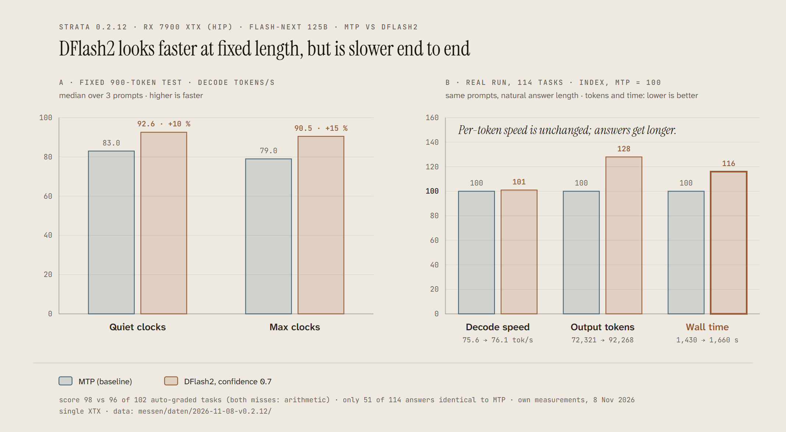
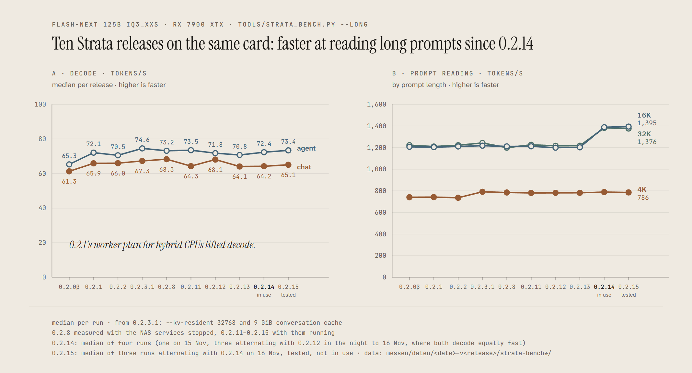

# Strata releases on this card, one by one

**English** · [Deutsch](releases.de.md) · [← README](../README.md)

In configs, scripts and file names the three versions of the model go by short names. `liber` is Flash-Next 125B in the IQ3_XXS quantization with the refusals removed, the uncensored version: the same weights, it answers whatever it is asked. It is the one in daily use, for chat and agent. `faber` is the original, which is measured first and kept as the fallback. `velox` is the same model in the smaller and faster IQ2_XS quantization, now measured only for comparison.

Newest first. Each release was measured against the one before it with the identical run config, only engine and control swapped. Summary table and chart: [README](../README.md#strata-releases-on-this-card).

## Follow-up 16 Nov 2026: Strata 0.2.15 is equally fast here, this NAS stays on 0.2.14

Control 0.1.61 with engine 0.1.60 `hip-rx7900`, the same engine as in 0.2.14; only the control program is new. Same run config (`konfig/strata-0.2.14/`), NAS services on, only my agent stopped.

| Median | 0.2.15 | 0.2.14 |
|---|---:|---:|
| 3 interleaved pairs, same session: decode / 63-token prompt, tokens/s | 59.2 / 118.6 | 59.1 / 118.6 |
| `strata_bench.py --long`, 3 alternating runs: decode chat / agent, tokens/s | 65.1 / 73.4 | 64.0 / 70.8 |
| same runs: prompt 4K / 16K / 32K, tokens/s | 786 / 1,395 / 1,377 | 786 / 1,392 / 1,375 |
| `standard-v1`, package: short decode / 4K / 16K prompt, tokens/s | 68.4 / 747 / 1,416 | |

**Equally fast.** The pairs are 0.1 tokens/s apart. In the three alternating runs, each engine loaded fresh and the order swapped every round, prompt reading is equal to the token, and decode lies within the scatter this test shows for one and the same release. The pairs measure short answers with less predictable text, which is why they come to 59 rather than the 66 tokens/s of long answers. `standard-v1` is complete and passes 12 of 12 sanity checks; 4K came at 747 tokens/s in this one run and at 786 in the three `strata_bench.py` runs, as with 0.2.14. My small task set (35 tasks) passes 34, 0.2.14 on the same day 35: tools 20 of 20, code 14 of 15; the one that failed is a code task that flips between runs.

Since the engine is the same and nothing gets faster, this NAS stays on 0.2.14. Raw data: `messen/daten/2026-11-16-v0.2.15/`. Reported to Strata: nothing.

## Follow-up 15/16 Nov 2026: Strata 0.2.14 reads long prompts faster, in production since 16 Nov

Engine 0.1.60 `hip-rx7900` with control 0.1.60 against 0.2.12, identical run config (`konfig/strata-0.2.12/`), NAS services running, only my agent paused. The release moves prompt reading to Strata's own kernels on AMD and NVIDIA, and its notes carry no measurement for the RX 7900 under Linux. Here is one.

| median tok/s | 0.2.14 | 0.2.12 | 0.2.13 |
|---|---:|---:|---:|
| 3 interleaved pairs, same session: decode / 63-token prompt | 59.3 / 117.9 | 60.5 / 107.5 | |
| `standard-v1`, package: short decode / 4K / 16K prompt | 67.8 / 800 / 1,411 | 63.6 / 788 / 1,202 * | 67.7 / 799 / 1,203 * |
| `strata_bench.py --long`: 4K / 16K / 32K prompt | 789 / 1,405 / 1,390 | 781 / 1,200 / 1,217 * | 782 / 1,203 / 1,217 * |
| needles, seconds: 128K / 250K | 66-96 / 206 | 120-158 / 294 * | 99-112 / 238 * |

\* earlier sessions (8 and 9 Nov). Only the pairs ran both versions back to back.

**Decode is equal, prompt reading is faster from 16K up.** In the same-session pairs decode sits inside the noise and the short prompt is 10 % faster. Against the earlier runs, 4K is unchanged, 16K is 17 % faster and 32K 14 % faster, the first token of a 16K prompt comes after 11.6 s instead of 13.7 s, and the 250K needle is found in 206 s instead of 238 s. Needles 7/7, 8 of 8 fresh engines healthy (637-758 tok/s), my small task set 28 of 29.

One number goes the other way: in the agent test of `strata_bench.py` the decode median over all 18 requests is 63.7 tok/s, against 70.8 on 0.2.13 and 71.8 on 0.2.12 (the tool's own summary without the first turns: 70.4 against 73.7 and 73.2). That test generates only 756 tokens, single requests range from 41 to 101 tok/s on every version, and the drafter's proposals were accepted less often this time (54 % against 56 % and 59 %). The pairs, which ran both versions back to back with 900 tokens each, show no difference. So in the night to 16 Nov I ran `strata_bench.py --long` three times each on 0.2.12 and 0.2.14 in one session, fresh engine per run, order swapped each round. **It was scatter:** agent decode comes out at 72.7 against 72.5 tok/s (median of the three runs), and the first agent session after a fresh start is the slow one on both versions (about 70 tok/s against about 84 in the later ones). The same session confirms the prompt gain without the caveat of different days: 16K at 1,387 against 1,196 tok/s (+16 %), 32K at 1,380 against 1,215 (+14 %), 4K +2 %.

Two things I looked for. The release notes list driver pauses and one card reset for a Radeon R9700 under Linux; in 192 kB of engine log from this session there is no such line, and the kernel log is clean. And `standard-v1` is complete but passes 11 of 12 sanity checks instead of 12: in T2 the model returned no structured tool call and wrote that it had already called the tool. One run does not tell me whether that is the sampling at temperature 1.0 or the new version.

No Docker image run this time, the `0.2.14-rocm-gfx110x` image was not published when I measured. My large task set (114 tasks, 102 auto-graded) passes 98 on 0.2.14 against 96 on 0.2.12 (13 Nov): one code and one logic task that failed now pass, nothing that passed fails, which on this set is equal and not better. It took 1,489 s against 1,622 s, decode median 75.2 against 73.5 tok/s. **Since 16 Nov this NAS serves with 0.2.14**, with the unchanged run configs (`konfig/strata-0.2.14/`). After the switch all three models answer, make a tool call and log the gfx1100 table as enabled, and the uncensored model loads its control vector and reads a picture. 0.2.12 stays on disk as the way back. Raw data: `messen/daten/2026-11-15-v0.2.14/`, reported to Strata as [#6056](https://github.com/Niko1221/Strata/issues/6056).

## Follow-up 9 Nov 2026: Strata 0.2.13, and without the gfx1100 table the Docker image reads 16K prompts 35 % slower

Engine 0.1.59 `hip-rx7900` with control 0.1.59 against 0.2.12, identical run config (`konfig/strata-0.2.12/`), NAS services running. **0.2.13 is equal to 0.2.12 here**: same-session pairs 60.0 against 60.7 tok/s decode, `standard-v1` on the package complete with 12/12 (short decode / 4K / 16K: 67.7 / 799 / 1,203), `strata_bench.py --long` 4K / 16K / 32K at 782 / 1,203 / 1,217, needles 7/7 to 250K (238 s at 250K). My task set: 97 of 102 against 98 for 0.2.12, one code task flipped, 1,381 s against 1,430 s. This NAS stays on 0.2.12 for now.

**The unchanged Docker image `0.2.13-rocm-gfx110x` no longer uses the gfx1100 hipBLASLt table.** The engine logs that the table is in the package and off by default; the release notes name only Windows for this. On Linux it costs 14 % at 4K and 35 % at 16K prompt reading (649 and 769 instead of 756 and 1,186 tok/s with the 0.2.12 image). `-e STRATA_HIPBLASLT_TABLE=on` brings it back (766 / 1,193). If you run the image on an RX 7900, set that variable. My run config sets `STRATA_HIPBLASLT_TUNING` explicitly and is not affected. Raw data: `messen/daten/2026-11-09-v0.2.13/`, sent to Strata as [issue #5666](https://github.com/Niko1221/Strata/issues/5666).

## Follow-up 8 Nov 2026: Strata 0.2.12, now in production, and the tuned DFlash2 drafter on gfx1100

Engine 0.1.58 `hip-rx7900` with control 0.1.58 against 0.2.11, identical run config, NAS services running. **0.2.12 is equal to 0.2.11 here**: on my own task set (114 tasks, 102 auto-graded) both pass 98 and take 1,430 s; same-session pairs 59.9 against 61.2 tok/s decode, inside the noise. `standard-v1` complete with 12/12 on the package (short decode / 4K / 16K: 63.6 / 788 / 1,202) and on the unchanged Docker image (69.1 / 756 / 1,186), needles 7/7 to 250K. **Since 8 Nov this NAS serves with 0.2.12**, still with MTP.

The release ships a **tuned DFlash2 drafter**, as far as I can tell not measured on gfx1100 before. It loads cleanly (591 MiB of VRAM, no MTP layer) and in a fixed 900-token test it decodes 10-15 % faster than MTP at confidence 0.7 (92.6 against 83.0 tok/s on my quiet card profile, 90.5 against 79.0 at stock clocks), although German prose is slower and only code gains. On the real task set, with natural answer length, it loses: decode per token is the same (+1 %), but only 51 of 114 answers are identical to MTP at temperature 0, the changed ones are longer (+28 % tokens), wall time is +16 %, and two multi-step price calculations go wrong (96 against 98). Halving the CPU pool workers changed nothing. DFlash2 stays off on this card. Run configs (production and the DFlash2 test): `konfig/strata-0.2.12/`. Raw data: `messen/daten/2026-11-08-v0.2.12/`, sent to Strata as [issue #5615](https://github.com/Niko1221/Strata/issues/5615).

## Follow-up 5 Nov 2026: Strata 0.2.11, now in production

Engine 0.1.57 `hip-rx7900` with control 0.1.57, against the 0.2.10 packages (0.1.56) with the identical run config, only engine and control swapped. The 0.2.11 release notes say this package had not been run with a model by the project; on this card it loads, serves and passes everything below. Unlike the 0.2.8 follow-up, the NAS services were running; only my agent was paused.

| median tok/s | 0.2.11 | 0.2.10 |
|---|---:|---:|
| 3 interleaved pairs, same session: decode / 63-token prompt | 60.9 / 118.1 | 59.8 / 109.0 |
| `standard-v1`, package: short decode / 4K / 16K prompt | 67.0 / 797 / 1,192 | 65.6 / 797 / 1,204 * |
| `standard-v1`, unchanged Docker image: short decode / 4K / 16K prompt | 65.0 / 758 / 1,182 | |
| `strata_bench.py --long`: 4K / 16K / 32K prompt | 781 / 1,212 / 1,226 | |

\* nightly 0.2.10 run of 3 Nov. Decode is equal; the short-prompt difference sits inside overlapping ranges. `standard-v1` complete with 12/12 on both tracks, our task set 29 of 29, needles 6/6 at 32K and 128K and 1/1 at 250K (239 s for 251,626 tokens), 8 of 8 fresh engines healthy (the first one, right after unpacking, read at 457 tok/s, the other seven at 670-750). The 128K and 250K needles were about 15 % faster than in the 0.2.10 night run, but no faster than on the quiet machine of 31 Oct, so I do not credit the release with it. Card power while writing: 208 W median. **Since 5 Nov this NAS serves with 0.2.11**, after 0.2.9 (fix for silently wrong long prompts when the engine stack landed in pinned expert memory, #3431) and 0.2.10 in between. Run configs unchanged (`konfig/strata-0.2.11/`). Raw data: `messen/daten/2026-11-05-v0.2.11/`, sent to Strata as [issue #5321](https://github.com/Niko1221/Strata/issues/5321).

## Follow-up 31 Oct 2026: Strata 0.2.8, now in production, measured on a quiet machine

Engine 0.1.54 `hip-rx7900` with control 0.1.54, against the 0.2.3.1 packages with the identical run config, only engine and control swapped. For this session I stopped every NAS service that was not needed (photo library, media server, agent, search, mail bridge, file sync), so the dates are not strictly comparable; the pairs are.

| median tok/s | 0.2.8 | 0.2.3.1 |
|---|---:|---:|
| 3 interleaved pairs, same session: decode / 63-token prompt | 61.4 / 111.2 | 61.6 / 121.2 |
| `strata_bench.py --long`: chat / agent decode | 68.3 / 75.6 | 67.3 / 78.3 * |
| 4K / 16K / 32K prompt | 785 / 1,212 / 1,199 | 791 / 1,218 / 1,244 * |
| `standard-v1`, package / unchanged Docker image: 4K / 16K prompt | 791 / 1,201 and 740 / 1,222 | 800 / 1,203 and 749 / 1,220 * |

\* 0.2.3.1 run of 23 Oct, NAS services running. Decode is equal; prompt reading from 4K up is equal. Only the short 63-token prompt read about 8 % slower on 0.2.8 in the pairs, with overlapping ranges, where a request's fixed cost dominates. `standard-v1` complete with 12/12 on both tracks, our task set 29 of 29, needles 6/6 at 32K and 128K and 3/3 at 250K (223-237 s for 251,626 tokens), 8 of 8 fresh engines normal. **Since 31 Oct this NAS serves with 0.2.8.** The run configs are unchanged (`konfig/strata-0.2.8/`, with the llama-swap macro). Script: `messen/t028.py`. Raw data: `messen/daten/2026-10-31-v0.2.8/`, the same data went to Strata as [PR #4851](https://github.com/Niko1221/Strata/pull/4851).

What else changed for this card:

- **The unchanged Docker image leaves 854 MiB of VRAM free after loading** (0.2.3: 594 MiB) and gave no low-VRAM warning during the run.
- **0.2.8 recovers slightly malformed tool calls by default** (`"tool_call_recovery": false` turns it off). In my small check, 10 agent tasks per version with four declared tools, every answer on both versions was already a well-formed tool call, so the check did not exercise the new path.
- **The quiet machine shows in the long prompts:** the first 128K prompt took 98-111 s, against 129-149 s in a nightly run with all services up.

## Follow-up 23 Oct 2026: Strata 0.2.3.1, now in production, and four releases side by side

The 0.2.3 notes list RX 7000 as built but not run on real hardware. Here it ran: engine 0.1.48 `hip-rx7900` with control 0.1.48.1, against the 0.2.2 packages with the identical run config, only engine and control swapped.

| median tok/s | 0.2.3.1 | 0.2.2 |
|---|---:|---:|
| 3 interleaved pairs: decode / 63-token prompt | 62.5 / 111.7 | 61.6 / 112.3 |
| `strata_bench.py --long`: chat / agent decode | 67.3 / 78.3 | 66.0 / 72.5 * |
| 4K / 16K / 32K prompt | 791 / 1,218 / 1,244 | 736 / 1,211 / 1,222 * |

\* 0.2.2 run of 21 Oct, before `--kv-resident 32768` and the 9 GiB conversation cache. Prompt reading at 4K is about 7 % faster in every test, decode is equal within the noise. Needles 6/6 at 32K and 128K and 3/3 at 250K, `standard-v1` complete with 12/12, our task set 29 of 29, 8 of 8 fresh engines normal. **Since the evening of 23 Oct this NAS serves with 0.2.3.1.** The models are called `faber` (was `arbeit`) and `velox` (was `schnell`) here now; configs and the llama-swap macro with the old names as aliases are in `konfig/strata-0.2.3.1/`. Script: `messen/t0231.py`. Raw data: `messen/daten/2026-10-23-v0.2.3.1/`.

From 0.2.0-beta to 0.2.3.1 nothing got slower on this card. Decode rose from 61 to 67 tok/s, mostly with 0.2.1's worker plan for hybrid CPUs (#3262); prompt reading at 16K and 32K was already at its ceiling.

**The first 128K prompt of the 0.2.3.1 run took 217 s, where every earlier release needed about 108 s.** A separate A/B (`messen/t128.py`) settled it: a fresh engine each time, the identical run config, alternating, twice each. 0.2.3.1 read the first 128K prompt in 110.5 and 110.8 s, 0.2.2 in 111.1 and 111.6 s, the needle was found every time. So no regression; the 217 s was a one-off in a long test run, most likely the conversation cache and RAM filled by the tests before it.

## Follow-up 21 Oct 2026, evening: Strata 0.2.2, also in production

0.2.2 (engine 0.1.47 `hip-rx7900`, control 0.1.47) brings no speed change for this combination, but more robustness: tool calls with a mistyped opener are read as calls, a NaN in a long prompt no longer fails the request, a rare hang of the first verify window on HIP is fixed. Measured against the 0.2.1 packages with the same run config, only engine and control swapped:

| median tok/s | 0.2.2 | 0.2.1 |
|---|---:|---:|
| 3 interleaved pairs: decode / 63-token prompt | 62.1 / 93.6 | 60.5 / 93.9 |
| `strata_bench.py --long`: chat / agent decode | 66.0 / 72.5 | 65.9 / 74.6 |
| 4K / 16K / 32K prompt | 736 / 1,211 / 1,222 | 742 / 1,204 / 1,210 |

Needles 6/6 up to 128K, 8 of 8 fresh engines normal, our task set 28 of 29 (the one miss is a false alarm of the check: the phishing mail was written, with a note in front). **`strata bench run` from the release package is complete now**, because the control archive carries a `COMMIT` file. The `0.2.2-rocm-gfx110x` Docker image runs too, with the same slow defaults as 0.2.1 (700 MiB reserve, no hipBLASLt table, 16K at 781 tok/s), so the advice above still holds. **Since the evening of 21 Oct this NAS serves with 0.2.2**; the configs are unchanged, only the macro mounts the new packages (`konfig/strata-0.2.2/`). Script: `messen/t022.py`. Raw data: `messen/daten/2026-10-21-v0.2.2/`. Reported in #3263 and PR #2904.

## Follow-up 21 Oct 2026: Strata 0.2.1, now in production here

**The hybrid-CPU fix from Strata issue #3262 works.** 0.2.1 counts the two LP-E cores (`cpu_lowpower`) as efficiency cores. Without `--pool-workers` it plans 10 workers on CPUs 1–10 and leaves CPUs 14/15 free, and setup inside the Docker image writes the same 10. Measured in 3 interleaved pairs, a fresh engine per run:

| | decode tok/s | 63-token prompt tok/s |
|---|---:|---:|
| 0.1.44.1, `--pool-workers 9` (two of them on the LP-E cores) | 63.3 | 66.1 |
| 0.2.1, `--pool-workers 9` (CPUs 1–9) | 61.5 | 88.0 |
| **0.2.1 default, 10 workers** | **61.1** | **97.6** |

Everything else stays as before: `strata_bench.py --long` 65.9 tok/s chat decode, 742 / 1,204 / 1,210 tok/s at 4K / 16K / 32K, needles 6/6 up to 128K, our task set 28 of 29, 8 of 8 fresh engines normal. Both packaging notes from #3263 are fixed in 0.1.46. **Since 21 Oct this NAS runs the prebuilt release packages** (engine 0.1.46 `hip-rx7900`, control 0.1.46.2) without `--pool-workers`; configs and the llama-swap macro are in `konfig/strata-0.2.1/`.

**The Docker image `ghcr.io/niko1221/strata:0.2.1-rocm-gfx110x` runs on the XTX.** The release notes listed it as built but not run on a card. Its unchanged `strata bench run --suite standard-v1 --track default` is complete with 12/12 sanity checks. Its own choices read long prompts more slowly than our config, though: 3 slots, GPU picture reader, 128K, 700 MiB reserve, and no hipBLASLt table give 772 tok/s at 16K. **The gfx1100 hipBLASLt table that ships in the package but is opt-in in 0.2.1 is worth +23 % at 4K and +60 % at 16K** (`STRATA_HIPBLASLT_TABLE=on` → 1,238 tok/s). If you use the image, set it.

| `standard-v1`, medians of 3, tok/s | short prompt / decode | 4K prompt / decode | 16K prompt / decode |
|---|---:|---:|---:|
| Docker image, defaults | 43.3 / 58.9 | 605.4 / 55.9 | 772.0 / 55.0 |
| + `PARALLEL=1` | 57.8 / 63.7 | 623.9 / 59.3 | 773.8 / 58.7 |
| + `PARALLEL=1 STRATA_HIPBLASLT_TABLE=on` | 60.4 / 65.8 | 768.3 / 62.4 | 1,238.5 / 69.3 |
| release packages with `konfig/strata-0.2.1/arbeit.json` | 51.7 / 69.0 | 743.9 / 63.5 | 1,236.7 / 62.5 |

Reported to Strata in #3262, #3263 and PR #2904, together with the results. Script: `messen/t021.py`. Raw data: `messen/daten/2026-10-21/`.

## Follow-up 19 Oct 2026: Strata 0.2.0-beta, pictures, and three checks for the Strata team

**0.2.0-beta's prebuilt RX 7000 engine runs on this card.** The release notes say the `hip-rx7900` package was compiled but never ran on a real RX 7000. Here it ran on the XTX with the same weights, packs and settings as `arbeit`: `strata_bench.py --long` gave 61.3 tok/s chat decode, 741 / 1,207 / 1,223 tok/s prompt at 4K / 16K / 32K and a 68.6 % agent cache hit, the same as 0.1.44.1. Recall was 9/9 up to 250K, and our task set passed 27 of 29. Production stays on 0.1.44.1, because the new version brings nothing measurable here.

| | 0.1.44.1 (17 Oct) | 0.2.0-beta `hip-rx7900` |
|---|---:|---:|
| chat decode (`strata_bench --long`) | 63.7 | 61.3 tok/s |
| 4K / 16K / 32K prompt | 741 / 1,195 / 1,224 | 741 / 1,207 / 1,223 tok/s |
| needles 32K / 128K / 250K | 9/9 | 9/9 |
| 0.2.0's new default worker count (15 here) | – | 39.8 / 41.2 tok/s instead of 59.7 / 64.0 with `--pool-workers 9` |

**Keep `--pool-workers` on a hybrid CPU.** 0.2.0 plans one worker per physical core but the host's, which means 15 on the 255H, and that was a third slower than 9. Strata also counts the two LP-E cores (Linux `cpu_lowpower`, no L3) as P-cores and puts workers on them early. Limiting the container to CPUs 0-13 made short prompts about 40 % faster (66 → 94 tok/s for a 63-token prompt) and left decode unchanged.

**Pictures straight into the 125B model.** Flash-Next has its own picture reader (mmproj, 907 MB). On the CPU (`--vision cpu`) it costs no VRAM and about 1 GiB of RAM, and it read all test pictures correctly in 1.2–5 s each. Our 0.1.44.1 engine can do this already once `tools/vision` is built (`-DSTRATA_VISION_CUDA=OFF`). 0.2.0 makes the GPU reader the default on 24 GB cards. On the XTX it costs 776 expert slots (1.28 GiB), and a large picture takes 3.5 s instead of 5.6 s. If you update, set `--vision cpu` explicitly unless you want that trade.

**Strata issue #3177** (MTP verify timeout on a single 7900 XTX at ~54K tokens) does not reproduce here: 6 of 6 agent requests of 55,019 tokens with 2,500 tokens of output each finished, on 0.1.45 and 0.1.44.1, with and without the MTP head.

**Fresh engines.** The 0.2.0 notes report that about half of the fresh engines with MTP on an R9700 read prompts 10–23 % slower. Here: 1 of 24 fresh 0.2.0 engines read both 4K prompts about 38 % slower (420 instead of about 675 tok/s), 0 of 24 with 0.1.44.1. The slow engine's start-up lines were the same as the others'. So it happens on gfx1100 too, but rarely.

Scripts: `messen/visiontest.py`, `messen/r3177.py`, `messen/folgetests.py`, `messen/t020.py`. Raw data: `messen/daten/2026-10-19/`.

## Strata 0.1.44.1 vs 0.1.45 (17 Oct 2026)

No measurable difference for Flash-Next on gfx1100; all values within noise:

| Variant | long T/s | 8k read T/s | 32k read s | Agent s |
|---|---|---|---|---|
| 0.1.44.1 | 65.5 | 1,175 | 26.0 | 52.6 |
| 0.1.45 | 63.5 | 1,151 | 26.3 | 53.7 |
| 0.1.45 `--pool-affinity p-cores` | 61.0 | 1,134 | 27.2 | 48.1 |
| 0.1.45 `--pool-affinity measure` | 62.5 | 1,111 | 26.7 | 49.5 |
| 0.1.45 `STRATA_CPU_IQ_ALL_EXACT1=1` | 61.4 | 1,143 | 26.8 | 49.8 |

Long prompt (103,341 tokens, fresh): 87.7 s · 88.1 s · with `STRATA_SCORES_THREAD=1` 85.3 s. Greedy answers
(temperature 0) are **not** byte-identical between the versions, but equivalent in content. `STRATA_HIP_WMMA` is
gfx12 only.
