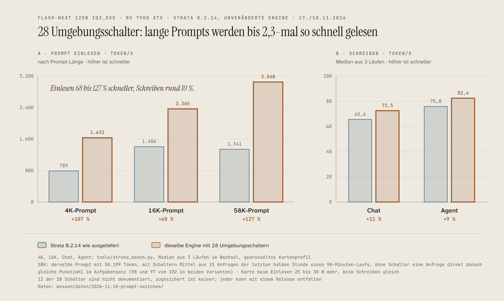
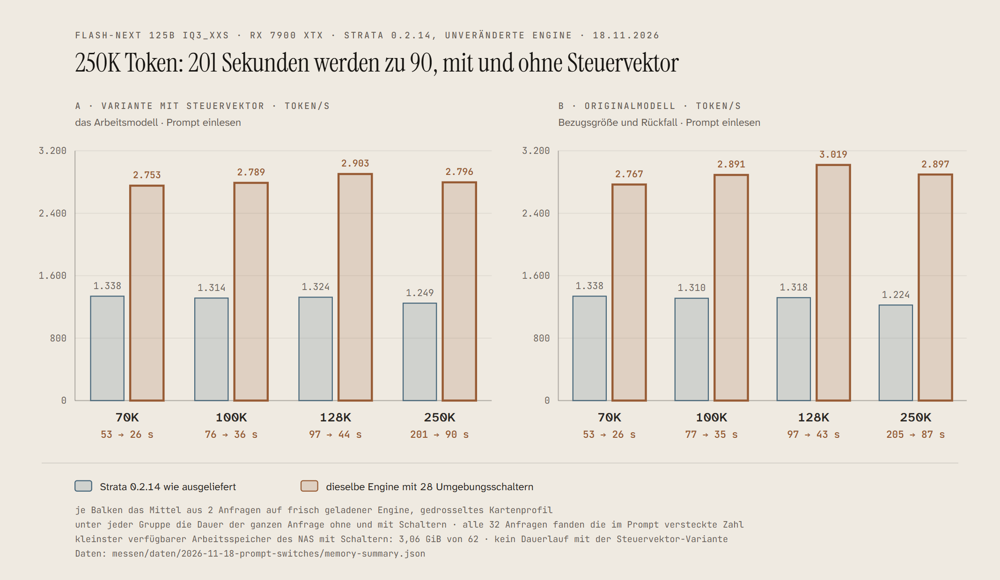

# 28 Umgebungsschalter: Prompts doppelt so schnell einlesen, ohne die Engine zu tauschen

[English](schalter.md) · **Deutsch** · [← README](../README.de.md)

**Stand 19.11.2026:** Diese Seite ist die Herleitung, nicht mehr der Betrieb. Sie beschreibt die Messungen vom 17. und 18.11.2026, bei denen die Schalter als Umgebungsvariablen in der Laufkonfiguration des Release 0.2.14 standen. Seit dem Abend des 18.11.2026 stecken sie im Code meines Eigenbaus [strata-xtx](https://github.com/faf-net/strata-xtx), seit dem 19.11.2026 auf der Basis von Strata 0.2.16, und in der Laufkonfiguration steht keiner mehr (im `env` nur noch die hipBLASLt-Tabelle). Aus den 28 wurden im Eigenbau 27: `STRATA_PREFILL_AUTO_MAX` ist dort eine feste Regel für die Stückgröße bei `--prefill auto`, `GPU_MAX_HW_QUEUES` brachte nichts und entfiel, `STRATA_CVEC_FUSE` kam dazu. Der Eigenbau liest so schnell wie hier mit den Schaltern gemessen. Die rund 10 % beim Schreiben aus dieser Messnacht sind im Eigenbau nicht geblieben: Dort ist das Schreiben gleich bis leicht schneller als auf dem Release. Ob das Release 0.2.16 jeden der Namen noch kennt, habe ich nicht einzeln nachgeprüft; der Eigenbau liest darauf so schnell wie auf 0.2.15. Die Werte dazu stehen im [README](../README.de.md) und im [Nachtrag vom 19.11.](releases.de.md).

Alle Zahlen auf dieser Seite sind auf diesem NAS gemessen: UGREEN iDX6011 Pro, 62 GB RAM, RX 7900 XTX im Dock, Strata 0.2.14 (Engine und Control 0.1.60, `hip-rx7900`), Flash-Next 125B IQ3_XXS.

In Konfigurationen und Skripten heißen die Fassungen des Modells `liber` (die Variante mit Steuervektor, mein Arbeitsmodell für Chat und Agent), `faber` (das Original, Bezugsgröße für Messungen und Rückfall) und `velox` (kleinere Quantisierung, nur zum Messen).

## Worum es geht

Stratas Engine bringt Umgebungsschalter für das Einlesen des Prompts mit, die auf dieser Kartengeneration ausgeschaltet sind. Ich wollte wissen, wie viel sie auf einer einzelnen RX 7900 XTX bringen, **auf der fertigen Engine**, die hier ohnehin läuft.

Gemessen habe ich einen Satz von 28 Schaltern, die die Engine 0.1.60 von Strata 0.2.14 kennt. Diese 28 stehen in [`konfig/strata-0.2.14/prompt-schalter.json`](../konfig/strata-0.2.14/prompt-schalter.json). Ich habe die Engine nicht verändert, es kommen nur 28 Zeilen im Abschnitt `env` der Laufkonfiguration dazu.

Am 18.11.2026 liefen `liber` und `faber` hier mit diesen Schaltern in der Laufkonfiguration; am Abend desselben Tages hat der Eigenbau sie abgelöst.

## Was sie bringen



Stahlblau ist Strata 0.2.14 wie ausgeliefert, Bernstein dieselbe Engine mit den 28 Schaltern.

| Original, gedrosseltes Kartenprofil | ohne | mit Schaltern | Unterschied |
|---|---:|---:|---:|
| Einlesen 4K-Prompt, Token/s | 789 | 1.632 | +107 % |
| Einlesen 16K-Prompt, Token/s | 1.406 | 2.365 | +68 % |
| Einlesen 58K-Prompt, Token/s | 1.341 | 3.048 | +127 % |
| Schreiben im Chat, Token/s | 65,6 | 72,5 | +11 % |
| Schreiben im Agent-Test, Token/s | 75,8 | 82,4 | +9 % |
| Leistungsaufnahme der Karte, Mittel über den ganzen Testlauf | 207 W | 201 W | gleich |
| Aufgabensatz, bestanden von 102 (zwei Läufe) | 98 / 97 | 98 / 97 | gleich |
| Karte im Leerlauf, Modell geladen | 16,0 W | 16,2 W | gleich |

- **Das Einlesen wird je nach Länge 68 bis 127 % schneller, das Schreiben rund 10 %.**
- **Strom: im Mittel gleich, beim Einlesen selbst mehr.** Über den ganzen Testlauf gemittelt zieht die Karte gleich viel. Während des Einlesens sind es mit den Schaltern 25 bis 30 W mehr (267 bis 270 W ohne, 292 bis 300 W mit, am 18.11.2026 im Wechsel gemessen). Weil das Einlesen nur halb so lange dauert, ist die Energie je gelesenem Token trotzdem rund halb so hoch: 0,037 bis 0,047 gegen 0,070 bis 0,087 Wh je 1.000 Token. An der Steckdose schwankt die Leistung beim Einlesen zwischen den Läufen so stark, dass ich dafür keine feste Zahl nenne.
- **Die Qualität bleibt gleich.** Mein Aufgabensatz (114 Aufgaben auf Deutsch, 102 automatisch bewertet) kommt in beiden Varianten auf 98 und 97. Dieselben vier Aufgaben scheitern in allen vier Läufen.
- **Nicht bitgleich, aber das ist die Engine ohnehin nicht.** Zwei der Schalter (`STRATA_HIP_WMMA`, `STRATA_SELECT_WMMA`) gelten als nicht bitgleich. Bei Temperatur 0 sind zwischen zwei Läufen ohne Schalter 47 von 114 Antworten identisch, zwischen zwei Läufen mit Schaltern 51.
- Vier weitere Argumente, die ich probiert habe (`--adapt-every 1 --adapt-swaps 32 --mtp-q4 all --mtp-window 4096`), bringen nichts, was sich vom Rauschen trennen lässt. Ich habe sie weggelassen.

### Lange Prompts, Arbeitsmodell und Original



Mein Agent arbeitet mit der Variante mit Steuervektor, nicht mit dem Original. Deshalb sind beide gemessen, je ohne und mit Schaltern, mit Prompts von 70.000 bis 250.000 Token. Die Engine war je Größe frisch geladen, jede Zelle hat zwei Läufe, und der Arbeitsspeicher des NAS wurde jede Sekunde mitgeschrieben.

| Prompt | Steuervektor, ohne | Steuervektor, mit | Original, ohne | Original, mit |
|---|---:|---:|---:|---:|
| 70.000 Token | 53 s | 26 s | 53 s | 26 s |
| 100.000 Token | 76 s | 36 s | 77 s | 35 s |
| 128.000 Token | 97 s | 44 s | 97 s | 43 s |
| 250.000 Token | 201 s | 90 s | 205 s | 87 s |
| kleinster verfügbarer Arbeitsspeicher | 3,72 GiB | 3,34 GiB | 3,23 GiB | 3,06 GiB |

- **Beide Modelle lesen lange Prompts mit den Schaltern gut doppelt so schnell**, das Arbeitsmodell +106 bis +124 %, das Original +107 bis +137 %.
- Alle 32 Anfragen kamen mit HTTP 200 zurück und fanden die im Prompt versteckte Zahl. In den Engine-Logs steht keine Zeile mit `non-finite` oder NaN.
- **Arbeitsspeicher:** Die Schalter kosten nach dem Laden rund 0,6 GiB. Unter Last unterscheiden sich die Tiefstwerte um höchstens 0,6 GiB, und der verfügbare Speicher fiel in keiner Sekunde unter 3 GiB.

### 90 Minuten unter Last

Ein anderer Nutzer mit einem ähnlichen Satz Schalter hatte nach 1 h 45 min nicht-endliche Werte gemeldet, danach HTTP 503 auf jede Anfrage. Er verdächtigte `STRATA_GDN_CHUNKED` und `STRATA_PF_F16`. Beide sind in meinem Satz, deshalb lief er 90 Minuten unter Dauerlast (Original): 1.232 Anfragen, 1.232-mal HTTP 200, 176 von 176 versteckten Zahlen gefunden, keine nicht-endlichen Werte. Davor liefen dieselben Schalter 38 Minuten mit `STRATA_DBG_NAN=1`, ebenfalls ohne Befund.

### Abnahme nach der Übernahme (18.11.2026)

Direkt nach dem Eintragen in die Laufkonfigurationen des Betriebs habe ich beide Modelle noch einmal geprüft, in beiden Kartenprofilen, je frisch geladen:

| | Steuervektor, gedrosselt | Steuervektor, max | Original, gedrosselt | Original, max |
|---|---:|---:|---:|---:|
| Laden bis zur ersten Antwort | 20,5 s | 19,8 s | 21,6 s | 23,8 s |
| Einlesen 16K, Token/s | 2.287 | 2.209 | 2.409 | 2.325 |
| Einlesen 58K, Token/s | 2.908 | 2.877 | 3.029 | 3.005 |
| Einlesen 127K, Token/s | 2.904 | – | – | – |
| versteckte Zahl gefunden | 4 von 4 | 3 von 3 | 3 von 3 | 3 von 3 |
| Tool-Call richtig | ja | ja | ja | ja |
| Farbe eines Testbilds genannt | ja | ja | – | – |
| Steuervektor laut Log | 41 Schichten | 41 Schichten | – | – |
| kleinster verfügbarer Arbeitsspeicher | 6,41 GiB | 6,97 GiB | 3,51 GiB | 3,65 GiB |
| Fehlerzeilen im Engine-Log | 0 | 0 | 0 | 0 |

- **Der Steuervektor wirkt mit den Schaltern weiter.** Von fünf Bitten, die Modelle oft ablehnen, beantwortet die Variante mit Steuervektor alle fünf ohne Ausweichformel, das Original weicht bei drei aus.
- Das volle Kartenprofil bringt beim Einlesen nichts gegenüber dem gedrosselten.
- Der erste Prompt nach dem Laden (4K) wurde mit 677 bis 798 Token/s gelesen, also langsamer als in `strata_bench.py` (1.632). Dort ist die Engine schon warm. Ich habe das nicht weiter zerlegt.
- Je Zelle ein Lauf. Werte: `messen/daten/2026-11-18-prompt-switches/acceptance-after-adoption.json`.

## Was das nicht zeigt

- Der Dauerlauf, der Aufgabensatz und die Leerlaufwerte stammen vom Original. Für die Variante mit Steuervektor gibt es Tempo, lange Prompts, Speicher und die Abnahme, aber keinen Dauerlauf.
- Gemessen ist eine einzelne Karte. Der gemeldete Fehler trat auf zwei Karten nach 105 Minuten auf, mein Lauf ging 90.
- Welche der 28 Schalter den Gewinn tragen, habe ich nicht aufgeschlüsselt.
- Das Schreibtempo im Agent-Test fiel im Dauerlauf von 70,7 auf 63,6 Token/s zwischen der ersten und der letzten halben Stunde. Die Ursache habe ich nicht gesucht.
- Mit `STRATA_DBG_NAN=1` trieb ein Prompt von 128.496 Token den verfügbaren Arbeitsspeicher für über eine Minute auf null. Ohne diesen Diagnoseschalter passiert das bis 250.000 Token nicht. Er gehört nicht in den Betrieb.
- Die 12 Schreibaufgaben auf Deutsch sind nicht automatisch bewertet, und ich habe sie noch nicht nebeneinander gelesen.

## Das Risiko, und wie ich es im Blick behalte

*Dieser und der nächste Abschnitt beschreiben den Stand vom 18.11.2026, als die Schalter in der Laufkonfiguration standen. Das Risiko selbst gilt für den Eigenbau genauso, weil er bis auf die drei genannten Unterschiede dieselben Schalter setzt; deshalb prüfe ich ihn bei jeder neuen Strata-Version neu, bevor er in Betrieb geht. Sein Ausweg ist eine einzige Variable: `STRATA_GFX1100_DEFAULTS=0` schaltet die ganze Tabelle ab, und nach nicht-endlichen Werten startet der Server die Engine von selbst einmal ohne sie neu.*

Die Schalter sind Umgebungsvariablen. Strata beschreibt 16 der 28 in der eigenen Dokumentation und lässt sie auf dieser Kartengeneration bewusst ausgeschaltet, weil sich die Rundung ändert und die Antworten nicht mehr Bit für Bit gleich sind; 12 sind nirgends beschrieben. Zugesichert ist keiner davon. Ein Release kann sie umbenennen, streichen oder ihre Wirkung ändern. Einen unbekannten Namen ignoriert die Engine stillschweigend, dann fällt das Einlesen ohne Fehlermeldung auf das alte Tempo zurück. Schlimmer wäre ein Schalter, der nach einem Release etwas anderes tut.

Dagegen stehen drei Dinge:

1. **Eine Liste, eine Stelle.** Die 28 Schalter stehen mit Quelle und Prüfstand in `konfig/strata-0.2.14/prompt-schalter.json`. `messen/schalter.py` trägt genau diese Schlüssel in die Laufkonfiguration ein und nimmt genau diese wieder heraus. Jede Umstellung landet mit Zeitstempel in einem Protokoll neben den Konfigurationen.
2. **Namensprüfung bei jedem Release, ohne Karte.** `messen/schalter_pruefen.py <engine-ordner> --alt <engine-ordner-in-betrieb>` sucht die 28 Namen in den Dateien der neuen Engine und meldet, welche fehlen. Auf 0.2.12 und 0.2.14 sind alle 28 vorhanden.
3. **Messung bei jedem Release, auf beiden Modellen.** Mein nächtlicher Release-Test lädt jede neue Version mit der Laufkonfiguration aus dem Betrieb, also mit den Schaltern. Er misst Tempo und Aufgabensatz gegen die laufende Version und prüft zusätzlich das Arbeitsmodell auf der neuen Engine: Laden, Steuervektor im Log, Tool-Call, Bild, langer Prompt mit versteckter Zahl. Fehlt ein Name oder besteht das Arbeitsmodell nicht, steht das als Warnung im Urteil, und die Version geht nicht in Betrieb.

`schalter.py pruefen <modell>` ist die schnelle Probe zwischendurch: Kurzantwort, Tool-Call, ein Prompt von rund 14.000 Token mit versteckter Zahl. Stehen die Schalter in der Konfiguration und liegt das Einlesen trotzdem unter 1.700 Token/s, schlägt die Probe an.

## Plan B: zurück in einer Minute

```
python3 messen/schalter.py stand              # welche Modelle haben die Schalter
python3 messen/schalter.py zurueck liber      # nimmt genau die 28 Schlüssel heraus, entlädt das Modell
python3 messen/schalter.py zurueck faber
python3 messen/schalter.py pruefen liber      # Kurzantwort, Tool-Call, langer Prompt
```

- `zurueck` braucht keine Sicherung: Es entfernt nur die Schlüssel aus der Liste und lässt alles andere in der Laufkonfiguration, wie es ist. Beim Eintragen legt `ein` trotzdem eine Kopie der Datei daneben.
- Der Weg zurück war die Konfiguration, mit der 0.2.14 hier vom 16. bis 18.11.2026 lief und gegen die alle Zahlen oben gemessen sind.
- Wenn nur das Arbeitsmodell Schwierigkeiten macht, bleibt das Original mit oder ohne Schalter als Rückfall. Beide lassen sich einzeln umstellen.
- Wenn ein neues Release die Schalter nicht mehr kennt, ist nichts kaputt. Das Einlesen ist dann so schnell wie in der Spalte „ohne“. Ich nehme die Schalter in dem Fall heraus, damit in der Konfiguration nichts steht, was nichts tut.

## Selbst nachmachen

1. `konfig/strata-0.2.14/prompt-schalter.json` neben die eigene Laufkonfiguration legen (`SCHALTER_LISTE` zeigt auf die Datei, `STRATA_KONFIG` auf den Ordner mit `<modell>.json`).
2. `python3 messen/schalter_pruefen.py <engine-ordner>`: Kennt die eigene Engine die Namen?
3. `python3 messen/schalter.py ein <modell>`, dann `pruefen <modell>`.
4. Vorher und nachher `tools/strata_bench.py` laufen lassen. Die Werte hier gelten für gfx1100 an OCuLink x4; auf anderer Hardware kann es anders aussehen.

Die Laufkonfigurationen mit Schaltern, wie sie am 18.11.2026 liefen: [`konfig/strata-0.2.14/liber.json`](../konfig/strata-0.2.14/liber.json) und [`faber.json`](../konfig/strata-0.2.14/faber.json). Rohdaten und Messbedingungen: [`messen/daten/2026-11-18-prompt-switches/`](../messen/daten/2026-11-18-prompt-switches/).

## Nebenbei geprüft: ein anderer Quant

Die Unsloth-Datei UD-IQ2_XS in Fassung 3.1 ist gleich groß wie meine IQ3_XXS-Datei und im Perplexitäts-Maßstab besser (3,854 gegen 4,153). Lange Prompts liest sie rund 10 % langsamer, ohne Schalter (1.262 gegen 1.405 Token/s bei 16K) und mit Schaltern (2.106 gegen 2.361). Die Schalter heben beide Dateien etwa gleich stark. Die Variante mit Steuervektor lädt auf der Datei, und der Vektor wirkt. Der Aufgabensatz steht noch aus, deshalb bleibt das NAS bei der bisherigen Datei. Daten: [`messen/daten/2026-11-18-unsloth-ud-iq2xs/`](../messen/daten/2026-11-18-unsloth-ud-iq2xs/).
