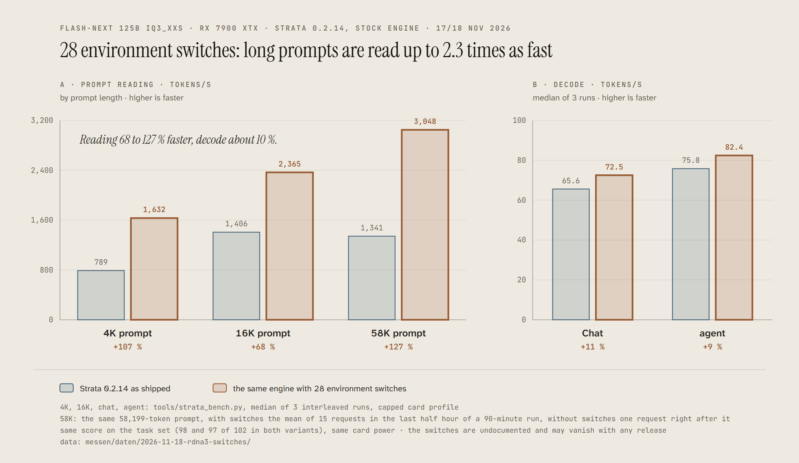
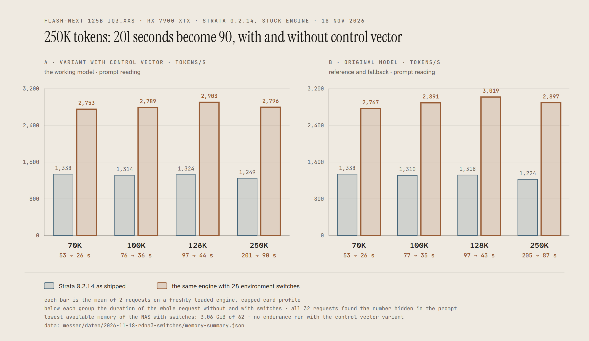

# 28 environment switches: reading prompts twice as fast without swapping the engine

**English** · [Deutsch](schalter.de.md) · [← README](../README.md)

As of 18 Nov 2026. Every number was measured on this NAS: UGREEN iDX6011 Pro, 62 GB RAM, RX 7900 XTX in the dock, Strata 0.2.14 (engine and control 0.1.60, `hip-rx7900`), Flash-Next 125B IQ3_XXS.

In configs and scripts the versions of the model are called `liber` (the variant with control vector, my working model for chat and agent), `faber` (the original, reference for measurements and fallback) and `velox` (smaller quantisation, for measuring only).

## What this is about

The fork [`nicejunjie/Strata-rdna3`](https://github.com/nicejunjie/Strata-rdna3) tunes Strata for RDNA3 cards. Its run config for a single RX 7900 XTX mostly sets environment variables. I wanted to know how much of that works **without the fork**, on the prebuilt engine that runs here anyway.

Of the 46 variables in the fork's config, 30 names are also present in the 0.1.60 engine of Strata 0.2.14. 28 of them are switches I could set as they stand. Those 28 are in [`konfig/strata-0.2.14/rdna3-schalter.json`](../konfig/strata-0.2.14/rdna3-schalter.json). I neither built the fork nor changed the engine; the only change is 28 lines in the `env` section of the run config.

Since 18 Nov 2026 `liber` and `faber` run with these switches here.

## What they bring



Steel blue is Strata 0.2.14 as shipped, amber is the same engine with the 28 switches.

| Original, capped card profile | without | with switches | difference |
|---|---:|---:|---:|
| reading a 4K prompt, tok/s | 789 | 1,632 | +107 % |
| reading a 16K prompt, tok/s | 1,406 | 2,365 | +68 % |
| reading a 58K prompt, tok/s | 1,341 | 3,048 | +127 % |
| chat decode, tok/s | 65.6 | 72.5 | +11 % |
| agent decode, tok/s | 75.8 | 82.4 | +9 % |
| card power, mean | 207 W | 201 W | same |
| task set, passed of 102 (two runs) | 98 / 97 | 98 / 97 | same |
| card idle, model loaded | 16.0 W | 16.2 W | same |

- **Reading gets 68 to 127 % faster depending on length, decode about 10 %.** The card draws no more power for it.
- **Quality stays the same.** My task set (114 tasks in German, 102 auto-graded) scores 98 and 97 in both variants. The same four tasks fail in all four runs.
- **Not bit-identical, but neither is the engine.** The fork names two switches (`STRATA_HIP_WMMA`, `STRATA_SELECT_WMMA`) as not bit-identical. At temperature 0, 47 of 114 answers are identical between two runs without switches and 51 between two runs with them.
- The four extra arguments from the fork's config (`--adapt-every 1 --adapt-swaps 32 --mtp-q4 all --mtp-window 4096`) add nothing I can separate from noise. I left them out.

### Long prompts, working model and original



My agent works with the variant with control vector, not with the original. So both are measured, each without and with the switches, on prompts from 70,000 to 250,000 tokens. The engine was freshly loaded per size, each cell has two runs, and the memory of the NAS was logged once per second.

| Prompt | control vector, without | control vector, with | original, without | original, with |
|---|---:|---:|---:|---:|
| 70,000 tokens | 53 s | 26 s | 53 s | 26 s |
| 100,000 tokens | 76 s | 36 s | 77 s | 35 s |
| 128,000 tokens | 97 s | 44 s | 97 s | 43 s |
| 250,000 tokens | 201 s | 90 s | 205 s | 87 s |
| lowest available memory | 3.72 GiB | 3.34 GiB | 3.23 GiB | 3.06 GiB |

- **Both models read long prompts a good twice as fast with the switches**, the working model +106 to +124 %, the original +107 to +137 %.
- All 32 requests returned HTTP 200 and found the number hidden in the prompt. The engine logs contain no line with `non-finite` or NaN.
- **Memory:** the switches cost about 0.6 GiB after loading. Under load the minima differ by at most 0.6 GiB, and available memory never fell below 3 GiB.

### 90 minutes under load

A user of the fork had reported non-finite values after 1 h 45 min, followed by HTTP 503 on every request. He suspected `STRATA_GDN_CHUNKED` and `STRATA_PF_F16`. Both are in my set, so it ran under continuous load for 90 minutes (original): 1,232 requests, 1,232 times HTTP 200, 176 of 176 hidden numbers found, no non-finite values. Before that, the same switches ran for 38 minutes with `STRATA_DBG_NAN=1`, also without a finding.

### Acceptance run after adoption (18 Nov 2026)

Right after writing the switches into the production run configs I checked both models again, in both card profiles, each freshly loaded:

| | control vector, capped | control vector, max | original, capped | original, max |
|---|---:|---:|---:|---:|
| loading until the first answer | 20.5 s | 19.8 s | 21.6 s | 23.8 s |
| reading 16K, tok/s | 2,287 | 2,209 | 2,409 | 2,325 |
| reading 58K, tok/s | 2,908 | 2,877 | 3,029 | 3,005 |
| reading 127K, tok/s | 2,904 | – | – | – |
| hidden number found | 4 of 4 | 3 of 3 | 3 of 3 | 3 of 3 |
| tool call correct | yes | yes | yes | yes |
| colour of a test picture named | yes | yes | – | – |
| control vector per the log | 41 layers | 41 layers | – | – |
| lowest available memory | 6.41 GiB | 6.97 GiB | 3.51 GiB | 3.65 GiB |
| error lines in the engine log | 0 | 0 | 0 | 0 |

- **The control vector keeps working with the switches.** Of five requests that models often refuse, the variant with control vector answers all five without an evasive phrase; the original is evasive on three.
- The full card profile gains nothing over the capped one on reading.
- The first prompt after loading (4K) was read at 677 to 798 tok/s, slower than in `strata_bench.py` (1,632). There the engine is already warm. I have not taken that apart further.
- One run per cell. Values: `messen/daten/2026-11-18-rdna3-switches/acceptance-after-adoption.json`.

## What this does not show

- The endurance run, the task set and the idle figures come from the original. For the variant with control vector there are speed, long prompts, memory and the acceptance run, but no endurance run.
- One card was measured. The reported failure occurred on two cards after 105 minutes; my run lasted 90.
- I have not taken apart which of the 28 switches carry the gain.
- Agent decode fell from 70.7 to 63.6 tok/s between the first and the last half hour of the endurance run. I have not looked for the cause.
- With `STRATA_DBG_NAN=1`, a prompt of 128,496 tokens drove available memory to zero for over a minute. Without that diagnostic switch it does not happen up to 250,000 tokens. It does not belong in production.
- The 12 German writing tasks are not auto-graded, and I have not read them side by side yet.

## The risk, and how I keep an eye on it

The switches are environment variables that Strata does not document. A release may rename them, drop them or change what they do. The engine silently ignores an unknown name, and reading then falls back to the old speed without any error. A switch that does something different after a release would be worse.

Three things stand against that:

1. **One list, one place.** The 28 switches, with source and test status, are in `konfig/strata-0.2.14/rdna3-schalter.json`. `messen/schalter.py` writes exactly these keys into the run config and removes exactly these again. Every change is logged with a timestamp next to the configs.
2. **A name check on every release, without the card.** `messen/schalter_pruefen.py <engine-dir> --alt <engine-dir-in-production>` searches the files of the new engine for the 28 names and reports which are missing. On 0.2.12 and 0.2.14 all 28 are present.
3. **A measurement on every release, on both models.** My nightly release test loads every new version with the run config from production, that is, with the switches. It measures speed and the task set against the running version and also checks the working model on the new engine: loading, control vector in the log, tool call, image, long prompt with a hidden number. If a name is missing or the working model fails, the verdict carries a warning and the version does not go into production.

`schalter.py pruefen <model>` is the quick check in between: short answer, tool call, a prompt of about 14,000 tokens with a hidden number. If the switches are in the config and reading still stays below 1,700 tok/s, the check fails.

## Plan B: back in a minute

```
python3 messen/schalter.py stand              # which models have the switches
python3 messen/schalter.py zurueck liber      # removes exactly the 28 keys, unloads the model
python3 messen/schalter.py zurueck faber
python3 messen/schalter.py pruefen liber      # short answer, tool call, long prompt
```

- `zurueck` (back) needs no backup: it removes only the keys from the list and leaves everything else in the run config as it is. `ein` (on) still puts a copy of the file next to it.
- The way back is the config 0.2.14 ran with here from 16 to 18 Nov 2026, and against which every number above was measured.
- If only the working model has trouble, the original remains as fallback, with or without the switches. Each can be changed on its own.
- If a new release no longer knows the switches, nothing is broken. Reading is then as fast as in the "without" column. In that case I take the switches out, so the config holds nothing that does nothing.

## Do it yourself

1. Put `konfig/strata-0.2.14/rdna3-schalter.json` next to your own run config (`SCHALTER_LISTE` points to the file, `STRATA_KONFIG` to the directory with `<model>.json`).
2. `python3 messen/schalter_pruefen.py <engine-dir>`: does your engine know the names?
3. `python3 messen/schalter.py ein <model>`, then `pruefen <model>`.
4. Run `tools/strata_bench.py` before and after. The figures here are for gfx1100 on OCuLink x4; other hardware may behave differently.

The finished run configs with switches: [`konfig/strata-0.2.14/liber.json`](../konfig/strata-0.2.14/liber.json) and [`faber.json`](../konfig/strata-0.2.14/faber.json). Raw data and conditions: [`messen/daten/2026-11-18-rdna3-switches/`](../messen/daten/2026-11-18-rdna3-switches/).

## Checked on the side: another quant

The Unsloth file UD-IQ2_XS in version 3.1 is the same size as my IQ3_XXS file and better on the perplexity yardstick (3.854 against 4.153). It reads long prompts about 10 % slower, without switches (1,262 against 1,405 tok/s at 16K) and with them (2,106 against 2,361). The switches lift both files by about the same amount. The variant with control vector loads on the file, and the vector takes effect. The task set is still to come, so the NAS stays on the current file. Data: [`messen/daten/2026-11-18-unsloth-ud-iq2xs/`](../messen/daten/2026-11-18-unsloth-ud-iq2xs/).
