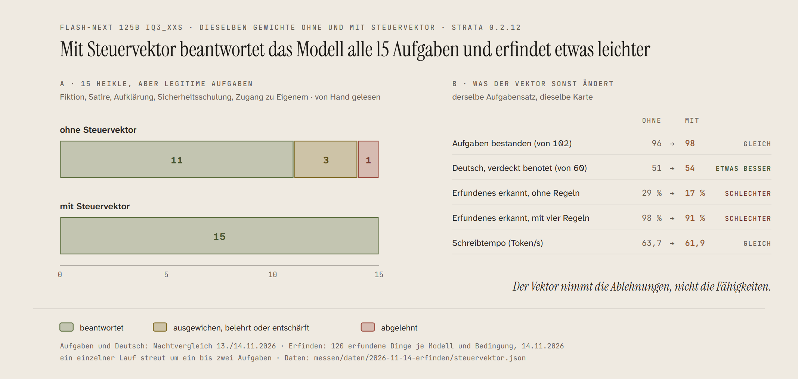

# Dasselbe Modell mit und ohne Steuervektor

[English](steuervektor.md) · **Deutsch** · [← README](../README.de.md)

Der Agent auf diesem NAS läuft nicht mit dem unveränderten 125B-Modell, sondern mit einer Variante davon: dieselben Gewichte, dazu ein Steuervektor, der die Richtung aus dem Modell herausnimmt, entlang derer Ablehnungen entstehen. In den Konfigurationen heißt sie `liber`, das unveränderte Modell `faber`. Diese Seite sagt, was der Vektor ändert, was er kostet und wo seine Grenzen liegen.

## Warum

Ab Werk lehnt das Modell eine Reihe von Bitten ab oder entschärft sie, obwohl der Zweck legitim ist: wie man das Schloss des eigenen Fahrrads öffnet, Schadensminderung für ein Festival, eine derbe Beschimpfung auf Plattdeutsch, das Passwort des eigenen ZIP-Archivs. Für einen privaten Assistenten zu Hause ist das Reibung ohne Nutzen. Der Vektor nimmt diese Reibung weg. Wissen oder Können fügt er nicht hinzu.

## Wie es funktioniert

Die Forschung an Sprachmodellen hat gezeigt, dass Ablehnungen weitgehend an einer einzigen Richtung in den inneren Aktivierungen des Modells hängen. Projiziert man diese Richtung heraus, hört das Modell auf abzulehnen, während alles andere bleibt, wie es ist. Strata unterstützt das als gewöhnliche Funktion: Eine Vektordatei wird beim Rechnen auf einen Bereich von Schichten angewandt. Die Gewichte auf der Platte werden nicht verändert, dieselben Dateien dienen also beiden Varianten.

Die Einstellungen stehen in [`konfig/strata-0.2.12/liber.json`](../konfig/strata-0.2.12/liber.json): Der Vektor wirkt auf die Schichten 4 bis 44, im Projektionsmodus, mit einer Richtung je Schicht. Die Vektordatei selbst ist nicht Teil dieses Repos.

## Was er ändert, und was er kostet

| | ohne (`faber`) | mit (`liber`) |
|---|---:|---:|
| 15 heikle, aber legitime Aufgaben: beantwortet / ausgewichen / abgelehnt | 11 / 3 / 1 | 15 / 0 / 0 |
| bestandene Aufgaben (von 102) | 96 | 98 |
| Deutsch, verdeckt benotet (von 60) | 51 | 54 |
| Erfundenes erkannt, ohne Regeln (von 120) | 35 (29 %) | 20 (17 %) |
| Erfundenes erkannt, mit den vier Regeln (von 120) | 117 (98 %) | 109 (91 %) |
| Echtes richtig beantwortet, ohne / mit Regeln (von 120) | 120 / 120 | 119 / 119 |
| Schreiben, lange Antwort | 63,7 T/s | 61,9 T/s |
| Einlesen bei 32K | 1.183 T/s | 1.188 T/s |

**Er nimmt die Ablehnungen, nicht die Fähigkeiten.** Aufgaben, Deutsch und Tempo sind innerhalb der Streuung eines einzelnen Laufs gleich; der Unterschied von zwei Aufgaben im Aufgabensatz ist kein Befund.

**Der Preis: Das Modell erfindet leichter.** Ohne Regeln im Systemprompt erkennt die Variante nur 17 % des Erfundenen statt 29 %. Die [vier Regeln](agent.de.md) holen das meiste zurück, aber eine Lücke bleibt: 91 % statt 98 %, und sie sitzt in einem Bereich, bei erfundenen Befehlsoptionen (17 von 24 erkannt). Wer die Variante für einen Agenten nimmt, kann auf Regeln und Prüfer nicht verzichten.

**Das Urteil wird nicht besser.** Im Test mit zehn Runden befolgen beide Varianten eine harte Anweisung in 10 von 10 Antworten, und beide erfinden Fähigkeiten, wenn nachts ein Lauf abbricht: in 6 von 10 Antworten ohne Vektor, in 8 von 10 mit.

## Grenzen und Verantwortung

- Die 15 heiklen Aufgaben sind von Hand gelesen, und zwar die Antwortanfänge; veröffentlicht sind hier nur Zählwerte, nicht die Texte.
- Ein Modell ohne Ablehnungen beantwortet, was man es fragt. Das ist eine Entscheidung für Erwachsene am eigenen Gerät, und die Verantwortung liegt bei dem, der es betreibt. Vor Kinder gehört es nicht.
- Der Vektor macht das Modell nicht klüger. Wo es etwas nicht weiß, rät es bereitwilliger als vorher.

Daten (nur Zählwerte): `messen/daten/2026-11-14-erfinden/steuervektor.json`.
