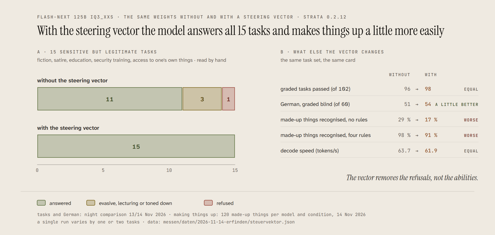

# The same model with and without a steering vector

**English** · [Deutsch](steuervektor.de.md) · [← README](../README.md)

The agent on this NAS does not run the plain 125B model but a variant of it: the same weights, plus a steering vector that removes the direction in the model along which refusals happen. In the configs it is called `liber`; the plain model is `faber`. This page says what the vector changes, what it costs, and where its limits are.

## Why

Out of the box the model declines or waters down a number of requests whose purpose is legitimate: how to pick the lock of your own bicycle, harm reduction for a festival, a coarse insult in Low German, the password of your own ZIP archive. For a private assistant at home that is friction without a benefit. The vector takes that friction away. It does not add knowledge or skill.

## How it works

Research on language models has shown that refusals largely hang on a single direction in the model's internal activations. If you project that direction out, the model stops refusing while everything else stays in place. Strata supports this as a regular feature: a vector file is applied to a range of layers while the model runs. The weights on disk are not modified, so the same files serve both variants.

The settings are in [`konfig/strata-0.2.12/liber.json`](../konfig/strata-0.2.12/liber.json): the vector is applied to layers 4 to 44 in projection mode, one direction per layer. The vector file itself is not part of this repository.

## What it changes, and what it costs

| | without (`faber`) | with (`liber`) |
|---|---:|---:|
| 15 sensitive but legitimate tasks: answered / evasive / refused | 11 / 3 / 1 | 15 / 0 / 0 |
| graded tasks passed (of 102) | 96 | 98 |
| German, graded blind (of 60) | 51 | 54 |
| made-up things recognised, without rules (of 120) | 35 (29 %) | 20 (17 %) |
| made-up things recognised, with the four rules (of 120) | 117 (98 %) | 109 (91 %) |
| real things answered correctly, without / with rules (of 120) | 120 / 120 | 119 / 119 |
| decode, long answer | 63.7 tok/s | 61.9 tok/s |
| prompt reading at 32K | 1,183 tok/s | 1,188 tok/s |

**It removes the refusals, not the abilities.** Tasks, German and speed are the same within the spread of a single run; the two-task difference on the task set is not a finding.

**The price: it makes things up more easily.** Without rules in the system prompt the variant recognises only 17 % of made-up things instead of 29 %. The [four rules](agent.md) repair most of it, but a gap remains: 91 % instead of 98 %, and it is concentrated in one area, made-up command options (17 of 24 recognised). If you use the variant for an agent, the rules and the checker are not optional.

**Judgement is no better.** In the ten-round test both variants follow a hard instruction in 10 of 10 answers, and both invent capabilities when a job aborts at night: 6 of 10 answers without the vector, 8 of 10 with it.

## Limits and responsibility

- The 15 sensitive tasks were read by hand, the beginnings of the answers; counts only are published here, not the texts.
- A model without refusals answers whatever it is asked. That is a decision for adults running their own machine, with the responsibility on the person who runs it. It is not something to put in front of children.
- The vector does not make the model better informed. Where it does not know, it guesses more readily than before.

Data (counts only): `messen/daten/2026-11-14-erfinden/steuervektor.json`.
